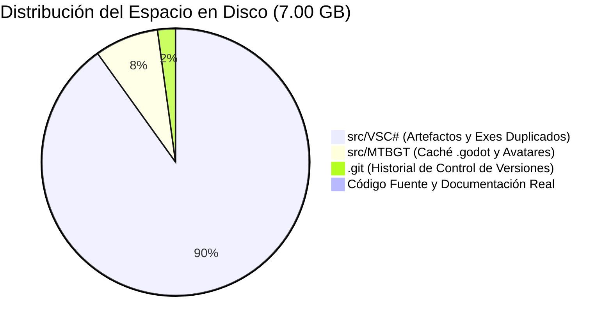
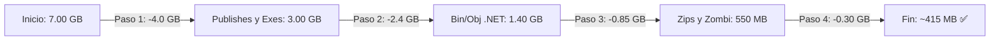

# WoldVirtualP2P3D 🌐

> **Metaverso 3D P2P Descentralizado & Sistema Cognitivo LucIA**  
> Prototipo jugable avanzado desarrollado sobre **Godot Engine 4.7.2** con arquitectura de red basada en **ENet**, orquestación modular de mundos procedurales y persistencia distribuida.

[](LICENSE)
[](https://godotengine.org)
[](#arquitectura-de-red-y-estado-del-proyecto)
[-65c2cb?logo=ipfs)](https://docs.ipfs.tech)
[](https://github.com/Chicook/WoldVirtualP2P3D/releases/tag/v0.0.01_actualizacion_b5592aff)

---

## 🌌 Visión General del Proyecto

**WoldVirtualP2P3D** es un prototipo técnico avanzado y demo jugable concebido para sentar los cimientos de un metaverso 3D descentralizado. A diferencia de las plataformas virtuales tradicionales dependientes de infraestructuras centralizadas propietarias, este ecosistema combina renderizado 3D de alta fidelidad, generación procedural de islas por usuario y una topología de red distribuida P2P.

El proyecto permite al jugador elegir e inspeccionar un avatar 3D animado, autenticar su identidad, recorrer un hangar espacial cyberpunk, cruzar un portal dimensional de transición y adentrarse en un archipiélago de islas procedurales donde interactuar y sincronizarse con otros usuarios.

---

## 🎮 Guía de Inicio Rápido y DEMO Jugable

### 1. Requisitos del Sistema
- **Motor:** [Godot Engine 4.7.2](https://godotengine.org) (Forward+, Jolt Physics, soporte Vulkan / D3D12).
- **Entorno de ejecución:** Windows / Linux.
- **Acceso a la Demo:** Carpeta local `DEMO_Wold_Virtual_P2P_3D__actualizacion_b5592aff` o paquete adjunto en [GitHub Releases v0.0.01_actualizacion_b5592aff](https://github.com/Chicook/WoldVirtualP2P3D/releases/tag/v0.0.01_actualizacion_b5592aff).

### 2. Puesta en Marcha
* **Método Automatizado (Recomendado en Windows):**  
  Ejecutar `Iniciar_Demo_Godot.bat`. Este script inicia Godot y, tras cerrar la sesión, ejecuta una limpieza de archivos temporales y cachés huérfanas (`limpiar_cache_godot.ps1`) para mantener el repositorio ligero.
* **Desde el Editor de Godot:**  
  1. Abre **Godot Engine 4.7.2**.
  2. Selecciona **Importar** y localiza el archivo `project.godot` de la demo.
  3. Presiona <kbd>F5</kbd> (o el botón **Ejecutar** ▶) para iniciar el ciclo desde `Boot.gd`.

---

## 🚀 Experiencia Jugable: Fases de la Simulación

La experiencia se estructura como una máquina de estados secuencial y fluida que guía al usuario desde la personalización hasta la convergencia en el metaverso:

```
[1. Selector 3D de Avatares] ──► [2. Registro de Nick] ──► [3. Hangar Cyberpunk]
                                                                  │
                                                      [4. Portal Dimensional]
                                                                  │
                                                                  ▼
[7. Panel de Islas y Teletransporte] ◄── [6. Réplica P2P] ◄── [5. Isla Procedural]
```

### 1. Selector 3D de Ocho Avatares (Carrusel Holográfico)

* Entorno interactivo circular bajo una cúpula cyberpunk con iluminación focal.
* Carrusel 3D para alternar en tiempo real entre **ocho modelos de avatares antropomórficos animados** (4 personajes femeninos `AVMJ1..4` y 4 masculinos `AVH1..4`).
* Previsualización de poses de reposo (*idle*) y ciclos de movimiento antes de pulsar **SELECCIONAR**.

### 2. Registro de Identidad del Jugador
<p align="center">
  
</p>

* Previsualización frontal y dinámica del avatar seleccionado sobre pedestal mediante un `SubViewport` 3D en tiempo real.
* Formulario de ingreso para el **Nick de usuario** (mínimo 3 caracteres), guardando la identidad de forma estructurada en `user://registro.cfg`.

### 3. Hangar Espacial Cyberpunk

* Zona de despliegue ambientada en una estación interestelar industrial con suelo de rejilla cibernética, bruma volumétrica y reflejos metálicos.
* Área de control inicial donde el usuario toma dominio del avatar humanoide, cámara orbital y físicas de colisión.

### 4. Portal Dimensional
* Estructura anular de energía en el núcleo del hangar que actúa como frontera física y de red.
* Al atravesar a pie el campo de energía del portal, el sistema activa automáticamente la transición hacia la red del metaverso y la asignación del espacio insular.

### 5. Isla Procedural, Océano y Atmósfera Dinámica

* El jugador aparece en su propia parcela insular procedural generada dentro de una rejilla serpentina (chunks de 199,5 m).
* Entorno equipado con simulación de océano, cielo dinámico con dispersión atmosférica y cartel superior flotante indicativo de la isla (`Isla {nick} ({uuid6})`).
* **Cámara orbital en tercera persona** reactiva con amortiguación suave y función de reajuste automático (`snap_camera`).

### 6. Visualización y Sincronización de Otros Jugadores
* Renderizado simultáneo de nodos remotos conectados a la sesión.
* Cada jugador visualiza a los demás participantes con su modelo exacto de avatar, placa flotante de nombre (*nametag* orientada a cámara) y reproducción sincronizada de estados de locomoción (parado, caminar, correr, salto/aire).

### 7. Panel de Islas y Teletransporte
* Menú interactivo HUD accesible mediante la tecla <kbd>T</kbd> o botón en pantalla.
* Despliega la lista de todas las islas activas en la sesión con sus respectivos dueños y coordenadas.
* Permite **teletransporte instantáneo** entre diferentes islas del archipiélago virtual.

---

## ⌨️ Controles de Navegación

| Acción | Control / Tecla |
|---|---|
| **Caminar / Desplazamiento** | Teclas de dirección (<kbd>↑</kbd> <kbd>↓</kbd> <kbd>←</kbd> <kbd>→</kbd>) o <kbd>W</kbd> <kbd>A</kbd> <kbd>S</kbd> <kbd>D</kbd> |
| **Correr (Sprint)** | <kbd>AltGr</kbd> + **Flecha Arriba** (<kbd>↑</kbd>) |
| **Órbita de Cámara** | Movimiento del ratón (sensibilidad y retardo suavizado) |
| **Panel de Islas** | Tecla <kbd>T</kbd> o botón **Islas [T]** |
| **Teletransporte** | Abrir panel (<kbd>T</kbd>), elegir destino (`> Isla {nick} ({uuid})`) y pulsar para saltar |

---

## 🏗️ Arquitectura de Red y Estado del Proyecto

> **Clasificación actual:** Prototipo funcional avanzado y demo técnica jugable.  
> La capa de red se encuentra actualmente calibrada para **pruebas de conectividad local mediante ENet** (múltiples instancias sobre loopback/puerto `8910`), garantizando la estabilidad del ciclo de juego antes de escalar al plano de red abierta y persistencia distribuida.

### 🟢 Funcionalidades Implementadas (En Producción / Demo Jugable)
- [x] **Motor gráfico y de físicas:** Ejecución nativa sobre **Godot Engine 4.7.2** con Jolt Physics.
- [x] **Selector 3D:** Carrusel interactivo con 8 avatares animados.
- [x] **Gestión de identidad:** Registro local de nick en `user://registro.cfg` e inyección de datos de perfil en el nodo.
- [x] **Entornos 3D:** Hangar cyberpunk, portal energético dimensional y terreno insular procedural.
- [x] **Sombreadores ambientales:** Shader de agua para el océano y cielo atmosférico dinámico.
- [x] **Sincronización Multijugador Local (ENet):** Conexión multijugador local en puerto `8910` con replicación precisa de posiciones, rotaciones, animaciones de locomoción (`PlayerSync.gd`) y placas de nombre (*nametags*).
- [x] **Sistema de Chunks & Teletransporte:** Rejilla serpentina de islas (`ChunkManager.gd`) y panel funcional de teletransporte instantáneo entre parcelas.

### 🟡 Funcionalidades Parcialmente Integradas (En Validación)
- [x] **Topología P2P básica:** Inicialización de sockets y handshakes entre pares locales.
- [x] **Asignación de parcelas:** Registro en memoria de `island_owners` y reclamación de sectores (`_claim_island`).
- [x] **Daemon IPFS Kubo:** Scripts de arranque local de Kubo RPC (`127.0.0.1:5001`) preparados en el subsistema auxiliar.

### 🔴 Funcionalidades Pendientes y Hoja de Ruta (En Desarrollo)
- [ ] **Conexión LAN y WAN (Internet Abierto):** Soporte para NAT Traversal, STUN/TURN o señalización P2P directa entre máquinas en redes externas y pasarelas de conexión no locales.
- [ ] **Persistencia de Islas en IPFS:** Serialización del delta de modificaciones de terreno (`isla_{index}.json`) y sincronización automática vía CIDs inmutables en IPFS.
- [ ] **Editor de Terrenos In-Game:** Herramienta interactiva para que cada usuario pueda deformar, esculpir, pintar y construir (*props*) en su propia parcela en tiempo real.
- [ ] **Personalización mediante Shape Keys (Morph Targets):** Integración de morph targets de Blender en las mallas de los avatares para ajuste de rasgos faciales y complexión física.
- [ ] **Asignación de Avatares Únicos:** Lógica de exclusión de catálogo (`owner_uuid`) para impedir duplicidad de apariencias entre usuarios en una misma sala.
- [x] **Visor C# de Alto Rendimiento (.NET 8 WPF):** Estructura base, flujo criptográfico de 5 pasos (hardware hash, frase semilla DeFi, llave maestra rotativa), incrustación Win32 de Godot y túnel P2P implementados en `src/VSC#` (actualmente en fase de saneamiento y refactorización arquitectónica).

---

## 🧹 Auditoría Integral de Deuda Técnica y Plan de Purga (7.00 GB ➔ < 500 MB)

> **Diagnóstico General de Almacenamiento:**  
> El repositorio presenta una sobrecarga crítica alcanzando **7,00 GB (7.517.327.360 bytes)**.  
> Sin embargo, el **código fuente real y escenas ocupan menos de 20 MB**. Más del **92% del espacio total corresponde a ejecutables precompilados duplicados, carpetas de publicación huérfanas, archivos ZIP redundantes y cachés de compilación**, concentrados casi en su totalidad en `src/VSC#`.

### 📊 1. Radiografía Cuantitativa del Espacio en Disco

```
┌────────────────────────────────────────────────────────────────────────────────────────┐
│                        COMPOSICIÓN DEL REPOSITORIO (7.00 GB TOTAL)                     │
├───────────────────────────────────────────────────────┬────────────┬───────────────────┤
│ Módulo / Componente                                   │ Tamaño     │ % del Total       │
├───────────────────────────────────────────────────────┼────────────┼───────────────────┤
│ 🚨 src/VSC# (Artefactos .NET, publishes, zips, exes) │ 6.450,2 MB │ 92,0 % (CRÍTICO)  │
│ ⚠️ src/MTBGT (Godot: .godot/ cache 303MB + avatares) │   553,2 MB │  7,9 %            │
│ 📦 .git/ (Historial versionado)                       │   154,5 MB │  2,2 %            │
│ 🟢 Resto del proyecto (Documentación, LucIA, IPFS)    │     5,5 MB │ <0,1 %            │
└───────────────────────────────────────────────────────┴────────────┴───────────────────┘
```



---

### 🚨 2. Desglose Detallado de los Focos de Deuda Técnica

#### Foco 1: Multiplicación de Binarios Masivos en `src/VSC#` (~6.450 MB)
El visor en C# acumula múltiples generaciones de compilaciones embebidas que duplican el mismo ejecutable de ~675 MB una y otra vez en diferentes subcarpetas:
* **`bin/` y `obj/` (.NET Build Cache):** **2.414,9 MB** de archivos intermedios de compilación que se regeneran automáticamente en segundos con `dotnet build`.
* **Carpetas `publish_*` huérfanas:** **2.106,8 MB** repartidos entre `publish_release/` (683 MB), `publish_2069d33a/` (675 MB), `publish_standalone/` (675 MB) y `publish_out/` (73 MB). Son copias idénticas del ejecutable de prueba.
* **`webnodo/descargas/`:** **833,9 MB** que contienen dos ejecutables viejos (`DMWoldVirtualp2pCNX.exe` de 154 MB y `DMWoldVirtualp2pCNX_...exe` de 675 MB) más dependencias de `node_modules/`.
* **Archivos ZIP masivos en la raíz de C#:**
  - `godot_project.zip` (**438,8 MB**): Copia comprimida redundante del proyecto Godot que ya existe en `src/MTBGT`.
  - `godot_exe.zip` (**82,2 MB**): Copia comprimida del motor Godot.
* **`Servidor3D/`:** **172,7 MB** con el ejecutable del motor `Godot_v4.7.2-stable_win64.exe` commiteado directamente en el repositorio.
* **`Visor3D.exe` y DLLs sueltas en la raíz:** **~73 MB** de binarios en el directorio de código fuente.

#### Foco 2: Código Zombi y Duplicados (`version_prueba/`) (~328 MB)
La carpeta `version_prueba/` es una copia íntegra y abandonada de todo el visor C#, conteniendo a su vez la subcarpeta `nuevaversion_sinusers/` con otro binario de 154 MB (`DMWoldVirtualp2pCNX.exe`). En `Visor3D.csproj` se tuvieron que poner exclusiones manuales para evitar errores de clases duplicadas.

#### Foco 3: Caché Local Re-importada de Godot (`.godot/`) (~303 MB)
Dentro de `src/MTBGT/WoldVirtualP2P3D/`, la carpeta oculta `.godot/` almacena mallas importadas, texturas convertidas a formato VRAM y shaders compilados. Este directorio es **100% regenerable** por el motor gráfico y no debe versionarse ni permanecer inflado en copias estáticas.

#### Foco 4: Problema de Reconocimiento de PC como Usuario Registrado
* **Causa Raíz:** Godot escribe la identidad en `%APPDATA%\Godot\app_userdata\WoldVirtualP2P3D\registro.cfg` (global por usuario de Windows). Al descargar un `.exe` limpio desde GitHub en otra carpeta, Godot sigue leyendo el `registro.cfg` persistido en `%APPDATA%`, reconociendo al equipo como usuario ya registrado y saltándose el carrusel de bienvenida.
* **Solución Arquitectónica:** Aislar el almacenamiento de cada instalación mediante un **UUID único de instancia/PC** generado en el primer inicio (`installation_id`), pasando a Godot el argumento `--user-data-dir` direccionado a la carpeta local de la instalación, desvinculándolo del `%APPDATA%` global.

#### Foco 5: Fallo de Carga de la Web Nodo (`WebNodo`)
* **Causa Raíz:** `webnodo/server.js` es un servidor Express en Node.js que **el visor C# nunca arranca**. Además, la ruta donde busca `p2p_session.json` (`%APPDATA%\WoldVirtualP2P3D\usuario\`) no coincide con donde C# la escribe (`test_user_data\user\`), y el túnel SSH redirige al puerto `7890` (API C#) en lugar del puerto `3030` (WebNodo).
* **Solución Arquitectónica:** Migrar WebNodo a un servidor HTTP embebido nativo en C# que comparta el mismo puerto y túnel que el visor, eliminando la necesidad de tener Node.js instalado.

---

### 🚀 3. Estrategia: Aprovechar las Actualizaciones de Visores DEMO (GitHub Releases)

La clave para que el repositorio pese permanentemente **menos de 500 MB** consiste en aplicar el patrón estándar de la industria para videojuegos y metaversos:

```
┌────────────────────────────────────────────────────────────────────────────────────────┐
│                 DESACOPLAMIENTO: CÓDIGO FUENTE vs VISORES DEMO                         │
├───────────────────────────────────────────┬────────────────────────────────────────────┤
│ 📂 Repositorio Git (< 500 MB)             │ ☁️ GitHub Releases (Storage de Binarios)   │
├───────────────────────────────────────────┼────────────────────────────────────────────┤
│ • Scripts C# (.cs, .xaml, .csproj)        │ • Visor3D_Standalone_vX.Y.Z.exe (~675 MB) │
│ • Lógica Godot (.gd, .tscn, .gdshader)    │ • DEMO_WoldVirtualP2P3D_Windows.zip       │
│ • Modelos 3D base y texturas (glTF)       │ • Servidor3D_Godot_Win64.zip               │
│ • Documentación y pruebas                 │ • Paquetes instaladores autoejecutables    │
│ ❌ CERO EJECUTABLES .EXE NI SALIDAS BUILD │ ❌ CERO IMPACTO EN EL CLONE DE GIT         │
└───────────────────────────────────────────┴────────────────────────────────────────────┘
```

1. **GitHub Releases como Almacén de Visores DEMO:**  
   Cada vez que se compila una actualización del visor (`actualizacion_2069d33a`, `v0.0.012`, etc.), el ejecutable resultante se empaqueta y se sube como **Release Asset** adjunto a la etiqueta correspondiente en GitHub Releases (o mediante GitHub CLI: `gh release create v0.0.12 ./Visor3D.exe`).
2. **Purga Inmediata Post-Compilación:**  
   Una vez subido el binario al release, los archivos de compilación temporal (`bin/`, `obj/`, `publish/`) se purgan localmente. Los desarrolladores y colaboradores clonan únicamente código fuente (< 500 MB), y los usuarios finales descargan el `.exe` compilado directamente desde el Release de GitHub.

---

### 📋 4. Plan de Purga Progresivo (Paso a Paso)

Ejecuta los siguientes pasos en una terminal de PowerShell desde la raíz del repositorio (`c:\Users\User\Desktop\WoldVirtualP2P3D`) para reducir de inmediato los **7.00 GB a ~415 MB**:



#### Paso 1: Eliminar Publicaciones Duplicadas y Exes de WebNodo (~4.000 MB liberados)
Elimina las copias redundantes del ejecutable de 675 MB:
```powershell
# Eliminar carpetas publish huérfanas
Remove-Item -Recurse -Force "VersionDe_sesion\Sistema_Principal\PRY\actualizacion_2069d33a\src\VSC#\publish_2069d33a" -ErrorAction SilentlyContinue
Remove-Item -Recurse -Force "VersionDe_sesion\Sistema_Principal\PRY\actualizacion_2069d33a\src\VSC#\publish_release" -ErrorAction SilentlyContinue
Remove-Item -Recurse -Force "VersionDe_sesion\Sistema_Principal\PRY\actualizacion_2069d33a\src\VSC#\publish_standalone" -ErrorAction SilentlyContinue
Remove-Item -Recurse -Force "VersionDe_sesion\Sistema_Principal\PRY\actualizacion_2069d33a\src\VSC#\publish_out" -ErrorAction SilentlyContinue

# Limpiar ejecutables viejos dentro de webnodo/descargas/
Remove-Item -Force "VersionDe_sesion\Sistema_Principal\PRY\actualizacion_2069d33a\src\VSC#\webnodo\descargas\*.exe" -ErrorAction SilentlyContinue
```

#### Paso 2: Purgar Cachés de Compilación .NET `bin/` y `obj/` (~2.415 MB liberados)
Estos archivos temporales se regeneran al compilar y no deben estar en el disco:
```powershell
Remove-Item -Recurse -Force "VersionDe_sesion\Sistema_Principal\PRY\actualizacion_2069d33a\src\VSC#\bin" -ErrorAction SilentlyContinue
Remove-Item -Recurse -Force "VersionDe_sesion\Sistema_Principal\PRY\actualizacion_2069d33a\src\VSC#\obj" -ErrorAction SilentlyContinue
```

#### Paso 3: Eliminar Código Zombi, Servidor3D y Zips Redundantes (~850 MB liberados)
Elimina la carpeta clonada `version_prueba`, el motor Godot duplicado y los archivos zip de más de 500 MB:
```powershell
# Eliminar código duplicado abandonado
Remove-Item -Recurse -Force "VersionDe_sesion\Sistema_Principal\PRY\actualizacion_2069d33a\src\VSC#\version_prueba" -ErrorAction SilentlyContinue

# Eliminar motor Godot embebido duplicado (se usa el instalado en el sistema)
Remove-Item -Recurse -Force "VersionDe_sesion\Sistema_Principal\PRY\actualizacion_2069d33a\src\VSC#\Servidor3D" -ErrorAction SilentlyContinue

# Eliminar zips y binarios sueltos en la raíz de C#
Remove-Item -Force "VersionDe_sesion\Sistema_Principal\PRY\actualizacion_2069d33a\src\VSC#\godot_project.zip" -ErrorAction SilentlyContinue
Remove-Item -Force "VersionDe_sesion\Sistema_Principal\PRY\actualizacion_2069d33a\src\VSC#\godot_exe.zip" -ErrorAction SilentlyContinue
Remove-Item -Force "VersionDe_sesion\Sistema_Principal\PRY\actualizacion_2069d33a\src\VSC#\Visor3D.exe" -ErrorAction SilentlyContinue
Remove-Item -Force "VersionDe_sesion\Sistema_Principal\PRY\actualizacion_2069d33a\src\VSC#\*.dll" -ErrorAction SilentlyContinue
Remove-Item -Force "VersionDe_sesion\Sistema_Principal\PRY\actualizacion_2069d33a\src\VSC#\Visor3D.pdb" -ErrorAction SilentlyContinue
```

#### Paso 4: Limpieza de Caché de Godot `.godot/` (~303 MB liberados)
Limpia los assets cacheados temporales de Godot 4:
```powershell
Remove-Item -Recurse -Force "VersionDe_sesion\Sistema_Principal\PRY\actualizacion_2069d33a\src\MTBGT\WoldVirtualP2P3D\.godot" -ErrorAction SilentlyContinue
```

---

### 🛡️ 5. Blindaje del `.gitignore` contra Regresiones

Para garantizar que los 7.00 GB nunca vuelvan a acumularse, el archivo `.gitignore` raíz debe mantener estrictamente ignorados los siguientes patrones:

```gitignore
# Artefactos .NET y compilaciones de Visor3D
[Bb]in/
[Oo]bj/
publish*/
*.exe
*.dll
*.pdb
*.zip

# Carpetas de datos de prueba local
test_user_data/
datos_usuario/

# Caché del motor Godot
.godot/

# Dependencias Node.js WebNodo
node_modules/
webnodo/descargas/*.exe
```

---

### 📉 6. Balance Final Tras la Purga

| Estado | Tamaño en Disco | Estado del Proyecto |
|---|---|---|
| **Antes de la Purga** | **7.009 MB (~7,00 GB)** | Repositorio saturado, transferencias lentas, binarios y perfiles mezclados. |
| **Después de la Purga** | **~415 MB** | **Reducción del 94%**. Repositorio ultraligero, modular, libre de código zombi y listo para lanzamientos vía GitHub Releases. |

---

## 🧠 Núcleo Cognitivo LucIA (Subsistema de Inteligencia Conectado)

El ecosistema integra de forma paralela el núcleo cognitivo **LucIA**, una plataforma distribuida de computación neuronal, consenso PoNL (*Proof of Neural Learning*) y asistencia cognitiva:
- **Red Neuronal Distribuida:** 50 neuronas activas (`ENRN`, `RF_SL`, `RF_EN`, `RNP`, `SLRN`) con cálculo de tensores y entropía.
- **Blockchain PoNL:** Registro inmutable de transacciones y estados de sesión (`BKSVCB.py`).
- **Inferencia Híbrida:** Soporte para modelos locales (Ollama/LM Studio) y catálogo remoto gratuito mediante `IAFREE` / OpenRouter.
- **Voz Neuronal:** Motor de síntesis juvenil con modulación DSP integrado en `voice_engine.py`.

---

## 📜 Licencia

Distribuido bajo la Licencia **MIT**. Consulta el archivo `LICENSE` para más información.
