# WoldVirtualP2P3D

> **Metaverso 3D P2P en construcción para Windows x64.** Visor autónomo C# / WPF (.NET 8) con **Godot 4.7.2** incrustado, red multiusuario por WebSocket, portal web público mediante **túneles efímeros** y actualizador OTA. Incluye además **LucIA**, un subsistema cognitivo en Python que hoy es un proyecto separado y que está planificado como parte del metaverso.

[](LICENSE)
[](https://dotnet.microsoft.com)
[](https://godotengine.org)
[](https://github.com/Chicook/WoldVirtualP2P3D/releases/tag/v2.6.4)
[](#5-descarga-y-primer-arranque)
[](#2-estado-del-proyecto-y-fase-actual)

| Carrusel de avatares (8 por turno) | Registro de jugador | Hangar y portal | Isla y P2P |
|:---:|:---:|:---:|:---:|
| [](#7-el-mundo-3d-godot) | [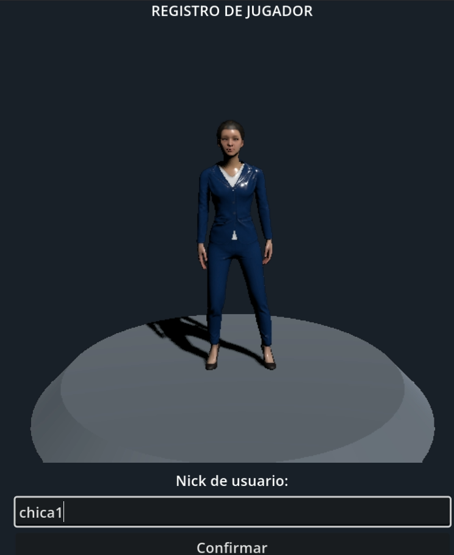](#6-registro-e-identidad) | [](#7-el-mundo-3d-godot) | [](#8-red-p2p-webnodo-y-t%C3%BAneles-ef%C3%ADmeros) |

| Construcción: pincel Playa | Prims y edición | Isla ajena: solo lectura |
|:---:|:---:|:---:|
| [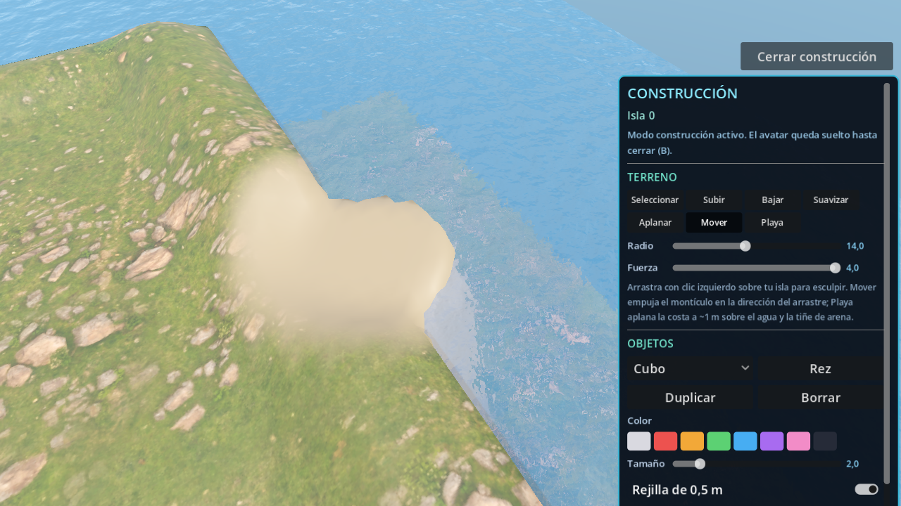](#34-construcci%C3%B3n-y-edici%C3%B3n-de-islas) | [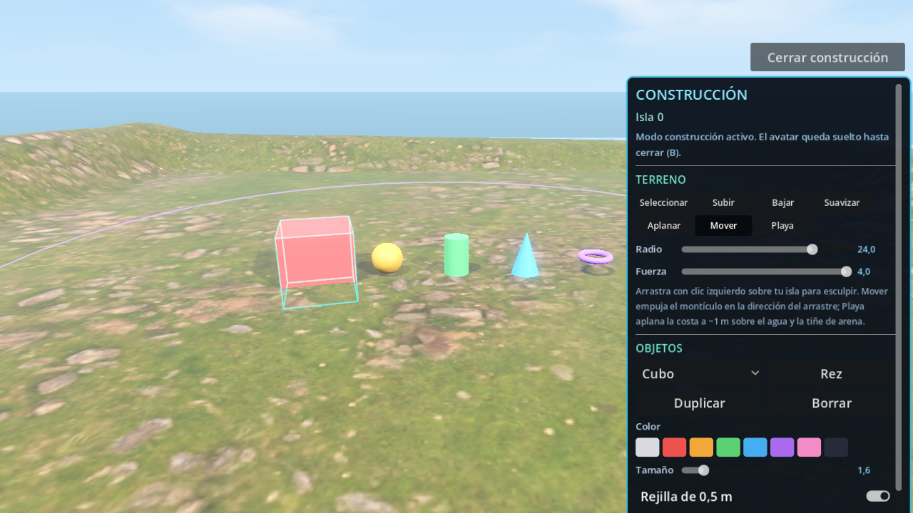](#34-construcci%C3%B3n-y-edici%C3%B3n-de-islas) | [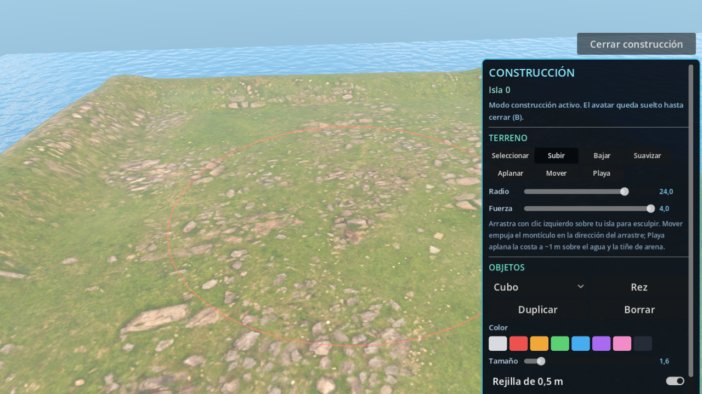](#34-construcci%C3%B3n-y-edici%C3%B3n-de-islas) |

> **Esta fase es una prueba de conexión P2P 3D.** El objetivo es validar que varias personas puedan encontrarse en el mundo, elegir avatar, personalizarlo y compartir sesión por túnel o LAN. **No es todavía un metaverso completo:** no hay economía ni blockchain, y LucIA no está integrada. Desde la 2.5.6 hay chat de texto (con captura de voz y webcam), amigos, y edición de terreno y prims; desde la 2.5.9 la edición queda aislada en la isla propia, un invitado conecta contra la raíz de la sesión y la bienvenida muestra si el metaverso está vacío u ocupado. La **2.6.0**, publicada el 2026-10-27, añade perfil de usuario persistente entre actualizaciones con una sola cuenta por PC, chat en barra inferior, «Deshacer isla» y «Guardar en inventario». La **2.6.1**, publicada el 2026-10-28, exige el enlace de invitación completo con su token de sesión, enfoca la instancia ya abierta en lugar de pedir otro inicio de sesión, retira del mundo las islas de jugadores desconectados y coloca las webcams en una franja horizontal dentro del marco del chat. La **2.6.2**, publicada el 2026-10-28, devuelve la vista local de la webcam a esa franja, que aparecía visible pero sin imagen. La **2.6.3**, publicada el 2026-10-28, comprueba al arrancar si el PC tiene una cuenta local utilizable: si sólo quedan restos a medias los archiva en `respaldo_cuenta` y vuelve al ciclo de registro completo, en vez de dejar al equipo sin «Crear cuenta» y sin forma de entrar. La **2.6.4**, publicada el 2026-10-28, deja la base local **vacía una sola vez** —archivándola en `respaldo_cuenta`— para recorrer el registro completo, y desde ese momento la cuenta persiste; además abre ese registro directamente si el PC no tiene nada de lo necesario. La sincronización entre dos máquinas sigue **sin prueba real**. Todo lo demás está en la hoja de ruta con estado **Planificado** (ver [§3](#3-visi%C3%B3n-del-metaverso-alcance-planificado)).

## Índice

1. [Qué es hoy y hacia dónde va](#1-qu%C3%A9-es-hoy-y-hacia-d%C3%B3nde-va)
2. [Estado del proyecto y fase actual](#2-estado-del-proyecto-y-fase-actual)
3. [Visión del metaverso (alcance planificado)](#3-visi%C3%B3n-del-metaverso-alcance-planificado)
4. [Mapa del repositorio](#4-mapa-del-repositorio)
5. [Descarga y primer arranque](#5-descarga-y-primer-arranque)
6. [Registro e identidad](#6-registro-e-identidad)
7. [El mundo 3D (Godot)](#7-el-mundo-3d-godot)
8. [Red P2P, WebNodo y túneles efímeros](#8-red-p2p-webnodo-y-t%C3%BAneles-ef%C3%ADmeros)
9. [Continuidad de sesión](#9-continuidad-de-sesi%C3%B3n)
10. [Actualizador OTA](#10-actualizador-ota)
11. [Compilar y publicar](#11-compilar-y-publicar)
12. [LucIA: subsistema cognitivo en Python](#12-lucia-subsistema-cognitivo-en-python)
13. [Herramienta RFPRMN (CONTRRF)](#13-herramienta-rfprmn-contrrf)
14. [Calidad y pruebas](#14-calidad-y-pruebas)
15. [Hoja de ruta y deuda técnica](#15-hoja-de-ruta-y-deuda-t%C3%A9cnica)
16. [Tareas pendientes](#16-tareas-pendientes)
17. [Política del repositorio](#17-pol%C3%ADtica-del-repositorio)
18. [Documentación interna](#18-documentaci%C3%B3n-interna)
19. [Contribuir y licencia](#19-contribuir-y-licencia)

> Convención de rutas: en este documento `src/` es la abreviatura de
> `VersionDe_sesion/CONTRRF/TLLDCD/src/`, el árbol que se exporta y compila. La copia
> `VersionDe_sesion/Sistema_Principal/PRY/actualizacion_f7bfd9ba/src/` es la última instantánea RFPRMN y está congelada en la 2.5.5.
> **Convención de estado:** cada capacidad se etiqueta como **Implementado**, **Implementado, sin prueba real**, **Parcial**, **Planificado** o **Fuera del repo**. La fuente de verdad es el código; las cifras de este documento se recalcularon el 2026-10-27 sobre la rama `DevQoderIA` (versión 2.6.0), y las propias de la 2.6.1, la 2.6.2, la 2.6.3 y la 2.6.4 (exe, PCK y extracción en disco) se midieron el 2026-10-28.

---

## 1. Qué es hoy y hacia dónde va

El repositorio contiene **dos piezas**:

1. **El visor** (`src/VSC#/`): aplicación WPF de .NET 8 que se distribuye como un único ejecutable portable autocontenido. Embebe el motor Godot 4.7.2 y un paquete del mundo 3D, los extrae en disco al primer arranque y los ejecuta incrustados en su ventana. Gestiona la identidad local, el portal web **WebNodo**, los **túneles efímeros** y el actualizador OTA.
2. **LucIA** (`src/LC_STM/` y carpetas hermanas en Python): arquitectura cognitiva experimental (red neuronal distribuida, ledger local PoNL, integración IPFS). **Hoy no tiene ninguna integración con el visor**: cero referencias cruzadas. Su incorporación al metaverso está planificada.

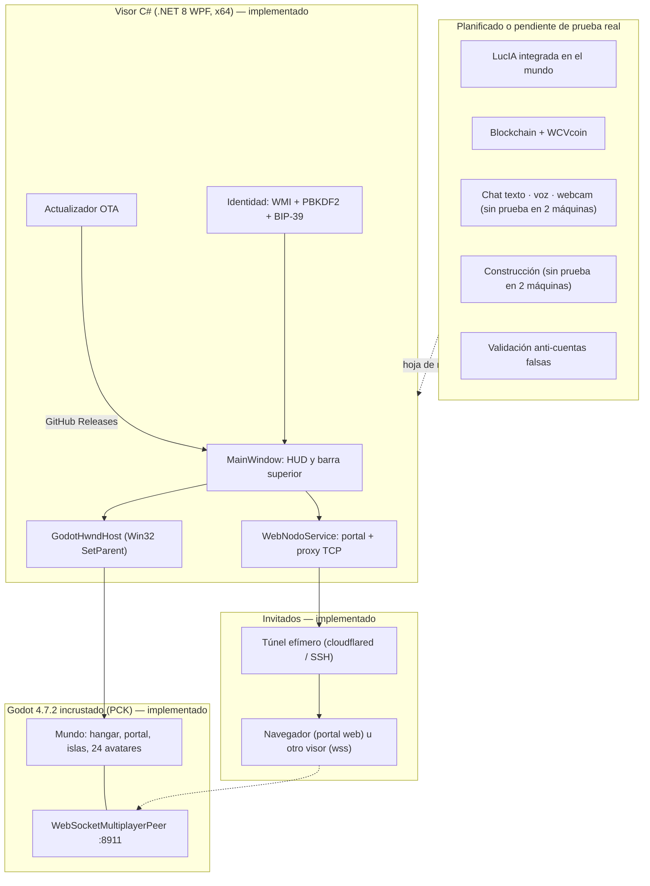

### Qué funciona hoy

- Mundo 3D navegable con **24 avatares**, carrusel en 3 turnos, registro de nick y personalización de aspecto.
- Sesión multiusuario con un **anfitrión con autoridad** y clientes por WebSocket, en LAN o a través de un túnel público.
- **Chat de texto**, amigos con chat privado y captura de voz/webcam dentro de la sesión (sin prueba entre dos máquinas).
- **Construcción**: pincel de terreno con seis herramientas (incluye mover conservando el color y playa) y prims editables solo en la isla propia, con guardado local.
- **Pantalla de presencia** antes del registro: indica si el metaverso está vacío u ocupado, descubre nodos en LAN y acepta el enlace de invitación.
- **Portal WebNodo** para invitar y descargar el visor, con API protegida por token.
- **Actualizador OTA** con verificación SHA-256 y reanudación.
- **Identidad local**: huella de hardware, contraseña PBKDF2 y semilla BIP-39 de 12 palabras.
- Persistencia del jugador (avatar, nick y aspecto) entre arranques.

### Qué no existe todavía

Economía y blockchain, token WCVcoin, validación de identidad única anti-Sybil e integración de LucIA. Nada de eso tiene código en el repositorio; se describe en [§3](#3-visi%C3%B3n-del-metaverso-alcance-planificado) como **Planificado**. La única "blockchain" que existe es el **ledger local PoNL** de LucIA en Python, que no es una cadena pública y no está conectado al visor. El chat y la construcción, en cambio, ya tienen implementación; les falta la prueba real entre dos máquinas.

**Honestidad técnica — lee esto antes de usar el proyecto:**

- Es un prototipo alpha, no un producto. Los binarios v2.5.4 a v2.6.4 se publican **sin firmar** (versiones anteriores usaron un certificado de desarrollo autofirmado): Windows SmartScreen mostrará un aviso.
- Solo funciona en **Windows x64**.
- La red es **P2P solo en el transporte**: cada sesión tiene un **anfitrión con autoridad** y el resto de nodos se conecta a él por WebSocket. No hay replicación descentralizada sin servidor de confianza.
- La red y el mundo **no persisten** más allá de la sesión: los túneles son efímeros y las islas se reconstruyen al reconectar.
- La "billetera DeFi" del visor está **en construcción**: la semilla BIP-39 y sus derivaciones son reales, pero no se conecta a ninguna blockchain ni gestiona fondos.
- El campo `<Version>` del [`Visor3D.csproj`](VersionDe_sesion/Sistema_Principal/PRY/actualizacion_52bf0d80/src/VSC%23/Visor3D.csproj) está en **2.6.4**, igual que su `AssemblyName` (`DMWoldVirtualP2P3Dv2.6.4`): es el **binario publicado vigente** (`v2.6.4`, *Latest* desde el 2026-10-28, tag sobre `5f23b8c`), que deja la base local vacía una sola vez, abre el registro completo si el PC está vacío y conserva la cuenta desde entonces. Su asset `DMWoldVirtualP2P3Dv2.6.4.exe` tiene SHA-256 `8ec5d19c…576b9f`, assets verificados por API, y la URL de descarga responde `200` con `Content-Length` 788.250.489. La `v2.6.3` (`9794cdb4…b03e62`, tag sobre `94afc4a`) queda como release anterior. La **2.6.7** está publicada como *Latest* (tag `v2.6.7` sobre `aecbc84` de `main`): recupera el chat completo sobre la base de la 2.6.4 y suma SMTPLC (ver §2).

---

## 2. Estado del proyecto y fase actual

**Fase vigente: prueba de conexión P2P 3D (2026-10-24).** Lo que se está validando es la conexión entre personas, no la economía ni el contenido generado por usuarios.

**Publicación de la 2.6.4 (2026-10-28).** Deja la base de datos local **vacía por completo una sola vez**: al primer arranque archiva en `%LOCALAPPDATA%\WoldVirtualP2P3D\respaldo_cuenta\reset-total-<fecha>\` el perfil, las credenciales, la llave, la semilla, los amigos y el sello de PC, junto con el estado del jugador en Godot (registro, avatar, islas, construcción, inventario y sesión), y conserva el runtime, los logs, las cachés del motor y `cloudflared.exe`. No borra nada: todo se mueve al respaldo. El marcador permanente `reset_total.txt` impide repetir el reset en esta ni en futuras versiones y desactiva la importación de cuentas antiguas, así que **lo que el usuario registre ahora persiste**. Además, un estado global versionado `estado.json` (adaptado de la configuración `Estado_Global` del proyecto de referencia) anota qué piezas necesita el visor y cuáles hay; si no hay ninguna, el visor abre el ciclo de registro completo en vez de mostrar una bienvenida inútil. Está publicada como *Latest* con el tag `v2.6.4` sobre `5f23b8c`; sus tres assets (exe, `release.json`, `SHA256SUMS`) tienen `digest` coincidente por API y la descarga responde `200` con `Content-Length` 788.250.489. El PCK es el mismo de la 2.6.1, la 2.6.2 y la 2.6.3 (SHA-256 `9d5c15e7…a69ac94`). Detalle, evidencias y deuda pendiente en [`README_desarrollo_20261028_2_6_4.md`](VersionDe_sesion/Sistema_Principal/PRY/actualizacion_52bf0d80/src/README_desarrollo_20261028_2_6_4.md).

**Publicación de la 2.6.7 (2026-10-28).** Recupera el chat de texto, voz y webcam, los amigos, el perfil persistente por PC, el reset total y las autopruebas que la 2.6.5 y la 2.6.6 habían perdido —se compilaron desde `actualizacion_022321c8`, un linaje que nunca tuvo la carpeta `Chat/`— sobre el árbol completo de la 2.6.4, y le añade el sistema **SMTPLC** (anti-VM, anti-VPN y límite de una cuenta por ubicación) en el registro. Mantiene la bienvenida con presencia P2P y su botón «Acceder». Snapshot `actualizacion_267f0a1c`; `DMWoldVirtualP2P3Dv2.6.7.exe` de 788.303.737 B con SHA-256 `902d5f43…a80fe71a` y `FileVersion 2.6.7.0`; autopruebas chat **26/26**, cuenta **19/19**, red **7/7** y arranque **15/15**; PCK y motor reutilizados sin cambios (SHA-256 `9d5c15e7…a69ac94`). Está publicada como *Latest* con el tag `v2.6.7` sobre `aecbc84` de `main`; sus tres assets (`exe`, `release.json` —`212f7a28…c0bff2b`— y `SHA256SUMS` —`a67e3cde…ad7ecc4`) tienen `digest` coincidente por API y la descarga responde `200` con `Content-Length` 788.303.737. La `v2.6.6` queda como release anterior. Detalle y evidencias en [`README_desarrollo_20261028_2_6_7.md`](VersionDe_sesion/Sistema_Principal/PRY/actualizacion_267f0a1c/src/README_desarrollo_20261028_2_6_7.md).

**Publicación de la 2.6.3 (2026-10-28).** Corrige el callejón sin salida del arranque: si el PC conservaba cualquier resto (perfil sin hash, llave suelta, sello de cuenta o carpeta copiada de otro equipo), el visor mostraba sólo «Acceder», ocultaba «Crear cuenta» y el login no podía completarse. Ahora el arranque diagnostica la identidad local: con credenciales y hash no toca nada; con restos a medias los archiva en `%LOCALAPPDATA%\WoldVirtualP2P3D\respaldo_cuenta\<fecha>` y vuelve al ciclo de registro completo; sin identidad archiva sólo el estado antiguo del motor para que Godot muestre el carrusel de primera vez. Está publicada como *Latest* con el tag `v2.6.3` sobre `94afc4a`; sus tres assets (exe, `release.json`, `SHA256SUMS`) tienen `digest` coincidente por API y la descarga responde `200` con `Content-Length` 788.242.297. El PCK es el mismo de la 2.6.1 y la 2.6.2. Detalle, evidencias y deuda pendiente en [`README_desarrollo_20261028_2_6_3.md`](VersionDe_sesion/Sistema_Principal/PRY/actualizacion_52bf0d80/src/README_desarrollo_20261028_2_6_3.md).

**Publicación de la 2.6.2 (2026-10-28).** Corrige que la vista local de la webcam desapareciera de la franja del chat: al iniciar sesión se vaciaba `PanelVideos` y se expulsaba del árbol el tile local definido en XAML. Ahora la limpieza conserva ese tile y, al encender la cámara, se reinserta si faltara. Está publicada con el tag `v2.6.2` sobre `d14e3b5` como release anterior a la 2.6.3; sus tres assets (exe, `release.json`, `SHA256SUMS`) tienen `digest` coincidente por API y la descarga responde `200` con `Content-Length` 788.230.009. El PCK es el mismo de la 2.6.1. Detalle, evidencias y deuda pendiente en [`README_desarrollo_20261028_2_6_2.md`](VersionDe_sesion/Sistema_Principal/PRY/actualizacion_52bf0d80/src/README_desarrollo_20261028_2_6_2.md).

**Publicación de la 2.6.1 (2026-10-28).** Sobre la 2.6.0, añade el acceso solo con el enlace de invitación completo (token de sesión), la instancia única que enfoca la ventana ya abierta, la retirada de islas de jugadores desconectados y la franja horizontal de webcams dentro del marco del chat. Sigue publicada con el tag `v2.6.1` sobre `e98b4f4` y sus assets verificados por API; detalle y evidencias en [`README_desarrollo_20261028_2_6_1.md`](VersionDe_sesion/Sistema_Principal/PRY/actualizacion_52bf0d80/src/README_desarrollo_20261028_2_6_1.md).

| Capacidad | Estado | Evidencia en el código |
|---|---|---|
| Visor WPF con Godot incrustado (Win32) | Implementado | [`src/VSC#/GodotHwndHost.cs`](VersionDe_sesion/CONTRRF/TLLDCD/src/VSC%23/GodotHwndHost.cs) |
| Extracción del runtime embebido por versión | Implementado | [`src/VSC#/AppExtractor.cs`](VersionDe_sesion/CONTRRF/TLLDCD/src/VSC%23/AppExtractor.cs) |
| Identidad local: WMI + PBKDF2 + BIP-39 | Implementado | [`src/VSC#/RegistroWindow.xaml.cs`](VersionDe_sesion/CONTRRF/TLLDCD/src/VSC%23/RegistroWindow.xaml.cs), [`src/VSC#/Seguridad/PasswordHasher.cs`](VersionDe_sesion/CONTRRF/TLLDCD/src/VSC%23/Seguridad/PasswordHasher.cs) |
| Mundo 3D: 24 avatares, hangar, portal, islas | Implementado | [`src/MTBGT/WoldVirtualP2P3D/`](VersionDe_sesion/CONTRRF/TLLDCD/src/MTBGT/WoldVirtualP2P3D) |
| Carrusel en 3 turnos con ocupación | Implementado | `src/MTBGT/WoldVirtualP2P3D/gdscrip/Turnos.gd`, `Sonda.gd` |
| Personalización de aspecto persistente | Implementado | `src/MTBGT/WoldVirtualP2P3D/gdscrip/Personalizacion.gd` |
| Red WebSocket con autoridad de anfitrión | Implementado | `gdscrip/ChunkManager.gd`, `PlayerSync.gd` |
| Descubrimiento LAN por beacon UDP | Implementado, sin prueba real | `ChunkManager.gd` (beacon `:8912`) |
| WebNodo: portal HTTP + proxy TCP | Implementado | [`src/VSC#/Services/WebNodoService.cs`](VersionDe_sesion/CONTRRF/TLLDCD/src/VSC%23/Services/WebNodoService.cs) |
| Túneles efímeros (cloudflared / serveo / localhost.run) | Implementado | `src/VSC#/p2pipfsCS/EphemeralTunnelRunner.cs`, `src/VSC#/RedP2P/P2PTunnelManager.cs` |
| Migración de anfitrión | Implementado, sin prueba real | `MainWindow.xaml.cs` (`ComprobarHostMigrado`), `ChunkManager.gd` |
| Actualizador OTA (SHA-256, reanudación) | Implementado | [`src/VSC#/STM_actualizar/`](VersionDe_sesion/CONTRRF/TLLDCD/src/VSC%23/STM_actualizar/UpdateChecker.cs) |
| LucIA: red neuronal, ledger PoNL, IPFS | Parcial (ver [§12](#12-lucia-subsistema-cognitivo-en-python)) | `src/LC_STM/`, `src/SBSTM/`, `src/STM_BKCH/`, `src/STMIPFS/` |
| LucIA integrada en el metaverso | Planificado | 0 referencias cruzadas visor ↔ LucIA |
| Blockchain del metaverso | Planificado | No hay cadena, contrato ni nodo |
| Token WCVcoin | Planificado | Sin implementación en el repositorio |
| Validación anti-cuentas falsas | Planificado | Solo identidad local; sin unicidad de red |
| Construcción: edición de terreno y prims | Implementado, sin prueba real entre dos máquinas | [`Construccion.gd`](VersionDe_sesion/CONTRRF/TLLDCD/src/MTBGT/WoldVirtualP2P3D/gdscrip/Construccion.gd), [`TerrenoEditable.gd`](VersionDe_sesion/CONTRRF/TLLDCD/src/MTBGT/WoldVirtualP2P3D/gdscrip/TerrenoEditable.gd), [`Prims.gd`](VersionDe_sesion/CONTRRF/TLLDCD/src/MTBGT/WoldVirtualP2P3D/gdscrip/Prims.gd) |
| Chat de texto, voz y webcam | Implementado, sin prueba real entre dos máquinas | [`Chat/`](VersionDe_sesion/CONTRRF/TLLDCD/src/VSC%23/Chat), [`MainWindow.xaml.cs`](VersionDe_sesion/CONTRRF/TLLDCD/src/VSC%23/MainWindow.xaml.cs) |
| CI (integración continua) | Roto (ver [§14](#14-calidad-y-pruebas)) | `src/STM_HRTS/.github/workflows/ci.yml` |

**Verificado en esta fase:** carrusel y personalización tras un reset limpio; persistencia de avatar/nick/aspecto; arranque como anfitrión tras un OTA (corrección 2.5.5); chat y amigos con 24/24 comprobaciones headless; control del avatar con 35/35; construcción con **201/201** (incluye terreno voxel, deshacer la isla e inventario) y capturas visuales del terreno; descubrimiento P2P con 6/6; prueba de arranque del binario 2.5.9 con 15/15 y del binario 2.6.1 con **15/15** leyendo el PCK reexportado (14/15 sin perfil previo por el carrusel de arranque; 15/15 con perfil aislado); portal anunciando el asset vigente por `/api/info` (probado en la 2.6.0 con `751,8`; la 2.6.1 usa el mismo `RefrescarReleaseVigente`); URL de descarga de GitHub con **200** y `Content-Length` 788.230.009; digest del asset igual al local por API (`86d9cb6e…a88fc`); OTA local con los componentes reales (digest falso rechazado, descarga verificada, reemplazo y re-extracción). Para la 2.6.1: invitación con token **7/7**, islas sin usuarios **7/7**, animaciones **24/24** avatares y **16/16** GLB importables, chat **25/25**, instancia única verificada (segunda ejecución sale `0` en ~1,05 s y enfoca la ventana existente). Para la 2.6.2: chat **26/26** (incluye la regresión «la limpieza de tiles conserva la vista local del XAML» y detecta la webcam), red **7/7**, arranque **15/15** con `runtime\2.6.2\` y `.extracted` = `2.6.2`, PCK extraído idéntico al de origen, y los tres `digest` de la release coincidentes con los SHA-256 locales (`bb176468…47b6c`, `9966950c…`, `320f74a3…`). Para la 2.6.3: cuenta **12/12** sobre directorios temporales (diagnóstico de siete estados, archivo de restos con copia en `respaldo_cuenta`, cuenta completa intacta y limpieza del motor sin cuenta), chat **26/26**, red **7/7**, arranque **15/15** con `runtime\2.6.3\` y `.extracted` = `2.6.3`, y los tres `digest` de la release coincidentes con los SHA-256 locales (`9794cdb4…b03e62`, `16f113b1…`, `abb37c5a…`). Para la 2.6.4: cuenta **19/19** sobre directorios temporales (incluye el reset total único, la conservación de runtime/logs/cachés, el estado global vacío → registro completo y cuenta registrada → acceso), chat **26/26**, red **7/7**, arranque **15/15** con `runtime\2.6.4\` y `.extracted` = `2.6.4`, PCK extraído idéntico al embebido (SHA-256 `9d5c15e7…a69ac94`, reutilizado), y los tres `digest` de la release coincidentes con los SHA-256 locales (`8ec5d19c…576b9f`, `e5c12374…`, `61329a80…`). **Verificado en el PC real el 2026-10-28:** el OTA **desde GitHub** 2.5.4 → 2.6.4 (el exe resultante es idéntico al asset publicado, el anterior se conservó como `.old` y la app relanzó con `FileVersion 2.6.4.0`) y el reset total único con registro completo (14 elementos archivados en `respaldo_cuenta\reset-total-20261028-024605`, `reset_total.txt` = `2.6.4`, registro abierto a las 02:46:10 y cuenta persistida). **Pendiente de verificar:** el OTA literal 2.6.3 → 2.6.4 y el OTA sin sesión iniciada, el segundo arranque tras el reset, la continuidad de sesión con tres instancias reales, el chat/construcción entre dos máquinas, la franja de webcams con una sesión autenticada real y dos cámaras, y el portal anunciando por `/api/info` el asset publicado de la 2.6.4. Detalle en [§16](#16-tareas-pendientes).

---

## 3. Visión del metaverso (alcance planificado)

Esta sección describe **qué se quiere construir**, no lo que ya existe. Todo lo que sigue está **Planificado** y no tiene implementación en el repositorio salvo donde se indique.

### 3.1 LucIA dentro del metaverso

LucIA se incorporará como parte del metaverso (presencia cognitiva y asistente del mundo). Hoy es un **proyecto Python separado**: el visor C# no contiene ninguna referencia a LucIA y LucIA no conoce al visor. La hoja de ruta L1–L6 cubre avatar con rig, IA conversacional local, puente LucIA ↔ visor ↔ Godot, entrenamiento, pesos en IPFS y licencia (ver [§15](#15-hoja-de-ruta-y-deuda-t%C3%A9cnica)). **Estado: Planificado.**

### 3.2 Blockchain y WCVcoin

Habrá una blockchain propia del metaverso para identidad, reputación y transacciones del token. **Hoy no existe**: no hay red, mecanismo de consenso, contrato ni nodo en el repositorio. El único ledger del repo es el **PoNL local de LucIA** (`src/STM_BKCH/`, puerto 8545), que no es una cadena pública ni tiene relación con WCVcoin.

**Tokenomics fijadas como objetivo (pendientes de implementación):**

| Parámetro | Valor |
|---|---|
| Nombre | WCVcoin |
| Suministro total | **30.000.000 WCV** |
| Decimales | **3** (unidad mínima 0,001 WCV) |
| Distribución el primer día | **0** (sin reparto inicial) |

No hay emisión, contrato ni monedero conectado. La billetera actual del visor solo genera y verifica la semilla BIP-39 en local. **Estado: Planificado.**

### 3.3 Validación segura y defensa contra cuentas falsas

El riesgo es el **ataque Sybil**: una sola persona crea 1.000 cuentas para manipular votaciones, reputación o el reparto de WCVcoin. Ninguna medida aislada lo resuelve; la huella de hardware actual (SHA-256 de SO + placa + CPU en `RegistroWindow.xaml.cs`) es solo una señal, se puede falsear y cambia con el hardware. **Propuesta técnica (no implementada): defensa en capas.**

1. **Identidad criptográfica por instalación.** Clave privada generada en local y custodiada por el sistema operativo (DPAPI/TPM), vinculada a la semilla BIP-39. La huella WMI se usa como señal secundaria, nunca como prueba única.
2. **Coste de creación proporcional.** Prueba de trabajo ligera por registro y límites por dispositivo, IP, subred y ASN con ventanas temporales. Crear una cuenta debe costar algo; crear mil, mucho más.
3. **Grafo de invitaciones (confianza web).** Cada cuenta necesita uno o dos avales de cuentas con antigüedad. Los cupos de invitación son limitados, decrecientes y revocables; si un avalista cae, sus avalados pierden reputación.
4. **Prueba de humanidad con divulgación mínima.** Verificación opcional mediante credenciales verificables o pruebas de conocimiento cero de un verificador externo. Se guarda solo un compromiso criptográfico, **sin almacenar datos biométricos ni documentos**; así se detectan duplicados sin crear una base de datos sensible.
5. **Reputación y comportamiento.** Antigüedad, actividad y moderación; detección de coordinación (mismas IP, tiempos, patrones) y límites progresivos antes de permitir acciones sensibles.
6. **Distribución del token solo a identidades verificadas y únicas.** El reparto de WCVcoin se hará sobre un *snapshot* de humanidad, no por cuenta creada, con vesting y límites por identidad para que el *farming* de cuentas no sea rentable.

**Criterio de éxito:** que el coste marginal de una cuenta falsa supere el valor esperado del reparto, con una tasa baja de falsos positivos y un mecanismo de apelación para personas reales. **Estado: Planificado.** Hoy solo existe identidad local, sin registro central ni comprobación de unicidad en la red.

### 3.4 Construcción y edición de islas

El jugador ya puede **esculpir el terreno** de su isla con seis herramientas (subir, bajar, suavizar, aplanar, mover y playa), **crear un terreno voxel suave** con el botón «Crear terreno» (siempre dentro del contorno de la isla, con una franja mínima de playa) y **crear y editar prims** (cubo, esfera, cilindro, cono y toro) con color, escala, rotación, duplicado y borrado. La edición está aislada por isla y el pincel «mover» transporta el color de la arena junto con la altura. Solo el dueño de la isla edita; el estado se guarda en `user://construccion/` y se sincroniza por el túnel durante la sesión. La 2.6.0 añade **«Deshacer isla»** (restaura el terreno original y elimina todos los prims, con confirmación y autoridad del anfitrión) y **«Guardar en inventario»** (instantánea del terreno y los prims, listada en una pestaña «Inventario»; todavía no se puede restaurar desde ella). La implementación está validada en headless (201/201) y con capturas visuales del terreno, **sin prueba real entre dos máquinas**. Queda **Planificado**: rehacer incremental, restaurar desde el inventario, selección múltiple, física de prims, edición del aspecto de la isla y persistencia en un servidor más allá de la sesión. **Estado: Implementado, sin prueba real entre dos máquinas.**

| Vista general de la isla | Pincel Aplanar | Playa desde la costa |
|:---:|:---:|:---:|
| [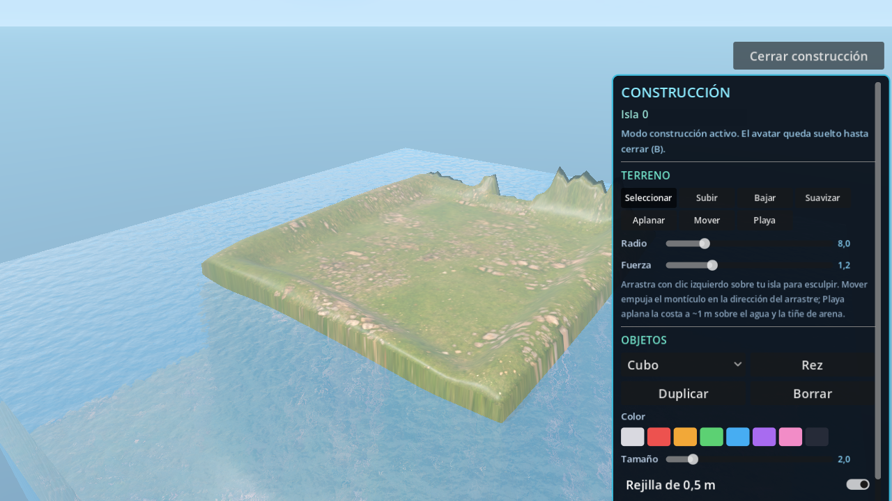](VersionDe_sesion/CONTRRF/TLLDCD/src/STM_DOC/docs/img/10_construccion_isla.png) | [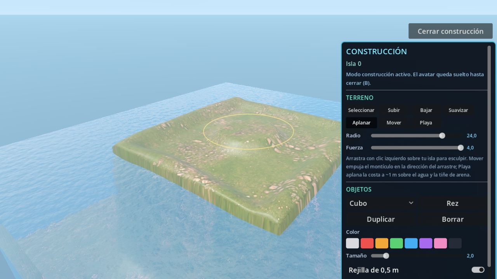](VersionDe_sesion/CONTRRF/TLLDCD/src/STM_DOC/docs/img/11_construccion_aplanar.png) | [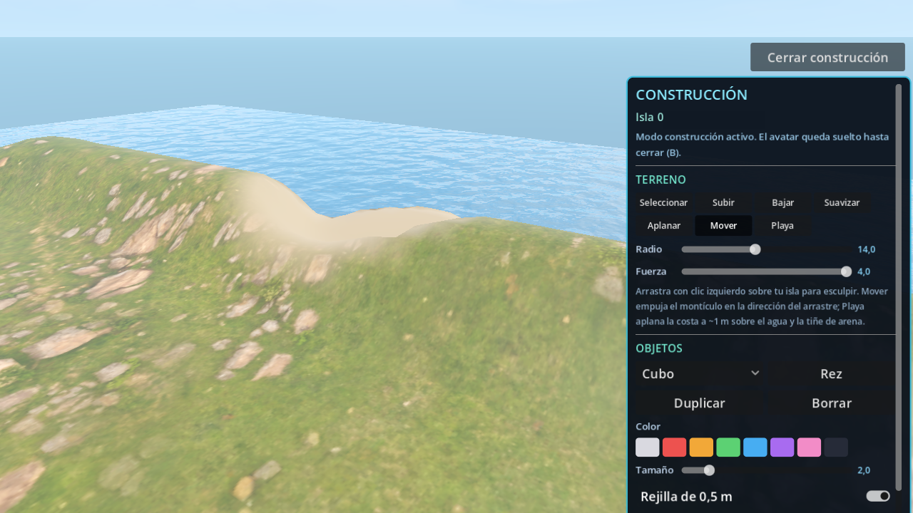](VersionDe_sesion/CONTRRF/TLLDCD/src/STM_DOC/docs/img/12_construccion_playa_costa.png) |

### 3.5 Chat de texto, voz y webcam

El visor incorpora **chat de texto** con relay WebSocket propio, **amigos y chat privado**, y **captura de voz y webcam** que se reenvía a los demás participantes de la sesión. El selftest del chat supera 24/24 comprobaciones; **no** se ha probado con dos visores en máquinas distintas. Queda **Planificado**: autenticación del chat, cola offline, historial privado persistente, selector de micrófono/cámara y reproducción de vídeo/audio en el mundo 3D. LucIA conserva sus módulos de voz en Python (`src/SBSTM/voice_engine.py`, `voice_helpers.py`), que son parte del subsistema cognitivo y no del canal entre jugadores. **Estado: Implementado, sin prueba real entre dos máquinas.**

---

## 4. Mapa del repositorio

El repositorio versiona **852 ficheros** con **280.338.160 B (≈267,3 MiB)** de contenido. Por lenguajes: **69.674 líneas de Python** (235 ficheros), **20.518 líneas de C#** (74), **18.381 líneas de GDScript** (94, incluidos los scripts de escenas y herramientas) y **2.963 líneas de XAML** (15).

### Modelo de versionado

El código que se exporta y compila vive en `VersionDe_sesion/CONTRRF/TLLDCD/src/` (el taller activo). La herramienta interna RFPRMN (ver [§13](#13-herramienta-rfprmn-contrrf)) genera instantáneas en `VersionDe_sesion/Sistema_Principal/PRY/actualizacion_<id>/src/`; la última, `actualizacion_f7bfd9ba`, está **congelada en la 2.5.5** y no es el árbol del que sale un binario nuevo.

```
WoldVirtualP2P3D/
├── .agents/rules/              # Reglas para asistentes de IA
├── .vercel/ .vercelignore      # Resto de una herramienta de despliegue (pendiente de limpiar)
├── .gitattributes .gitignore   # Configuración de Git
├── AGENTS.md GEMINI.md         # Directivas para asistentes de código
├── LICENSE                     # MIT
├── README.md                   # Este documento
├── REGLAS_DE_ACTUALIZACION.md  # Reglas obligatorias del flujo de publicación
├── purgar_repositorio.ps1      # Script de mantenimiento del autor
├── borrar_packs_viejos.ps1     # Script de mantenimiento del autor
├── test_user_data/             # Datos locales de sesión (ignorado por Git)
└── VersionDe_sesion/
    ├── CONTRRF/                # Herramienta RFPRMN (STM_RFC + TLLDCD)
    │   └── TLLDCD/
    │       └── src/            # ← árbol activo (2.6.4)
    │           ├── VSC#/       # Visor C# (.NET 8 WPF)
    │           ├── MTBGT/      # Mundo Godot 4.7.2
    │           ├── LC_STM/     # Red neuronal LucIA
    │           ├── SBSTM/      # Módulos LucIA
    │           ├── STMGNRL/    # Orquestador LucIA
    │           ├── STM_BKCH/   # Ledger local PoNL
    │           ├── STMIPFS/    # Integración IPFS
    │           ├── STM_IA/     # Conocimiento / IA
    │           ├── STM_JSON/   # Utilidades JSON
    │           ├── STM_SGR/    # Vault de credenciales
    │           ├── STM_HRTS/   # Manifiesto y registro
    │           ├── STM_DOC/    # Documentación (incluye capturas)
    │           ├── STM_CH/     # Artefactos de ejecución (pendiente de limpiar)
    │           ├── WCVcoin/    # Hoja de ruta del token (sin código)
    │           ├── tests/      # Pruebas pytest
    │           ├── HOJA_DE_RUTA.md  README_DESARROLLO.md  ref_info.md
    │           └── pytest.ini
    └── Sistema_Principal/
        └── PRY/
            └── actualizacion_f7bfd9ba/src/   # instantánea RFPRMN (2.5.5, histórica)
```

### Módulos

| Carpeta | Rol | Lenguaje | Ficheros | Estado |
|---|---|---|---:|---|
| `src/VSC#/` | Visor WPF: identidad, HUD, Godot incrustado, WebNodo, túneles, actualizador | C# + XAML | 44 | Implementado |
| `src/MTBGT/` | Proyecto Godot: escenas, 24 avatares glTF, shaders, scripts de red | GDScript + escenas | 263 | Implementado |
| `src/LC_STM/` | Red neuronal distribuida de LucIA (5 familias de neuronas) | Python | 60 | Parcial (pesos no publicados) |
| `src/SBSTM/` | Módulos LucIA: IA local/remota, voz, memoria, emoción | Python | 23 | Parcial |
| `src/STMGNRL/` | Orquestador de LucIA (`mainLCSTM.py`) | Python | 2 | Implementado, sin prueba real |
| `src/STM_BKCH/` | Ledger local PoNL (`BKSVCB.py`) | Python | 4 | Implementado (ledger local) |
| `src/STMIPFS/` | Subida/respaldo de pesos a IPFS (CLI Kubo) | Python + BAT | 6 | Parcial (sin daemon real) |
| `src/STM_IA/` | Base de conocimiento y gestor de IA local | Python + Markdown | 10 | Parcial |
| `src/STM_JSON/` | Utilidades de registro JSON | Python + JSON | 4 | Implementado |
| `src/STM_SGR/` | Vault de credenciales OpenRouter | Python | 1 | Implementado |
| `src/STM_HRTS/` | Manifiesto `pyproject.toml` de LucIA + registro | TOML + Python + YAML | 3 | Implementado |
| `src/STM_DOC/` | Documentación y capturas del sistema | Markdown + PNG | 9 | Documentación |
| `src/STM_CH/` | Artefactos de ejecución de LucIA (ledger, memorias, datastore) | Datos | 13 | Pendiente de limpieza |
| `src/tests/` | Pruebas pytest de LucIA | Python | 10 | Implementado |
| `VersionDe_sesion/CONTRRF/` | Herramienta RFPRMN + taller aislado TLLDCD | Python | 11 | Implementado |

**Sobre las siglas**: `VSC#`, `MTBGT`, `SBSTM`, `STM_*`, `CONTRRF` y `TLLDCD` son nombres internos del autor; el repositorio **no expande ninguno de estos acrónimos**, así que quedan como "sin documentar". Sus roles en la tabla provienen del contenido verificado de cada carpeta.

---

## 5. Descarga y primer arranque

### Descarga

- **Release vigente**: [v2.6.4](https://github.com/Chicook/WoldVirtualP2P3D/releases/tag/v2.6.4) — marcada como *Latest* y publicada el 2026-10-28 desde el commit `5f23b8c` de `DevQoderIA`. Sobre la 2.6.3 (diagnóstico de cuenta al arrancar), deja la base local vacía una sola vez —archivada en `respaldo_cuenta`— para recorrer el registro completo, abre ese registro si el PC no tiene nada de lo necesario y conserva la cuenta desde entonces.
- **Ejecutable recomendado**: [`DMWoldVirtualP2P3Dv2.6.4.exe`](https://github.com/Chicook/WoldVirtualP2P3D/releases/download/v2.6.4/DMWoldVirtualP2P3Dv2.6.4.exe) — **788.250.489 bytes (≈751,7 MiB)**, portable, autocontenido. SHA-256 `8ec5d19cb5f14cc3be0a7d2e00cdf9ef9e2e65366411315f14d2defd88576b9f`, idéntico al `digest` publicado por la API de GitHub.
- La release vigente incluye también `release.json` y `SHA256SUMS`, con digests verificados contra la API. Los binarios históricos permanecen colgados de etiquetas anteriores (algunos, como el de 2.5.3, bajo el tag `v2.5.4`), así que **descarga siempre por el enlace de la versión vigente**, no por búsqueda de fichero.
- **Releases anteriores**: [v2.6.2](https://github.com/Chicook/WoldVirtualP2P3D/releases/tag/v2.6.2) — `DMWoldVirtualP2P3Dv2.6.2.exe`, 788.230.009 B, SHA-256 `bb176468…47b6c`; [v2.6.1](https://github.com/Chicook/WoldVirtualP2P3D/releases/tag/v2.6.1) — `DMWoldVirtualP2P3Dv2.6.1.exe`, 788.230.009 B, SHA-256 `86d9cb6e…a88fc`; [v2.6.0](https://github.com/Chicook/WoldVirtualP2P3D/releases/tag/v2.6.0) — `DMWoldVirtualP2P3Dv2.6.0.exe`, 788.230.009 B, SHA-256 `29644fdd…502347`; y [v2.5.9](https://github.com/Chicook/WoldVirtualP2P3D/releases/tag/v2.5.9) — `DMWoldVirtualp2pCNXv2.5.9.exe`, 788.201.343 B, SHA-256 `96c1cf98…187798`. Siguen publicadas con sus assets para quien necesite volver atrás.

**Requisitos**: Windows 10/11 x64. El ejecutable es autocontenido (incluye el runtime de .NET 8, el motor Godot y el mundo 3D): no hay nada que instalar, no necesita permisos de administrador y no escribe en el registro.

**Aviso de SmartScreen**: el binario v2.6.4 se publica **sin firmar** (no había certificado de firma disponible en el equipo de compilación), así que Windows puede mostrar "Windows protegió tu equipo" → *Más información* → *Ejecutar de todas formas*. El estado real de cualquier descarga se comprueba con `Get-AuthenticodeSignature`.

**Verificación**: descarga `SHA256SUMS` de la misma release y comprueba el digest. Desde el 2026-10-23 `SHA256SUMS` y `release.json` están alineados con el binario de cada release; históricamente estuvieron desalineados (apuntaban al binario `v0.3`, ver [§10](#10-actualizador-ota)), así que conviene comprobar que el `exe` declarado en `release.json` coincide con la primera línea de `SHA256SUMS`.

### Qué ocurre al arrancarlo

1. El visor se valida a sí mismo y muestra el flujo de identidad (ver [§6](#6-registro-e-identidad)).
2. En el primer arranque extrae sus recursos embebidos en `%LOCALAPPDATA%\WoldVirtualP2P3D\runtime\<versión>\` (medido en la 2.6.1, la 2.6.2 y la 2.6.3: **718.695.417 bytes ≈ 685,4 MiB** por versión — 512,9 MiB de PCK + 172,5 MiB de motor ya extraído; la 2.6.4 usa el mismo PCK y el mismo motor, y su prueba de arranque volvió a leer 512,9 MiB + 172,5 MiB). El marcador que decide si hay que re-extraer es la **versión del ensamblado** (`AssemblyInformationalVersion`), no una constante a mano: así un OTA que cambia el `wvp3d.pck` embebido fuerza la re-extracción del mundo. La variable de entorno `WOLD_RUNTIME_DIR` permite redirigir la extracción.
3. Lanza el motor Godot incrustado y activa en segundo plano la API P2P local y el WebNodo.

**Limitaciones conocidas**: cada versión publicada extrae su propia carpeta de runtime (no hay limpieza automática de versiones antiguas); el primer arranque tarda unos segundos por la extracción, y **el primer arranque tras un OTA también vuelve a extraer ~686 MiB**. Medido el 2026-10-24: **8,0 GB en 15 carpetas** de runtime en la máquina de desarrollo (deuda registrada en el issue [#12](https://github.com/Chicook/WoldVirtualP2P3D/issues/12)).

---

## 6. Registro e identidad

Hay **dos registros distintos**: el del visor (identidad y llave de acceso, en C#) y el del jugador dentro del mundo (avatar y nick, en Godot). Ambos se describen paso a paso. **La identidad es hoy local**: no hay servidor central de cuentas ni comprobación de unicidad entre dispositivos; la validación anti-Sybil está planificada ([§3.3](#33-validaci%C3%B3n-segura-y-defensa-contra-cuentas-falsas)).

### 6.1 Registro en el visor (primer arranque)

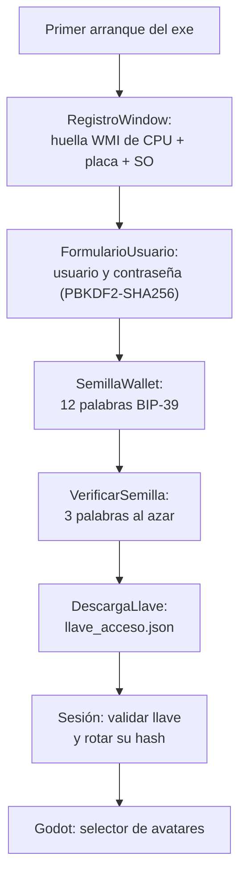

1. **Huella de hardware** (`RegistroWindow`): el visor consulta WMI (`Win32_OperatingSystem`, `Win32_BaseBoard`, `Win32_Processor`) y calcula un hash SHA-256 de la máquina. Es una señal de identificación local, **no** una prueba de unicidad frente a cuentas falsas.
2. **Usuario y contraseña** (`FormularioUsuarioWindow`): la contraseña se procesa con **PBKDF2-SHA256, 210.000 iteraciones** y sal aleatoria de 16 bytes (`PasswordHasher.cs`, comparación en tiempo constante). Se guardan `user_profile.json` y `credentials.json` en la carpeta de datos del usuario (en desarrollo, `test_user_data/user/`).
3. **Frase semilla** (`SemillaWalletWindow`): se generan **12 palabras BIP-39 reales** (lista oficial de 2.048 palabras embebida como recurso del ejecutable, con checksum). **Apúntalas y guárdalas**: es tu única vía de respaldo. La cartera está en construcción: aún no gestiona fondos ni se conecta a ninguna blockchain.
4. **Verificación** (`VerificarSemillaWindow`): el visor pide 3 palabras aleatorias de la semilla para confirmar que la respaldaste.
5. **La llave** (`DescargaLlaveWindow`): se genera `llave_acceso.json`, el fichero maestro de acceso. Cada vez que inicies sesión, el visor valida la llave y **rota su hash** (SHA-256 sobre hash anterior + GUID + marca de tiempo), lo que impide usar copias duplicadas de la misma llave.
6. Las credenciales heredadas en SHA-256 plano se **migran de forma transparente** a PBKDF2 al iniciar sesión (formato versionado `hashVersion: 2`).

**Comprobación de cuenta al arrancar (desde la 2.6.3).** Antes de mostrar la bienvenida, el visor diagnostica la identidad local: si hay usuario y `passwordHash` en `user_profile.json` o `credentials.json`, la cuenta se mantiene intacta; si sólo quedan restos (`llave_acceso.json` suelta, perfil sin hash, sello de PC o una carpeta copiada de otro equipo), los archiva en `%LOCALAPPDATA%\WoldVirtualP2P3D\respaldo_cuenta\<fecha>` y vuelve al ciclo de registro completo; si no hay ninguna identidad, archiva también el estado antiguo del motor para que Godot muestre el carrusel de primera vez. Ninguna ruta borra ficheros: todo se mueve al respaldo.

**Reset total único y registro directo (desde la 2.6.4).** El primer arranque de la 2.6.4 archiva **toda** la base local en `respaldo_cuenta\reset-total-<fecha>\local` y el estado del jugador en `…\godot`, conservando `runtime`, `logs`, `respaldo_cuenta`, `cloudflared.exe` y las cachés del motor (`shader_cache`, `vulkan`, `objectdb_snapshots`). Si algún fichero crítico no se pudo mover, no escribe el marcador y lo reintenta en el siguiente arranque. El marcador permanente `reset_total.txt` hace que el reset no se repita nunca más y que no se importen cuentas antiguas. Después, el visor escribe `estado.json` con las cinco piezas que necesita (`credenciales`, `perfil`, `llave`, `sello`, `motor`) y una acción (`acceso`, `reparar` o `registro-completo`); si no hay ninguna, abre el ciclo de registro completo sin pasar por la pantalla de bienvenida. Desde ese registro en adelante la cuenta persiste.

### 6.2 Registro del jugador dentro del mundo

Sigue el orden de las capturas de la cabecera:

1. **Selector de avatares** — pantalla `SELECTOR DE AVATARES` con el contador `Turno n/3 · k/8`. Usa **← →** para rotar el carrusel circular de **24 modelos antropomórficos animados** (12 femeninos `AVMJ1..12` y 12 masculinos `AVH1..12`) y confirma con **ENTER**. Cada avatar gira sobre su pedestal; el carrusel los agrupa en **3 turnos de 8** con alternancia estricta chico/chica y solo monta en escena los 8 del turno activo.
2. **Registro de jugador** — pantalla `REGISTRO DE JUGADOR` con tu avatar previsualizado en 3D sobre una cúpula de energía. Escribe tu **nick** (mínimo 3 caracteres) y pulsa **Confirmar**. Se guarda en `user://registro.cfg` (sección `[jugador]`: nick + escena de avatar) y se calcula un hash SHA-256 (nick | avatar | tiempo) en `avatar_hash.json`.
3. **Personalización del aspecto** (misma pantalla, panel derecho con pestañas):
   - **Colores**: piel, pelo, camiseta, pantalón y zapatillas (tinte por material).
   - **Cuerpo**: altura hasta **+30 cm**, complexión, cabeza, hombros, torso, brazos y piernas, con porcentaje visible.
   - **Cara**: nariz, labios, orejas y ojos de 0 % (original) a 100 %.
   Todo se aplica **en vivo** sobre la previsualización sin morph targets: se deforman los vértices de la malla del cuerpo por regiones (piel, UV y pesos de skin intactos, así que las animaciones siguen funcionando) y la altura se escala en el nodo visual del modelo, nunca en la cápsula de colisión. La estatura base se mide en espacio de mundo desde el hueso `HeadTop_End` del esqueleto (las unidades de malla de los GLB no son metros en todos los avatares). Se guarda en `[personalizacion]` de `user://registro.cfg`, se restaura al reconectar y se replica a los demás jugadores en el texto compacto de `PlayerSync` (10 Hz).
4. **Hangar** — aparece `GRACIAS POR ENTRAR A WOLD VIRTUAL 3D` / `CREA TU ISLA PROPIA`. Camina con **WASD** hasta el **portal dimensional** (anillo de energía).
5. **Cruza el portal** → pantalla de carga → aterrizas en tu **isla procedural propia** en el archipiélago, bautizada `Isla <tu-nick> (<uuid>)`. Con **T** abres el panel de islas para teletransportarte; los demás jugadores conectados aparecen con su *nametag*.
6. **Siguientes arranques**: si `registro.cfg` existe, el mundo salta directamente al hangar y no repite el registro.

**Reserva exclusiva de avatares.** El anfitrión es la única autoridad sobre quién usa cada avatar: no puede haber dos jugadores con el mismo modelo mientras quede alguno libre.

- El turno de cada avatar es su página del carrusel: puestos 1–8 → turno 1, 9–16 → turno 2, 17–24 → turno 3.
- Al conectar, el cliente declara el avatar elegido; si ya está ocupado, el anfitrión le asigna el más cercano del **mismo género**, empezando por su turno y siguiendo el orden 1 → 2 → 3. El cliente recibe el cambio, lo guarda en `registro.cfg` y ve un aviso ("El avatar X ya estaba en uso. Se te asignó Y · Turno N").
- La plaza de quien se desconecta queda **libre y reutilizable** por el siguiente jugador.
- Con los 24 avatares ocupados, el jugador 25 entra en **turno 4 con un avatar reciclado** (repetido) y la interfaz lo marca como "(avatar reutilizado)".
- La reserva vive en el anfitrión. Tras una migración de anfitrión se descartan los IDs antiguos, las plazas huérfanas se liberan y cada cliente vuelve a declarar su avatar al reconectar.
- **Consulta previa al carrusel (Fase B):** antes de elegir avatar, el visor abre una conexión corta e independiente con el anfitrión (`gdscrip/Sonda.gd`) y pide su tabla de plazas. El carrusel abre en el primer hueco libre, rotula `OCUPADO` sobre los avatares reservados y las flechas los saltan; si no hay sesión alcanzable se muestran los 24 libres. Con los 24 ocupados el contador avisa `reciclando` y se permite elegir igualmente (turno 4). Esta consulta no altera la conexión del mundo ni la del túnel: es un WebSocket breve que se cierra antes de arrancar la isla, y el anfitrión marca al consultante para no crearle isla ni dejarlo en el roster.
- El reparto por orden de llegada a partir de un lobby persistente sigue pendiente: la consulta es una instantánea y la autoridad final sigue siendo la sustitución del anfitrión al conectar.
- Comprobado con `tools/probar_turnos.gd`, `tools/probar_cambio_avatar.gd`, `tools/probar_red.gd`, `tools/probar_carrusel_ocupado.gd` y la pareja `tools/probar_sonda_anfitrion.gd` + `tools/probar_sonda_invitado.gd`.

### 6.3 Galería: la zona de registro del avatar

Capturas del **2026-10-24** del aspecto actual de `registro.tscn` a 1280×720, con el avatar sobre la cúpula de energía, el campo de nick y **Confirmar** a la izquierda, y el panel **PERSONALIZA TU AVATAR** a la derecha. Los tres grupos de controles actúan **en vivo** sobre la previsualización, sin botón de aplicar.

| Colores | Cuerpo | Cara |
|:---:|:---:|:---:|
| [](VersionDe_sesion/CONTRRF/TLLDCD/src/STM_DOC/docs/img/02_registro_jugador.png) | [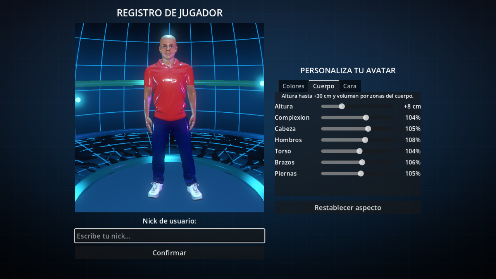](VersionDe_sesion/CONTRRF/TLLDCD/src/STM_DOC/docs/img/05_registro_cuerpo.png) | [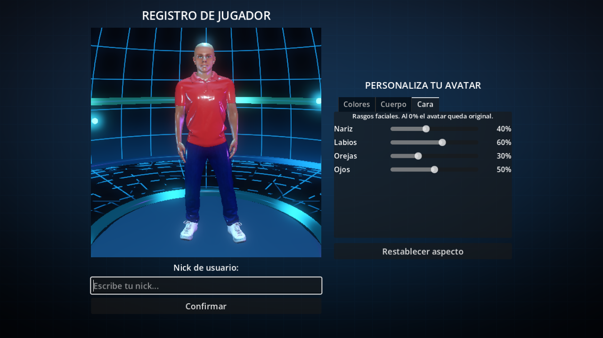](VersionDe_sesion/CONTRRF/TLLDCD/src/STM_DOC/docs/img/06_registro_cara.png) |
| Tinte por material en 5 zonas: piel, pelo, camiseta, pantalón y zapatillas | Altura hasta **+30 cm** y seis volúmenes (complexión, cabeza, hombros, torso, brazos, piernas) | Nariz, labios, orejas y ojos de **0 %** (original) a **100 %** |

El botón **Restablecer aspecto** devuelve todos los valores a su estado original. La captura la genera [`tools/probar_registro.gd`](VersionDe_sesion/CONTRRF/TLLDCD/src/MTBGT/WoldVirtualP2P3D/tools/probar_registro.gd), que además comprueba los 16 controles, que el tinte llegue al material correcto, que la altura crezca exactamente lo pedido y que aplicar el aspecto dos veces no acumule escala.

### 6.4 Invitar a otras personas (prueba de túneles)

Con la sesión 3D abierta, el botón **🌐 WebNodo** de la barra superior levanta un **túnel efímero público** y copia al portapapeles una URL tipo `https://xxx.trycloudflare.com/?host=...`. Tus contactos pueden:

- abrirla en el **navegador** (portal web: estado del nodo y descarga del visor), o
- usar **su propio visor** y conectarse por `wss://` a tu túnel para aparecer en tu isla.

Detalles completos de puertos y proveedores en [§8](#8-red-p2p-webnodo-y-t%C3%BAneles-ef%C3%ADmeros).

**Limitaciones conocidas**: DPAPI se descartó a propósito (la llave debe ser portable); la rotación de llave aún no usa escritura atómica (deuda D10); el túnel cambia de URL en cada sesión.

---

## 7. El mundo 3D (Godot)

Motor **Godot 4.7.2** con renderer **Forward+** sobre **D3D12** y física **Jolt** (configuración en [`src/MTBGT/WoldVirtualP2P3D/project.godot`](VersionDe_sesion/CONTRRF/TLLDCD/src/MTBGT/WoldVirtualP2P3D/project.godot)). Escena principal: `WoldVirtual3DP2P.tscn`, orquestada por [`gdscrip/Boot.gd`](VersionDe_sesion/CONTRRF/TLLDCD/src/MTBGT/WoldVirtualP2P3D/gdscrip/Boot.gd), que implementa la máquina de estados:

```
carrusel de avatares → registro de nick → hangar / zona de portal → carga → isla
```

### Contenido verificado

| Elemento | Dato | Fuente |
|---|---|---|
| Avatares | 24 (12 `AVMJ*` femeninos + 12 `AVH*` masculinos), glTF + bin, con escena `Ch3D.tscn` cada uno; carrusel en 3 turnos de 8 con alternancia chico/chica | `gltfimport/avatares/`, `SLCAV/AVATARESCONANIMACION/`, `gdscrip/Turnos.gd` |
| Isla / terreno | Chunks de **199,5 m**, **10 islas por fila** en rejilla serpentina, malla glTF compartida | `ChunkManager.gd` (`chunk_size=199.5`, `islands_per_row=10`), `gltfimport/terrenoblok/` |
| Shaders | 8 propios: `OCEANO`, `cielo_nubes`, `cupula_panel`, `grid_floor`, `hangar_panel`, `portal_energy`, `portal_ring`, `registro_fondo` | `gdshader/` (`*.gdshader`) |
| Sincronización de jugadores | **10 Hz** (intervalo 0,1 s), RPCs con autoridad de anfitrión | `gdscrip/PlayerSync.gd` |
| Panel de islas | Tecla **T**, teletransporte instantáneo entre parcelas | `gdscrip/TeleportPanel.gd` |
| Addon | `limpiar_cache` | `project.godot` |

Nota: `Boot.gd` contiene un comentario antiguo que habla de "3 chicas / 3 chicos"; el contenido real del carrusel son los **24 avatares** listados arriba.

### Controles

| Acción | Control |
|---|---|
| Caminar | **W A S D** o flechas |
| Correr (sprint) | **AltGr** |
| Órbita de cámara | Botón derecho del ratón + movimiento |
| Panel de islas / teletransporte | **T** |
| Entrar o salir de construcción | **B** (o **Esc** para salir) |
| Confirmar avatar en el carrusel | **ENTER** |

**Limitaciones conocidas**: las fuentes de Blender (`.blend`) de los avatares no se versionan; solo hay un `.blend` de prueba (`hm1.blend`). Los 16 avatares nuevos viven en `avtrnCRS/` (**≈4,2 GB** de GLB y PNG, también fuera de Git); sus `.import` llevan `process/size_limit=2048` y el `export_presets.cfg` excluye las copias duplicadas. Reconstruir los modelos exige las fuentes originales del autor. La **construcción** permite esculpir el terreno, generar terreno voxel y editar prims de la isla propia ([§3.4](#34-construcci%C3%B3n-y-edici%C3%B3n-de-islas)); desde la 2.6.0 hay «Deshacer isla» (por isla completa, no por pasos) y guardado en inventario (sin restauración todavía). No hay rehacer incremental, selección múltiple ni física de prims, y la sincronización entre dos máquinas no se ha probado.

---

## 8. Red P2P, WebNodo y túneles efímeros

La sesión tiene un **anfitrión** (host) con autoridad y **invitados** que se conectan a él. El transporte es directo (WebSocket TCP), sin servidor de juego central; el único servicio en la nube es el **túnel efímero** opcional que publica el WebNodo del anfitrión. Es la arquitectura que se está probando en esta fase.

> Contexto histórico: un prototipo anterior usaba **ENet UDP en el puerto 8910**; fue descartado y sustituido por WebSocket. El puerto 8910 no se usa.

### Puertos

| Puerto | Protocolo | Servicio | Rutas / uso |
|---:|---|---|---|
| **7890** | HTTP | API P2P local del visor | `/ping`, `/info`, `/peer` |
| **3030–3040** | HTTP | WebNodo público (proxy TCP externo) | Portal de invitados |
| **3130–3140** | HTTP | `HttpListener` interno (WebNodo real) | Sirve el portal y la API |
| **8911** | WebSocket (TCP) | Red del motor Godot | `WebSocketMultiplayerPeer` |
| **8912** | UDP | Beacon de descubrimiento LAN | Difusión `255.255.255.255`, cada 2 s |

### Cómo funciona

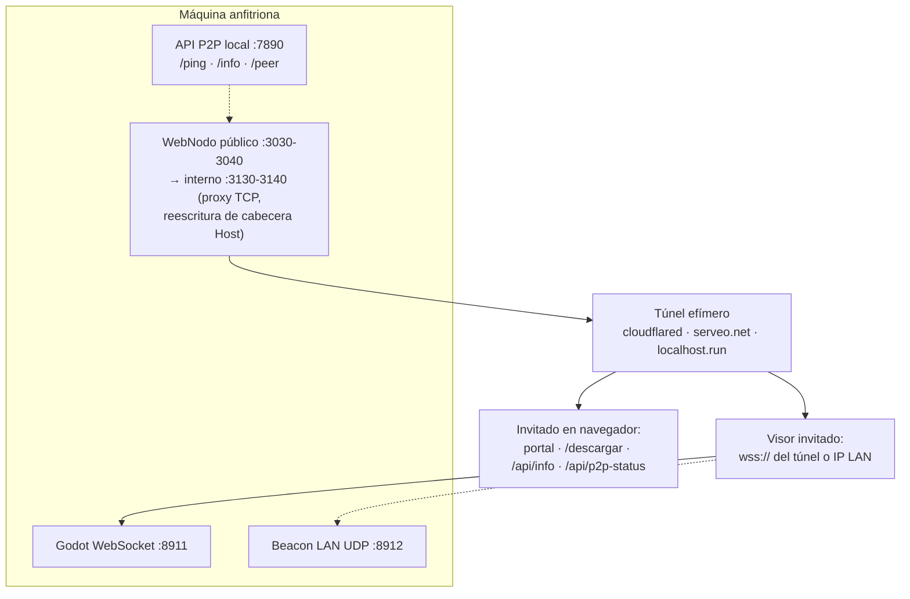

- **WebNodo** ([`Services/WebNodoService.cs`](VersionDe_sesion/CONTRRF/TLLDCD/src/VSC%23/Services/WebNodoService.cs)): un `HttpListener` interno sirve el portal (`webnodo/public/index.html`, embebido también en el exe) y una API. Un **proxy TCP transparente** delante reescribe la cabecera `Host` en tiempo real para que las peticiones del túnel no sean rechazadas.
- **Endpoints del portal**: `/` y `/index.html`, `/metaverso.jpg`, `/descargar` (descarga del visor), `/api/info` y `/api/p2p-status` (estado del nodo). La API exige un **token por sesión**; hay límites por IP de 120 req/min en `/api/*` y 3 descargas/min ([`Services/RateLimiter.cs`](VersionDe_sesion/CONTRRF/TLLDCD/src/VSC%23/Services/RateLimiter.cs)).
- **Túneles efímeros** ([`p2pipfsCS/EphemeralTunnelRunner.cs`](VersionDe_sesion/CONTRRF/TLLDCD/src/VSC%23/p2pipfsCS/EphemeralTunnelRunner.cs)): el proveedor principal es **cloudflared** (Quick Tunnel, URLs `*.trycloudflare.com` sin cuenta ni configuración); si no está disponible cae a **SSH inverso** con `serveo.net` o `localhost.run` ([`RedP2P/P2PTunnelManager.cs`](VersionDe_sesion/CONTRRF/TLLDCD/src/VSC%23/RedP2P/P2PTunnelManager.cs)). No hay que abrir puertos en el router.
- **Enlace de invitación**: `https://<túnel>/?host=<raíz>`; el visor invitado normaliza la URL y converge al mismo anfitrión.
- **Descubrimiento LAN**: el anfitrión difunde un beacon UDP en `255.255.255.255:8912` cada 2 s con la cadena `WOLDVIRTUAL_HOST_WS_8911`; los visores de la misma red pueden unirse sin túnel usando la IP local.

**Limitaciones conocidas**: la URL del túnel es efímera (cambia en cada sesión); la sincronización depende por completo del anfitrión (ver [§9](#9-continuidad-de-sesi%C3%B3n)); la red es P2P en el transporte, no en la autoridad. El análisis de diseño más detallado está en [`src/VSC#/README_TUNELES_P2P.md`](VersionDe_sesion/CONTRRF/TLLDCD/src/VSC%23/README_TUNELES_P2P.md).

---

## 9. Continuidad de sesión

Si el anfitrión cae, la sesión no se pierde: los nodos acuerdan un nuevo anfitrión entre los conectados.

```mermaid
sequenceDiagram
    participant H as Anfitrión actual
    participant A as Nodo A (orden menor)
    participant B as Nodo B
    Note over H,A,B: Roster replicado en cada nodo: peer_id, orden, nick, IP LAN y URL pública
    H -->> A: (el anfitrión se detiene)
    A->>A: Polling de session_host.txt cada 4 s (ComprobarHostMigrado)
    A->>A: Elección determinista: menor orden → Nodo A
    A->>B: Nuevo roster con Nodo A como anfitrión
    B->>A: Reconexión por wss:// (o IP LAN :8911)
    Note over A,B: Re-rooting del enlace ?host= a la URL del nuevo anfitrión
```

Implementado en `MainWindow.xaml.cs` (`ComprobarHostMigrado`) y `ChunkManager.gd` (roster y elección):

- **Roster replicado**: cada nodo conoce `peer_id`, orden, nick, IP LAN y URL pública del WebNodo de los demás.
- **Elección determinista**: gana el nodo con **menor orden**; nadie más se proclama anfitrión.
- **Reconexión**: los invitados se reconectan por `wss://` a la URL del elegido, con *fallback* a la IP LAN.
- **Re-rooting del enlace**: el enlace `?host=` se reescribe vía `session_host.txt`.
- **Islas**: se reconstruyen desde `TeleportManager` y cada nodo reclama su `my_own_index` sin duplicados.

**Estado: implementado, sin prueba real.** El plan original exige una prueba con 3 instancias y muerte del anfitrión que no consta como ejecutada (fase F7 de la [hoja de ruta](VersionDe_sesion/CONTRRF/TLLDCD/src/HOJA_DE_RUTA.md)). La corrección de 2.5.5 evita que un reinicio o un OTA convierta al anfitrión en cliente de su propio túnel caducado.

---

## 10. Actualizador OTA

El visor incorpora un actualizador contra las Releases de GitHub, repartido en tres clases de [`src/VSC#/STM_actualizar/`](VersionDe_sesion/CONTRRF/TLLDCD/src/VSC%23/STM_actualizar/UpdateChecker.cs):

- **`UpdateChecker`**: consulta la API de GitHub (`/repos/{repo}/releases`), elige de cada release el `.exe` de mayor versión (la versión real puede estar en el nombre del fichero, no sólo en el tag) y compara SemVer con la local. Prioriza estables sobre *prereleases*. Expone `GetLatestReleaseAsync()` (la release vigente sin filtrar por la versión local), que es la que consume el portal WebNodo.
- **`UpdateDownloader`**: descarga el binario por rangos HTTP (**reanudación** con fichero `.part`), **verifica el SHA-256** contra el digest de la API antes de aplicar y comprueba permisos de escritura de la carpeta con antelación.
- **`UpdateApplier`**: aplica la actualización con `apply-pending.bat` y mantiene el estado en `state.json` con **escritura atómica**.

El botón de la barra superior muestra los estados `Buscando · Al día · Actualizar vX.Y.Z · Descargando % · Reiniciando · Error/Reintentar`, con una barra de progreso de 2 px en el borde inferior (nunca sobre el viewport 3D).

**El portal WebNodo ya no depende de un `release.json` empaquetado.** Antes leía ese fichero del disco, junto al `.exe`, y como el OTA sólo reemplaza el binario, el portal seguía anunciando la versión antigua —y su URL, obsoleta, cortaba en un 404. Ahora, al arrancar el nodo, `WebNodoService.RefrescarReleaseVigente()` consulta GitHub con el **mismo** `UpdateChecker` que el botón, de modo que ambos anuncian exactamente el mismo binario; si la consulta falla, se queda con el `release.json` local o el *fallback* cableado. En `/descargar`, si el `.exe` en ejecución es la release vigente se sirve directamente ése.

**Corrección v2.5.5 (2026-10-23)**: tras un OTA el visor podía arrancar Godot como **cliente del túnel efímero de la sesión anterior**, ya cerrado; como el cliente explícito no degrada a anfitrión, el mundo se quedaba en «Conectando a la red P2P». La causa era que `MainWindow.ComprobarHostMigrado()` interpretaba `user://session_host.txt` —que sólo escribe el anfitrión local— como destino remoto. Ahora ese fichero sólo actualiza el enlace de invitación, nunca el rol de arranque, y se ignoran los archivos de ejecuciones anteriores.

**Corrección v2.5.8 (2026-10-26)**: la 2.5.6 introdujo un control de avatar por clic para que el teclado del chat no moviera al personaje, pero el avatar arrancaba bloqueado y el usuario lo percibía como «los avatares no andan». Desde la 2.5.8 `control_avatar` vale `true` al arrancar; el control sólo se suelta al perder el foco y se recupera al volver, sin otro clic y salvo que el modo construcción siga activo.

**Pendiente** (fase F3): canal estable/beta, *changelog* en el tooltip, espera controlada del `apply-pending.bat`, reintento del refresco del portal si GitHub no responde al arrancar y validación del PCK embebido por hash. Registrado en el issue [#12](https://github.com/Chicook/WoldVirtualP2P3D/issues/12).

---

## 11. Compilar y publicar

### Propiedades de compilación

Definidas en [`src/VSC#/Visor3D.csproj`](VersionDe_sesion/CONTRRF/TLLDCD/src/VSC%23/Visor3D.csproj):

- `net8.0-windows`, `WinExe`, `UseWPF`, plataforma `x64`.
- `PublishSingleFile` + `SelfContained` + `IncludeNativeLibrariesForSelfExtract` → **un único .exe portable**.
- Sin trimming (`PublishTrimmed=false`) y sin compresión del single-file.
- Recursos embebidos: `Seguridad/bip39-english.txt`, `webnodo/public/index.html` y `metaverso.jpg`, y —si no se pasa `-p:SkipGodotAssets=true`— **`godot_exe.zip`** y **`wvp3d.pck`**.

### Comando de publicación

```bash
cd VersionDe_sesion/CONTRRF/TLLDCD/src/VSC#
dotnet publish -c Release -r win-x64 --self-contained true
```

El interruptor de desarrollo `-p:SkipGodotAssets=true` compila solo la UI sin el motor ni el mundo (exe ligero para iterar en WPF).

**Antes de publicar, lee [`REGLAS_DE_ACTUALIZACION.md`](REGLAS_DE_ACTUALIZACION.md)**: el flujo Godot → PCK → versión → build → release → OTA es obligatorio y tiene checklist.

### Insumos NO versionados (importantes)

`.gitignore` excluye `*.zip`, `*.pck`, `*.exe` y `*.dll`. Por tanto, **estos dos insumos de build no están en el repositorio** y hay que colocarlos manualmente en `src/VSC#/` antes de publicar:

| Insumo | Tamaño | Origen |
|---|---:|---|
| `godot_exe.zip` | 86 MB (82 MiB) | Distribución oficial de Godot 4.7.2 win64 (`Godot_v4.7.2-stable_win64.exe`), empaquetada en ZIP |
| `wvp3d.pck` | 537.836.524 B (512,9 MiB) | Exportación PCK del proyecto Godot de `src/MTBGT/WoldVirtualP2P3D/` con el `export_presets.cfg` versionado (24 avatares a 2K; sin copias duplicadas); el de la 2.6.1 se exportó el 2026-10-28 y su SHA-256 es `9d5c15e7…a69ac94`; la 2.6.2, la 2.6.3 y la 2.6.4 lo reutilizan sin cambios |

Reconstruirlos en otra máquina exige: 1) descargar Godot 4.7.2, y 2) abrir el proyecto MTBGT una vez (`--headless --path . --import`) y exportar con `--export-pack "Windows Desktop"`; el preset ya está versionado y fija el filtro de recursos. Las fuentes `.blend` de los avatares no están versionadas (ver [§7](#7-el-mundo-3d-godot)).

### Tamaños medidos del ciclo de publicación

| Artefacto | Tamaño |
|---|---:|
| Exe publicado (v2.6.4) | 788.250.489 B (≈751,7 MiB) |
| Exe anterior (v2.6.3) | 788.242.297 B (≈751,7 MiB) |
| Exe anterior (v2.6.2) | 788.230.009 B (≈751,8 MiB) |
| Exe anterior (v2.6.0) | 788.230.009 B (≈751,8 MiB) |
| Exe anterior (v2.5.9) | 788.201.343 B (≈751,7 MiB) |
| PCK embebido (v2.6.4) | 537.836.524 B (512,9 MiB) |
| Extracción en disco por versión (v2.6.4) | 718.695.417 B (≈685,4 MiB) |
| Contenido versionado del repositorio | 852 ficheros, 280.338.160 B (≈267,3 MiB) |

### Pipeline completo

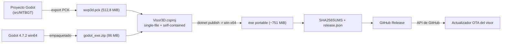

**Limitaciones conocidas**: los binarios actuales se publican **sin firmar** (no hay certificado de distribución); `GodotConfig.cs` conserva rutas de desarrollo como *fallback* (deuda D9, ver [§15](#15-hoja-de-ruta-y-deuda-t%C3%A9cnica)).

---

## 12. LucIA: subsistema cognitivo en Python

LucIA es una arquitectura cognitiva experimental que vive en el mismo repositorio pero **sin ninguna integración con el visor C#** (cero referencias mutuas). **Su integración en el metaverso está planificada** ([§3.1](#31-lucia-dentro-del-metaverso)); esta sección describe solo lo que existe hoy.

El manifiesto del proyecto es [`src/STM_HRTS/pyproject.toml`](VersionDe_sesion/CONTRRF/TLLDCD/src/STM_HRTS/pyproject.toml): paquete `lucia-woldvirtualp2p3d`, Python ≥ 3.10, dependencia única `numpy>=1.24` (más `pytest`/`ruff` en dev).

### Cómo ejecutarla

```bash
cd VersionDe_sesion/CONTRRF/TLLDCD/src
python STMGNRL/mainLCSTM.py        # o, tras pip install -e .: comando "lucia"
```

### Red neuronal distribuida (`src/LC_STM/red_neuronal/`)

| Familia | Papel | Ficheros |
|---|---|---:|
| `ENRN` | Neuronas ENRN (cálculo de tensores y entropía) | 1 módulo principal + soporte |
| `RF_EN` | Familia RF_EN | 1 |
| `RF_SL` / `RFSL1` | Familia RF_SL | 2 |
| `RNP` | Familia RNP | 1 |
| `SLRN` | Familia SLRN | 1 |
| `procesador_voz_neuronal.py` | Voz neuronal con modulación DSP | 1 |

*(Nombres de familia tal y como aparecen en el código; el repositorio no expande las siglas.)*

### Módulos acompañantes

- **`src/SBSTM/`**: subsistemas de LucIA — `IAFREE` (catálogo de IA remota gratuita vía OpenRouter), `IALOCAL` (modelos locales Ollama/LM Studio), `STYLOS` (estilos de respuesta), `RPLC`, motor de voz (`voice_engine.py`, `voice_helpers.py`), emoción y memoria.
- **`src/STM_BKCH/BKSVCB.py`**: un **ledger local PoNL** (Proof of Neuron Learning) con interfaz de red en el puerto **8545**. No es una blockchain pública ni el futuro WCVcoin.
- **`src/STM_SGR/vault_openrouter.py`**: vault de credenciales para OpenRouter (cifrado con PBKDF2-HMAC-SHA256 + XOR, sin claves hardcodeadas).
- **`src/STMIPFS/SBSTMPYIPFS/pesos_ipfs.py`**: subida de pesos a IPFS mediante el CLI de Kubo; el CID queda registrado en `STM_CH/lucia_pesos.cid`.
- **`src/STM_IA/`**: base de conocimiento (Markdown) y gestor de modelos locales.
- **`src/STM_JSON/registro_json.py`**: utilidades de registro JSON.

### Qué NO está publicado (importante)

Por la política del proyecto (fases L5–L6): el **avatar 3D de LucIA, sus animaciones y los pesos entrenados NO se publican** ni en el repositorio ni en las releases. Lo que sí está versionado es todo el **código Python** listado arriba. Además:

- `STM_BKCH/compat_local.py` es un **shim** que simula 50 neuronas sintéticas para ejecutar sin los pesos reales.
- La integración IPFS no arranca un daemon real (deuda reconocida).
- La memoria persistente (`STM_DOC/memoria.md`, `STM_CH/memoria_LUCIA_*.json`) es **simulada**: registra turnos con respuestas marcadas como simuladas.
- La hoja de ruta L1–L6 está íntegramente **Planificado**.

---

## 13. Herramienta RFPRMN (CONTRRF)

`VersionDe_sesion/CONTRRF/` contiene la herramienta interna de flujo de trabajo del autor (documentada en [`CONTRRF/STM_RFC/README.md`](VersionDe_sesion/CONTRRF/STM_RFC/README.md)):

- **`STM_RFC/RFPRMN.py`**: utilidad de refactorización y sincronización con los comandos **`enviar`**, **`refactorizar`**, **`actualizar`**, **`ia local`** y **`ds ialocal`**. Aplica un tope de **450 líneas por fichero** (el `RFPRMN.py` original de 1.813 líneas se dividió en módulos sin cambiar firmas ni comportamiento).
- **Flujo `enviar` → RFC → `actualizar`**: produce las instantáneas `PRY/actualizacion_<id>` que dan nombre al modelo de versionado del [§4](#4-mapa-del-repositorio).
- **`TLLDCD/`**: taller aislado del autor (zona de trabajo delimitada) y registro de operaciones `STM_RFC/envios.json`. La sigla **TLLDCD no se expande en el repositorio** ("sin documentar").

*(`CONTRRF`, `STM_RFC` y `RFPRMN` son también siglas sin expandir en el repositorio; su función sí está documentada en el README citado.)*

---

## 14. Calidad y pruebas

### Pruebas

- **LucIA** (`src/tests/`, 10 ficheros): pruebas pytest de voz, memoria, emoción, comandos, conocimiento, perfil, escucha, regresión y sistema, más un script de diagnóstico de voz (`diag_voz.py`). Configuración en `src/pytest.ini` / `pyproject.toml` (`testpaths=["tests"]`). Ejecución: `python -m pytest` desde `src/`.
- **Visor C#**: no hay suite unitaria ni CI (deuda D15), pero el ejecutable incluye autopruebas de línea de comandos que se pasan antes de publicar: `--startup-selftest` (15/15), `--chat-selftest` (24/24) y `--red-selftest` (6/6). Cada release se valida además a mano.
- **Mundo Godot**: scripts de comprobación en `src/MTBGT/WoldVirtualP2P3D/tools/` (`probar_turnos.gd`, `probar_carrusel_ocupado.gd`, `probar_red.gd`, `probar_sonda_*.gd`, `probar_personalizacion.gd`, `probar_construccion.gd`…), ejecutados a mano en headless. La prueba visual `capturar_construccion.gd` esculpe y reza prims en una ventana real, guarda 18 capturas y comprueba 26 condiciones (26/26 en la ejecución de referencia del 2026-10-26).

### CI

**No hay CI efectivo.** Existe [`src/STM_HRTS/.github/workflows/ci.yml`](VersionDe_sesion/CONTRRF/TLLDCD/src/STM_HRTS/.github/workflows/ci.yml), pero:

1. GitHub solo ejecuta workflows situados en `.github/workflows/` de la **raíz** del repositorio; este está anidado tres niveles abajo, así que **nunca se dispara**.
2. Además ordena `pytest LC/celebro/test`, una ruta que **no existe** en el árbol actual.

Mover el workflow a la raíz y corregir la ruta de tests son los arreglos recomendados.

---

## 15. Hoja de ruta y deuda técnica

Fuente: [`HOJA_DE_RUTA.md`](VersionDe_sesion/CONTRRF/TLLDCD/src/HOJA_DE_RUTA.md) (casillas verificadas una a una; ⬜ = pendiente).

### Fases F0–F7

| Fase | Objetivo | Estado |
|---|---|---|
| F0 | Congelar el taller aislado (snapshots, build reproducible) | Parcial: reglas de exclusión hechas; scripts del taller pendientes |
| F1 | Botón de actualización en la barra | Implementado; falta probar 1280×720 y DPI 125/150 % |
| F2 | Release portable y verificable | Implementado (exe portable, PCK, `release.json`, `SHA256SUMS`); **firma no aplicada** en 2.5.4–2.6.4 |
| F3 | Updater robusto | Implementado y probado (hash, reanudación, carpeta escribible); falta canal beta, *changelog* y reintento del portal |
| F4 | Puente Godot/WPF | Implementado (DPI, reinicio del motor, overlays solo en la barra); falta medir 60 fps |
| F5 | Identidad PBKDF2/BIP-39 | Implementado y probado (10/10); DPAPI descartado; rotación atómica pendiente |
| F6 | LucIA, WebNodo y observabilidad | Parcial: portal, token, logs y límites por IP hechos; empaquetado de LucIA pendiente |
| F7 | Continuidad de sesión | Implementado, **sin prueba real** con 3 instancias |

### Fases del metaverso

| Área | Objetivo | Estado |
|---|---|---|
| LucIA | Integración como presencia cognitiva/asistente del mundo (L1–L6) | Planificado |
| Blockchain | Cadena propia para identidad, reputación y token | Planificado |
| WCVcoin | 30.000.000 WCV, 3 decimales, 0 distribución el día 1 | Planificado |
| Anti-Sybil | Identidad única en red y reparto solo a humanidad verificada ([§3.3](#33-validaci%C3%B3n-segura-y-defensa-contra-cuentas-falsas)) | Planificado |
| Construcción | Edición y persistencia de islas por el jugador ([§3.4](#34-construcci%C3%B3n-y-edici%C3%B3n-de-islas)) | Implementado, sin prueba real entre dos máquinas |
| Comunicación | Chat de texto, voz y webcam dentro del mundo ([§3.5](#35-chat-de-texto-voz-y-webcam)) | Implementado, sin prueba real entre dos máquinas |

### Métricas de la v0.1.0 (histórico)

| Métrica | Objetivo | Medido |
|---|---|---|
| Tamaño del PCK | Reducir texturas | 299,5 MB → 171,5 MB (texturas 2K, 8 avatares) |
| Exe final | Portable | 409,5 MB, arranque verificado |
| Extracción en frío | Rápida | 344 MB en 3,3 s |
| Identidad | PBKDF2 + BIP-39 | 10/10 pruebas en entorno aislado |

*(Cifras de la fase F2 para la v0.1.0; el binario vigente v2.6.4 incorpora 24 avatares a 2K en un PCK de 512,9 MiB y un exe de ≈751,7 MiB.)*

### Deuda técnica más relevante

Inventario completo con evidencias en [`README_DESARROLLO.md`](VersionDe_sesion/CONTRRF/TLLDCD/src/README_DESARROLLO.md) (D1–D16) y en los issues [#11](https://github.com/Chicook/WoldVirtualP2P3D/issues/11) (nits del actualizador), [#12](https://github.com/Chicook/WoldVirtualP2P3D/issues/12) (deuda del ciclo 2.5.4/2.5.5), [#17](https://github.com/Chicook/WoldVirtualP2P3D/issues/17) (deuda de la jornada 2026-10-26, 2.5.6 → 2.5.9), [#19](https://github.com/Chicook/WoldVirtualP2P3D/issues/19) (deuda de la 2.6.0), [#22](https://github.com/Chicook/WoldVirtualP2P3D/issues/22) (deuda de la jornada 2026-10-28, 2.6.1 → 2.6.4), [#23](https://github.com/Chicook/WoldVirtualP2P3D/issues/23) (actualizador sin sesión), [#24](https://github.com/Chicook/WoldVirtualP2P3D/issues/24) (bienvenida y `estado.json`) y [#25](https://github.com/Chicook/WoldVirtualP2P3D/issues/25) (nits del OTA y del perfil). Las más relevantes hoy:

| ID | Deuda |
|---|---|
| D7 | Un mismo tag de release acumula muchos binarios distintos (selección de versión frágil) |
| D8 | Nombre de asset y URL del portal resueltos por `release.json` con *fallback* cableado |
| D9 | Rutas absolutas de desarrollo en `GodotConfig.cs` |
| D10 | Rotación de llave sin escritura atómica |
| D12 | Árbol MTBGT sin `.godot` ni fuentes `.blend`: no se puede abrir el editor y ejecutar tal cual |
| D14 | Visor y LucIA sin integrar (dos productos en un repo) |
| D15 | Sin tests ni CI del visor |
| D16 | Assets duplicados (evitables en el PCK) |
| — | `runtime\<versión>\` sin recolector: 8,0 GB en 15 carpetas (medido 2026-10-24) |
| — | El portal solo refresca la release al arrancar, sin reintento si GitHub falla |
| — | El PCK embebido no se valida por hash al extraer |

### Pendientes inmediatos

La lista viva de tareas, priorizada y enlazada a su issue, está en [§16](#16-tareas-pendientes); aquí queda el inventario histórico de la hoja de ruta.

Checklist de publicación: [§7 de `REGLAS_DE_ACTUALIZACION.md`](REGLAS_DE_ACTUALIZACION.md).

Checklist de publicación: [§7 de `REGLAS_DE_ACTUALIZACION.md`](REGLAS_DE_ACTUALIZACION.md).

---

## 16. Tareas pendientes

> **Sección viva, actualizada el 2026-10-28** al cerrar la 2.6.4 y fusionar `DevQoderIA` en `main`. La fuente de verdad es el código y el [rastreador de issues](https://github.com/Chicook/WoldVirtualP2P3D/issues); cada fila apunta a su issue. Las etiquetas de estado siguen la convención de la cabecera.

### 16.1 Cerrado en la jornada 2026-10-28

| Tarea | Evidencia |
|---|---|
| OTA real desde GitHub 2.5.4 → 2.6.4 | El exe resultante es idéntico al asset publicado (SHA-256 `8ec5d19c…576b9f`, 788.250.489 B), el anterior se conservó como `.old` (787.264.673 B), `STM_actualizar` quedó limpio y la app relanzó con `FileVersion 2.6.4.0` / `ProductVersion 2.6.4+a5f84b1…` |
| Reset total único y registro completo en el PC real | 14 elementos archivados en `respaldo_cuenta\reset-total-20261028-024605`, conservados `runtime`, `logs`, `cloudflared.exe` y `respaldo_cuenta`; `reset_total.txt` = `2.6.4`; `estado.json` en `vacio`/`registro-completo`; registro abierto a las 02:46:10 y cuenta persistida con sesión y túnel |
| Suite de la jornada | `--cuenta-selftest` **19/19**, `--chat-selftest` **26/26**, `--red-selftest` **7/7** y `--startup-selftest` **15/15** con `runtime\2.6.4`; PCK reutilizado (`9d5c15e7…a69ac94`) y los tres `digest` de la release coincidentes con los SHA-256 locales |
| Integración en `main` | PR [#21](https://github.com/Chicook/WoldVirtualP2P3D/pull/21), commit de merge `17a7b94`, sin binarios ni los borrados del flujo RFPRMN |

Detalle y evidencias completas de la versión: [`README_desarrollo_20261028_2_6_4.md`](VersionDe_sesion/Sistema_Principal/PRY/actualizacion_52bf0d80/src/README_desarrollo_20261028_2_6_4.md).

### 16.2 Pendiente, por prioridad

| Prioridad | Tarea | Qué falta | Estado | Issue |
|---|---|---|---|---|
| P0 | Segundo arranque tras el reset total | Comprobar que `reset_total.txt` impide repetirlo y que la cuenta se reconoce (`Completa` → `acceso`). No se cerró la sesión del usuario para no cortar el túnel | Implementado, sin prueba real | [#22](https://github.com/Chicook/WoldVirtualP2P3D/issues/22) |
| P0 | OTA literal 2.6.3 → 2.6.4 y OTA sin sesión | Hoy se validó 2.5.4 → 2.6.4 con el mismo actualizador (`STM_actualizar` idéntico en `a5f84b1..5f23b8c`); falta un equipo con la 2.6.3 y un arranque sin sesión iniciada | Implementado, sin prueba real | [#22](https://github.com/Chicook/WoldVirtualP2P3D/issues/22), [#23](https://github.com/Chicook/WoldVirtualP2P3D/issues/23) |
| P0 | Sesión real entre dos máquinas | Chat, amigos, voz/webcam y construcción entre dos equipos, por LAN y por túnel; los selftests locales (26/26 y 7/7) no lo sustituyen | Implementado, sin prueba real entre dos máquinas | [#22](https://github.com/Chicook/WoldVirtualP2P3D/issues/22), [#17](https://github.com/Chicook/WoldVirtualP2P3D/issues/17) |
| P0 | Flujo de identidad completo en equipos reales | Sesión vacía → llave + avatar; sesión ocupada → enlace de invitado con el `?host=` del portal; el reinicio automático de cuenta sólo está probado sobre directorios temporales | Implementado, sin prueba real | [#17](https://github.com/Chicook/WoldVirtualP2P3D/issues/17) |
| P0 | Webcams con dos cámaras y sesión autenticada | La franja está validada en XAML/headless (26/26, incluida la vista local de la 2.6.2) pero no con dos cámaras reales | Implementado, sin prueba real | [#22](https://github.com/Chicook/WoldVirtualP2P3D/issues/22) |
| P0 | Portal `/api/info` contra la release 2.6.4 | La última medición usó el fallback local; falta ver el portal anunciando el asset publicado de la 2.6.4 | Implementado, sin prueba real | [#22](https://github.com/Chicook/WoldVirtualP2P3D/issues/22) |
| P1 | Actualizador accesible sin sesión | El botón sólo existe en la vista del mundo (`PanelMundo3D`); faltan un indicador en la bienvenida y una prueba `--update-selftest` sin cuenta | Parcial | [#23](https://github.com/Chicook/WoldVirtualP2P3D/issues/23) |
| P1 | Bienvenida y `estado.json` tras registrarse | La bienvenida queda detrás del registro automático y `estado.json` sigue en `vacio` después de registrarse (evidencia 02:46:05 frente a 02:46:42) | Parcial | [#24](https://github.com/Chicook/WoldVirtualP2P3D/issues/24) |
| P1 | Firma de código | 2.5.4–2.6.4 se publican sin firmar y SmartScreen sigue avisando | Planificado | [#22](https://github.com/Chicook/WoldVirtualP2P3D/issues/22) |
| P1 | CI y suite unitaria del visor | Sólo hay autopruebas del ejecutable (D15); el workflow anidado de `src/STM_HRTS/.github/workflows/ci.yml` nunca se dispara ([§14](#14-calidad-y-pruebas)) | Planificado | — |
| P1 | Recolección de runtimes antiguos | Sin recolector: medido 8,0 GB en 15 carpetas el 2026-10-24; hoy conviven `0.1.0`, `2.5.4` y `2.6.0`–`2.6.4` | Planificado | [#22](https://github.com/Chicook/WoldVirtualP2P3D/issues/22) |
| P2 | Nits del OTA y del perfil | El exe conserva el nombre anterior tras la OTA, `reset_total.txt` y `reset_cuenta.txt` duplican el marcador y los JSON de perfil llevan BOM | Implementado | [#25](https://github.com/Chicook/WoldVirtualP2P3D/issues/25) |
| P2 | `release.json` / `SHA256SUMS` verificados por hash | Publicados desde la 2.6.1 hasta la 2.6.4; la verificación sigue siendo manual con `gh api`, sin automatizar | Parcial | [#19](https://github.com/Chicook/WoldVirtualP2P3D/issues/19) |
| P2 | Deuda anterior vigente | Inventario D1–D16 y nits del actualizador, del ciclo 2.5.4/2.5.5 y de la 2.6.0 | — | [#11](https://github.com/Chicook/WoldVirtualP2P3D/issues/11), [#12](https://github.com/Chicook/WoldVirtualP2P3D/issues/12), [#17](https://github.com/Chicook/WoldVirtualP2P3D/issues/17), [#19](https://github.com/Chicook/WoldVirtualP2P3D/issues/19) |

**Regla de cierre:** una tarea sólo pasa a cerrada cuando su evidencia queda en este README o en el issue correspondiente; mientras tanto conserva la etiqueta de estado que refleje el código. Publicar una release, fusionar en `main` o cerrar issues requiere confirmación del dueño (R16 de [`REGLAS_DE_ACTUALIZACION.md`](REGLAS_DE_ACTUALIZACION.md)).

---

## 17. Política del repositorio

### Qué se versiona y qué no

Resumen de [`/.gitignore`](.gitignore):

- **Nunca se versionan** (bloqueados): ejecutables (`*.exe`), librerías (`*.dll`, `*.so`, `*.dylib`), paquetes (`*.zip`, `*.pck`), compilaciones (`bin/`, `obj/`, `publish*`), cachés de Godot (`.godot/`), datos de usuario (`datos_usuario/`, `llave_acceso.json`, `semilla_wallet*`, `test_user_data/`, `registro.cfg`, `p2p_session.json`), copias de cuenta (`respaldo_cuenta/`), capturas de las pruebas visuales (`capturas_construccion/`), metadatos de release (`release.json`, `SHA256SUMS`), IPFS local (`.ipfs/`) y una **"zona sensible"** con credenciales, certificados (`*.pfx`, `*.pem`, `*.key`, `*.token`) y descargas del actualizador (`update-pending/`, `state.json`, `*.part`).
- **Los binarios se distribuyen solo por [GitHub Releases](https://github.com/Chicook/WoldVirtualP2P3D/releases)**, nunca por el repositorio.
- Los assets del mundo que no pueden versionarse (texturas y modelos de `avtrnCRS/`, `.blend`, `wvp3d.pck`) se documentan como insumos locales; ver [§11](#11-compilar-y-publicar).

### Limpieza aplicada (2026-10-26)

Se dejaron de versionar los artefactos de ejecución de LucIA que quedaban en una instantánea antigua (`actualizacion_f7bfd9ba/src/STM_CH/`): un datastore IPFS (`.ldb`, `CURRENT`, `LOCK`, `LOG`, `MANIFEST`), dos copias de `blockchain_ledger.json`, el `.npz` de pesos y una memoria de sesión `memoria_LUCIA_*.json`. También se destrackeó `.vercel/project.json`, resto de otra herramienta de despliegue. Los ficheros siguen en el historial de git, pero ya no forman parte del árbol actual; los patrones que los excluyen están en [`.gitignore`](.gitignore).

### Tamaño y ramas

- Contenido versionado: **849 ficheros, 280.271.173 B (≈267 MiB)**.
- Ramas remotas: `main` (integración) más una familia de ramas de trabajo por asistente (`DevAntigravityIA`, `DevChatGPTIA`, `DevCursorIA`, `DevDeepSeekHarnessIA`, `DevOpencodeIA`, `DevQoderIA`, `DevTraeIA`).

### Ficheros de configuración de agentes

- [`AGENTS.md`](AGENTS.md) y [`GEMINI.md`](GEMINI.md): directivas de entorno para asistentes de código (rutas de herramientas locales y política de commits).
- `.agents/rules/disco_e.md`: reglas por unidad de disco.
Estos ficheros describen el entorno de trabajo del autor y no afectan a la compilación.

### Scripts de mantenimiento del autor

`purgar_repositorio.ps1` y `borrar_packs_viejos.ps1` son scripts personales de limpieza que contienen rutas e identificadores de instantáneas antiguas cableados. No son herramientas genéricas: revísalos antes de ejecutarlos.

---

## 18. Documentación interna

**44 documentos Markdown** versionados. "Vigencia" según su contenido frente al código actual.

| Documento | Contenido | Cubre | Vigencia |
|---|---|---|---|
| [`README.md`](README.md) | Este documento | 2.6.4 publicada | Vigente |
| [`REGLAS_DE_ACTUALIZACION.md`](REGLAS_DE_ACTUALIZACION.md) | Flujo obligatorio y checklist de publicación | 2.6.4 publicada | Vigente |
| [`src/HOJA_DE_RUTA.md`](VersionDe_sesion/CONTRRF/TLLDCD/src/HOJA_DE_RUTA.md) | Plan F0–F7 + L1–L6 con casillas | transición 0.0.20 → 0.1.0 | Parcial (fases F2–F5 ya ejecutadas) |
| [`src/README_DESARROLLO.md`](VersionDe_sesion/CONTRRF/TLLDCD/src/README_DESARROLLO.md) | Análisis profundo del visor, updater, deuda D1–D16 | v0.0.2 → 0.1.0 | Histórico (base del plan) |
| [`src/ref_info.md`](VersionDe_sesion/CONTRRF/TLLDCD/src/ref_info.md) | Plan maestro LucIA (límites de diseño) | 2026-10-12 | Vigente para LucIA |
| [`src/MTBGT/WoldVirtualP2P3D/README.md`](VersionDe_sesion/CONTRRF/TLLDCD/src/MTBGT/WoldVirtualP2P3D/README.md) | Doc técnica del mundo Godot | 2026-10 | Vigente con erratas (documenta ENet/8910 descartado) |
| [`src/MTBGT/RESUMEN_SESION.md`](VersionDe_sesion/CONTRRF/TLLDCD/src/MTBGT/RESUMEN_SESION.md) | Resumen de una sesión de trabajo del mundo | 2026-10-18 | Histórico |
| [`src/VSC#/README_TUNELES_P2P.md`](VersionDe_sesion/CONTRRF/TLLDCD/src/VSC%23/README_TUNELES_P2P.md) | Diseño y estado de los túneles efímeros | 0.0.20 | Vigente (implementación actual) |
| [`src/VSC#/README.md`](VersionDe_sesion/CONTRRF/TLLDCD/src/VSC%23/README.md) | Doc del visor C# y WebNodo | 2.6.4 publicada (auditoría histórica incluida) | Parcial: la cabecera, el chat y la barra inferior están al día; las fases antiguas aún hablan de Node.js/Express, que no existe |
| [`src/VSC#/webnodo/README.md`](VersionDe_sesion/CONTRRF/TLLDCD/src/VSC%23/webnodo/README.md) | Doc de un servidor Express no versionado | — | **Obsoleto** (no hay `server.js` ni npm) |
| [`src/STM_DOC/README.md`](VersionDe_sesion/CONTRRF/TLLDCD/src/STM_DOC/README.md) | Plan de desarrollo y hoja de ruta LucIA | 2026-09-25 | Parcial |
| [`src/STM_DOC/desarrollo.md`](VersionDe_sesion/CONTRRF/TLLDCD/src/STM_DOC/desarrollo.md) | Registro de desarrollo (`ds ialocal`) | 2026-09-24 | Histórico |
| [`src/STM_DOC/memoria.md`](VersionDe_sesion/CONTRRF/TLLDCD/src/STM_DOC/memoria.md) | Memoria de sesión de LucIA (simulada) | 2026-09-22 | Artefacto |
| [`src/STM_IA/conocimiento/*.md`](VersionDe_sesion/CONTRRF/TLLDCD/src/STM_IA/conocimiento/comandos.md) (4) | Conocimiento: blockchain, comandos, red neuronal, auto-descripción | 2026-09/10 | Vigente (datos de LucIA) |
| [`src/STM_IA/modelosIAlocal/IALOCAL/uso_ialocal.md`](VersionDe_sesion/CONTRRF/TLLDCD/src/STM_IA/modelosIAlocal/IALOCAL/uso_ialocal.md) | Uso de la IA local | — | Vigente |
| [`src/STM_IA/modelosIAlocal/registro_refactor.md`](VersionDe_sesion/CONTRRF/TLLDCD/src/STM_IA/modelosIAlocal/registro_refactor.md) | Registro de refactorización | — | Histórico |
| [`CONTRRF/STM_RFC/README.md`](VersionDe_sesion/CONTRRF/STM_RFC/README.md) | Doc del sistema RFPRMN | 2026-10-14 | Vigente |
| [`AGENTS.md`](AGENTS.md) / [`GEMINI.md`](GEMINI.md) / `.agents/rules/disco_e.md` | Directivas para asistentes de código | entorno local | Vigentes (uso interno) |

---

## 19. Contribuir y licencia

- **Licencia**: [MIT](LICENSE) — `Copyright (c) 2026 WoldVirtualP2P3D Contributors`.
- **Issues y PR**: usa el [rastreador de GitHub](https://github.com/Chicook/WoldVirtualP2P3D/issues). El proyecto trabaja con ramas por asistente (`Dev*IA`) que se integran en `main` mediante pull request; cualquier PR debería seguir ese patrón.
- **Qué NO subir**: binarios, cachés de Godot, datos de usuario, credenciales ni artefactos de ejecución (ver [§17](#17-pol%C3%ADtica-del-repositorio)).
- **Alcance de esta fase**: prueba de conexión P2P 3D. Las propuestas de economía, token, anti-Sybil, construcción y chat se debaten como diseño antes de abrir código.
