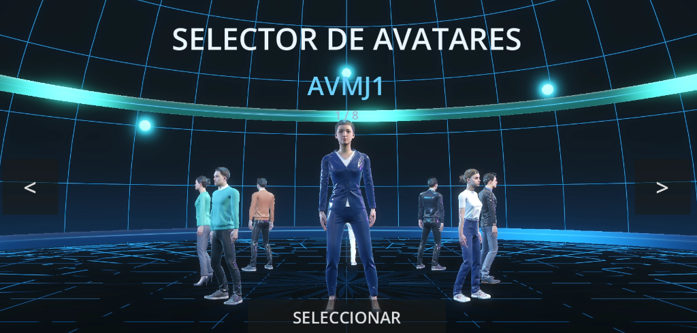
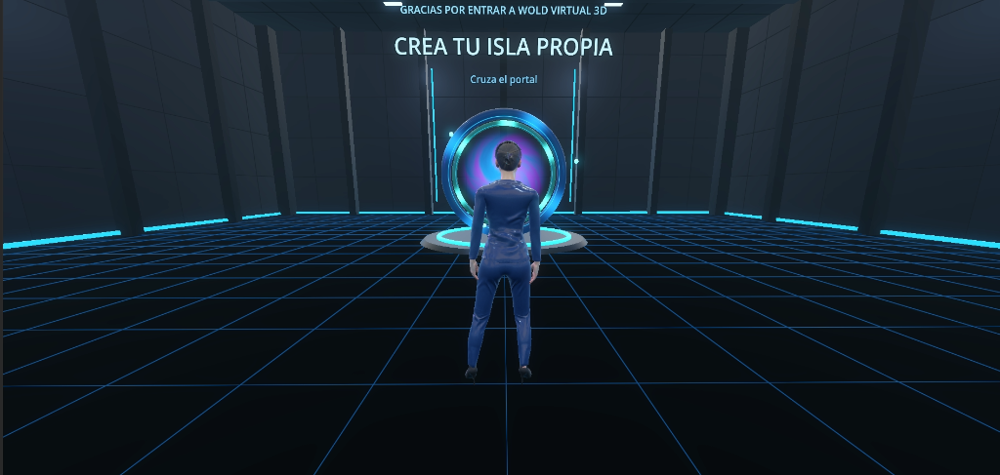
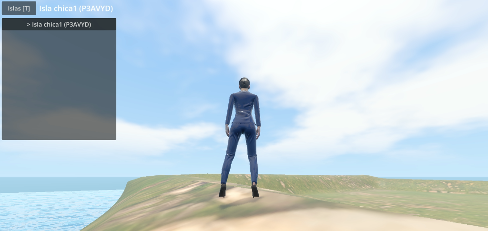

# WoldVirtualP2P3D 🌐

> **Metaverso 3D P2P Descentralizado & Sistema Cognitivo LucIA**  
> Prototipo jugable avanzado desarrollado sobre **Godot Engine 4.7.2** con arquitectura de red basada en **ENet**, orquestación modular de mundos procedurales y persistencia distribuida.

[](LICENSE)
[](https://godotengine.org)
[](#arquitectura-de-red-y-estado-del-proyecto)
[-65c2cb?logo=ipfs)](https://docs.ipfs.tech)
[)](CHANGELOG.md)

---

## 🌌 Visión General del Proyecto

**WoldVirtualP2P3D** es un prototipo técnico avanzado y demo jugable concebido para sentar los cimientos de un metaverso 3D descentralizado. A diferencia de las plataformas virtuales tradicionales dependientes de infraestructuras centralizadas propietarias, este ecosistema combina renderizado 3D de alta fidelidad, generación procedural de islas por usuario y una topología de red distribuida P2P.

El proyecto permite al jugador elegir e inspeccionar un avatar 3D animado, autenticar su identidad, recorrer un hangar espacial cyberpunk, cruzar un portal dimensional de transición y adentrarse en un archipiélago de islas procedurales donde interactuar y sincronizarse con otros usuarios.

---

## 🎮 Guía de Inicio Rápido y DEMO Jugable

### 1. Requisitos del Sistema
- **Motor:** [Godot Engine 4.7.2](https://godotengine.org) (Forward+, Jolt Physics, soporte Vulkan / D3D12).
- **Entorno de ejecución:** Windows / Linux.
- **Acceso a la Demo:** Carpeta local `DEMO_Wold_Virtual_P2P_3D__actualizacion_b5592aff` o paquete adjunto en [GitHub Releases v0.0.01_actualizacion_b5592aff](https://github.com/Chicook/WoldVirtualP2P3D/releases/tag/v0.0.01_actualizacion_b5592aff).

### 2. Puesta en Marcha
* **Método Automatizado (Recomendado en Windows):**  
  Ejecutar `Iniciar_Demo_Godot.bat`. Este script inicia Godot y, tras cerrar la sesión, ejecuta una limpieza de archivos temporales y cachés huérfanas (`limpiar_cache_godot.ps1`) para mantener el repositorio ligero.
* **Desde el Editor de Godot:**  
  1. Abre **Godot Engine 4.7.2**.
  2. Selecciona **Importar** y localiza el archivo `project.godot` de la demo.
  3. Presiona <kbd>F5</kbd> (o el botón **Ejecutar** ▶) para iniciar el ciclo desde `Boot.gd`.

---

## 🚀 Experiencia Jugable: Fases de la Simulación

La experiencia se estructura como una máquina de estados secuencial y fluida que guía al usuario desde la personalización hasta la convergencia en el metaverso:

```
[1. Selector 3D de Avatares] ──► [2. Registro de Nick] ──► [3. Hangar Cyberpunk]
                                                                  │
                                                      [4. Portal Dimensional]
                                                                  │
                                                                  ▼
[7. Panel de Islas y Teletransporte] ◄── [6. Réplica P2P] ◄── [5. Isla Procedural]
```

### 1. Selector 3D de Ocho Avatares (Carrusel Holográfico)

* Entorno interactivo circular bajo una cúpula cyberpunk con iluminación focal.
* Carrusel 3D para alternar en tiempo real entre **ocho modelos de avatares antropomórficos animados** (4 personajes femeninos `AVMJ1..4` y 4 masculinos `AVH1..4`).
* Previsualización de poses de reposo (*idle*) y ciclos de movimiento antes de pulsar **SELECCIONAR**.

### 2. Registro de Identidad del Jugador
<p align="center">
  
</p>

* Previsualización frontal y dinámica del avatar seleccionado sobre pedestal mediante un `SubViewport` 3D en tiempo real.
* Formulario de ingreso para el **Nick de usuario** (mínimo 3 caracteres), guardando la identidad de forma estructurada en `user://registro.cfg`.

### 3. Hangar Espacial Cyberpunk

* Zona de despliegue ambientada en una estación interestelar industrial con suelo de rejilla cibernética, bruma volumétrica y reflejos metálicos.
* Área de control inicial donde el usuario toma dominio del avatar humanoide, cámara orbital y físicas de colisión.

### 4. Portal Dimensional
* Estructura anular de energía en el núcleo del hangar que actúa como frontera física y de red.
* Al atravesar a pie el campo de energía del portal, el sistema activa automáticamente la transición hacia la red del metaverso y la asignación del espacio insular.

### 5. Isla Procedural, Océano y Atmósfera Dinámica

* El jugador aparece en su propia parcela insular procedural generada dentro de una rejilla serpentina (chunks de 199,5 m).
* Entorno equipado con simulación de océano, cielo dinámico con dispersión atmosférica y cartel superior flotante indicativo de la isla (`Isla {nick} ({uuid6})`).
* **Cámara orbital en tercera persona** reactiva con amortiguación suave y función de reajuste automático (`snap_camera`).

### 6. Visualización y Sincronización de Otros Jugadores
* Renderizado simultáneo de nodos remotos conectados a la sesión.
* Cada jugador visualiza a los demás participantes con su modelo exacto de avatar, placa flotante de nombre (*nametag* orientada a cámara) y reproducción sincronizada de estados de locomoción (parado, caminar, correr, salto/aire).

### 7. Panel de Islas y Teletransporte
* Menú interactivo HUD accesible mediante la tecla <kbd>T</kbd> o botón en pantalla.
* Despliega la lista de todas las islas activas en la sesión con sus respectivos dueños y coordenadas.
* Permite **teletransporte instantáneo** entre diferentes islas del archipiélago virtual.

---

## ⌨️ Controles de Navegación

| Acción | Control / Tecla |
|---|---|
| **Caminar / Desplazamiento** | Teclas de dirección (<kbd>↑</kbd> <kbd>↓</kbd> <kbd>←</kbd> <kbd>→</kbd>) o <kbd>W</kbd> <kbd>A</kbd> <kbd>S</kbd> <kbd>D</kbd> |
| **Correr (Sprint)** | <kbd>AltGr</kbd> + **Flecha Arriba** (<kbd>↑</kbd>) |
| **Órbita de Cámara** | Movimiento del ratón (sensibilidad y retardo suavizado) |
| **Panel de Islas** | Tecla <kbd>T</kbd> o botón **Islas [T]** |
| **Teletransporte** | Abrir panel (<kbd>T</kbd>), elegir destino (`> Isla {nick} ({uuid})`) y pulsar para saltar |

---

## 🏗️ Arquitectura de Red y Estado del Proyecto

> **Clasificación actual:** Prototipo funcional avanzado y demo técnica jugable.  
> La capa de red se encuentra actualmente calibrada para **pruebas de conectividad local mediante ENet** (múltiples instancias sobre loopback/puerto `8910`), garantizando la estabilidad del ciclo de juego antes de escalar al plano de red abierta y persistencia distribuida.

### 🟢 Funcionalidades Implementadas (En Producción / Demo Jugable)
- [x] **Motor gráfico y de físicas:** Ejecución nativa sobre **Godot Engine 4.7.2** con Jolt Physics.
- [x] **Selector 3D:** Carrusel interactivo con 8 avatares animados.
- [x] **Gestión de identidad:** Registro local de nick en `user://registro.cfg` e inyección de datos de perfil en el nodo.
- [x] **Entornos 3D:** Hangar cyberpunk, portal energético dimensional y terreno insular procedural.
- [x] **Sombreadores ambientales:** Shader de agua para el océano y cielo atmosférico dinámico.
- [x] **Sincronización Multijugador Local (ENet):** Conexión multijugador local en puerto `8910` con replicación precisa de posiciones, rotaciones, animaciones de locomoción (`PlayerSync.gd`) y placas de nombre (*nametags*).
- [x] **Sistema de Chunks & Teletransporte:** Rejilla serpentina de islas (`ChunkManager.gd`) y panel funcional de teletransporte instantáneo entre parcelas.

### 🟡 Funcionalidades Parcialmente Integradas (En Validación)
- [x] **Topología P2P básica:** Inicialización de sockets y handshakes entre pares locales.
- [x] **Asignación de parcelas:** Registro en memoria de `island_owners` y reclamación de sectores (`_claim_island`).
- [x] **Daemon IPFS Kubo:** Scripts de arranque local de Kubo RPC (`127.0.0.1:5001`) preparados en el subsistema auxiliar.

### 🔴 Funcionalidades Pendientes y Hoja de Ruta (En Desarrollo)
- [ ] **Conexión LAN y WAN (Internet Abierto):** Soporte para NAT Traversal, STUN/TURN o señalización P2P directa entre máquinas en redes externas y pasarelas de conexión no locales.
- [ ] **Persistencia de Islas en IPFS:** Serialización del delta de modificaciones de terreno (`isla_{index}.json`) y sincronización automática vía CIDs inmutables en IPFS.
- [ ] **Editor de Terrenos In-Game:** Herramienta interactiva para que cada usuario pueda deformar, esculpir, pintar y construir (*props*) en su propia parcela en tiempo real.
- [ ] **Personalización mediante Shape Keys (Morph Targets):** Integración de morph targets de Blender en las mallas de los avatares para ajuste de rasgos faciales y complexión física.
- [ ] **Asignación de Avatares Únicos:** Lógica de exclusión de catálogo (`owner_uuid`) para impedir duplicidad de apariencias entre usuarios en una misma sala.
- [ ] **Visor C# de Alto Rendimiento:** Desarrollo del visor complementario basado en C# (.NET) para optimizar la paralelización de cálculos procedurales y red.

---

## 🧠 Núcleo Cognitivo LucIA (Subsistema de Inteligencia Conectado)

El ecosistema integra de forma paralela el núcleo cognitivo **LucIA**, una plataforma distribuida de computación neuronal, consenso PoNL (*Proof of Neural Learning*) y asistencia cognitiva:
- **Red Neuronal Distribuida:** 50 neuronas activas (`ENRN`, `RF_SL`, `RF_EN`, `RNP`, `SLRN`) con cálculo de tensores y entropía.
- **Blockchain PoNL:** Registro inmutable de transacciones y estados de sesión (`BKSVCB.py`).
- **Inferencia Híbrida:** Soporte para modelos locales (Ollama/LM Studio) y catálogo remoto gratuito mediante `IAFREE` / OpenRouter.
- **Voz Neuronal:** Motor de síntesis juvenil con modulación DSP integrado en `voice_engine.py`.

---

## 📜 Licencia

Distribuido bajo la Licencia **MIT**. Consulta el archivo `LICENSE` para más información.
