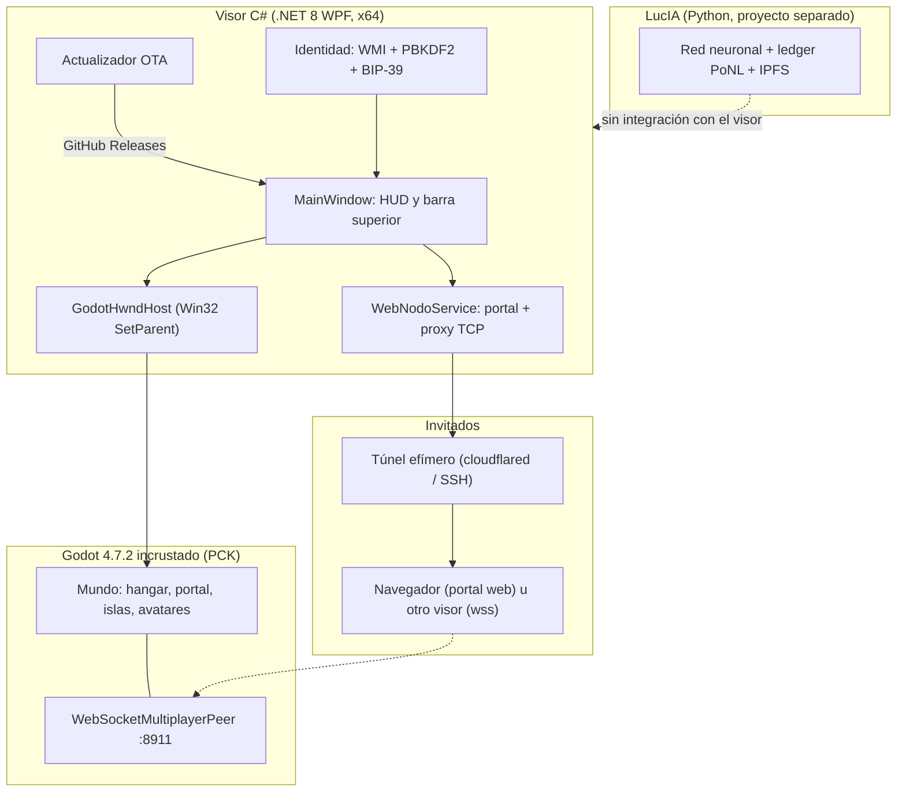
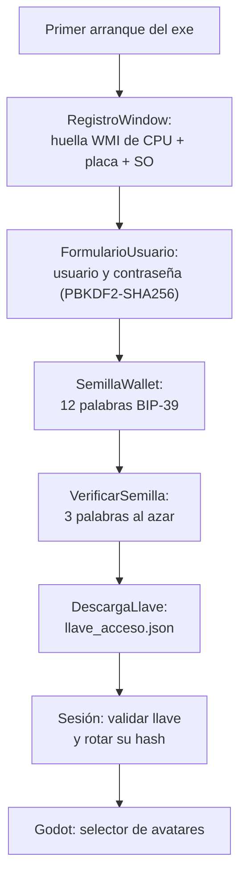
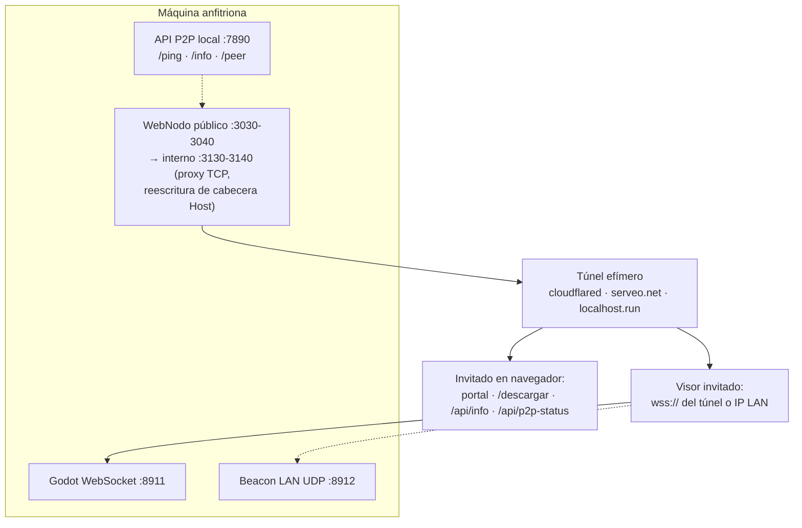
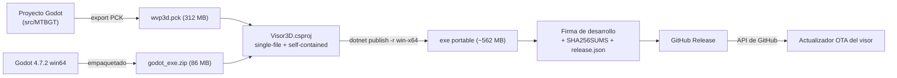

# WoldVirtualP2P3D

> **Prototipo de metaverso 3D P2P en Windows**: visor autónomo C# / WPF (.NET 8) con el motor **Godot 4.7.2** incrustado, red multiusuario por WebSocket y portal web público mediante **túneles efímeros** (Cloudflare / SSH). Incluye además, como producto separado, el subsistema cognitivo **LucIA** en Python.

[](LICENSE)
[](https://dotnet.microsoft.com)
[](https://godotengine.org)
[](https://github.com/Chicook/WoldVirtualP2P3D/releases/tag/v2.5.2)
[](#3-descarga-y-primer-arranque)
[-orange)](#1-qu%C3%A9-es-y-estado-real)

| Carrusel de avatares | Registro de jugador | Hangar y portal | Isla y P2P |
|:---:|:---:|:---:|:---:|
| [](#5-el-mundo-3d-godot) | [](#4-registro-e-identidad) | [](#5-el-mundo-3d-godot) | [](#6-red-p2p-webnodo-y-t%C3%BAneles-ef%C3%ADmeros) |

## Índice

1. [Qué es y estado real](#1-qu%C3%A9-es-y-estado-real)
2. [Mapa del repositorio](#2-mapa-del-repositorio)
3. [Descarga y primer arranque](#3-descarga-y-primer-arranque)
4. [Registro e identidad](#4-registro-e-identidad)
5. [El mundo 3D (Godot)](#5-el-mundo-3d-godot)
6. [Red P2P, WebNodo y túneles efímeros](#6-red-p2p-webnodo-y-t%C3%BAneles-ef%C3%ADmeros)
7. [Continuidad de sesión (migración de anfitrión)](#7-continuidad-de-sesi%C3%B3n-migraci%C3%B3n-de-anfitri%C3%B3n)
8. [Actualizador OTA](#8-actualizador-ota)
9. [Compilar y publicar](#9-compilar-y-publicar)
10. [LucIA: subsistema cognitivo en Python](#10-lucia-subsistema-cognitivo-en-python)
11. [Herramienta RFPRMN (CONTRRF)](#11-herramienta-rfprmn-contrrf)
12. [Calidad y pruebas](#12-calidad-y-pruebas)
13. [Hoja de ruta y deuda técnica](#13-hoja-de-ruta-y-deuda-t%C3%A9cnica)
14. [Política del repositorio](#14-pol%C3%ADtica-del-repositorio)
15. [Índice de documentación interna](#15-%C3%ADndice-de-documentaci%C3%B3n-interna)
16. [Contribuir y licencia](#16-contribuir-y-licencia)

> Convención de rutas: en este documento `src/` es la abreviatura de
> `VersionDe_sesion/Sistema_Principal/PRY/actualizacion_f7bfd9ba/src/`.
> Los enlaces son siempre rutas relativas reales del repositorio.

---

## 1. Qué es y estado real

WoldVirtualP2P3D es un **prototipo en fase alpha** de metaverso 3D para **Windows x64**. Consta de dos productos sin integración entre sí:

1. **El visor** (`src/VSC#/`): una aplicación WPF de .NET 8 que se distribuye como un único ejecutable portable autocontenido. Embebe el motor Godot 4.7.2 y un paquete del mundo 3D, los extrae en disco al primer arranque y los ejecuta incrustados en su ventana mediante Win32 (`SetParent`). Gestiona la identidad del usuario, el portal web **WebNodo**, los **túneles efímeros** públicos y el actualizador OTA.
2. **LucIA** (`src/LC_STM/` y carpetas hermanas en Python): una arquitectura cognitiva experimental (red neuronal distribuida, ledger local PoNL, integración IPFS). El visor C# **no contiene ninguna referencia a LucIA** y viceversa: son dos proyectos independientes que comparten repositorio.



**Honestidad técnica — lee esto antes de usar el proyecto:**

- Es un prototipo alpha, no un producto. Los binarios van firmados con un **certificado de desarrollo autofirmado** (Windows SmartScreen mostrará un aviso).
- Solo funciona en **Windows x64**.
- La red es **P2P solo en el transporte**: cada sesión tiene un **anfitrión con autoridad** (host-authority) y el resto de nodos se conectan a él por WebSocket. No hay replicación descentralizada sin servidor de confianza.
- La "billetera DeFi" del visor está **en construcción**: la semilla BIP-39 de 12 palabras y sus derivaciones hash son reales, pero aún no se conecta a ninguna blockchain ni gestiona fondos.
- El campo `<Version>` del [`Visor3D.csproj`](VersionDe_sesion/Sistema_Principal/PRY/actualizacion_f7bfd9ba/src/VSC%23/Visor3D.csproj) versionado quedó en `0.1.0`, mientras que el binario publicado vigente es **v2.5.2** (construido a partir del mismo árbol con el número de versión de la sesión de publicación). Ambos datos se documentan tal cual son.

### Estado de las capacidades

| Capacidad | Estado | Dónde está en el código |
|---|---|---|
| Visor WPF con Godot incrustado (Win32) | Implementado | [`src/VSC#/GodotHwndHost.cs`](VersionDe_sesion/Sistema_Principal/PRY/actualizacion_f7bfd9ba/src/VSC%23/GodotHwndHost.cs) |
| Extracción del runtime embebido al primer arranque | Implementado | [`src/VSC#/AppExtractor.cs`](VersionDe_sesion/Sistema_Principal/PRY/actualizacion_f7bfd9ba/src/VSC%23/AppExtractor.cs) |
| Identidad: huella de hardware WMI + PBKDF2 + BIP-39 | Implementado | [`src/VSC#/Seguridad/PasswordHasher.cs`](VersionDe_sesion/Sistema_Principal/PRY/actualizacion_f7bfd9ba/src/VSC%23/Seguridad/PasswordHasher.cs), ventanas `*Window.xaml.cs` |
| Mundo 3D: 8 avatares, hangar, portal, islas procedurales | Implementado | [`src/MTBGT/WoldVirtualP2P3D/`](VersionDe_sesion/Sistema_Principal/PRY/actualizacion_f7bfd9ba/src/MTBGT/WoldVirtualP2P3D) |
| Red multiusuario WebSocket (autoridad de anfitrión) | Implementado | [`src/MTBGT/WoldVirtualP2P3D/gdscrip/ChunkManager.gd`](VersionDe_sesion/Sistema_Principal/PRY/actualizacion_f7bfd9ba/src/MTBGT/WoldVirtualP2P3D/gdscrip/ChunkManager.gd), `PlayerSync.gd` |
| Descubrimiento LAN por beacon UDP | Implementado, sin prueba real | `ChunkManager.gd` (beacon `:8912`) |
| WebNodo: portal HTTP + proxy TCP | Implementado | [`src/VSC#/Services/WebNodoService.cs`](VersionDe_sesion/Sistema_Principal/PRY/actualizacion_f7bfd9ba/src/VSC%23/Services/WebNodoService.cs) |
| Túneles efímeros (cloudflared / serveo / localhost.run) | Implementado | [`src/VSC#/p2pipfsCS/EphemeralTunnelRunner.cs`](VersionDe_sesion/Sistema_Principal/PRY/actualizacion_f7bfd9ba/src/VSC%23/p2pipfsCS/EphemeralTunnelRunner.cs), [`src/VSC#/RedP2P/P2PTunnelManager.cs`](VersionDe_sesion/Sistema_Principal/PRY/actualizacion_f7bfd9ba/src/VSC%23/RedP2P/P2PTunnelManager.cs) |
| Migración de anfitrión | Implementado, sin prueba real | `MainWindow.xaml.cs` (`ComprobarHostMigrado`) |
| Actualizador OTA (SHA-256, reanudación) | Implementado | [`src/VSC#/STM_actualizar/`](VersionDe_sesion/Sistema_Principal/PRY/actualizacion_f7bfd9ba/src/VSC%23/STM_actualizar/UpdateChecker.cs) |
| LucIA: red neuronal, ledger PoNL, IPFS | Parcial (ver [§10](#10-lucia-subsistema-cognitivo-en-python)) | `src/LC_STM/`, `src/SBSTM/`, `src/STM_BKCH/`, `src/STMIPFS/` |
| Integración visor ↔ LucIA | Fuera del repo (no existe) | 0 referencias cruzadas entre ambos |
| Economía / token WCVcoin | Fuera del repo | Solo un nombre de carpeta en `P2PWebNode.cs` |
| CI (integración continua) | Roto (ver [§12](#12-calidad-y-pruebas)) | `src/STM_HRTS/.github/workflows/ci.yml` |

---

## 2. Mapa del repositorio

El repositorio versiona **425 ficheros** (~133 MiB de contenido; una clonación fresca ocupa ~175 MiB). Por lenguajes: **35.965 líneas de Python** (120 ficheros), **7.303 líneas de C#** (29), **2.697 líneas de GDScript** (16) y **1.255 líneas de XAML** (7).

### Modelo de versionado

El código fuente vive bajo `VersionDe_sesion/Sistema_Principal/PRY/actualizacion_<id>/src/`. Cada carpeta `actualizacion_<id>` es una **instantánea** generada por la herramienta interna RFPRMN (ver [§11](#11-herramienta-rfprmn-contrrf)). Actualmente existe **una sola instantánea: `actualizacion_f7bfd9ba`**, que es la activa.

```
WoldVirtualP2P3D/
├── .agents/rules/              # Reglas para asistentes de IA
├── .vercel/ .vercelignore      # Resto de una herramienta de despliegue (pendiente de limpiar)
├── .gitattributes .gitignore   # Configuración de Git
├── AGENTS.md GEMINI.md         # Directivas para asistentes de código
├── LICENSE                     # MIT
├── README.md                   # Este documento
├── purgar_repositorio.ps1      # Script de mantenimiento del autor
├── borrar_packs_viejos.ps1     # Script de mantenimiento del autor
├── test_user_data/             # Datos locales de sesión (ignorado por Git)
└── VersionDe_sesion/
    ├── CONTRRF/                # Herramienta RFPRMN (STM_RFC + TLLDCD)
    └── Sistema_Principal/
        └── PRY/
            └── actualizacion_f7bfd9ba/
                └── src/
                    ├── VSC#/      # Visor C# (.NET 8 WPF)
                    ├── MTBGT/     # Mundo Godot 4.7.2
                    ├── LC_STM/    # Red neuronal LucIA
                    ├── SBSTM/     # Módulos LucIA
                    ├── STMGNRL/   # Orquestador LucIA
                    ├── STM_BKCH/  # Ledger PoNL
                    ├── STMIPFS/   # Integración IPFS
                    ├── STM_IA/    # Conocimiento / IA
                    ├── STM_JSON/  # Utilidades JSON
                    ├── STM_SGR/   # Vault de credenciales
                    ├── STM_HRTS/  # Manifiesto y registro
                    ├── STM_DOC/   # Documentación (incluye capturas)
                    ├── STM_CH/    # Artefactos de ejecución (pendiente de limpiar)
                    ├── tests/     # Pruebas pytest
                    ├── HOJA_DE_RUTA.md  README_DESARROLLO.md  ref_info.md
                    └── pytest.ini
```

### Módulos

| Carpeta | Rol | Lenguaje | Nº ficheros | Estado |
|---|---|---|---:|---|
| `src/VSC#/` | Visor WPF: identidad, HUD, Godot incrustado, WebNodo, túneles, actualizador | C# + XAML | 44 | Implementado |
| `src/MTBGT/` | Proyecto Godot: escenas, 8 avatares glTF, shaders, scripts de red | GDScript + escenas | 212 | Implementado |
| `src/LC_STM/` | Red neuronal distribuida de LucIA (5 familias de neuronas) | Python | 60 | Parcial (pesos no publicados) |
| `src/SBSTM/` | Módulos LucIA: IA local/remota, voz, memoria, emoción | Python | 23 | Parcial |
| `src/STMGNRL/` | Orquestador de LucIA (`mainLCSTM.py`) | Python | 2 | Implementado, sin prueba real |
| `src/STM_BKCH/` | Blockchain local PoNL (`BKSVCB.py`) | Python | 4 | Implementado (ledger local) |
| `src/STMIPFS/` | Subida/respaldo de pesos a IPFS (CLI Kubo) | Python + BAT | 6 | Parcial (sin daemon real) |
| `src/STM_IA/` | Base de conocimiento y gestor de IA local | Python + Markdown | 10 | Parcial |
| `src/STM_JSON/` | Utilidades de registro JSON | Python + JSON | 4 | Implementado |
| `src/STM_SGR/` | Vault de credenciales OpenRouter | Python | 1 | Implementado |
| `src/STM_HRTS/` | Manifiesto `pyproject.toml` del proyecto LucIA + registro | TOML + Python + YAML | 3 | Implementado |
| `src/STM_DOC/` | Documentación y capturas del sistema | Markdown + PNG | 7 | Documentación |
| `src/STM_CH/` | Artefactos de ejecución de LucIA (ledger, memorias, datastore) | Datos | 13 | Pendiente de limpieza |
| `src/tests/` | Pruebas pytest de LucIA | Python | 10 | Implementado |
| `VersionDe_sesion/CONTRRF/` | Herramienta RFPRMN + taller aislado TLLDCD | Python | 11 | Implementado |

**Sobre las siglas**: `VSC#`, `MTBGT`, `SBSTM`, `STM_*`, `CONTRRF` y `TLLDCD` son nombres internos del autor; el repositorio **no expande ninguno de estos acrónimos**, así que quedan como "sin documentar". Sus roles en la tabla provienen del contenido verificado de cada carpeta, no de ninguna fuente externa.

---

## 3. Descarga y primer arranque

### Descarga

- **Release vigente**: [v2.5.3](https://github.com/Chicook/WoldVirtualP2P3D/releases/tag/v2.5.3) — marcada como *Latest*. Nació del renombrado del tag `v2.5.2`, así que la ruta `.../download/v2.5.2/…` responde **404** y todo binario debe referenciarse bajo `.../download/v2.5.3/…`.
- **Ejecutable recomendado**: [`DMWoldVirtualp2pCNXv2.5.3__actualizacion_f7bfd9ba.exe`](https://github.com/Chicook/WoldVirtualP2P3D/releases/download/v2.5.3/DMWoldVirtualp2pCNXv2.5.3__actualizacion_f7bfd9ba.exe) — **561.984.817 bytes (≈536 MiB)**, portable, autocontenido. SHA-256 `9953720dde5a67a5520c109baed5df517a4f24396c7d1c1a94cdc02cbc2cdbbe` (verificado el 2026-10-22 contra el digest que publica GitHub).
- La release incluye también un ZIP demo del mundo 3D, el descriptor `release.json` y el fichero `SHA256SUMS`, además de ejecutables históricos de versiones anteriores —entre ellos el de `v2.5.2`, que sigue publicado bajo esta misma etiqueta.

**Requisitos**: Windows 10/11 x64. El ejecutable es autocontenido (incluye el runtime de .NET 8, el motor Godot y el mundo 3D): no hay nada que instalar, no necesita permisos de administrador y no escribe en el registro.

**Aviso de SmartScreen**: el binario lleva una firma de desarrollo autofirmada, no un certificado de distribución. Al ejecutarlo por primera vez, Windows puede mostrar "Windows protegió tu equipo" → *Más información* → *Ejecutar de todas formas*.

**Verificación**: descarga `SHA256SUMS` de la misma release y comprueba el digest. Desde el 2026-10-22 `SHA256SUMS` y `release.json` están alineados con el binario v2.5.3; históricamente estuvieron desalineados (apuntaban al binario `v0.3`, ver [§8](#8-actualizador-ota)), así que conviene comprobar que el `exe` declarado en `release.json` coincide con la primera línea de `SHA256SUMS`.

### Qué ocurre al arrancarlo

1. El visor se valida a sí mismo y muestra el flujo de identidad (ver [§4](#4-registro-e-identidad)).
2. En el primer arranque extrae sus recursos embebidos en `%LOCALAPPDATA%\WoldVirtualP2P3D\runtime\<versión>\` (medido: **≈470 MiB** en disco por versión). El marcador que decide si hay que re-extraer es la **versión del ensamblado** (`AssemblyInformationalVersion`), no una constante a mano: así un OTA que cambia el `wvp3d.pck` embebido fuerza la re-extracción del mundo. La variable de entorno `WOLD_RUNTIME_DIR` permite redirigir la extracción.
3. Lanza el motor Godot incrustado y activa en segundo plano la API P2P local y el WebNodo.

**Limitaciones conocidas**: cada versión publicada extrae su propia carpeta de runtime (no hay limpieza automática de versiones antiguas); el primer arranque tarda unos segundos por la extracción, y **el primer arranque tras un OTA también vuelve a extraer ~470 MiB**. Antes de esta corrección el marcador estaba congelado en `0.1.0`, de modo que todas las versiones compartían `runtime\0.1.0\` y el mundo actualizado por OTA no llegaba a disco.

---

## 4. Registro e identidad

Hay **dos registros distintos**: el del visor (identidad y llave de acceso, en C#) y el del jugador dentro del mundo (avatar y nick, en Godot). Ambos se describen paso a paso.

### 4.1 Registro en el visor (primer arranque)



1. **Huella de hardware** (`RegistroWindow`): el visor consulta WMI (`Win32_OperatingSystem`, `Win32_BaseBoard`, `Win32_Processor`) y calcula un hash SHA-256 que identifica la máquina.
2. **Usuario y contraseña** (`FormularioUsuarioWindow`): la contraseña se procesa con **PBKDF2-SHA256, 210.000 iteraciones** y sal aleatoria de 16 bytes (`PasswordHasher.cs`, comparación en tiempo constante). Se guardan `user_profile.json` y `credentials.json` en la carpeta de datos del usuario (en desarrollo, `test_user_data/user/`).
3. **Frase semilla** (`SemillaWalletWindow`): se generan **12 palabras BIP-39 reales** (lista oficial de 2.048 palabras embebida como recurso del ejecutable, con checksum). **Apúntalas y guárdalas**: es tu única vía de respaldo. La cartera está en construcción: aún no gestiona fondos ni se conecta a ninguna blockchain.
4. **Verificación** (`VerificarSemillaWindow`): el visor pide 3 palabras aleatorias de la semilla para confirmar que la respaldaste.
5. **La llave** (`DescargaLlaveWindow`): se genera `llave_acceso.json`, el fichero maestro de acceso. Cada vez que inicies sesión, el visor valida la llave y **rota su hash** (SHA-256 sobre hash anterior + GUID + marca de tiempo), lo que impide usar copias duplicadas de la misma llave.
6. Las credenciales heredadas en SHA-256 plano se **migran de forma transparente** a PBKDF2 al iniciar sesión (formato versionado `hashVersion: 2`).

### 4.2 Registro del jugador dentro del mundo

Sigue el orden de las capturas de la cabecera:

1. **Selector de avatares** — pantalla `SELECTOR DE AVATARES` con el contador `1 / 8`. Usa **← →** para rotar el carrusel circular de **8 modelos antropomórficos animados** (4 femeninos `AVMJ1..4` y 4 masculinos `AVH1..4`, en ese orden de aparición) y confirma con **ENTER**. Cada avatar gira sobre su pedestal.
2. **Registro de jugador** — pantalla `REGISTRO DE JUGADOR` con tu avatar previsualizado en 3D. Escribe tu **nick** (mínimo 3 caracteres) y pulsa **Confirmar**. Se guarda en `user://registro.cfg` (sección `[jugador]`: nick + escena de avatar) y se calcula un hash SHA-256 (nick | avatar | tiempo) en `avatar_hash.json`.
3. **Hangar** — aparece `GRACIAS POR ENTRAR A WOLD VIRTUAL 3D` / `CREA TU ISLA PROPIA`. Camina con **WASD** hasta el **portal dimensional** (anillo de energía).
4. **Cruza el portal** → pantalla de carga → aterrizas en tu **isla procedural propia** en el archipiélago, bautizada `Isla <tu-nick> (<uuid>)`. Con **T** abres el panel de islas para teletransportarte; los demás jugadores conectados aparecen con su *nametag*.
5. **Siguientes arranques**: si `registro.cfg` existe, el mundo salta directamente al hangar y no repite el registro.

### 4.3 Invitar a otras personas (prueba de túneles)

Con la sesión 3D abierta, el botón **🌐 WebNodo** de la barra superior levanta un **túnel efímero público** y copia al portapapeles una URL tipo `https://xxx.trycloudflare.com/?host=...`. Tus contactos pueden:

- abrirla en el **navegador** (portal web: estado del nodo y descarga del visor), o
- usar **su propio visor** y conectarse por `wss://` a tu túnel para aparecer en tu isla.

Detalles completos de puertos y proveedores en [§6](#6-red-p2p-webnodo-y-t%C3%BAneles-ef%C3%ADmeros).

**Limitaciones conocidas**: DPAPI se descartó a propósito (la llave debe ser portable); la rotación de llave aún no usa escritura atómica (deuda D10 parcial, ver [§13](#13-hoja-de-ruta-y-deuda-t%C3%A9cnica)).

---

## 5. El mundo 3D (Godot)

Motor **Godot 4.7.2** con renderer **Forward+** sobre **D3D12** y física **Jolt** (configuración en [`src/MTBGT/WoldVirtualP2P3D/project.godot`](VersionDe_sesion/Sistema_Principal/PRY/actualizacion_f7bfd9ba/src/MTBGT/WoldVirtualP2P3D/project.godot)). Escena principal: `WoldVirtual3DP2P.tscn`, orquestada por [`gdscrip/Boot.gd`](VersionDe_sesion/Sistema_Principal/PRY/actualizacion_f7bfd9ba/src/MTBGT/WoldVirtualP2P3D/gdscrip/Boot.gd), que implementa la máquina de estados:

```
carrusel de avatares → registro de nick → hangar / zona de portal → carga → isla
```

### Contenido verificado

| Elemento | Dato | Fuente |
|---|---|---|
| Avatares | 8 (4 `AVMJ*` femeninos + 4 `AVH*` masculinos), glTF + bin, con escena `Ch3D.tscn` cada uno | `gltfimport/avatares/` |
| Isla / terreno | Chunks de **199,5 m**, **10 islas por fila** en rejilla serpentina, malla glTF compartida | `ChunkManager.gd`, `gltfimport/terrenoblok/` |
| Shaders | 7 propios: `OCEANO`, `cielo_nubes`, `cupula_panel`, `grid_floor`, `hangar_panel`, `portal_energy`, `portal_ring` | `ESCENAS/…/shaders/` (`*.gdshader`) |
| Sincronización de jugadores | **10 Hz** (intervalo 0,1 s), RPCs con autoridad de anfitrión | `gdscrip/PlayerSync.gd` |
| Panel de islas | Tecla **T**, teletransporte instantáneo entre parcelas | `gdscrip/TeleportPanel.gd` |
| Addon | `limpiar_cache` | `project.godot` |

Nota: `Boot.gd` contiene un comentario antiguo que habla de "3 chicas / 3 chicos"; el contenido real del carrusel son los **8 avatares** listados arriba.

### Controles

| Acción | Control |
|---|---|
| Caminar | **W A S D** o flechas |
| Correr (sprint) | **AltGr** |
| Órbita de cámara | Botón derecho del ratón + movimiento |
| Panel de islas / teletransporte | **T** |
| Confirmar avatar en el carrusel | **ENTER** |

**Limitaciones conocidas**: las fuentes de Blender (`.blend`) de los avatares no se versionan; solo hay un `.blend` de prueba (`hm1.blend`). El pipeline documentado es "modelado en Blender → exportación glTF a `gltfimport/` → importación en Godot" y reconstruir los modelos exige las fuentes originales del autor.

---

## 6. Red P2P, WebNodo y túneles efímeros

La sesión tiene un **anfitrión** (host) con autoridad y **invitados** que se conectan a él. El transporte es directo (WebSocket TCP), sin servidor de juego central; el único servicio en la nube es el **túnel efímero** opcional que publica el WebNodo del anfitrión.

> Contexto histórico: un prototipo anterior usaba **ENet UDP en el puerto 8910**; fue descartado y sustituido por WebSocket. El puerto 8910 no se usa.

### Puertos

| Puerto | Protocolo | Servicio | Rutas / uso |
|---:|---|---|---|
| **7890** | HTTP | API P2P local del visor | `/ping`, `/info`, `/peer` |
| **3030–3040** | HTTP | WebNodo público (proxy TCP externo) | Portal de invitados |
| **3130–3140** | HTTP | `HttpListener` interno (WebNodo real) | Sirve el portal y la API |
| **8911** | WebSocket (TCP) | Red del motor Godot | `WebSocketMultiplayerPeer` |
| **8912** | UDP | Beacon de descubrimiento LAN | Difusión `255.255.255.255`, cada 2 s |

### Cómo funciona



- **WebNodo** ([`Services/WebNodoService.cs`](VersionDe_sesion/Sistema_Principal/PRY/actualizacion_f7bfd9ba/src/VSC%23/Services/WebNodoService.cs)): un `HttpListener` interno sirve el portal (`webnodo/public/index.html`, embebido también en el exe) y una API. Un **proxy TCP transparente** delante reescribe la cabecera `Host` en tiempo real para que las peticiones del túnel no sean rechazadas.
- **Endpoints del portal**: `/` y `/index.html`, `/metaverso.jpg`, `/descargar` (descarga del visor), `/api/info` y `/api/p2p-status` (estado del nodo). La API exige un **token por sesión**; hay límites por IP de 120 req/min en `/api/*` y 3 descargas/min ([`Services/RateLimiter.cs`](VersionDe_sesion/Sistema_Principal/PRY/actualizacion_f7bfd9ba/src/VSC%23/Services/RateLimiter.cs)).
- **Túneles efímeros** ([`p2pipfsCS/EphemeralTunnelRunner.cs`](VersionDe_sesion/Sistema_Principal/PRY/actualizacion_f7bfd9ba/src/VSC%23/p2pipfsCS/EphemeralTunnelRunner.cs)): el proveedor principal es **cloudflared** (Quick Tunnel, URLs `*.trycloudflare.com` sin cuenta ni configuración); si no está disponible cae a **SSH inverso** con `serveo.net` o `localhost.run` ([`RedP2P/P2PTunnelManager.cs`](VersionDe_sesion/Sistema_Principal/PRY/actualizacion_f7bfd9ba/src/VSC%23/RedP2P/P2PTunnelManager.cs)). No hay que abrir puertos en el router.
- **Enlace de invitación**: `https://<túnel>/?host=<raíz>`; el visor invitado normaliza la URL y converge al mismo anfitrión.
- **Descubrimiento LAN**: el anfitrión difunde un beacon UDP en `255.255.255.255:8912` cada 2 s con la cadena `WOLDVIRTUAL_HOST_WS_8911`; los visores de la misma red pueden unirse sin túnel usando la IP local.

**Limitaciones conocidas**: la URL del túnel es efímera (cambia en cada sesión); la sincronización depende por completo del anfitrión (ver [§7](#7-continuidad-de-sesi%C3%B3n-migraci%C3%B3n-de-anfitri%C3%B3n)). El análisis de diseño más detallado está en [`src/VSC#/README_TUNELES_P2P.md`](VersionDe_sesion/Sistema_Principal/PRY/actualizacion_f7bfd9ba/src/VSC%23/README_TUNELES_P2P.md).

---

## 7. Continuidad de sesión (migración de anfitrión)

Si el anfitrión cae, la sesión no se pierde: los nodos acuerdan un nuevo anfitrión entre los conectados.

```mermaid
sequenceDiagram
    participant H as Anfitrión actual
    participant A as Nodo A (orden menor)
    participant B as Nodo B
    Note over H,A,B: Roster replicado en cada nodo: peer_id, orden, nick, IP LAN y URL pública
    H -->> A: (el anfitrión se detiene)
    A->>A: Polling de session_host.txt cada 4 s (ComprobarHostMigrado)
    A->>A: Elección determinista: menor orden → Nodo A
    A->>B: Nuevo roster con Nodo A como anfitrión
    B->>A: Reconexión por wss:// (o IP LAN :8911)
    Note over A,B: Re-rooting del enlace ?host= a la URL del nuevo anfitrión
```

Implementado en `MainWindow.xaml.cs` (`ComprobarHostMigrado`) y `ChunkManager.gd` (roster y elección):

- **Roster replicado**: cada nodo conoce `peer_id`, orden, nick, IP LAN y URL pública del WebNodo de los demás.
- **Elección determinista**: gana el nodo con **menor orden**; nadie más se proclama anfitrión.
- **Reconexión**: los invitados se reconectan por `wss://` a la URL del elegido, con *fallback* a la IP LAN.
- **Re-rooting del enlace**: el enlace `?host=` se reescribe vía `session_host.txt`.
- **Islas**: se reconstruyen desde `TeleportManager` y cada nodo reclama su `my_own_index` sin duplicados.

**Estado: implementado, sin prueba real.** El plan original exige una prueba con 3 instancias y muerte del anfitrión que no consta como ejecutada (ver [`HOJA_DE_RUTA.md`](VersionDe_sesion/Sistema_Principal/PRY/actualizacion_f7bfd9ba/src/HOJA_DE_RUTA.md), fase F7).

---

## 8. Actualizador OTA

El visor incorpora un actualizador contra las Releases de GitHub, repartido en tres clases de [`src/VSC#/STM_actualizar/`](VersionDe_sesion/Sistema_Principal/PRY/actualizacion_f7bfd9ba/src/VSC%23/STM_actualizar/UpdateChecker.cs):

- **`UpdateChecker`**: consulta la API de GitHub (`/repos/{repo}/releases`), elige de cada release el `.exe` de mayor versión (la versión real puede estar en el nombre del fichero, no sólo en el tag) y compara SemVer con la local. Prioriza estables sobre *prereleases*. Expone `GetLatestReleaseAsync()` (la release vigente sin filtrar por la versión local), que es la que consume el portal WebNodo.
- **`UpdateDownloader`**: descarga el binario por rangos HTTP (**reanudación** con fichero `.part`), **verifica el SHA-256** contra el digest de la API antes de aplicar y comprueba permisos de escritura de la carpeta con antelación.
- **`UpdateApplier`**: aplica la actualización con `apply-pending.bat` y mantiene el estado en `state.json` con **escritura atómica**.

El botón de la barra superior muestra los estados `Buscando · Al día · Actualizar vX.Y.Z · Descargando % · Reiniciando · Error/Reintentar`, con una barra de progreso de 2 px en el borde inferior (nunca sobre el viewport 3D).

**El portal WebNodo ya no depende de un `release.json` empaquetado.** Antes leía ese fichero del disco, junto al `.exe`, y como el OTA sólo reemplaza el binario, el portal seguía anunciando la versión antigua —y su URL, obsoleta, cortaba en un 404. Ahora, al arrancar el nodo, `WebNodoService.RefrescarReleaseVigente()` consulta GitHub con el **mismo** `UpdateChecker` que el botón, de modo que ambos anuncian exactamente el mismo binario; si la consulta falla, se queda con el `release.json` local o el *fallback* cableado. En `/descargar`, si el `.exe` en ejecución es la release vigente se sirve directamente ése, en vez de una copia empaquetada que queda obsoleta al actualizar.

**Situación actual del canal**: el OTA está **verificado en funcionamiento** — el registro de `%LOCALAPPDATA%\WoldVirtualP2P3D\update_debug.log` muestra un ciclo real `0.3.0 → 2.5.2` detectado, descargado, aplicado y relanzado. Lo que estuvo roto era el descriptor publicado: el `release.json` de la release apuntaba al binario `v0.3` bajo una ruta que no existe en esa release (404). El 2026-10-22 se subió el binario v2.5.3 y se regeneraron `release.json` y `SHA256SUMS` alineados con él.

**Pendiente** (fase F3 de la hoja de ruta): canal estable/beta, *changelog* en el tooltip y la espera controlada del `apply-pending.bat`.

---

## 9. Compilar y publicar

### Propiedades de compilación

Definidas en [`src/VSC#/Visor3D.csproj`](VersionDe_sesion/Sistema_Principal/PRY/actualizacion_f7bfd9ba/src/VSC%23/Visor3D.csproj):

- `net8.0-windows`, `WinExe`, `UseWPF`, plataforma `x64`.
- `PublishSingleFile` + `SelfContained` + `IncludeNativeLibrariesForSelfExtract` → **un único .exe portable**.
- Sin trimming (`PublishTrimmed=false`) y sin compresión del single-file.
- Recursos embebidos: `Seguridad/bip39-english.txt`, `webnodo/public/index.html` y `metaverso.jpg`, y —si no se pasa `-p:SkipGodotAssets=true`— **`godot_exe.zip`** y **`wvp3d.pck`**.

### Comando de publicación

```bash
cd VersionDe_sesion/Sistema_Principal/PRY/actualizacion_f7bfd9ba/src/VSC#
dotnet publish -c Release -r win-x64 --self-contained true
```

El interruptor de desarrollo `-p:SkipGodotAssets=true` compila solo la UI sin el motor ni el mundo (exe ligero para iterar en WPF).

### Insumos NO versionados (importantes)

`.gitignore` excluye `*.zip`, `*.pck`, `*.exe` y `*.dll`. Por tanto, **estos dos insumos de build no están en el repositorio** y hay que colocarlos manualmente en `src/VSC#/` antes de publicar:

| Insumo | Tamaño | Origen |
|---|---:|---|
| `godot_exe.zip` | 86 MB (82 MiB) | Distribución oficial de Godot 4.7.2 win64 (`Godot_v4.7.2-stable_win64.exe`), empaquetada en ZIP |
| `wvp3d.pck` | 312 MB (298 MiB) | Exportación PCK del proyecto Godot de `src/MTBGT/WoldVirtualP2P3D/` (con `--main-pack`) |

Reconstruirlos en otra máquina exige: 1) descargar Godot 4.7.2, y 2) abrir el proyecto MTBGT en el editor y exportarlo a PCK. Las fuentes `.blend` de los avatares no están versionadas (ver [§5](#5-el-mundo-3d-godot)).

### Tamaños medidos del ciclo de publicación

| Artefacto | Tamaño |
|---|---:|
| Exe publicado (v2.5.2) | 562 MB |
| Extracción en disco por versión | ≈470 MiB |
| Contenido versionado del repositorio | 425 ficheros, ~133 MiB |

### Pipeline completo



**Limitaciones conocidas**: la firma es de desarrollo (autofirmada), no hay certificado de distribución; el número `<Version>` del csproj versionado (`0.1.0`) no coincide con el binario publicado (`2.5.2`) — sincronizarlos es la primera tarea recomendada; `GodotConfig.cs` conserva rutas de desarrollo como *fallback* (deuda D9, ver [§13](#13-hoja-de-ruta-y-deuda-t%C3%A9cnica)).

---

## 10. LucIA: subsistema cognitivo en Python

LucIA es una arquitectura cognitiva experimental que vive en el mismo repositorio pero **sin ninguna integración con el visor C#** (cero referencias mutuas; deuda D14). El manifiesto del proyecto es [`src/STM_HRTS/pyproject.toml`](VersionDe_sesion/Sistema_Principal/PRY/actualizacion_f7bfd9ba/src/STM_HRTS/pyproject.toml): paquete `lucia-woldvirtualp2p3d`, Python ≥ 3.10, dependencia única `numpy>=1.24` (más `pytest`/`ruff` en dev).

### Cómo ejecutarla

```bash
cd VersionDe_sesion/Sistema_Principal/PRY/actualizacion_f7bfd9ba/src
python STMGNRL/mainLCSTM.py        # o, tras pip install -e .: comando "lucia"
```

### Red neuronal distribuida (`src/LC_STM/red_neuronal/`)

| Familia | Papel | Ficheros |
|---|---|---:|
| `ENRN` | Neuronas ENRN (cálculo de tensores y entropía) | 1 módulo principal + soporte |
| `RF_EN` | Familia RF_EN | 1 |
| `RF_SL` / `RFSL1` | Familia RF_SL | 2 |
| `RNP` | Familia RNP | 1 |
| `SLRN` | Familia SLRN | 1 |
| `procesador_voz_neuronal.py` | Voz neuronal con modulación DSP | 1 |

*(Nombres de familia tal y como aparecen en el código; el repositorio no expande las siglas.)*

### Módulos acompañantes

- **`src/SBSTM/`**: subsistemas de LucIA — `IAFREE` (catálogo de IA remota gratuita vía OpenRouter), `IALOCAL` (modelos locales Ollama/LM Studio), `STYLOS` (estilos de respuesta), `RPLC`, motor de voz, emoción y memoria.
- **`src/STM_BKCH/BKSVCB.py`**: el único "blockchain" real del repositorio: un **ledger local PoNL** (Proof of Neuron Learning) con interfaz de red en el puerto **8545**.
- **`src/STM_SGR/vault_openrouter.py`**: vault de credenciales para OpenRouter (cifrado con PBKDF2-HMAC-SHA256 + XOR, sin claves hardcodeadas).
- **`src/STMIPFS/SBSTMPYIPFS/pesos_ipfs.py`**: subida de pesos a IPFS mediante el CLI de Kubo; el CID queda registrado en `STM_CH/lucia_pesos.cid`.
- **`src/STM_IA/`**: base de conocimiento (Markdown) y gestor de modelos locales.
- **`src/STM_JSON/registro_json.py`**: utilidades de registro JSON.

### Qué NO está publicado (importante)

Per la política del proyecto (fases L5–L6 de la hoja de ruta): el **avatar 3D de LucIA, sus animaciones y los pesos entrenados NO se publican** ni en el repositorio ni en las releases. Lo que sí está versionado es todo el **código Python** listado arriba. Además:

- `STM_BKCH/compat_local.py` es un **shim** que simula 50 neuronas sintéticas para ejecutar sin los pesos reales.
- La integración IPFS no arranca un daemon real (deuda reconocida).
- La memoria persistente (`STM_DOC/memoria.md`, `STM_CH/memoria_LUCIA_*.json`) es **simulada**: registra turnos con respuestas marcadas como simuladas.
- La hoja de ruta L1–L6 (avatar con rig, IA conversacional local, puente visor↔LucIA, entrenamiento, pesos en IPFS, licencia) está íntegramente **Planificado**.

---

## 11. Herramienta RFPRMN (CONTRRF)

`VersionDe_sesion/CONTRRF/` contiene la herramienta interna de flujo de trabajo del autor (documentada en [`CONTRRF/STM_RFC/README.md`](VersionDe_sesion/CONTRRF/STM_RFC/README.md)):

- **`STM_RFC/RFPRMN.py`**: utilidad de refactorización y sincronización con los comandos **`enviar`**, **`refactorizar`**, **`actualizar`**, **`ia local`** y **`ds ialocal`**. Aplica un tope de **450 líneas por fichero** (el `RFPRMN.py` original de 1.813 líneas se dividió en módulos sin cambiar firmas ni comportamiento).
- **Flujo `enviar` → RFC → `actualizar`**: produce las instantáneas `PRY/actualizacion_<id>` que dan nombre al modelo de versionado del [§2](#2-mapa-del-repositorio).
- **`TLLDCD/`**: taller aislado del autor (zona de trabajo delimitada) y registro de operaciones `STM_RFC/envios.json` (19 operaciones registradas). La sigla **TLLDCD no se expande en el repositorio** ("sin documentar").

*(`CONTRRF`, `STM_RFC` y `RFPRMN` son también siglas sin expandir en el repositorio; su función sí está documentada en el README citado.)*

---

## 12. Calidad y pruebas

### Pruebas

- **LucIA** (`src/tests/`, 10 ficheros): pruebas pytest de voz, memoria, emoción, comandos, conocimiento, perfil, escucha, regresión y sistema (≈18 casos), más un script de diagnóstico de voz (`diag_voz.py`). Configuración en `src/pytest.ini` / `pyproject.toml` (`testpaths=["tests"]`). Ejecución: `python -m pytest` desde `src/`.
- **Visor C#**: **no hay pruebas automatizadas** (deuda D15); cada release del visor se valida manualmente.

### CI

**No hay CI efectivo.** Existe [`src/STM_HRTS/.github/workflows/ci.yml`](VersionDe_sesion/Sistema_Principal/PRY/actualizacion_f7bfd9ba/src/STM_HRTS/.github/workflows/ci.yml), pero:

1. GitHub solo ejecuta workflows situados en `.github/workflows/` de la **raíz** del repositorio; este está anidado tres niveles abajo, así que **nunca se dispara**.
2. Además ordena `pytest LC/celebro/test`, una ruta que **no existe** en el árbol actual.

Mover el workflow a la raíz y corregir la ruta de tests son los arreglos recomendados.

---

## 13. Hoja de ruta y deuda técnica

Fuente: [`HOJA_DE_RUTA.md`](VersionDe_sesion/Sistema_Principal/PRY/actualizacion_f7bfd9ba/src/HOJA_DE_RUTA.md) (casillas verificadas una a una; ⬜ = pendiente).

### Fases F0–F7

| Fase | Objetivo | Estado |
|---|---|---|
| F0 | Congelar el taller aislado (snapshots, build reproducible) | Parcial: reglas de exclusión hechas; scripts del taller pendientes |
| F1 | Botón de actualización en la barra | Implementado; falta probar 1280×720 y DPI 125/150 % |
| F2 | Release ligera, firmada y portable | Implementado (exe portable, PCK, firma de desarrollo, `release.json`) |
| F3 | Updater robusto | Implementado y probado (hash, reanudación, carpeta escribible); falta canal beta/changelog |
| F4 | Puente Godot/WPF | Implementado (DPI, reinicio del motor, overlays solo en la barra); falta medir 60 fps |
| F5 | Identidad PBKDF2/BIP-39 | Implementado y probado (10/10); DPAPI descartado; rotación atómica pendiente |
| F6 | LucIA, WebNodo y observabilidad | Parcial: portal, token, logs, límites por IP hechos; empaquetado de LucIA pendiente |
| F7 | Continuidad de sesión | Implementado, **sin prueba real** con 3 instancias |

### Métricas de la v0.1.0 (objetivo → medido)

| Métrica | Objetivo | Medido |
|---|---|---|
| Tamaño del PCK | Reducir texturas | 299,5 MB → 171,5 MB (texturas 2K) |
| Exe final | Portable | 409,5 MB, arranque verificado |
| Extracción en frío | Rápida | 344 MB en 3,3 s |
| Identidad | PBKDF2 + BIP-39 | 10/10 pruebas en entorno aislado |

*(Cifras de la fase F2 para la v0.1.0; el binario vigente v2.5.2 incorpora el PCK sin comprimir de 312 MB, de ahí su mayor tamaño.)*

### LucIA L1–L6

Avatar glTF con rig (L1), IA conversacional local (L2), puente LucIA↔visor↔Godot (L3), entrenamiento de `LC_STM` (L4), pesos en IPFS (L5) y exclusión de repo/release con licencia (L6): **todo Planificado** (⬜).

### Deuda técnica más relevante

Inventario completo con evidencias en [`README_DESARROLLO.md`](VersionDe_sesion/Sistema_Principal/PRY/actualizacion_f7bfd9ba/src/README_DESARROLLO.md) (D1–D16). Las más relevantes hoy:

| ID | Deuda |
|---|---|
| D7 | Un mismo tag de release acumula muchos binarios distintos (selección de versión frágil) |
| D8 | Nombre de asset y URL del portal resueltos por `release.json` con *fallback* viejo |
| D9 | Rutas absolutas de desarrollo en `GodotConfig.cs` |
| D10 | Rotación de llave sin escritura atómica |
| D12 | Árbol MTBGT sin `.godot` ni fuentes `.blend`: no se puede abrir el editor y ejecutar tal cual |
| D14 | Visor y LucIA sin integrar (dos productos en un repo) |
| D15 | Sin tests ni CI del visor |
| D16 | Assets duplicados (~180 MB evitables en el PCK) |

---

## 14. Política del repositorio

### Qué se versiona y qué no

Resumen de [`/.gitignore`](.gitignore):

- **Nunca se versionan** (bloqueados): ejecutables (`*.exe`), librerías (`*.dll`, `*.so`, `*.dylib`), paquetes (`*.zip`, `*.pck`), compilaciones (`bin/`, `obj/`, `publish*`), cachés de Godot (`.godot/`), datos de usuario (`datos_usuario/`, `llave_acceso.json`, `semilla_wallet*`, `test_user_data/`, `registro.cfg`, `p2p_session.json`), IPFS local (`.ipfs/`), y una **"zona sensible"** con credenciales, certificados (`*.pfx`, `*.pem`, `*.key`, `*.token`) y descargas del actualizador (`update-pending/`, `state.json`).
- **Los binarios se distribuyen solo por [GitHub Releases](https://github.com/Chicook/WoldVirtualP2P3D/releases)**, nunca por el repositorio.

### Pendiente de limpieza

El repositorio aún versiona artefactos de ejecución de LucIA que convendría desvincular: 3 ficheros `.ldb` y un `LOG` de un datastore IPFS (`src/STM_CH/ipfs_datastore/`), 2 copias de `blockchain_ledger.json` y un `.npz` de pesos (`src/STM_CH/`), una memoria de sesión (`src/STM_CH/PSNRL/memoria_LUCIA_*.json`) y `.vercel/project.json` (resto de otra herramienta de despliegue).

### Tamaño y ramas

- Contenido versionado: **425 ficheros, ~133 MiB**. Clonación fresca: **~175 MiB**.
- Ramas remotas: `main` (integración) más una familia de ramas de trabajo por asistente (`DevAntigravityIA`, `DevChatGPTIA`, `DevCursorIA`, `DevDeepSeekHarnessIA`, `DevOpencodeIA`, `DevQoderIA`, `DevTraeIA`).

### Ficheros de configuración de agentes

- [`AGENTS.md`](AGENTS.md) y [`GEMINI.md`](GEMINI.md): directivas de entorno para asistentes de código (rutas de herramientas locales y política de commits).
- `.agents/rules/disco_e.md`: reglas por unidad de disco.
Estos ficheros describen el entorno de trabajo del autor y no afectan a la compilación.

### Scripts de mantenimiento del autor

`purgar_repositorio.ps1` y `borrar_packs_viejos.ps1` son scripts personales de limpieza que contienen rutas e identificadores de instantáneas antiguas cableados. No son herramientas genéricas: revísalos antes de ejecutarlos.

---

## 15. Índice de documentación interna

22 documentos Markdown en el repositorio. "Vigencia" según su contenido frente al código actual.

| Documento | Contenido | Cubre | Vigencia |
|---|---|---|---|
| [`README.md`](README.md) | Este documento | v2.5.2 | Vigente |
| [`src/HOJA_DE_RUTA.md`](VersionDe_sesion/Sistema_Principal/PRY/actualizacion_f7bfd9ba/src/HOJA_DE_RUTA.md) | Plan F0–F7 + L1–L6 con casillas | transición 0.0.20 → 0.1.0 | Parcial (fases F2–F5 ya ejecutadas) |
| [`src/README_DESARROLLO.md`](VersionDe_sesion/Sistema_Principal/PRY/actualizacion_f7bfd9ba/src/README_DESARROLLO.md) | Análisis profundo del visor, updater, deuda D1–D16 | v0.0.2 → 0.1.0 | Histórico (base del plan) |
| [`src/ref_info.md`](VersionDe_sesion/Sistema_Principal/PRY/actualizacion_f7bfd9ba/src/ref_info.md) | Plan maestro LucIA (límites de diseño) | 2026-10-12 | Vigente para LucIA |
| [`src/MTBGT/WoldVirtualP2P3D/README.md`](VersionDe_sesion/Sistema_Principal/PRY/actualizacion_f7bfd9ba/src/MTBGT/WoldVirtualP2P3D/README.md) | Doc técnica del mundo Godot | 2026-10 | Vigente con erratas (documenta ENet/8910 descartado) |
| [`src/MTBGT/RESUMEN_SESION.md`](VersionDe_sesion/Sistema_Principal/PRY/actualizacion_f7bfd9ba/src/MTBGT/RESUMEN_SESION.md) | Resumen de una sesión de trabajo del mundo | 2026-10-18 | Histórico |
| [`src/VSC#/README_TUNELES_P2P.md`](VersionDe_sesion/Sistema_Principal/PRY/actualizacion_f7bfd9ba/src/VSC%23/README_TUNELES_P2P.md) | Diseño y estado de los túneles efímeros | 0.0.20 | Vigente (implementación actual) |
| [`src/VSC#/README.md`](VersionDe_sesion/Sistema_Principal/PRY/actualizacion_f7bfd9ba/src/VSC%23/README.md) | Doc del visor C# y WebNodo | instantánea 0.0.012 (carpeta 049ac229) | **Obsoleto** (describe WebNodo con Node.js/Express, que no existe) |
| [`src/VSC#/webnodo/README.md`](VersionDe_sesion/Sistema_Principal/PRY/actualizacion_f7bfd9ba/src/VSC%23/webnodo/README.md) | Doc de un servidor Express no versionado | — | **Obsoleto** (no hay `server.js` ni npm) |
| [`src/STM_DOC/README.md`](VersionDe_sesion/Sistema_Principal/PRY/actualizacion_f7bfd9ba/src/STM_DOC/README.md) | Plan de desarrollo y hoja de ruta LucIA | 2026-09-25 | Parcial |
| [`src/STM_DOC/desarrollo.md`](VersionDe_sesion/Sistema_Principal/PRY/actualizacion_f7bfd9ba/src/STM_DOC/desarrollo.md) | Registro de desarrollo (`ds ialocal`) | 2026-09-24 | Histórico |
| [`src/STM_DOC/memoria.md`](VersionDe_sesion/Sistema_Principal/PRY/actualizacion_f7bfd9ba/src/STM_DOC/memoria.md) | Memoria de sesión de LucIA (simulada) | 2026-09-22 | Artefacto |
| [`src/STM_IA/conocimiento/*.md`](VersionDe_sesion/Sistema_Principal/PRY/actualizacion_f7bfd9ba/src/STM_IA/conocimiento/comandos.md) (4) | Conocimiento: blockchain, comandos, red neuronal, auto-descripción | 2026-09/10 | Vigente (datos de LucIA) |
| [`src/STM_IA/modelosIAlocal/IALOCAL/uso_ialocal.md`](VersionDe_sesion/Sistema_Principal/PRY/actualizacion_f7bfd9ba/src/STM_IA/modelosIAlocal/IALOCAL/uso_ialocal.md) | Uso de la IA local | — | Vigente |
| [`src/STM_IA/modelosIAlocal/registro_refactor.md`](VersionDe_sesion/Sistema_Principal/PRY/actualizacion_f7bfd9ba/src/STM_IA/modelosIAlocal/registro_refactor.md) | Registro de refactorización | — | Histórico |
| [`CONTRRF/STM_RFC/README.md`](VersionDe_sesion/CONTRRF/STM_RFC/README.md) | Doc del sistema RFPRMN | 2026-10-14 | Vigente |
| [`AGENTS.md`](AGENTS.md) / [`GEMINI.md`](GEMINI.md) / `.agents/rules/disco_e.md` | Directivas para asistentes de código | entorno local | Vigentes (uso interno) |

---

## 16. Contribuir y licencia

- **Licencia**: [MIT](LICENSE) — `Copyright (c) 2026 WoldVirtualP2P3D Contributors`.
- **Issues y PR**: usa el [rastreador de GitHub](https://github.com/Chicook/WoldVirtualP2P3D/issues). El proyecto trabaja con ramas por asistente (`Dev*IA`) que se integran en `main` mediante pull request; cualquier PR debería seguir ese patrón.
- **Qué NO subir**: binarios, cachés de Godot, datos de usuario, credenciales ni artefactos de ejecución (ver [§14](#14-pol%C3%ADtica-del-repositorio)).
