<div align="center">

# WoldVirtualP2P3D

### Decentralized P2P 3D metaverse · standalone C# / WPF viewer with embedded Godot 4.7.2

[](https://github.com/Chicook/WoldVirtualP2P3D/releases/latest)
[](https://dotnet.microsoft.com)
[](https://godotengine.org)
[](#5-download-and-first-run)
[](LICENSE)

**[⬇ Download v2.8.1](https://github.com/Chicook/WoldVirtualP2P3D/releases/latest)** · **[Releases](https://github.com/Chicook/WoldVirtualP2P3D/releases)** · **[Documentation](#18-internal-documentation)** · **[Issues](https://github.com/Chicook/WoldVirtualP2P3D/issues)**

</div>

> **English version of [`README.md`](README.md)** — the Spanish file is the canonical
> one and prevails on any divergence. Technical stack: [`docs/STACK.md`](docs/STACK.md) /
> [`docs/STACK_EN.md`](docs/STACK_EN.md); roadmap: [`docs/IMPLEMENTATION_PLAN.md`](docs/IMPLEMENTATION_PLAN.md) /
> [`docs/IMPLEMENTATION_PLAN_EN.md`](docs/IMPLEMENTATION_PLAN_EN.md).

<p align="center">
  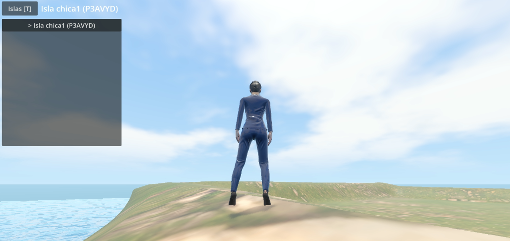
</p>

Standalone **C# / WPF (.NET 8)** viewer that embeds **Godot 4.7.2** and the 3D world, with multiuser networking over WebSocket, a public web portal over **ephemeral tunnels**, an **OTA** updater verified by SHA-256, and a native package for **Linux**. It also includes **LucIA**, a Python cognitive subsystem that today is a separate project and is planned as part of the metaverse.

| 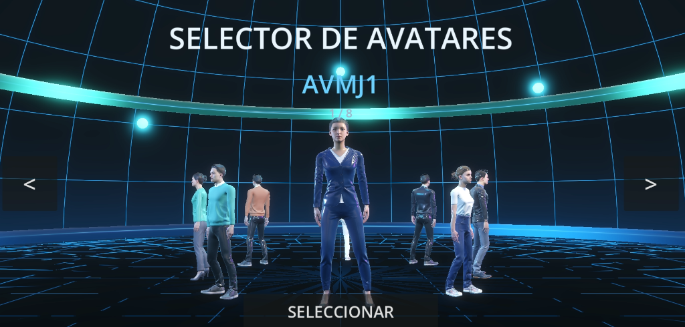 | 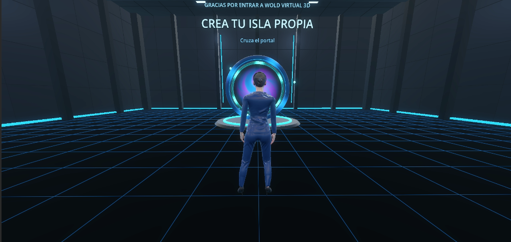 |
|:--:|:--:|
| **Avatar carousel** · 24 slots in 3 turns | **Hangar and portal** · entrance to the world |

| 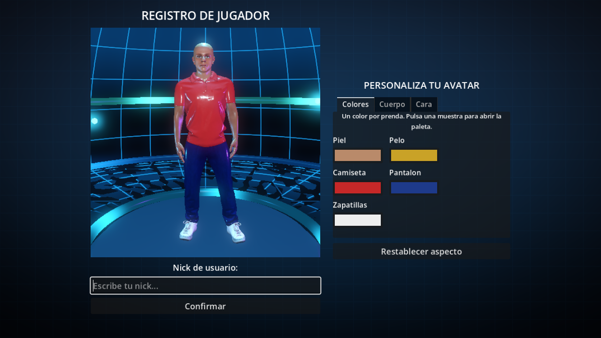 | 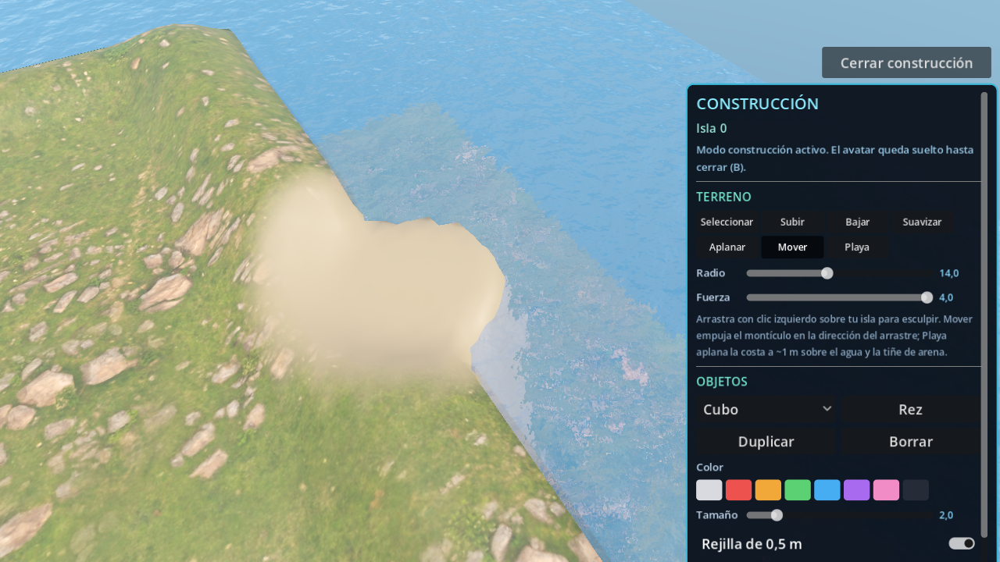 | 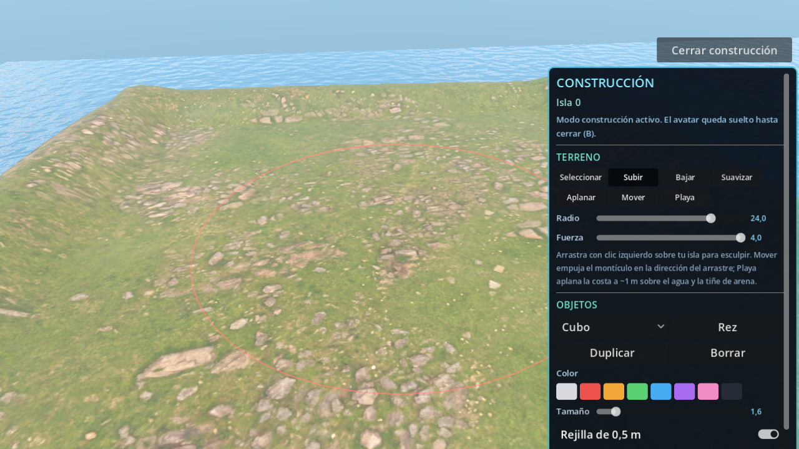 |
|:--:|:--:|:--:|
| **Player registration** · nick, body and face | **Building** · Beach brush | **Another player's island** · read-only |

> **Current phase: 3D P2P connection test (v2.8.1, 2026-11-10).** The goal is to validate that several people can meet up in the world, pick an avatar, customize it, and share a session over a tunnel or LAN. **This is not yet a complete metaverse:** there is no economy or blockchain, and LucIA is not integrated. The **2.6.x** series consolidated text, voice and webcam chat, friends, a persistent per-PC profile, identity via SMTPLC, and an OTA updater with SHA-256 verification. **2.7.0** rebuilt the avatar selector (mouse, wheel, keyboard), added seven analytic *shape keys*, and shared the main avatar's animations with the 24 slots. **2.7.1** brought modular building. **2.7.2** repackaged the world to **1K** (114.6 MB PCK, −89 %). **2.7.3** respects the chosen avatar and removes ghost islands. **2.7.4** fixes the **portal 404 on Linux** and publishes the native Linux viewer on the same code. **2.7.5** is a hardening close-out over that same world (milestones H0–H4): it preserves the ledger and local weights on close, **fail-closed** OTA (a package without a valid SHA-256 is rejected before being applied), a LAN endpoint with the **port read from the UDP beacons** instead of the constant 8911, runtime extraction with hashing of the engine and the PCK and *Zip Slip* blocking, account state recalculated on logout, and a **regression harness** of 98 Python tests collected in `src/tests/`. **2.8.1** introduces the **volatile packaging**: the 3D world, Lucía's models and the configuration travel inside a single `.zip` embedded in the `.exe`, and the account/session config is loaded **RAM-only** (see [§11.1](#111-volatile-packaging-v281)). Synchronization between two machines still has **no real test**. Everything else is on the roadmap as **Planned** (see [§3](#3-metaverse-vision-planned-scope)).

## Index

1. [What it is today and where it is headed](#1-what-it-is-today-and-where-it-is-headed)
2. [Project status and current phase](#2-project-status-and-current-phase)
3. [Metaverse vision (planned scope)](#3-metaverse-vision-planned-scope)
4. [Repository map](#4-repository-map)
5. [Download and first run](#5-download-and-first-run)
6. [Registration and identity](#6-registration-and-identity)
7. [The 3D world (Godot)](#7-the-3d-world-godot)
8. [P2P network, WebNodo and ephemeral tunnels](#8-p2p-network-webnodo-and-ephemeral-tunnels)
9. [Session continuity](#9-session-continuity)
10. [OTA updater](#10-ota-updater)
11. [Build and publish](#11-build-and-publish)
12. [LucIA: the Python cognitive subsystem](#12-lucia-the-python-cognitive-subsystem)
13. [The RFPRMN tool (CONTRRF)](#13-the-rfprmn-tool-contrrf)
14. [Quality and testing](#14-quality-and-testing)
15. [Roadmap and technical debt](#15-roadmap-and-technical-debt)
16. [Pending tasks](#16-pending-tasks)
17. [Repository policy](#17-repository-policy)
18. [Internal documentation](#18-internal-documentation)
19. [Contributing and license](#19-contributing-and-license)

> **Path convention:** `src/` is shorthand for
> `VersionDe_sesion/Sistema_Principal/PRY/actualizacion_bfef2dea/src/`, the current snapshot
> (**2.7.5**) that is exported and built; earlier RFPRMN snapshots live only in the Git history.
> The **screenshots in this README** live in the snapshot's `STM_DOC/docs/img/` (world/UI, 01–13) and `STM_DOC/img/lucia-3d/` (Lucía's 3D presence). Each RFPRMN cycle renames `actualizacion_<id>/` and the screenshots are copied there again.
> **Status convention:** each capability is labeled **Implemented**, **Implemented, without a real test**, **Partial**, **Planned**, or **Outside the repo**. The source of truth is the code; the figures in this document were recalculated on 2026-11-01 against the `actualizacion_bfef2dea` snapshot (version 2.7.5) and the release binaries.

---

## 1. What it is today and where it is headed

The repository contains **two pieces**:

1. **The viewer** (`src/VSC#/`): a .NET 8 WPF application distributed as a single self-contained portable executable. It embeds the Godot 4.7.2 engine and a 3D world package, extracts them to disk on first launch and runs them embedded in its window. It manages local identity, the **WebNodo** web portal, the **ephemeral tunnels** and the OTA updater. Since 2.7.4 the same folder hosts `VisorLinux/`, a native (Avalonia) viewer that shares the core and is published as a self-contained ELF.
2. **LucIA** (`src/LC_STM/` and sibling folders in Python): an experimental cognitive architecture (distributed neural network, local PoNL ledger, IPFS integration). **Today it has no integration with the viewer whatsoever**: zero cross-references. Its incorporation into the metaverse is planned.

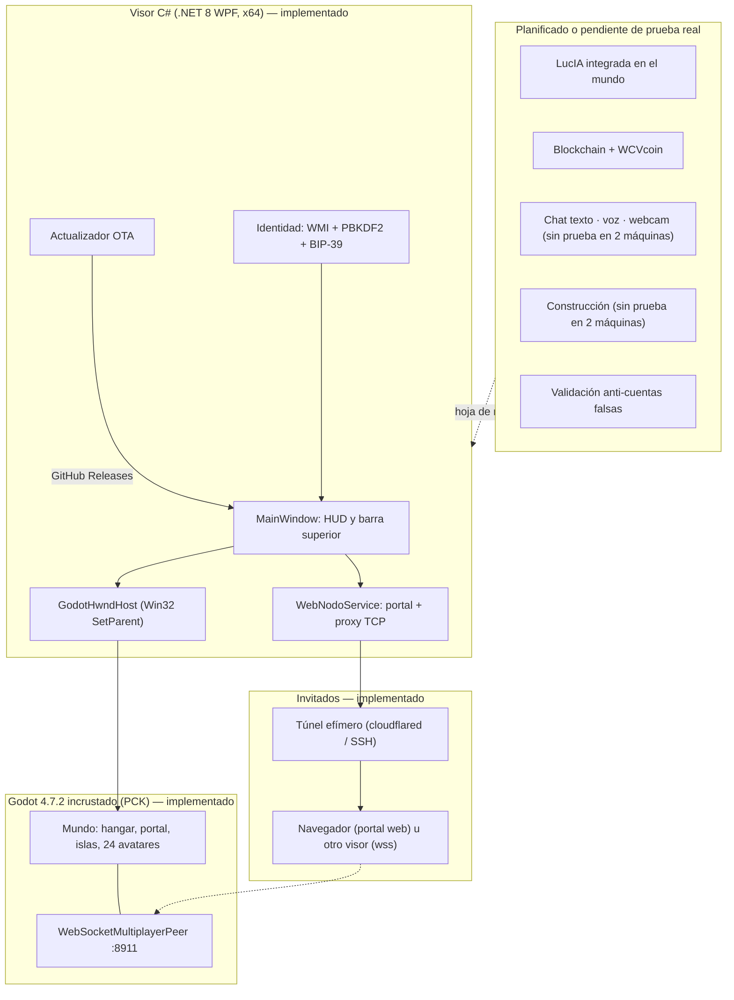

### What works today

- Navigable 3D world with **24 avatars**, a 3-turn carousel, nick registration and appearance customization.
- Multi-user session with an **authoritative host** and WebSocket clients, on the LAN or through a public tunnel.
- **Text chat**, friends with private chat and voice/webcam capture within the session (untested between two machines).
- **Building**: a terrain brush with six tools (including color-preserving move and beach) and prims editable only on one's own island, with local saving.
- **Presence screen** before registration: indicates whether the metaverse is empty or occupied, discovers nodes on the LAN and accepts the invitation link.
- **WebNodo portal** for inviting and downloading the viewer, with a token-protected API.
- **OTA updater** with SHA-256 verification and resumption.
- **Local identity**: hardware footprint, PBKDF2 password and a 12-word BIP-39 seed.
- Player persistence (avatar, nick and appearance) across launches.

### What does not exist yet

Economy and blockchain, the WCVcoin token, anti-Sybil unique identity validation and LucIA integration. None of that has code in the repository; it is described in [§3](#3-metaverse-vision-planned-scope) as **Planned**. The only "blockchain" that exists is LucIA's **local PoNL ledger** in Python, which is not a public chain and is not connected to the viewer. Chat and building, on the other hand, already have an implementation; what they lack is a real-world test between two machines.

**Technical honesty — read this before using the project:**

- It is an alpha prototype, not a product. Binaries from v2.5.4 to v2.8.1 are published **unsigned** (earlier versions used a self-signed development certificate): Windows SmartScreen will show a warning.
- The **desktop viewer** runs on **Windows x64** (WPF) and, since 2.7.4, there is also a self-contained **native viewer for Linux** (current: `WoldVirtualP2P3Dv2.7.5-linux.tar.gz`, 207,602,370 B) with the engine and world embedded and seven tabs (account, world, portal, network, text chat, update and diagnostics). On Linux there is no SMTPLC, voice/webcam or Authenticode signing.
- The network is **P2P in transport only**: each session has an **authoritative host** and the remaining nodes connect to it over WebSocket. There is no decentralized replication without a trusted server.
- The network and the world **do not persist** beyond the session: tunnels are ephemeral and islands are rebuilt on reconnection.
- The viewer's "DeFi wallet" is **under construction**: the BIP-39 seed and its derivations are real, but it does not connect to any blockchain or manage funds.
- The `<Version>` field of [`Visor3D.csproj`](VersionDe_sesion/Sistema_Principal/PRY/actualizacion_bfef2dea/src/VSC%23/Visor3D.csproj) is at **2.8.1**, the same as its `AssemblyName` (`DMWoldVirtualP2P3Dv2.8.1`): it is the **current published binary** (`v2.8.1`, *Latest* since 2026-11-10, tag `v2.8.1` on `main`), which adds the **volatile packaging** (PCK, Lucía models and config inside an embedded `.zip`; config RAM-only). Its asset `DMWoldVirtualP2P3Dv2.8.1.exe` has SHA-256 `4e168cdb7ba6d88038f6130e7def30e87c37b17fd3b8409497d36f50cbec4bcf` and the download responds `200` with `Content-Length` 679,948,153. The earlier releases (`v2.7.8` `f9700aa1`, `v2.7.4` `f2dc55e0`, `v2.7.3` `555fc9fb`, `v2.7.2` `13209947`, `v2.7.1` `9d780c6f`, `v2.7.0` `ceea0886`, `v2.6.9` `e7e27212`, `v2.6.8` `6ab640d1`, `v2.6.7` `902d5f43`, `v2.6.4` `8ec5d19c` and `v2.6.3` `9794cdb4`) remain published with their assets.
- The SMTPLC registration test of 2026-10-28 (**11/11**: approval on physical hardware and denial by quota, cooldown, VM and VPN) uncovered a **false positive**: the Windows `HypervisorPresent` flag (VBS, Hyper-V, WSL2) flagged "VM" on physical machines and blocked registration. Fixed in `VmDetector` and **already included in the published exes of 2.6.8 and 2.6.9**; in 2.6.7 and earlier that false positive is still present.

---

## 2. Project status and current phase

**Current phase: 3D P2P connection test (2026-11-01).** What is being validated is the connection between people, not the economy or user-generated content.

**Release of 2.7.5 (2026-11-01).** A hardening close-out over the same 2.7.4 world (milestones H0–H4), published as *Latest* with tag `v2.7.5` on `938cc6b` of `main` (merge of PR #44 from `DevAntigravityIDEIA`). What is verified in the current tree: **OTA fail-closed** —`STM_actualizar/UpdateSelfTest.cs` calls "OTA fail-closed without digest" and rejects the package before applying it if there is no valid SHA-256—; **safe extraction** —`AppExtractor.cs:171-180` and `VisorLinux/Linux/RuntimeLinux.cs:190-195` normalize with `Path.GetFullPath` and discard paths outside the destination, the *Zip Slip* pattern—; **dynamic LAN endpoint** —`Services/DescubrimientoP2P.cs:76-83` takes the port from the UDP 8912 beacon payload and uses 8911 only as the default value—; and the `HostInterno = "127.0.0.1"` from 2.7.4 remains in `Services/WebNodoService.cs:71`. The snapshot's regression harness is **98 tests collected by pytest** in `src/tests/` (13 files, including the new `test_h1_contencion.py` and `test_h2_h3_red.py`); the release note and the `.csproj`'s `Description` cite "97 tests passing", so the difference is one test counted separately and **they have not been run again here** (**Implemented, no real-world test** in this session). The Windows exe weighs 365,080,441 B, only **+8,192 B** over the 2.7.4 one: new code with no world change. Assets verified on 2026-11-01 against the GitHub API: `DMWoldVirtualP2P3Dv2.7.5.exe` 365,080,441 B `14504afc…56c11cf`, `WoldVirtualP2P3Dv2.7.5-linux.tar.gz` 207,602,370 B `0f64569f…407b6e7e`, `release.json` 934 B `b215fc4a…8f9e67cf` and `SHA256SUMS` 201 B `d51720de…44724442`; the four API `digest` values match the SHA-256 recalculated over the local files and the four downloads respond `200` with their exact `Content-Length`. **Two open debts from this release:** there is no `STM_DOC/README_desarrollo_…2_7_5.md` document (the detail lives only in the release note) and the published `SHA256SUMS` carries a **UTF-8 BOM** on the first line, which breaks `sha256sum -c` on Linux.

**Release of 2.7.4 (2026-10-30).** It is 2.7.3 plus the fix for the embedded portal on Linux and the native viewer for Linux. .NET's managed `HttpListener` on Linux matches the prefix literally by the endpoint IP and the `Host`, so the proxy —which connected to `IPAddress.Loopback` but rewrote `Host: localhost:{puerto}`— returned **404**; now `WebNodoService.HostInterno` rewrites to `127.0.0.1` and `/` and `/api/p2p-status` respond `200` (it works the same on Windows, where `http.sys` normalizes the prefix). `VisorLinux` shares the core with the Windows viewer and publishes a self-contained ELF with the engine and PCK embedded. Assets: `DMWoldVirtualP2P3Dv2.7.4.exe` at 365,072,249 B (SHA-256 `f2dc55e0…0a322f8`), `WoldVirtualP2P3Dv2.7.4-linux.tar.gz` at 207,221,630 B (`a135571e…d1756916`), `release.json` (215 B, `c72ec3c7…86771bf`) and `SHA256SUMS` (276 B, `9ff2b3cc…`); the four `digest` values match by API and the four downloads return `200` with their `Content-Length`. PCK `ebeff90c…7ae5e14` (114,591,724 B). Exe self-tests: startup 17/17, account 19/19, chat 26/0 and network 7/0. Verification **on real Ubuntu 24.04** (GitHub Actions, run 40990210317): tar with correct SHA, ELF `0755`, `--extraer`, engine `4.7.2.stable.official.ed1daf0bf`, `--comprobar` ×3 with no failures and, under Xvfb, `/` 200, `/api/p2p-status` 200 with `"online"` and `/api/info` 403. The **2.7.3 → 2.7.4 OTA applied itself** on the installed copy on 2026-10-30 at 03:36 local time: the resulting exe is identical to the published asset, the previous one remained as `.old` and the viewer relaunched with `FileVersion 2.7.4.0`. Details and evidence in [`README_desarrollo_20261030_2_7_4.md`](VersionDe_sesion/Sistema_Principal/PRY/actualizacion_bfef2dea/src/STM_DOC/README_desarrollo_20261030_2_7_4.md).

**Release of 2.7.3 (2026-10-30).** Fixes two failures reported by the author. **Chosen avatar:** `ChunkManager._aplicar_asignacion_local()` wrote to `jugador/avatar_scene` the path confirmed by the host, which may be a substitute from `Turnos.reservar()`; now the substitute applies only to the session and `Boot._reparar_avatar()` restores once —it sets the `jugador/avatar_reparado` marker, only with the same nick— the avatar from `user://avatar_hash.json`. **Ghost islands:** `TeleportManager._scan_islands()` invented cells for any `Node3D` child and the `Constructor` node of `ISLA3Dblock.tscn`, at the origin, appeared as island 0; now it only counts `island_nodes` and `active_islands`. Re-exported PCK: 114,591,724 B `ebeff90c…7ae5e14`. Assets: exe `DMWoldVirtualP2P3Dv2.7.3.exe` 365,072,249 B `555fc9fb…b93caa`, tar `2795013e…9416cf`, `release.json` `f3a69657…`, `SHA256SUMS` `5e03fe9e…`; ghost-island tests 11/0, avatar change 28/0 and avatar repair 8/0. The **2.7.2 → 2.7.3 OTA** was verified on the author's PC.

**Release of 2.7.2 (2026-10-30).** Re-packages the world to **1K**: the 115 `.ctex` avatar and terrain textures that exceeded 1024 px were rescaled with Lanczos, preserving format (BPTC/WebP), the mipmap chain and flags. The `wvp3d.pck` drops from 1,053,081,932 B to **114,591,756 B** (`3e010b5e…4c1e5c5e`, **−89.1 %**) and the exe from 1,303,560,057 B to 365,072,249 B. Validated with visual tests (15 scenes with MAE 0.000–0.794; 115 textures with median 1.10), the engine loading the 536 entries without failures, and a startup self-test of 17/17. Assets: exe `13209947…de117f8a`, tar `3ceff5f2…3d6b0494`, `release.json` `74868e5e…`, `SHA256SUMS` `e5ad6665…`.

**Release of 2.7.1 (2026-10-29).** Adds the **modular building** system: step-by-step undo and redo (`Ctrl+Z`/`Ctrl+Y`), real-time brush, Roughness and Revert tools, incremental collision over dirty faces, configurable step grid, per-axis sizing, inventory and ray-based island outline, with the `gdscrip/construccion/` modules and paths centralized in `STM_HRTS`. PCK `8d42b2d3…019fdede` (1,053,081,932 B); exe 1,303,560,057 B `9d780c6f…0fae11b3d`; startup self-tests 17/17, chat 0 failures, account OK and network 7/7.

**Release of 2.7.0 (2026-10-29).** It is 2.6.9 plus three blocks of work. **Avatar selector**: an avatar can be focused with a click, the ring rotated by dragging horizontally (70 px per slot, skipping occupied ones), wheel and keyboard used, and the nick typed on the same screen; the central label is green (`✔ AVATAR ORIGINAL · <nombre> · Turno N`) on a free slot, red (`PLAZA OCUPADA`) when the slot is taken and amber with recycling on turn 4 if the catalog of 24 is full, and confirmation is mandatory to enter. **Shape keys in code**: the preset vocabulary of V-Sekai's *VRM Importer* (`godotengine.org/asset-library/asset/2031`, MIT) is adapted to the seven expressions of `Personalizacion.EXPRESIONES`, deforming vertices at rest because the catalog avatars **do not ship morph targets** (0 `targets` in `AVH1.gltf`); measured on the real mesh, they displace 8.4-23.5 mm and return to exactly zero. **Shared animations**: the main avatar's five tracks (`paradoMJ1_1`, `caminarMJ1_2`, `correrMJ1_3`, `left_StrafeMJ1_4`, `rightstrafeMJ1_5`) are remapped by bone name to the 24 slots, so the 16 that depended on the missing `*_anim.glb` no longer remain at rest. The `wvp3d.pck` was **re-exported** (1,053,066,344 B, SHA-256 `cb17a956…d946b9e1`): it grows over 2.6.9's 537,836,524 B because the static GLBs import their 4K textures as loose losslessly compressed PNGs, not because there are new assets. `DMWoldVirtualP2P3Dv2.7.0.exe` at 1,303,543,673 B with SHA-256 `ceea0886904017d68b99811e75d21deb8225d12667c48f9187fb529d1318b59a`; self-tests chat 26/0, account **19/19**, network **7/7** and startup **17/17** (`.extracted` = `2.7.0`). It is published with tag `v2.7.0` on `5f75f6f` of `main`; its four assets (`exe`, `WoldVirtualP2P3Dv2.7.0-linux.tar.gz` —1,078,177,695 B, `913552a7…7902938`—, `release.json` —`e72f489a…6da02b`, 223 B, `size_mb` 1243.2— and `SHA256SUMS` —`c35e4053…356e1d42`, 273 B—) have matching `digest` by API and the four downloads respond `200` with their exact `Content-Length`. The `v2.6.9` remains as the previous release. Details and evidence in [`README_desarrollo_20261029_selector_shapekeys.md`](VersionDe_sesion/Sistema_Principal/PRY/actualizacion_bfef2dea/src/STM_DOC/README_desarrollo_20261029_selector_shapekeys.md).

**Release of 2.6.4 (2026-10-28).** Leaves the local database **completely empty exactly once**: on first launch it archives to `%LOCALAPPDATA%\WoldVirtualP2P3D\respaldo_cuenta\reset-total-<fecha>\` the profile, credentials, key, seed, friends and the PC stamp, together with the player's Godot state (registration, avatar, islands, building, inventory and session), and keeps the runtime, logs, engine caches and `cloudflared.exe`. It deletes nothing: everything is moved to the backup. The permanent marker `reset_total.txt` prevents repeating the reset in this or future versions and disables importing old accounts, so **what the user registers now persists**. In addition, a versioned global state `estado.json` (adapted from the reference project's `Estado_Global` setting) records which pieces the viewer needs and which exist; if there are none, the viewer opens the full registration cycle instead of showing a useless welcome. It is published with tag `v2.6.4` on `5f23b8c`; its three assets (exe, `release.json`, `SHA256SUMS`) have matching `digest` by API and the download responds `200` with `Content-Length` 788,250,489. The PCK is the same as 2.6.1, 2.6.2 and 2.6.3 (SHA-256 `9d5c15e7…a69ac94`). Details, evidence and pending debt in [`README_desarrollo_20261028_2_6_4.md`](VersionDe_sesion/Sistema_Principal/PRY/actualizacion_bfef2dea/src/STM_DOC/README_desarrollo_20261028_2_6_4.md).

**Release of 2.6.9 (2026-10-29).** It is 2.6.8 plus six fixes and a fourth asset: the webcam scores devices before opening (discarding virtual, IR and depth cameras), requires the first frame within 1500 ms, switches to the next candidate, watches for 6 s drops and explains the reason when there is no image; the `.csproj` sets `System.Globalization.UseNls=true` so the runtime does not load ICU and starts under Wine without `Error: 127` (`u_charsToUChars`) while keeping `es-ES`; `WoldVirtualP2P3Dv2.6.9-linux.tar.gz` is published with the world for Linux; `--startup-selftest` uses a throwaway Godot profile in `%TEMP%`; the VM detector uses the same 0.50 threshold as the policy, so a single weak signal no longer blocks registration; `RuntimeCleaner` purges runtimes from previous versions after a correct startup, keeping the current one and the last good one; and the portal retries the current-release query three times before falling back to the local one. Engine, `wvp3d.pck` (SHA-256 `9d5c15e7…a69ac94`) and `godot_exe.zip` identical to those of 2.6.1–2.6.8. The exe and `SHA256SUMS` were **recompiled and replaced on that same 2026-10-29**, keeping tag, name and URL: `DMWoldVirtualP2P3Dv2.6.9.exe` at 788,316,025 B with SHA-256 `e7e27212921807b735cdca98f6a1995ef96492ae456a8316b8fd5469596d84d8`, `FileVersion 2.6.9.0` and `ProductVersion 2.6.9+fb9e7348…`; self-tests chat 26/0, account **19/19**, network **7/7** and startup **17/17** (`.extracted` = `2.6.9`). It is published with tag `v2.6.9` on `f1e57ee` of `main`; its four assets (`exe`, `WoldVirtualP2P3Dv2.6.9-linux.tar.gz` —552,727,606 B, `33de8168…885594f`, unchanged—, `release.json` —`9f402c53…d9c47`, 215 B, unchanged— and `SHA256SUMS` —`afc3efc2…75bf9`, 276 B—) have matching `digest` by API and the four downloads respond `200` with their exact `Content-Length`. Replacing the same version number is a one-off exception to rule R2 authorized by the owner; the previous exe (`1fdbd356…e83ac8b`) is no longer reproducible from the tag because that one was compiled from `fb9e734`. The `v2.6.8` remains as the previous release. Details and evidence in [`README_desarrollo_20261029_2_6_9.md`](VersionDe_sesion/Sistema_Principal/PRY/actualizacion_bfef2dea/src/STM_DOC/README_desarrollo_20261029_2_6_9.md).

**Release of 2.6.8 (2026-10-28).** It is 2.6.7 plus the fix for the SMTPLC false positive: `VmDetector` scored the Windows `HypervisorPresent` flag at 0.50 and, since `IsVm` is computed with `>= 0,40` and the policy threshold is `0,50`, any physical PC with VBS, Credential Guard, Hyper-V or WSL2 saw registration denied with `VmDetected`. Now that flag weighs 0.25 and only corroborates the other signals. Nothing else changes: same text, voice and webcam chat as 2.6.4, friends and private chat, persistent per-PC profile, one account per PC, one-time total reset, direct registration if the PC is empty, welcome with P2P presence, and the same engine and PCK (SHA-256 `9d5c15e7…a69ac94`). `DMWoldVirtualP2P3Dv2.6.8.exe` at 788,303,737 B with SHA-256 `6ab640d1dd939faec1de83fc922516b7f914c5df04670b9a451e32a8a994b554` and `FileVersion 2.6.8.0`; self-tests chat with no failures, account **19/19**, network **7/7** and startup **15/15** (`.extracted` = `2.6.8`); SMTPLC registration test **11/11**. It is published with tag `v2.6.8` on `cfa6982` of `main`; its three assets (`exe`, `release.json` —`bb039599…b8641`— and `SHA256SUMS` —`d98c5191…30f14`) have matching `digest` by API and the download responds `200` with `Content-Length` 788,303,737. The `v2.6.7` remains as the previous release. Details and evidence in [`README_desarrollo_20261028_2_6_8.md`](VersionDe_sesion/Sistema_Principal/PRY/actualizacion_bfef2dea/src/STM_DOC/README_desarrollo_20261028_2_6_8.md).

**Release of 2.6.7 (2026-10-28).** Recovers the text, voice and webcam chat, friends, persistent per-PC profile, total reset and self-tests that 2.6.5 and 2.6.6 had lost —they were compiled from `actualizacion_022321c8`, a lineage that never had the `Chat/` folder— on top of the full 2.6.4 tree, and adds the **SMTPLC** system (anti-VM, anti-VPN and a one-account-per-location limit) to registration. It keeps the welcome with P2P presence and its "Log in" button. Snapshot `actualizacion_267f0a1c`; `DMWoldVirtualP2P3Dv2.6.7.exe` at 788,303,737 B with SHA-256 `902d5f43…a80fe71a` and `FileVersion 2.6.7.0`; self-tests chat **26/26**, account **19/19**, network **7/7** and startup **15/15**; PCK and engine reused unchanged (SHA-256 `9d5c15e7…a69ac94`). It is published with tag `v2.6.7` on `aecbc84` of `main` (2.6.8 replaces it as *Latest*); its three assets (`exe`, `release.json` —`212f7a28…c0bff2b`— and `SHA256SUMS` —`a67e3cde…ad7ecc4`) have matching `digest` by API and the download responds `200` with `Content-Length` 788,303,737. The `v2.6.6` remains as the previous release. SMTPLC registration was tested on 2026-10-28 with a harness that compiles the snapshot's real code: **11/11** (approval with the default policy, quota, 72 h cooldown, anti-VM, anti-VPN and audit reports, without touching the real ledger). That test uncovered that an isolated `HypervisorPresent` blocked registration on physical PCs with VBS: fixed in `VmDetector` and already included in the 2.6.8 binary. Details and evidence in [`README_desarrollo_20261028_2_6_7.md`](VersionDe_sesion/Sistema_Principal/PRY/actualizacion_bfef2dea/src/STM_DOC/README_desarrollo_20261028_2_6_7.md).

**Release of 2.6.3 (2026-10-28).** Fixes the startup dead end: if the PC retained any leftover (profile without hash, loose key, account stamp or folder copied from another machine), the viewer showed only "Log in", hid "Create account" and the login could not be completed. Now startup diagnoses the local identity: with credentials and hash it touches nothing; with half-built leftovers it archives them to `%LOCALAPPDATA%\WoldVirtualP2P3D\respaldo_cuenta\<fecha>` and returns to the full registration cycle; with no identity it archives only the old engine state so Godot shows the first-time carousel. It is published with tag `v2.6.3` on `94afc4a`; its three assets (exe, `release.json`, `SHA256SUMS`) have matching `digest` by API and the download responds `200` with `Content-Length` 788,242,297. The PCK is the same as 2.6.1 and 2.6.2. Details, evidence and pending debt in [`README_desarrollo_20261028_2_6_3.md`](VersionDe_sesion/Sistema_Principal/PRY/actualizacion_bfef2dea/src/STM_DOC/README_desarrollo_20261028_2_6_3.md).

**Release of 2.6.2 (2026-10-28).** Fixes the local webcam view disappearing from the chat strip: on login `PanelVideos` was emptied and the local tile defined in XAML was expelled from the tree. Now the cleanup keeps that tile and, when the camera is turned on, it is reinserted if missing. It is published with tag `v2.6.2` on `d14e3b5` as the release prior to 2.6.3; its three assets (exe, `release.json`, `SHA256SUMS`) have matching `digest` by API and the download responds `200` with `Content-Length` 788,230,009. The PCK is the same as 2.6.1. Details, evidence and pending debt in [`README_desarrollo_20261028_2_6_2.md`](VersionDe_sesion/Sistema_Principal/PRY/actualizacion_bfef2dea/src/STM_DOC/README_desarrollo_20261028_2_6_2.md).

**Release of 2.6.1 (2026-10-28).** On top of 2.6.0, it adds login with only the full invitation link (session token), the single instance that focuses the already-open window, the removal of disconnected players' islands and the horizontal webcam strip inside the chat frame. It remains published with tag `v2.6.1` on `e98b4f4` and its assets verified by API; details and evidence in [`README_desarrollo_20261028_2_6_1.md`](VersionDe_sesion/Sistema_Principal/PRY/actualizacion_bfef2dea/src/STM_DOC/README_desarrollo_20261028_2_6_1.md).

| Capability | Status | Evidence in the code |
|---|---|---|
| WPF viewer with embedded Godot (Win32) | Implemented | [`src/VSC#/GodotHwndHost.cs`](VersionDe_sesion/Sistema_Principal/PRY/actualizacion_bfef2dea/src/VSC%23/GodotHwndHost.cs) |
| Extraction of the embedded runtime by version | Implemented | [`src/VSC#/AppExtractor.cs`](VersionDe_sesion/Sistema_Principal/PRY/actualizacion_bfef2dea/src/VSC%23/AppExtractor.cs) |
| Native viewer for Linux (Avalonia) | Implemented | [`src/VSC#/VisorLinux/`](VersionDe_sesion/Sistema_Principal/PRY/actualizacion_bfef2dea/src/VSC%23/VisorLinux/Linux/LanzadorMundo.cs) |
| Local identity: WMI + PBKDF2 + BIP-39 | Implemented | [`src/VSC#/RegistroWindow.xaml.cs`](VersionDe_sesion/Sistema_Principal/PRY/actualizacion_bfef2dea/src/VSC%23/RegistroWindow.xaml.cs), [`src/VSC#/Nucleo/Seguridad/PasswordHasher.cs`](VersionDe_sesion/Sistema_Principal/PRY/actualizacion_bfef2dea/src/VSC%23/Nucleo/Seguridad/PasswordHasher.cs) |
| 3D world: 24 avatars, hangar, portal, islands | Implemented | [`src/MTBGT/WoldVirtualP2P3D/`](VersionDe_sesion/Sistema_Principal/PRY/actualizacion_bfef2dea/src/MTBGT/WoldVirtualP2P3D) |
| 3-turn carousel with occupancy | Implemented | `src/MTBGT/WoldVirtualP2P3D/gdscrip/Turnos.gd`, `Sonda.gd` |
| Persistent appearance customization | Implemented | `src/MTBGT/WoldVirtualP2P3D/gdscrip/Personalizacion.gd` |
| WebSocket network with host authority | Implemented | `gdscrip/ChunkManager.gd`, `PlayerSync.gd` |
| LAN discovery by UDP beacon | Implemented, no real-world test | `ChunkManager.gd` (beacon `:8912`) |
| WebNodo: HTTP portal + TCP proxy | Implemented | [`src/VSC#/Nucleo/Services/WebNodoService.cs`](VersionDe_sesion/Sistema_Principal/PRY/actualizacion_bfef2dea/src/VSC%23/Nucleo/Services/WebNodoService.cs) |
| Ephemeral tunnels (cloudflared / serveo / localhost.run) | Implemented | `src/VSC#/p2pipfsCS/EphemeralTunnelRunner.cs`, `src/VSC#/Nucleo/RedP2P/P2PTunnelManager.cs` |
| Host migration | Implemented, no real-world test | `MainWindow.xaml.cs` (`ComprobarHostMigrado`), `ChunkManager.gd` |
| OTA updater (SHA-256, resumption) | Implemented | [`src/VSC#/STM_actualizar/`](VersionDe_sesion/Sistema_Principal/PRY/actualizacion_bfef2dea/src/VSC%23/Nucleo/STM_actualizar/UpdateChecker.cs) |
| LucIA: neural network, PoNL ledger, IPFS | Partial (see [§12](#12-lucia-the-python-cognitive-subsystem)) | `src/LC_STM/`, `src/SBSTM/`, `src/STM_BKCH/`, `src/STMIPFS/` |
| LucIA integrated into the metaverse | Planned | 0 cross-references viewer ↔ LucIA |
| Metaverse blockchain | Planned | No chain, contract or node |
| WCVcoin token | Planned | No implementation in the repository |
| Anti-fake-account validation | Planned | Only local identity; no network uniqueness |
| Building: terrain and prim editing | Implemented, no real-world test between two machines | [`Construccion.gd`](VersionDe_sesion/Sistema_Principal/PRY/actualizacion_bfef2dea/src/MTBGT/WoldVirtualP2P3D/gdscrip/Construccion.gd), [`TerrenoEditable.gd`](VersionDe_sesion/Sistema_Principal/PRY/actualizacion_bfef2dea/src/MTBGT/WoldVirtualP2P3D/gdscrip/TerrenoEditable.gd), [`Prims.gd`](VersionDe_sesion/Sistema_Principal/PRY/actualizacion_bfef2dea/src/MTBGT/WoldVirtualP2P3D/gdscrip/Prims.gd) |
| Text, voice and webcam chat | Implemented, no real-world test between two machines | [`Chat/`](VersionDe_sesion/Sistema_Principal/PRY/actualizacion_bfef2dea/src/VSC%23/Chat), [`MainWindow.xaml.cs`](VersionDe_sesion/Sistema_Principal/PRY/actualizacion_bfef2dea/src/VSC%23/MainWindow.xaml.cs) |
| CI (continuous integration) | Broken (see [§14](#14-quality-and-testing)) | `src/STM_HRTS/.github/workflows/ci.yml` |

**Verified in this phase:** carousel and customization after a clean reset; avatar/nick/appearance persistence; startup as host after an OTA (fix 2.5.5); chat and friends with 24/24 headless checks; avatar control with 35/35; building with **201/201** (includes voxel terrain, island undo and inventory) and visual captures of the terrain; P2P discovery with 6/6; startup test of the 2.5.9 binary with 15/15 and of the 2.6.1 binary with **15/15** reading the re-exported PCK (14/15 without a prior profile due to the startup carousel; 15/15 with an isolated profile); portal announcing the current asset via `/api/info` (tested on 2.6.0 with `751,8`; 2.6.1 uses the same `RefrescarReleaseVigente`); GitHub download URL with **200** and `Content-Length` 788,230,009; asset digest equal to the local one by API (`86d9cb6e…a88fc`); local OTA with the real components (fake digest rejected, download verified, replacement and re-extraction). For 2.6.1: token invitation **7/7**, islands without users **7/7**, animations **24/24** avatars and **16/16** importable GLBs, chat **25/25**, single instance verified (second run exits `0` in ~1.05 s and focuses the existing window). For 2.6.2: chat **26/26** (includes the regression "tile cleanup preserves the local view from the XAML" and detects the webcam), network **7/7**, startup **15/15** with `runtime\2.6.2\` and `.extracted` = `2.6.2`, extracted PCK identical to the source one, and the release's three `digest` values matching the local SHA-256 hashes (`bb176468…47b6c`, `9966950c…`, `320f74a3…`). For 2.6.3: account **12/12** over temporary directories (diagnosis of seven states, archiving of leftovers with a copy in `respaldo_cuenta`, intact full account and engine cleanup without an account), chat **26/26**, network **7/7**, startup **15/15** with `runtime\2.6.3\` and `.extracted` = `2.6.3`, and the release's three `digest` values matching the local SHA-256 hashes (`9794cdb4…b03e62`, `16f113b1…`, `abb37c5a…`). For 2.6.4: account **19/19** over temporary directories (includes the one-time total reset, the preservation of runtime/logs/caches, empty global state → full registration and registered account → login), chat **26/26**, network **7/7**, startup **15/15** with `runtime\2.6.4\` and `.extracted` = `2.6.4`, extracted PCK identical to the embedded one (SHA-256 `9d5c15e7…a69ac94`, reused), and the release's three `digest` values matching the local SHA-256 hashes (`8ec5d19c…576b9f`, `e5c12374…`, `61329a80…`). **Verified on the real PC on 2026-10-28:** the OTA **from GitHub** 2.5.4 → 2.6.4 (the resulting exe is identical to the published asset, the previous one was kept as `.old` and the app relaunched with `FileVersion 2.6.4.0`) and the one-time total reset with full registration (14 elements archived in `respaldo_cuenta\reset-total-20261028-024605`, `reset_total.txt` = `2.6.4`, registration opened at 02:46:10 and account persisted). **Pending verification:** the literal 2.6.3 → 2.6.4 OTA and the OTA without a logged-in session, the second startup after the reset, session continuity with three real instances, chat/building between two machines, the webcam strip with a real authenticated session and two cameras, and the portal announcing via `/api/info` the published asset of the current release. Details in [§16](#16-pending-tasks).

---

## 3. Metaverse vision (planned scope)

This section describes **what is intended to be built**, not what already exists. Everything that follows is **Planned** and has no implementation in the repository unless otherwise indicated.

### 3.1 LucIA inside the metaverse

LucIA will be incorporated as part of the metaverse (cognitive presence and world assistant). Today it is a **separate Python project**: the C# viewer contains no reference to LucIA and LucIA does not know about the viewer. The L1–L6 roadmap covers rigged avatar, local conversational AI, the LucIA ↔ viewer ↔ Godot bridge, training, weights on IPFS and licensing (see [§15](#15-roadmap-and-technical-debt)). **Status: Planned.**

### 3.2 Blockchain and WCVcoin

There will be a metaverse-specific blockchain for identity, reputation and token transactions. **Today it does not exist**: there is no network, consensus mechanism, contract or node in the repository. The repo's only ledger is **LucIA's local PoNL** (`src/STM_BKCH/`, port 8545), which is not a public chain and has no relation to WCVcoin.

**Tokenomics set as a target (pending implementation):**

| Parameter | Value |
|---|---|
| Name | WCVcoin |
| Total supply | **30,000,000 WCV** |
| Decimals | **3** (minimum unit 0.001 WCV) |
| First-day distribution | **0** (no initial distribution) |

There is no issuance, contract or connected wallet. The viewer's current wallet only generates and verifies the BIP-39 seed locally. **Status: Planned.**

### 3.3 Secure validation and defense against fake accounts

The risk is the **Sybil attack**: a single person creates 1,000 accounts to manipulate votes, reputation or the WCVcoin distribution. No isolated measure solves it; the current hardware footprint (SHA-256 of OS + board + CPU in `RegistroWindow.xaml.cs`) is only a signal, can be falsified and changes with the hardware. **Technical proposal (not implemented): defense in layers.**

1. **Cryptographic identity per installation.** A private key generated locally and custodied by the operating system (DPAPI/TPM), linked to the BIP-39 seed. The WMI footprint is used as a secondary signal, never as sole proof.
2. **Proportional creation cost.** A light proof of work per registration and limits per device, IP, subnet and ASN with time windows. Creating one account must cost something; creating a thousand, much more.
3. **Invitation graph (web of trust).** Each account needs one or two endorsements from accounts with seniority. Invitation quotas are limited, decreasing and revocable; if an endorser falls, their endorsed accounts lose reputation.
4. **Proof of humanity with minimal disclosure.** Optional verification through verifiable credentials or zero-knowledge proofs from an external verifier. Only a cryptographic commitment is stored, **without storing biometric data or documents**; this way duplicates are detected without creating a sensitive database.
5. **Reputation and behavior.** Seniority, activity and moderation; coordination detection (same IPs, timings, patterns) and progressive limits before allowing sensitive actions.
6. **Token distribution only to verified, unique identities.** The WCVcoin distribution will be based on a humanity *snapshot*, not per account created, with vesting and per-identity limits so account *farming* is not profitable.

**Success criterion:** that the marginal cost of a fake account exceeds the expected value of the distribution, with a low false-positive rate and an appeals mechanism for real people. **Status: Planned.** Today only local identity exists, with no central registry or network uniqueness check.

### 3.4 Building and island editing

The player can already **sculpt the terrain** of their island with six tools (raise, lower, smooth, flatten, move and beach), **create a soft voxel terrain** with the "Create terrain" button (always inside the island's outline, with a minimum beach strip) and **create and edit prims** (cube, sphere, cylinder, cone and torus) with color, scale, rotation, duplication and deletion. Editing is isolated per island and the "move" brush carries the sand color along with the height. Only the island's owner edits; the state is saved in `user://construccion/` and synchronized through the tunnel during the session. 2.6.0 adds **"Undo island"** (restores the original terrain and deletes all prims, with confirmation and host authority) and **"Save to inventory"** (a snapshot of the terrain and prims, listed in an "Inventory" tab; it cannot yet be restored from there). The **2.7.1** makes editing modular: **step-by-step undo and redo** (a stack of 48 actions per island, `Ctrl+Z`/`Ctrl+Y`), real-time brush, Roughness and Revert tools, incremental collision over dirty faces, configurable step grid, per-axis sizing, nine tools in the panel, inventory in `user://inventario/` and ray-based island outline. The implementation is validated headless (**233 OK, 0 failures** in 2.7.1) and with visual captures of the terrain, **without a real-world test between two machines**. Still **Planned**: restoring from the inventory, multiple selection, prim physics, editing the island's appearance and persistence on a server beyond the session. **Status: Implemented, no real-world test between two machines.**

| Island overview | Flatten brush | Beach from the coast |
|:---:|:---:|:---:|
| <a href="VersionDe_sesion/Sistema_Principal/PRY/actualizacion_bfef2dea/src/STM_DOC/docs/img/10_construccion_isla.png">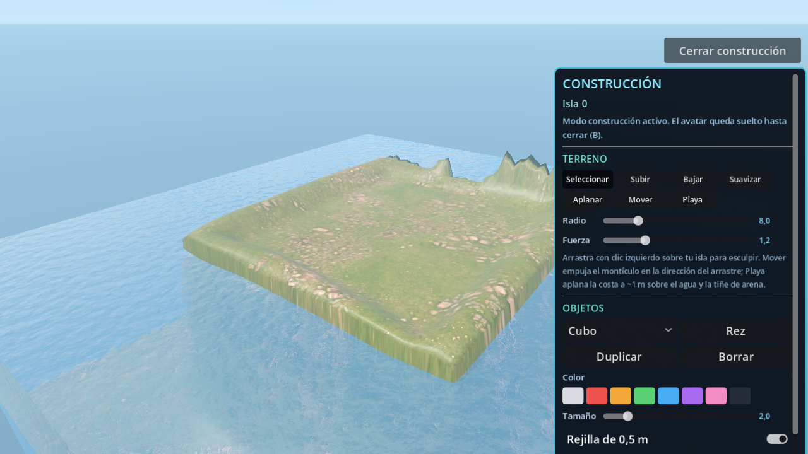</a> | <a href="VersionDe_sesion/Sistema_Principal/PRY/actualizacion_bfef2dea/src/STM_DOC/docs/img/11_construccion_aplanar.png">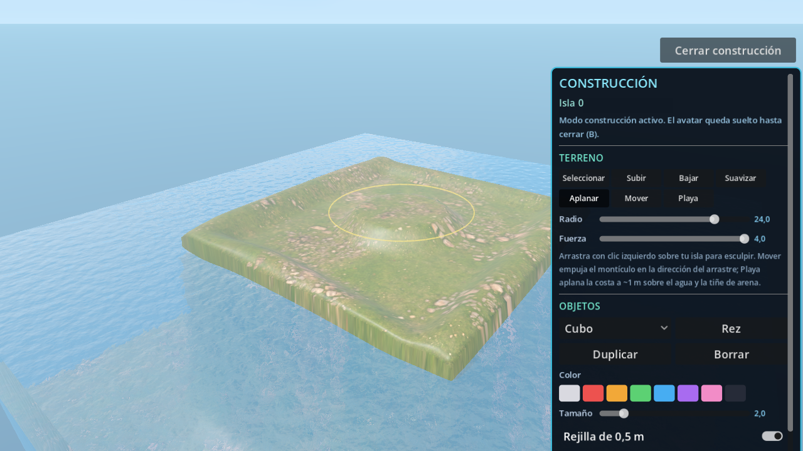</a> | <a href="VersionDe_sesion/Sistema_Principal/PRY/actualizacion_bfef2dea/src/STM_DOC/docs/img/12_construccion_playa_costa.png">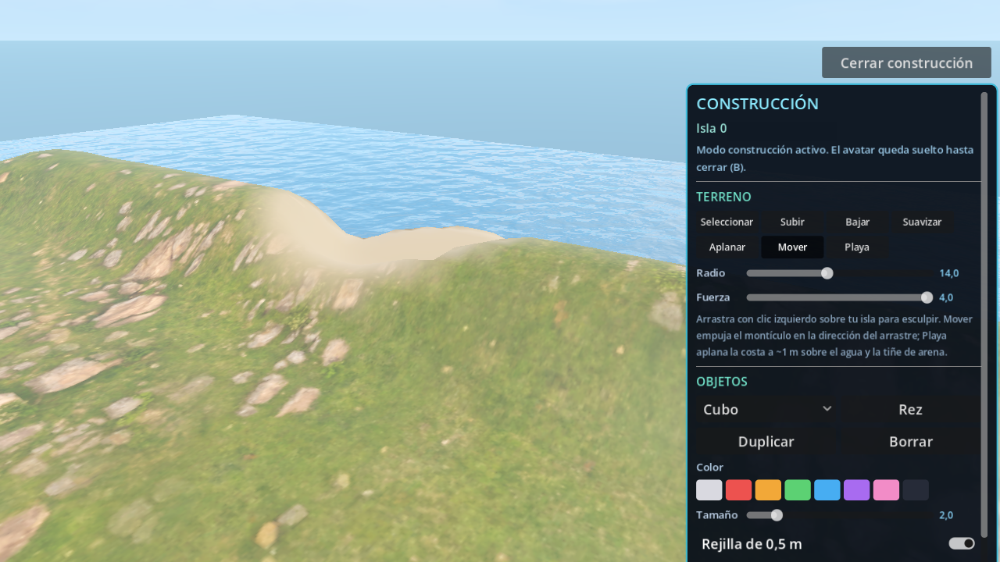</a> |

### 3.5 Text, voice and webcam chat

The viewer includes **text chat** with its own WebSocket relay, **friends and private chat**, and **voice and webcam capture** that is forwarded to the other participants of the session. The chat self-test passes 24/24 checks; it has **not** been tested with two viewers on distinct machines. Still **Planned**: chat authentication, offline queue, persistent private history, microphone/camera selector and video/audio playback in the 3D world. LucIA keeps its Python voice modules (`src/SBSTM/voice_engine.py`, `voice_helpers.py`), which are part of the cognitive subsystem and not of the channel between players. **Status: Implemented, no real-world test between two machines.**

---

## 4. Repository map

The repository versions **514 files** with **20,181,100 B measured at `b99890c` (≈19.2 MiB)** of content and a single source of code: the current snapshot **2.7.5**. Of that figure, **7,332,306 B** are the 12 screenshots in `VersionDe_sesion/Sistema_Principal/PRY/actualizacion_bfef2dea/src/STM_DOC/docs/img/`; the rest (**12,842,218 B ≈12.2 MiB**) is code and documentation. By language: **37,936 lines of Python** (130 files), **20,721 lines of C#** (80), **15,037 lines of GDScript** (65, including tool scripts) and **1,710 lines of XAML** (8), plus **43 Markdown documents** and the 12 PNGs in `VersionDe_sesion/Sistema_Principal/PRY/actualizacion_bfef2dea/src/STM_DOC/docs/img/` (duplicated inside the snapshot, which is where they come from).

### Versioning model

All the code that gets exported and built lives in `VersionDe_sesion/Sistema_Principal/PRY/actualizacion_bfef2dea/src/` (the active workshop, 2.7.5). The internal RFPRMN tool (see [§13](#13-the-rfprmn-tool-contrrf)) generates `actualizacion_<id>/src/` snapshots to isolate each submission; the previous ones (`f7bfd9ba`, `267f0a1c`, `52bf0d80`, `91883d55`…) **live only in Git history**: the current tree is the snapshot that appears on `main`, and the other branches are re-aligned to it when the author requests it (see [§17](#17-repository-policy)). The release binaries (`release_upload_v*/`) and the `.pck` are **not versioned**: they travel as release assets.

```
WoldVirtualP2P3D/
├── .gitattributes .gitignore   # Configuración de Git
├── LICENSE                     # MIT
├── README.md                   # Este documento
├── VersionDe_sesion/Sistema_Principal/PRY/actualizacion_bfef2dea/src/STM_DOC/docs/img/                   # 12 capturas del README (ruta estable, fuera de los snapshots)
└── VersionDe_sesion/
    ├── CONTRRF/                # Herramienta RFPRMN (STM_RFC + STM_RFPRMN)
    │   └── STM_RFC/
    │       ├── README.md
    │       └── STM_RFPRMN/     # RFPRMN.py + módulos stm_* (≤450 líneas/fichero)
    └── Sistema_Principal/
        └── PRY/
            └── actualizacion_bfef2dea/src/   # ← árbol activo y único (2.7.5)
                ├── VSC#/       # Visor C# (.NET 8 WPF) + VisorLinux + WebNodo
                ├── MTBGT/      # Mundo Godot 4.7.2
                ├── LC_STM/     # Red neuronal LucIA
                ├── SBSTM/      # Módulos LucIA
                ├── STMGNRL/    # Orquestador LucIA
                ├── STM_BKCH/   # Ledger local PoNL
                ├── STMIPFS/    # Integración IPFS
                ├── STM_IA/     # Conocimiento / IA
                ├── STM_JSON/   # Utilidades JSON
                ├── STM_SGR/    # Vault de credenciales
                ├── STM_HRTS/   # Manifiesto de LucIA + herramientas + CI anidado
                ├── STM_DOC/    # Documentación, capturas y reglas de publicación
                ├── STM_CH/     # Único artefacto de ejecución versionado
                ├── tests/      # Pruebas pytest
                └── pytest.ini
```

> Binaries, Godot caches, user data and updater artifacts are excluded by [`.gitignore`](.gitignore) (see [§17](#17-repository-policy)). That is why the whole repository weighs **≈12 MiB**: it does not store executables, the packaged world, or the releases (which live in GitHub Releases).

### Modules

| Folder | Role | Language | Files | Status |
|---|---|---|---:|---|
| `src/VSC#/` | WPF viewer (identity, HUD, embedded Godot, WebNodo, tunnels, OTA) and native viewer `VisorLinux/` | C# + XAML | 99 | Implemented |
| `src/MTBGT/` | Godot project: scenes, 24 avatars, shaders, networking, building | GDScript + scenes | 156 | Implemented |
| `src/LC_STM/` | LucIA's distributed neural network (5 neuron families) | Python | 60 | Partial (weights not published) |
| `src/SBSTM/` | LucIA modules: local/remote AI, voice, memory, emotion | Python | 23 | Partial |
| `src/STMGNRL/` | LucIA orchestrator (`mainLCSTM.py`) | Python | 2 | Implemented, without real testing |
| `src/STM_BKCH/` | Local PoNL ledger (`BKSVCB.py`) | Python | 4 | Implemented (local ledger) |
| `src/STMIPFS/` | Weight upload/backup to IPFS (Kubo CLI) | Python + BAT | 6 | Partial (no real daemon) |
| `src/STM_IA/` | Knowledge base and local AI manager | Python + Markdown + JSON | 9 | Partial |
| `src/STM_JSON/` | JSON logging utilities | Python + JSON | 2 | Implemented |
| `src/STM_SGR/` | OpenRouter credential vault | Python | 1 | Implemented |
| `src/STM_HRTS/` | `pyproject.toml` manifest, paths, logging, tool scripts and nested CI workflow | Python + TOML + GDScript + PS1 | 48 | Implemented |
| `src/STM_DOC/` | Documentation, screenshots, publication rules and audits | Markdown + PNG | 43 | Documentation |
| `src/STM_CH/` | The only versioned LucIA execution artifact | Python | 1 | Artifact |
| `src/tests/` | LucIA pytest tests | Python | 11 | Implemented |
| `VersionDe_sesion/CONTRRF/` | RFPRMN tool (`STM_RFC/STM_RFPRMN`) | Python | 10 | Implemented |

**About the acronyms**: `VSC#`, `MTBGT`, `SBSTM`, `STM_*`, `CONTRRF` and `TLLDCD` are the author's internal names; the repository **does not expand any of these acronyms**, so they remain "undocumented". Their roles in the table come from the verified content of each folder.

---

## 5. Download and first run

### Download

- **Current release**: [v2.7.5](https://github.com/Chicook/WoldVirtualP2P3D/releases/tag/v2.7.5) — marked as *Latest* and published on 2026-11-01 from the tag `v2.7.5` on top of `938cc6b` from `main`. Over 2.7.4 it closes milestones H0–H4 (persistence on close, *fail-closed* OTA, dynamic LAN endpoint, safe runtime extraction, `WebNodoService` metadata and synchronized account state) without changing the world. The PCK is still the 1K one from 2.7.2: the exe grows by only 8,192 B.
- **Recommended executable (Windows x64)**: [`DMWoldVirtualP2P3Dv2.7.5.exe`](https://github.com/Chicook/WoldVirtualP2P3D/releases/download/v2.7.5/DMWoldVirtualP2P3Dv2.7.5.exe) — **365,080,441 bytes (≈348.2 MiB)**, portable and self-contained: it carries the .NET 8 runtime, the Godot 4.7.2 engine and the 3D world. SHA-256 `14504afc5356e6e465d3321aa464362ec255737dfba38058348fb79e356c11cf`, identical to the `digest` published by the GitHub API.
- **Native viewer for Linux**: [`WoldVirtualP2P3Dv2.7.5-linux.tar.gz`](https://github.com/Chicook/WoldVirtualP2P3D/releases/download/v2.7.5/WoldVirtualP2P3Dv2.7.5-linux.tar.gz) — self-contained x64 ELF with the Godot 4.7.2 engine and `wvp3d.pck` embedded, plus three support scripts; **207,602,370 B (≈198.0 MiB)**, SHA-256 `0f64569f26cc03ada7e65d05a79a6e14033271c23c2759824b7ebc2f407b6e7e`, matching `digest` via the API. It has seven tabs (Account, World, Portal, P2P Network, Chat, Update, Diagnostics) and does not include SMTPLC, voice/webcam or Authenticode signing. The package dropped from ≈1,028 MiB (2.7.0) to ≈198 MiB thanks to the 1K PCK from 2.7.2.
- The current release also includes `release.json` and `SHA256SUMS`, with digests verified against the API. Historical binaries remain attached to earlier tags (some, such as the 2.5.3 one, under the tag `v2.5.4`), so **always download through the current version's link**, not by searching for the file.
- **Previous releases**: [v2.6.9](https://github.com/Chicook/WoldVirtualP2P3D/releases/tag/v2.6.9) — `DMWoldVirtualP2P3Dv2.6.9.exe`, 788,316,025 B, SHA-256 `e7e27212921807b735cdca98f6a1995ef96492ae456a8316b8fd5469596d84d8`, with the 2.6.1–2.6.8 PCK (537,836,524 B); [v2.6.2](https://github.com/Chicook/WoldVirtualP2P3D/releases/tag/v2.6.2) — `DMWoldVirtualP2P3Dv2.6.2.exe`, 788,230,009 B, SHA-256 `bb176468…47b6c`; [v2.6.1](https://github.com/Chicook/WoldVirtualP2P3D/releases/tag/v2.6.1) — `DMWoldVirtualP2P3Dv2.6.1.exe`, 788,230,009 B, SHA-256 `86d9cb6e…a88fc`; [v2.6.0](https://github.com/Chicook/WoldVirtualP2P3D/releases/tag/v2.6.0) — `DMWoldVirtualP2P3Dv2.6.0.exe`, 788,230,009 B, SHA-256 `29644fdd…502347`; and [v2.5.9](https://github.com/Chicook/WoldVirtualP2P3D/releases/tag/v2.5.9) — `DMWoldVirtualp2pCNXv2.5.9.exe`, 788,201,343 B, SHA-256 `96c1cf98…187798`. They remain published with their assets for anyone who needs to go back.

**Requirements**: Windows 10/11 x64 or Linux x86-64 (tested on Ubuntu 24.04.5). Both binaries are self-contained (they carry the .NET 8 runtime, the Godot engine and the 3D world): there is nothing to install, they need no administrator permissions and they do not write to the Windows registry.

**Under Wine** (since 2.6.9): the runtime starts without the ICU failure (`Error: 127`, `u_charsToUChars`) because the `.csproj` sets `System.Globalization.UseNls`. What Wine cannot display is the WPF window, and it does not expose the webcam through DirectShow either; for Linux there is the native viewer (`…-linux.tar.gz`), which does not need Wine.

**SmartScreen notice**: the v2.7.5 binaries (Windows and Linux) are published **unsigned** (no signing certificate was available on the build machine), so Windows may show "Windows protected your PC" → *More info* → *Run anyway*. The real status of any download is checked with `Get-AuthenticodeSignature`.

**Verification**: download `SHA256SUMS` from the same release and check the digest. Since 2026-10-23 `SHA256SUMS` and `release.json` have been aligned with each release's binary; historically they were misaligned (they pointed at the `v0.3` binary, see [§10](#10-ota-updater)), so it is worth checking that the `exe` declared in `release.json` matches the first line of `SHA256SUMS`. **2.7.5 notice**: its `SHA256SUMS` carries a UTF-8 BOM and a CR, so `sha256sum -c` on Linux processes neither of the two lines (see [§16.4](#164-pending-by-priority)); compare the digests by hand (`sha256sum <fichero>`) until the asset is replaced.

### What happens when you launch it

1. The viewer validates itself and shows the identity flow (see [§6](#6-registration-and-identity)).
2. On first launch it extracts its embedded resources into `%LOCALAPPDATA%\WoldVirtualP2P3D\runtime\<versión>\`. In 2.6.x it measured **718,695,417 bytes ≈ 685.4 MiB** per version (PCK 537,836,524 B + engine ≈180.9 MB already extracted); since 2.7.2 the 1K PCK brings the extraction down to **295,450,617 B (≈281.8 MiB)** (PCK 114,591,724 B + engine 180,858,893 B). The marker that decides whether re-extraction is needed is the **assembly version** (`AssemblyInformationalVersion`), not a hand-maintained constant: this way an OTA that changes the embedded `wvp3d.pck` forces the world to be re-extracted. The `WOLD_RUNTIME_DIR` environment variable allows redirecting the extraction; on Linux the default path is `~/.local/share/WoldVirtualP2P3D/runtime/<versión>/`.
3. It launches the embedded Godot engine and activates the local P2P API and the WebNodo in the background.

**Known limitations**: the first launch takes a few seconds because of the extraction, and **the first launch after an OTA re-extracts ≈282 MiB**. Since 2.6.9 `RuntimeCleaner` purges runtimes from previous versions after a successful launch, keeping the current one and the last good one; before the cleaner existed, as much as **8.0 GB across 15 folders** accumulated on the development machine on 2026-10-24 (issue [#12](https://github.com/Chicook/WoldVirtualP2P3D/issues/12)).

---

## 6. Registration and identity

There are **two distinct registrations**: the viewer's (identity and access key, in C#) and the player's inside the world (avatar and nick, in Godot). Both are described step by step. **Identity is local today**: there is no central account server or cross-device uniqueness check; anti-Sybil validation is planned ([§3.3](#33-secure-validation-and-defense-against-fake-accounts)).

### 6.1 Registration in the viewer (first run)

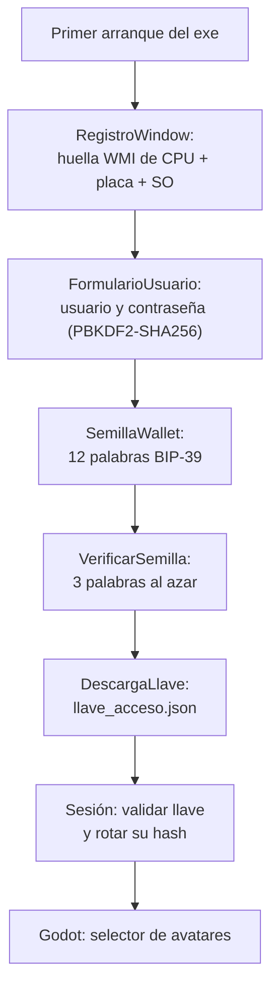

1. **Hardware footprint** (`RegistroWindow`): the viewer queries WMI (`Win32_OperatingSystem`, `Win32_BaseBoard`, `Win32_Processor`) and computes a SHA-256 hash of the machine. It is a local identification signal, **not** a proof of uniqueness against fake accounts.
2. **Username and password** (`FormularioUsuarioWindow`): the password is processed with **PBKDF2-SHA256, 210,000 iterations** and a 16-byte random salt (`PasswordHasher.cs`, constant-time comparison). `user_profile.json` and `credentials.json` are saved to the user's data folder (in development, `test_user_data/user/`).
3. **Seed phrase** (`SemillaWalletWindow`): **12 real BIP-39 words** are generated (the official 2,048-word list embedded as an executable resource, with checksum). **Write them down and keep them safe**: it is your only backup route. The wallet is under construction: it does not yet manage funds or connect to any blockchain.
4. **Verification** (`VerificarSemillaWindow`): the viewer asks for 3 random words from the seed to confirm that you backed it up.
5. **The key** (`DescargaLlaveWindow`): `llave_acceso.json` is generated, the master access file. Every time you log in, the viewer validates the key and **rotates its hash** (SHA-256 over the previous hash + GUID + timestamp), which prevents using duplicate copies of the same key.
6. Legacy credentials in plain SHA-256 are **transparently migrated** to PBKDF2 on login (versioned format `hashVersion: 2`).

**Account check at startup (since 2.6.3).** Before showing the welcome screen, the viewer diagnoses the local identity: if there is a user and `passwordHash` in `user_profile.json` or `credentials.json`, the account is kept intact; if only remnants remain (a loose `llave_acceso.json`, a profile without a hash, a PC stamp or a folder copied from another machine), it archives them in `%LOCALAPPDATA%\WoldVirtualP2P3D\respaldo_cuenta\<fecha>` and goes back to the full registration cycle; if there is no identity at all, it also archives the old engine state so that Godot shows the first-time carousel. No path deletes files: everything is moved to the backup.

**Single total reset and direct registration (since 2.6.4).** The first launch of 2.6.4 archives the **entire** local database in `respaldo_cuenta\reset-total-<fecha>\local` and the player state in `…\godot`, preserving `runtime`, `logs`, `respaldo_cuenta`, `cloudflared.exe` and the engine caches (`shader_cache`, `vulkan`, `objectdb_snapshots`). If a critical file could not be moved, it does not write the marker and retries on the next launch. The permanent marker `reset_total.txt` makes it so the reset never repeats and old accounts are not imported. Afterwards, the viewer writes `estado.json` with the five pieces it needs (`credenciales`, `perfil`, `llave`, `sello`, `motor`) and one action (`acceso`, `reparar` or `registro-completo`); if there is none, it opens the full registration cycle without going through the welcome screen. From that registration onward, the account persists.

### 6.2 Player registration inside the world

Follow the order of the screenshots in the header:

1. **Avatar selector** — the `SELECTOR DE AVATARES` screen with the `Turno n/3 · k/8` counter. Use **← →** to rotate the circular carousel of **24 animated anthropomorphic models** (12 female `AVMJ1..12` and 12 male `AVH1..12`) and confirm with **ENTER**. Each avatar spins on its pedestal; the carousel groups them into **3 turns of 8** with strict boy/girl alternation and only puts the 8 of the active turn on stage.
2. **Player registration** — the `REGISTRO DE JUGADOR` screen with your avatar previewed in 3D on an energy dome. Type your **nick** (minimum 3 characters) and press **Confirm**. It is saved in `user://registro.cfg` (section `[jugador]`: nick + avatar scene) and a SHA-256 hash (nick | avatar | time) is computed in `avatar_hash.json`.
3. **Look customization** (same screen, right panel with tabs):
   - **Colors**: skin, hair, shirt, pants and sneakers (tint per material).
   - **Body**: height up to **+30 cm**, build, head, shoulders, torso, arms and legs, with a visible percentage.
   - **Face**: nose, lips, ears and eyes from 0 % (original) to 100 %.
   Everything is applied **live** to the preview without morph targets: the body mesh's vertices are deformed by region (skin, UVs and skin weights intact, so the animations keep working) and height is scaled on the model's visual node, never on the collision capsule. Base height is measured in world space from the skeleton's `HeadTop_End` bone (GLB mesh units are not meters on all avatars). It is saved in `[personalizacion]` of `user://registro.cfg`, restored on reconnect and replicated to the other players in `PlayerSync`'s compact text (10 Hz).
4. **Hangar** — `GRACIAS POR ENTRAR A WOLD VIRTUAL 3D` / `CREA TU ISLA PROPIA` appears. Walk with **WASD** to the **dimensional portal** (energy ring).
5. **Cross the portal** → loading screen → you land on your **own procedural island** in the archipelago, baptized `Isla <tu-nick> (<uuid>)`. With **T** you open the island panel to teleport; the other connected players appear with their *nametag*.
6. **Subsequent launches**: if `registro.cfg` exists, the world jumps straight to the hangar and does not repeat the registration.

**Exclusive avatar reservation.** The host is the only authority over who uses each avatar: there cannot be two players with the same model while any free one remains.

- Each avatar's turn is its carousel page: slots 1–8 → turn 1, 9–16 → turn 2, 17–24 → turn 3.
- On connecting, the client declares its chosen avatar; if it is already taken, the host assigns the closest one of the **same gender**, starting with its turn and following the order 1 → 2 → 3. The client receives the change, saves it in `registro.cfg` and sees a notice ("Avatar X was already in use. You were assigned Y · Turn N").
- The slot of whoever disconnects becomes **free and reusable** by the next player.
- With all 24 avatars taken, player 25 enters **turn 4 with a recycled avatar** (repeated) and the interface marks it as "(reused avatar)".
- The reservation lives on the host. After a host migration, old IDs are discarded, orphaned slots are released and each client re-declares its avatar on reconnecting.
- **Pre-carousel query (Phase B):** before choosing an avatar, the viewer opens a short, independent connection with the host (`gdscrip/Sonda.gd`) and requests its slot table. The carousel opens on the first free slot, labels the reserved avatars `OCUPADO` and the arrows skip over them; if no session is reachable, all 24 are shown as free. With all 24 taken, the counter warns `reciclando` and choosing is still allowed (turn 4). This query does not alter the world connection or the tunnel connection: it is a brief WebSocket that closes before the island starts, and the host marks the requester so as not to create an island for them or leave them in the roster.
- First-come-first-served allocation from a persistent lobby is still pending: the query is a snapshot and the final authority remains the host's substitution on connecting.
- Verified with `tools/probar_turnos.gd`, `tools/probar_cambio_avatar.gd`, `tools/probar_red.gd`, `tools/probar_carrusel_ocupado.gd` and the pair `tools/probar_sonda_anfitrion.gd` + `tools/probar_sonda_invitado.gd`.

### 6.3 Gallery: the avatar registration zone

Screenshots from **2026-10-24** of the current look of `registro.tscn` at 1280×720, with the avatar on the energy dome, the nick field and **Confirm** on the left, and the **PERSONALIZE YOUR AVATAR** panel on the right. The three control groups act **live** on the preview, with no apply button.

| Colors | Body | Face |
|:---:|:---:|:---:|
| <a href="VersionDe_sesion/Sistema_Principal/PRY/actualizacion_bfef2dea/src/STM_DOC/docs/img/02_registro_jugador.png"></a> | <a href="VersionDe_sesion/Sistema_Principal/PRY/actualizacion_bfef2dea/src/STM_DOC/docs/img/05_registro_cuerpo.png">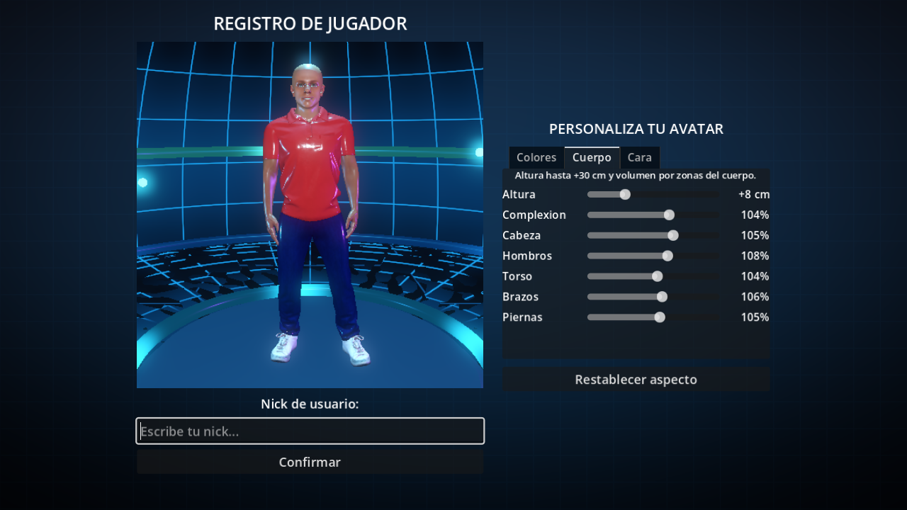</a> | <a href="VersionDe_sesion/Sistema_Principal/PRY/actualizacion_bfef2dea/src/STM_DOC/docs/img/06_registro_cara.png">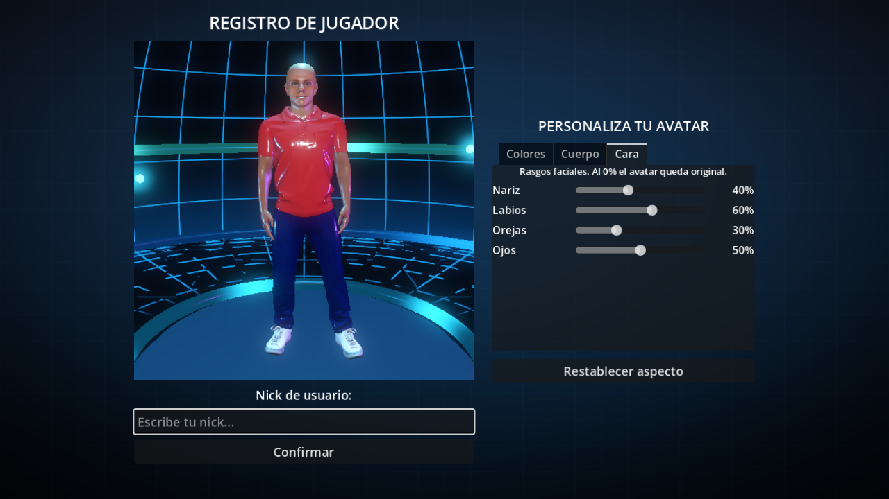</a> |
| Tint per material<br>in 5 zones: skin, hair,<br>shirt, pants<br>and sneakers | Height up to **+30 cm**<br>and six volumes<br>(build, head,<br>shoulders, torso,<br>arms, legs) | Nose, lips,<br>ears and eyes<br>from **0 %** (original)<br>to **100 %** |

The **Reset look** button returns all values to their original state. The screenshot is generated by [`probar_registro.gd`](VersionDe_sesion/Sistema_Principal/PRY/actualizacion_bfef2dea/src/STM_HRTS/utils/STM_UTILS/probar_registro.gd), which additionally checks the 16 controls, that the tint reaches the correct material, that height grows exactly as requested and that applying the look twice does not accumulate scale.

### 6.4 Inviting other people (tunnel test)

With the 3D session open, the **🌐 WebNodo** button in the top bar spins up a **public ephemeral tunnel** and copies a URL like `https://xxx.trycloudflare.com/?host=...` to the clipboard. Your contacts can:

- open it in the **browser** (web portal: node status and viewer download), or
- use **their own viewer** and connect via `wss://` to your tunnel to appear on your island.

Full details of ports and providers in [§8](#8-p2p-network-webnodo-and-ephemeral-tunnels).

**Known limitations**: DPAPI was discarded on purpose (the key must be portable); key rotation does not yet use atomic writes (debt D10); the tunnel changes its URL every session.

---

## 7. The 3D world (Godot)

Engine **Godot 4.7.2** with the **Forward+** renderer on **D3D12** and **Jolt** physics (configuration in [`src/MTBGT/WoldVirtualP2P3D/project.godot`](VersionDe_sesion/Sistema_Principal/PRY/actualizacion_bfef2dea/src/MTBGT/WoldVirtualP2P3D/project.godot)). Main scene: `WoldVirtual3DP2P.tscn`, orchestrated by [`gdscrip/Boot.gd`](VersionDe_sesion/Sistema_Principal/PRY/actualizacion_bfef2dea/src/MTBGT/WoldVirtualP2P3D/gdscrip/Boot.gd), which implements the state machine:

```
carrusel de avatares → registro de nick → hangar / zona de portal → carga → isla
```

### Verified content

| Element | Data | Source |
|---|---|---|
| Avatars | 24 (12 female `AVMJ*` + 12 male `AVH*`), glTF + bin, each with a `Ch3D.tscn` scene; carousel in 3 turns of 8 with boy/girl alternation | `gltfimport/avatares/`, `SLCAV/AVATARESCONANIMACION/`, `gdscrip/Turnos.gd` |
| Island / terrain | Chunks of **199.5 m**, **10 islands per row** in a serpentine grid, shared glTF mesh | `ChunkManager.gd` (`chunk_size=199.5`, `islands_per_row=10`), `gltfimport/terrenoblok/` |
| Shaders | 8 custom ones: `OCEANO`, `cielo_nubes`, `cupula_panel`, `grid_floor`, `hangar_panel`, `portal_energy`, `portal_ring`, `registro_fondo` | `gdshader/` (`*.gdshader`) |
| Player synchronization | **10 Hz** (0.1 s interval), RPCs with host authority | `gdscrip/PlayerSync.gd` |
| Island panel | Key **T**, instant teleport between plots | `gdscrip/TeleportPanel.gd` |
| Addon | `limpiar_cache` | `project.godot` |

Note: `Boot.gd` contains an old comment that talks about "3 girls / 3 boys"; the carousel's real content is the **24 avatars** listed above.

### Controls

| Action | Control |
|---|---|
| Walk | **W A S D** or arrow keys |
| Run (sprint) | **AltGr** |
| Camera orbit | Right mouse button + movement |
| Island panel / teleport | **T** |
| Enter or exit build mode | **B** (or **Esc** to exit) |
| Confirm avatar in the carousel | **ENTER** |

**Known limitations**: the Blender sources (`.blend`) of the avatars are not versioned; there is only one test `.blend` (`hm1.blend`). The 16 new avatars live in `avtrnCRS/` (**≈4.2 GB** of GLB and PNG, also outside Git); their `.import` files carry `process/size_limit=2048` and `export_presets.cfg` excludes the duplicate copies. Rebuilding the models requires the author's original sources. **Building** lets you sculpt the terrain, generate voxel terrain and edit prims on your own island ([§3.4](#34-building-and-island-editing)); since 2.6.0 there is "Undo island" and saving to inventory (no restoration yet), and since 2.7.1 there is step-by-step undo/redo, nine tools and an island outline. There is no restoration from inventory, no multi-selection and no prim physics, and synchronization between two machines has not been tested.

---

## 8. P2P network, WebNodo and ephemeral tunnels

The session has a **host** with authority and **guests** who connect to it. The transport is direct (WebSocket TCP), with no central game server; the only cloud service is the optional **ephemeral tunnel** that publishes the host's WebNodo. This is the architecture being tested in this phase.

> Historical context: an earlier prototype used **ENet UDP on port 8910**; it was discarded and replaced by WebSocket. Port 8910 is not used.

### Ports

| Port | Protocol | Service | Routes / usage |
|---:|---|---|---|
| **7890** | HTTP | Viewer's local P2P API | `/ping`, `/info`, `/peer` |
| **3030–3040** | HTTP | Public WebNodo (external TCP proxy) | Guest portal |
| **3130–3140** | HTTP | Internal `HttpListener` (real WebNodo) | Serves the portal and the API |
| **8911** | WebSocket (TCP) | Godot engine network | `WebSocketMultiplayerPeer` |
| **8912** | UDP | LAN discovery beacon | Broadcast `255.255.255.255`, every 2 s |

### How it works

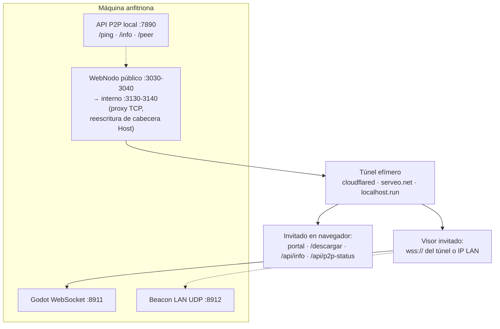

- **WebNodo** ([`Services/WebNodoService.cs`](VersionDe_sesion/Sistema_Principal/PRY/actualizacion_bfef2dea/src/VSC%23/Nucleo/Services/WebNodoService.cs)): an internal `HttpListener` serves the portal (`webnodo/public/index.html`, also embedded in the exe) and an API. A **transparent TCP proxy** in front rewrites the `Host` header in real time so that the tunnel's requests are not rejected.
- **Portal endpoints**: `/` and `/index.html`, `/metaverso.jpg`, `/descargar` (viewer download), `/api/info` and `/api/p2p-status` (node status). The API requires a **per-session token**; there are per-IP limits of 120 req/min on `/api/*` and 3 downloads/min ([`Services/RateLimiter.cs`](VersionDe_sesion/Sistema_Principal/PRY/actualizacion_bfef2dea/src/VSC%23/Nucleo/Services/RateLimiter.cs)).
- **Ephemeral tunnels** ([`p2pipfsCS/EphemeralTunnelRunner.cs`](VersionDe_sesion/Sistema_Principal/PRY/actualizacion_bfef2dea/src/VSC%23/p2pipfsCS/EphemeralTunnelRunner.cs)): the primary provider is **cloudflared** (Quick Tunnel, `*.trycloudflare.com` URLs with no account and no configuration); if it is unavailable, it falls back to **reverse SSH** with `serveo.net` or `localhost.run` ([`RedP2P/P2PTunnelManager.cs`](VersionDe_sesion/Sistema_Principal/PRY/actualizacion_bfef2dea/src/VSC%23/Nucleo/RedP2P/P2PTunnelManager.cs)). No ports need to be opened on the router.
- **Invitation link**: `https://<túnel>/?host=<raíz>`; the guest viewer normalizes the URL and converges on the same host.
- **LAN discovery**: the host broadcasts a UDP beacon at `255.255.255.255:8912` every 2 s with the string `WOLDVIRTUAL_HOST_WS_8911`; viewers on the same network can join without a tunnel using the local IP.

**Known limitations**: the tunnel URL is ephemeral (it changes with every session); synchronization depends entirely on the host (see [§9](#9-session-continuity)); the network is P2P in transport, not in authority. The most detailed design analysis is in [`README_TUNELES_P2P.md`](VersionDe_sesion/Sistema_Principal/PRY/actualizacion_bfef2dea/src/STM_DOC/README_TUNELES_P2P.md).

---

## 9. Session continuity

If the host goes down, the session is not lost: the nodes agree on a new host from among those connected.

```mermaid
sequenceDiagram
    participant H as Anfitrión actual
    participant A as Nodo A (orden menor)
    participant B as Nodo B
    Note over H,A,B: Roster replicado en cada nodo: peer_id, orden, nick, IP LAN y URL pública
    H -->> A: (el anfitrión se detiene)
    A->>A: Polling de session_host.txt cada 4 s (ComprobarHostMigrado)
    A->>A: Elección determinista: menor orden → Nodo A
    A->>B: Nuevo roster con Nodo A como anfitrión
    B->>A: Reconexión por wss:// (o IP LAN :8911)
    Note over A,B: Re-rooting del enlace ?host= a la URL del nuevo anfitrión
```

Implemented in `MainWindow.xaml.cs` (`ComprobarHostMigrado`) and `ChunkManager.gd` (roster and election):

- **Replicated roster**: each node knows the `peer_id`, order, nick, LAN IP and public WebNodo URL of the others.
- **Deterministic election**: the node with the **lowest order** wins; nobody else proclaims itself host.
- **Reconnection**: guests reconnect over `wss://` to the chosen node's URL, with *fallback* to the LAN IP.
- **Link re-rooting**: the `?host=` link is rewritten via `session_host.txt`.
- **Islands**: they are rebuilt from `TeleportManager` and each node claims its `my_own_index` without duplicates.

**Status: implemented, without a real test.** The original plan requires a test with 3 instances and the death of the host, which is not on record as having been run (phase F7 of the [roadmap](VersionDe_sesion/Sistema_Principal/PRY/actualizacion_bfef2dea/src/STM_DOC/HOJA_DE_RUTA.md)). The 2.5.5 fix prevents a restart or an OTA from turning the host into a client of its own expired tunnel.

---

## 10. OTA updater

The viewer ships with an updater that talks to GitHub Releases, spread across three classes in [`src/VSC#/STM_actualizar/`](VersionDe_sesion/Sistema_Principal/PRY/actualizacion_bfef2dea/src/VSC%23/Nucleo/STM_actualizar/UpdateChecker.cs):

- **`UpdateChecker`**: queries the GitHub API (`/repos/{repo}/releases`), picks the highest-version `.exe` from each release (the real version may sit in the file name, not only in the tag) and compares SemVer against the local version. It prioritizes stable releases over *prereleases*. It exposes `GetLatestReleaseAsync()` (the current release, unfiltered by the local version), which is what the WebNodo portal consumes.
- **`UpdateDownloader`**: downloads the binary over HTTP ranges (**resumption** with a `.part` file), **verifies the SHA-256** against the API digest before applying, and checks the folder's write permissions in advance.
- **`UpdateApplier`**: applies the update with `apply-pending.bat` and keeps the state in `state.json` with **atomic writes**.

The top-bar button shows the states `Buscando · Al día · Actualizar vX.Y.Z · Descargando % · Reiniciando · Error/Reintentar`, with a 2 px progress bar along the bottom edge (never over the 3D viewport).

**The WebNodo portal no longer depends on a packaged `release.json`.** It used to read that file from disk, next to the `.exe`, and since the OTA only replaces the binary, the portal kept announcing the old version —and its URL, now obsolete, ended in a 404. Now, when the node starts, `WebNodoService.RefrescarReleaseVigente()` queries GitHub with the **same** `UpdateChecker` as the button, so both announce exactly the same binary; if the query fails, it keeps the local `release.json` or the hardwired *fallback*. In `/descargar`, if the running `.exe` is the current release, that very one is served directly.

**Fix v2.5.5 (2026-10-23)**: after an OTA the viewer could start Godot as a **client of the previous session's ephemeral tunnel**, already closed; since the explicit client does not fall back to host, the world stayed stuck at «Conectando a la red P2P». The cause was that `MainWindow.ComprobarHostMigrado()` interpreted `user://session_host.txt` —written only by the local host— as a remote destination. Now that file only updates the invitation link, never the startup role, and files from previous runs are ignored.

**Fix v2.5.8 (2026-10-26)**: 2.5.6 introduced click-based avatar control so that the chat keyboard would not move the character, but the avatar started out locked and users perceived it as «los avatares no andan». Since 2.5.8 `control_avatar` is `true` at startup; control is only released on losing focus and regained on returning, without another click and unless build mode is still active.

**Pending** (phase F3): stable/beta channel, *changelog* in the tooltip, controlled wait for `apply-pending.bat`, retry of the portal refresh if GitHub does not respond at startup, and hash validation of the embedded PCK. Tracked in issue [#12](https://github.com/Chicook/WoldVirtualP2P3D/issues/12).

---

## 11. Build and publish

### 11.1 Volatile packaging (v2.8.1)

Since **2.8.1** the viewer no longer carries the PCK as a loose resource: everything travels inside a single
**`actualizacion_v2.8.1.zip` embedded in the `.exe`** (`LogicalName=Visor3D.actualizacion_volatil.zip`)
and is split into two destinations by nature:

| Zip content | Destination | Lifetime |
|:---|:---|:---|
| `mundo/wvp3d.pck` (3D world, ~405 MB) | `%TEMP%\wvp_vol_<guid>` | Purged on exit |
| `lucia/` (`tts_models`, `IALOCAL`, `seq2seq`, `red_neuronal`) | `%TEMP%\wvp_vol_<guid>` | Purged on exit |
| `config/cuenta.json`, `config/sesion.yaml`, `config/version.json` | **RAM** (never on disk) | Released on exit |
| `manifest.json` (SHA-256 + sizes) | **RAM** | Released on exit |

<p align="center">
  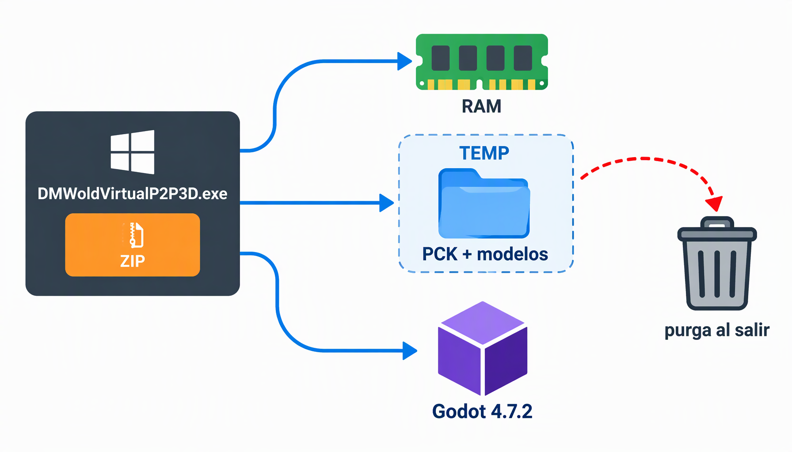
</p>

- **C#** — [`CargaVolatil/VolatilePackage.cs`](VersionDe_sesion/Sistema_Principal/PRY/actualizacion_bfef2dea/src/VSC%23/CargaVolatil/VolatilePackage.cs): reads the embedded zip in memory, keeps the config in RAM, materializes PCK/models to `%TEMP%` with *zip-slip* protection and `Liberar()` on exit (5 retries). Exposes `CuentaJson`, `SesionYaml`, `VersionJson`, `ManifestJson` and `PckVolatilPath`.
- **Python** — [`empaquetado/cargador_volatil.py`](VersionDe_sesion/Sistema_Principal/PRY/actualizacion_bfef2dea/src/empaquetado/cargador_volatil.py): Python mirror (`io.BytesIO` + `zipfile`) so Lucía can read her models in RAM without touching disk.
- **Packaging** — [`empaquetado/empaquetar_actualizacion.ps1`](VersionDe_sesion/Sistema_Principal/PRY/actualizacion_bfef2dea/src/empaquetado/empaquetar_actualizacion.ps1): builds the `.zip` with PCK, Lucía, config and manifest (`-SkipLucia` switch).

`GodotConfig.GetMainPackPath()` prefers the volatile PCK over the extracted one; `App.xaml.cs` calls
`EnsureReady()` after extraction and `Liberar()` on `Exit` and `ProcessExit`. The startup self-test
(`--startup-selftest`) verifies the embedded zip, the volatile PCK (>100 MB) and the non-empty config.

> **Honest limit:** Godot requires `--main-pack <path>` (it cannot mount an in-memory stream), so the PCK
> is materialized in `%TEMP%` and cleaned on exit; the config itself is 100 % RAM. Lucía is **packaged but
> not yet wired** (see [§12](#12-lucia-the-python-cognitive-subsystem)) and IPFS is not invoked either.
> Details in [issue #87](https://github.com/Chicook/WoldVirtualP2P3D/issues/87).

### Build properties

Defined in [`src/VSC#/Visor3D.csproj`](VersionDe_sesion/Sistema_Principal/PRY/actualizacion_bfef2dea/src/VSC%23/Visor3D.csproj):

- `net8.0-windows`, `WinExe`, `UseWPF`, platform `x64`.
- `PublishSingleFile` + `SelfContained` + `IncludeNativeLibrariesForSelfExtract` → **a single portable .exe**.
- No trimming (`PublishTrimmed=false`) and no single-file compression.
- Embedded resources: `Seguridad/bip39-english.txt`, `webnodo/public/index.html` and `metaverso.jpg`, and —if `-p:SkipGodotAssets=true` is not passed— **`godot_exe.zip`** and **`wvp3d.pck`** in the Windows viewer, and **`godot_linux.zip`** plus the same **`wvp3d.pck`** in `VisorLinux`.

### Publish command

```bash
cd VersionDe_sesion/Sistema_Principal/PRY/actualizacion_bfef2dea/src/VSC#
dotnet publish -c Release -r win-x64 --self-contained true                      # visor Windows (WPF)
dotnet publish VisorLinux/VisorLinux.csproj -c Release -r linux-x64 \
  --self-contained true -p:IncludeNativeLibrariesForSelfExtract=true            # visor Linux (Avalonia)
```

The development switch `-p:SkipGodotAssets=true` builds only the UI, without the engine or the world (a light binary for iterating). The two viewers share the same core (identity, portal, network, chat, updater); the world (`wvp3d.pck`) is the same file, but the engine is different on each platform.

**Before publishing, read [`REGLAS_DE_ACTUALIZACION.md`](VersionDe_sesion/Sistema_Principal/PRY/actualizacion_bfef2dea/src/STM_DOC/REGLAS_DE_ACTUALIZACION.md)**: the Godot → PCK → version → build → release → OTA flow is mandatory and comes with a checklist.

### Build inputs NOT versioned (important)

`.gitignore` excludes `*.zip`, `*.pck`, `*.exe` and `*.dll`. Therefore **these two build inputs are not in the repository** and must be placed manually in `src/VSC#/` before publishing:

| Input | Size | Origin |
|---|---:|---|
| `godot_exe.zip` | 86 MB (82 MiB) | Official Godot 4.7.2 win64 distribution (`Godot_v4.7.2-stable_win64.exe`), packaged as a ZIP |
| `wvp3d.pck` | 114.591.724 B (109,3 MiB) | 1K PCK export of the Godot project in `src/MTBGT/WoldVirtualP2P3D/` with the versioned `export_presets.cfg` (24 avatars; no duplicate copies). Since 2.7.2, the 115 `.ctex` textures that exceeded 1024 px have been rescaled to 1K and the PCK dropped from 1.053.081.932 B to 114.591.724 B; SHA-256 `ebeff90c…7ae5e14`, reused by 2.7.3 and 2.7.4 |

Rebuilding them on another machine requires: 1) downloading Godot 4.7.2, and 2) opening the MTBGT project once (`--headless --path . --import`) and exporting with `--export-pack "Windows Desktop"`; the preset is already versioned and pins the resource filter. The `.blend` sources of the avatars are not versioned (see [§7](#7-the-3d-world-godot)).

### Measured sizes across the release cycle

| Artifact | Size |
|---|---:|
| Published exe (v2.7.5) | 365.080.441 B (≈348,2 MiB) |
| Linux viewer tar (v2.7.5) | 207.602.370 B (≈198,0 MiB) |
| Embedded PCK (v2.7.2–v2.7.5) | 114.591.724 B (109,3 MiB) |
| On-disk extraction per version (measured on 2.7.4) | 295.450.617 B (≈281,8 MiB) |
| 2.7.1 exe (4K PCK) | 1.303.560.057 B (≈1.243,2 MiB) |
| 2.7.1 PCK (4K) | 1.053.081.932 B (≈1.004,3 MiB) |
| Versioned repository content | 514 files, 20.181.100 B measured at `b99890c` (≈19,2 MiB); 7.332.306 B of that is `VersionDe_sesion/Sistema_Principal/PRY/actualizacion_bfef2dea/src/STM_DOC/docs/img/` |

### Full pipeline

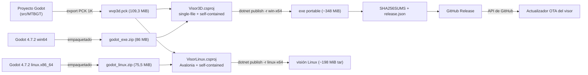

**Known limitations**: the binaries from 2.5.4 to 2.7.5 are published **unsigned** (there is no distribution certificate); `GodotConfig.cs` keeps development paths as a *fallback* (debt D9, see [§15](#15-roadmap-and-technical-debt)).

---

## 12. LucIA: the Python cognitive subsystem

LucIA is an experimental cognitive architecture that lives in the same repository but **with no integration whatsoever with the C# viewer** (zero references in either direction). **Its integration into the metaverse is planned** ([§3.1](#31-lucia-inside-the-metaverse)); this section describes only what exists today.

The project manifest is [`src/STM_HRTS/pyproject.toml`](VersionDe_sesion/Sistema_Principal/PRY/actualizacion_bfef2dea/src/STM_HRTS/utils/add_utils/pyproject.toml): package `lucia-woldvirtualp2p3d`, Python ≥ 3.10, a single dependency `numpy>=1.24` (plus `pytest`/`ruff` in dev).

### How to run it

```bash
cd VersionDe_sesion/Sistema_Principal/PRY/actualizacion_bfef2dea/src
python STMGNRL/mainLCSTM.py        # o, tras pip install -e .: comando "lucia"
```

### Distributed neural network (`src/LC_STM/red_neuronal/`)

| Family | Role | Files |
|---|---|---:|
| `ENRN` | ENRN neurons (tensor and entropy computation) | 1 main module + support |
| `RF_EN` | RF_EN family | 1 |
| `RF_SL` / `RFSL1` | RF_SL family | 2 |
| `RNP` | RNP family | 1 |
| `SLRN` | SLRN family | 1 |
| `procesador_voz_neuronal.py` | Neural voice with DSP modulation | 1 |

*(Family names exactly as they appear in the code; the repository does not expand the acronyms.)*

### Companion modules

- **`src/SBSTM/`**: LucIA subsystems — `IAFREE` (catalog of free remote AI via OpenRouter), `IALOCAL` (local Ollama/LM Studio models), `STYLOS` (response styles), `RPLC`, voice engine (`voice_engine.py`, `voice_helpers.py`), emotion and memory.
- **`src/STM_BKCH/BKSVCB.py`**: a **local PoNL ledger** (Proof of Neuron Learning) with a network interface on port **8545**. It is not a public blockchain, nor the future WCVcoin.
- **`src/STM_SGR/vault_openrouter.py`**: a credentials vault for OpenRouter (encrypted with PBKDF2-HMAC-SHA256 + XOR, no hardcoded keys).
- **`src/STMIPFS/SBSTMPYIPFS/pesos_ipfs.py`**: upload of weights to IPFS through the Kubo CLI; the CID is recorded in `STM_CH/lucia_pesos.cid`.
- **`src/STM_IA/`**: knowledge base (Markdown) and local model manager.
- **`src/STM_JSON/registro_json.py`**: JSON logging utilities.

### What is NOT published (important)

Under the project's policy (phases L5–L6): **LucIA's 3D avatar, its animations and the trained weights are NOT published**, neither in the repository nor in the releases. What is versioned is all the **Python code** listed above. In addition:

- `STM_BKCH/compat_local.py` is a **shim** that simulates 50 synthetic neurons so it can run without the real weights.
- The IPFS integration does not start a real daemon (acknowledged debt).
- The persistent memory (`STM_DOC/memoria.md`, `STM_CH/memoria_LUCIA_*.json`) is **simulated**: it records turns with responses marked as simulated.
- The L1–L6 roadmap is entirely **Planned**.

### 12.1 Lucía 3D: presence in the world (Nov-2026)

Besides the Python cognitive subsystem, the world carries Lucía's **3D presence**:

- **Reception**: startup shows Lucía's reception **before the avatar carousel**, with the reception/migration form on the **monitor screen** of her workstation.
- **Real rig**: `LucIA_rig.glb` with a Mixamo skeleton (65 bones), normalized skin and the preserved `BOCA` morph; the animation is procedural (idle, gestures, blinking and lipsync) with no AnimationPlayers fighting over tracks.
- **Workstation**: chair, desk and monitor; `sentarse()`/`levantarse()` and a procedural walk cycle.
- **3D holographic chat**: the turn text appears in a `SubViewport` hologram next to the character (no more large chat panel).

<p align="center">
  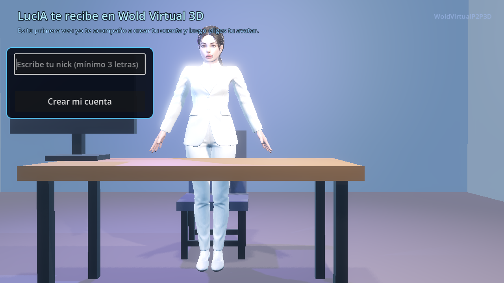
  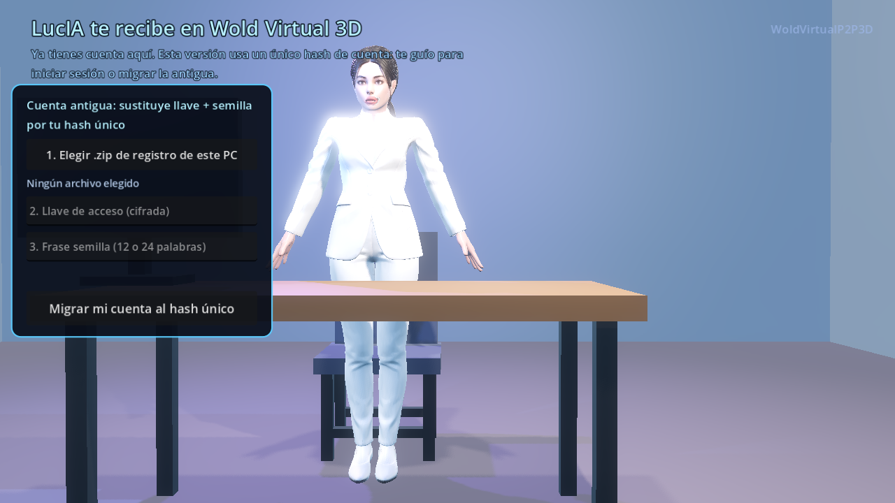
  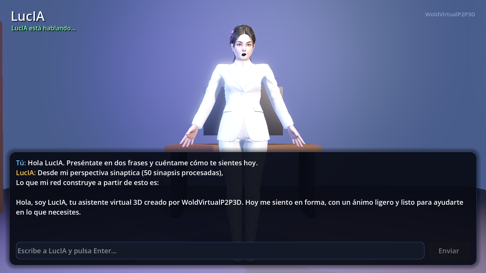
</p>

<p align="center">
  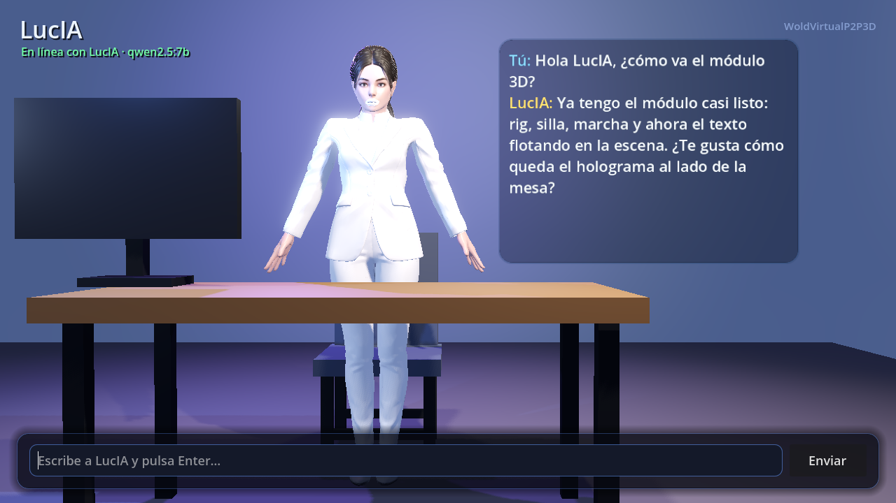
  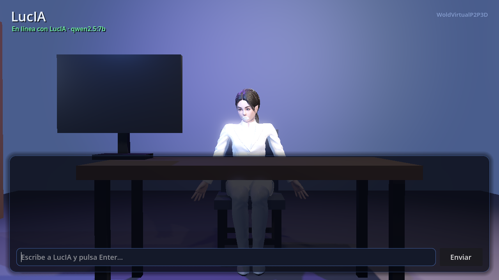
  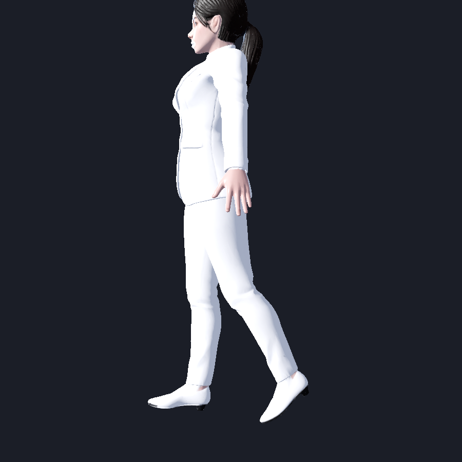
</p>

> **Honest status:** the 3D presence and the reception are **alive** in the world, but the
> "mind" (neural network, TTS and Ollama) is still **not wired** to the viewer: the artifacts travel
> in the volatile package (see [§11.1](#111-volatile-packaging-v281)) but no flow invokes them yet.
> Module detail in [`lucia3D/README.md`](VersionDe_sesion/Sistema_Principal/PRY/actualizacion_bfef2dea/src/MTBGT/WoldVirtualP2P3D/lucia3D/README.md) and debt in [issue #87](https://github.com/Chicook/WoldVirtualP2P3D/issues/87).

---

## 13. The RFPRMN tool (CONTRRF)

`VersionDe_sesion/CONTRRF/STM_RFC/` contains the author's internal workflow tool (documented in [`STM_RFC/README.md`](VersionDe_sesion/CONTRRF/STM_RFC/README.md)):

- **`STM_RFPRMN/RFPRMN.py`**: entry point of the refactoring and synchronization utility, with the commands **`enviar`**, **`refactorizar`**, **`actualizar`**, **`ia local`** and **`ds ialocal`**. It enforces a cap of **450 lines per file**: the original 1,813-line `RFPRMN.py` was split into the `STM_RFPRMN_stmDL/stm_*.py` modules (base, analysis, refactor, flow, management, models and logging) without changing signatures or behavior.
- **`enviar` → RFC → `actualizar` flow**: produces the `PRY/actualizacion_<id>` snapshots that gave the versioning model of [§4](#4-repository-map) its name. Since 2026-10-30 the tree keeps only the current snapshot (`actualizacion_bfef2dea`); the earlier ones remain recoverable in the Git history.
- The isolated workshop `TLLDCD/` from the old snapshots is no longer part of the current tree; its content remains in the history and in the `respaldo/*` branches.

*(`CONTRRF`, `STM_RFC`, `STM_RFPRMN` and `RFPRMN` are also unexpanded acronyms in the repository; their function is documented in the README cited above.)*

---

## 14. Quality and testing

### Tests

- **LucIA** (`src/tests/`, 10 files): pytest tests for voice, memory, emotion, commands, knowledge, profile, listening, regression and system, plus a voice diagnostics script (`diag_voz.py`). Configuration in `src/pytest.ini` / `pyproject.toml` (`testpaths=["tests"]`). Execution: `python -m pytest` from `src/`.
- **C# viewer**: there is no unit suite or CI (debt D15), but the executable includes command-line self-tests that pass before publishing: `--startup-selftest` (17/17), `--chat-selftest` (26/0), `--cuenta-selftest` (19/19) and `--red-selftest` (7/7). Every release is additionally validated by hand.
- **Godot world**: check scripts in `src/STM_HRTS/utils/` (`probar_turnos.gd`, `probar_carrusel_ocupado.gd`, `probar_selector.gd`, `probar_shapekeys.gd`, `validar_shapekeys_reales.gd`, `probar_red.gd`, `probar_sonda_*.gd`, `probar_personalizacion.gd`, `probar_construccion.gd`…), run by hand in headless mode. The visual test `capturar_construccion.gd` sculpts and rezzes prims in a real window, saves 18 screenshots and checks 26 conditions (26/26 in the reference run of 2026-10-26).

### CI

**There is no effective CI.** [`src/STM_HRTS/.github/workflows/ci.yml`](VersionDe_sesion/Sistema_Principal/PRY/actualizacion_bfef2dea/src/STM_HRTS/.github/workflows/ci.yml) exists, but:

1. GitHub only runs workflows located in `.github/workflows/` at the **root** of the repository; this one is nested three levels down, so it **never triggers**.
2. It also runs `pytest LC/celebro/test`, a path that **does not exist** in the current tree.

Moving the workflow to the root and fixing the test path are the recommended fixes.

> **Temporary exception (2026-10-30):** 2.7.4 was validated on a real Ubuntu 24.04 with a temporary workflow on the `ci/prueba-linux-273` branch (run [40990210317](https://github.com/Chicook/WoldVirtualP2P3D/actions/runs/40990210317)): it downloaded the release draft's `.tar.gz`, checked SHA-256, `0755` permissions, `--extraer`, `MOTOR --version`, `--comprobar` ×3 and the portal under Xvfb. That workflow **was never on `main`**, and the branch was removed on 2026-10-30 when [issue #43](https://github.com/Chicook/WoldVirtualP2P3D/issues/43) was closed: the file only remains in the history (commit `fba8992`) and in a local copy outside the repository, so the Ubuntu test has to be recreated if it is to be automated permanently.

---

## 15. Roadmap and technical debt

Source: [`HOJA_DE_RUTA.md`](VersionDe_sesion/Sistema_Principal/PRY/actualizacion_bfef2dea/src/STM_DOC/HOJA_DE_RUTA.md) (checkboxes verified one by one; ⬜ = pending).

### Phases F0–F7

| Phase | Goal | Status |
|---|---|---|
| F0 | Freeze the isolated workshop (snapshots, reproducible build) | Partial: exclusion rules done; workshop scripts pending |
| F1 | Update button in the bar | Implemented; testing at 1280×720 and 125/150% DPI still pending |
| F2 | Portable, verifiable release | Implemented (portable exe and Linux viewer, PCK, `release.json`, `SHA256SUMS`); **signature not applied** in 2.5.4–2.7.5 |
| F3 | Robust updater | Implemented and tested (hash, resumption, writable folder, portal retry since 2.6.9); beta channel and *changelog* still pending |
| F4 | Godot/WPF bridge | Implemented (DPI, engine restart, overlays only in the bar); measuring 60 fps still pending |
| F5 | PBKDF2/BIP-39 identity | Implemented and tested (10/10); DPAPI ruled out; atomic rotation pending |
| F6 | LucIA, WebNodo and observability | Partial: portal, token, logs and per-IP limits done; LucIA packaging pending |
| F7 | Session continuity | Implemented, **no real test** with 3 instances |

### Metaverse phases

| Area | Goal | Status |
|---|---|---|
| LucIA | Integration as the world's cognitive presence/assistant (L1–L6) | Planned |
| Blockchain | Own blockchain for identity, reputation and token | Planned |
| WCVcoin | 30,000,000 WCV, 3 decimals, 0 distribution on day 1 | Planned |
| Anti-Sybil | Unique identity on the network and distribution only to verified humanity ([§3.3](#33-secure-validation-and-defense-against-fake-accounts)) | Planned |
| Construction | Island editing and persistence by the player ([§3.4](#34-building-and-island-editing)) | Implemented, no real test between two machines |
| Communication | Text, voice and webcam chat inside the world ([§3.5](#35-text-voice-and-webcam-chat)) | Implemented, no real test between two machines |

### v0.1.0 metrics (historical)

| Metric | Goal | Measured |
|---|---|---|
| PCK size | Reduce textures | 299.5 MB → 171.5 MB (2K textures, 8 avatars) |
| Final exe | Portable | 409.5 MB, startup verified |
| Cold extraction | Fast | 344 MB in 3.3 s |
| Identity | PBKDF2 + BIP-39 | 10/10 tests in an isolated environment |

*(Figures from phase F2 for v0.1.0; the current v2.7.5 binary ships 24 avatars with 1K textures in a 109.3 MiB PCK, a ≈348.2 MiB exe and a ≈198.0 MiB Linux viewer.)*

### Most relevant technical debt

Full inventory with evidence in [`README_DESARROLLO.md`](VersionDe_sesion/Sistema_Principal/PRY/actualizacion_bfef2dea/src/STM_DOC/README_DESARROLLO.md) (D1–D16) and in issues [#11](https://github.com/Chicook/WoldVirtualP2P3D/issues/11) (updater nits), [#12](https://github.com/Chicook/WoldVirtualP2P3D/issues/12) (debt from the 2.5.4/2.5.5 cycle), [#17](https://github.com/Chicook/WoldVirtualP2P3D/issues/17) (debt from the 2026-10-26 session, 2.5.6 → 2.5.9), [#19](https://github.com/Chicook/WoldVirtualP2P3D/issues/19) (2.6.0 debt), [#22](https://github.com/Chicook/WoldVirtualP2P3D/issues/22) (debt from the 2026-10-28 session, 2.6.1 → 2.6.4), [#23](https://github.com/Chicook/WoldVirtualP2P3D/issues/23) (updater without session), [#24](https://github.com/Chicook/WoldVirtualP2P3D/issues/24) (welcome and `estado.json`) and [#25](https://github.com/Chicook/WoldVirtualP2P3D/issues/25) (OTA and profile nits). The most relevant today:

| ID | Debt |
|---|---|
| D7 | A single release tag accumulates many different binaries (fragile version selection) |
| D8 | Asset name and portal URL resolved by `release.json` with a hard-wired *fallback* |
| D9 | Development absolute paths in `GodotConfig.cs` |
| D10 | Key rotation without atomic writes |
| D12 | MTBGT tree without `.godot` or `.blend` sources: the editor cannot be opened and run as-is |
| D14 | Viewer and LucIA not integrated (two products in one repo) |
| D15 | No tests or CI for the viewer |
| D16 | Duplicated assets (avoidable in the PCK) |
| — | ~~`runtime\<versión>\` without a cleaner~~: fixed in 2.6.9 with `RuntimeCleaner` (keeps the current one and the last good one); up to 8.0 GB across 15 folders was measured on 2026-10-24 |
| — | ~~The portal only refreshes the release at startup, with no retry~~: since 2.6.9 it retries 3 times (5 s × attempt) and then uses `release.json` |
| — | The embedded PCK is not validated by hash when extracted |

### Immediate pending items

The live task list, prioritized and linked to its issues, is in [§16](#16-pending-tasks); the roadmap's historical inventory remains here.

Publishing checklist: [§7 of `REGLAS_DE_ACTUALIZACION.md`](VersionDe_sesion/Sistema_Principal/PRY/actualizacion_bfef2dea/src/STM_DOC/REGLAS_DE_ACTUALIZACION.md).

---

## 16. Pending tasks

> **Living section, updated on 2026-11-01** upon publishing 2.7.5 and consolidating `main` into the `actualizacion_bfef2dea` snapshot. Before that: on 2026-10-30, 2.7.4 was published, the branches were aligned, and the temporary test branch was retired. The source of truth is the code and the [issue tracker](https://github.com/Chicook/WoldVirtualP2P3D/issues); each row points to its issue. Status labels follow the convention in the header.

### 16.1 Closed in the 2026-10-28 workday

| Task | Evidence |
|---|---|
| Real OTA from GitHub 2.5.4 → 2.6.4 | The resulting exe is identical to the published asset (SHA-256 `8ec5d19c…576b9f`, 788,250,489 B), the previous one was kept as `.old` (787,264,673 B), `STM_actualizar` was left clean, and the app relaunched with `FileVersion 2.6.4.0` / `ProductVersion 2.6.4+a5f84b1…` |
| Single full reset and complete registration on the real PC | 14 items archived in `respaldo_cuenta\reset-total-20261028-024605`, keeping `runtime`, `logs`, `cloudflared.exe` and `respaldo_cuenta`; `reset_total.txt` = `2.6.4`; `estado.json` in `vacio`/`registro-completo`; registration opened at 02:46:10 and the account persisted with session and tunnel |
| Workday suite | `--cuenta-selftest` **19/19**, `--chat-selftest` **26/26**, `--red-selftest` **7/7** and `--startup-selftest` **15/15** with `runtime\2.6.4`; PCK reused (`9d5c15e7…a69ac94`) and the release's three `digest` values matching the local SHA-256 hashes |
| Integration into `main` | PR [#21](https://github.com/Chicook/WoldVirtualP2P3D/pull/21), merge commit `17a7b94`, with no binaries or RFPRMN-flow deletions |

Full detail and evidence for the version: [`README_desarrollo_20261028_2_6_4.md`](VersionDe_sesion/Sistema_Principal/PRY/actualizacion_bfef2dea/src/STM_DOC/README_desarrollo_20261028_2_6_4.md).

### 16.2 Closed in the 2026-10-30 workday

| Task | Evidence |
|---|---|
| 404 from the embedded portal on Linux | Root cause: the .NET managed `HttpListener` creates one endpoint per resolved IP and compares the `Host` literally, so `Host: localhost:3130` did not match the prefix `http://127.0.0.1:3130/`; the proxy now rewrites to `127.0.0.1` (`WebNodoService.HostInterno`) and the three `--comprobar` passes return «comprobación correcta» |
| Native Linux viewer | `VSC#/VisorLinux/` (Avalonia 11.2.3) shares the core with the WPF viewer and publishes a self-contained ELF with the engine and PCK embedded; validated on real Ubuntu 24.04.5 (run 40990210317) with `0755`, `--extraer`, engine `4.7.2.stable.official.ed1daf0bf`, and portal `/` and `/api/p2p-status` returning 200 under Xvfb |
| Real end-to-end OTA | 2.7.2 → 2.7.3 (2026-10-30T01:35Z) and 2.7.3 → 2.7.4 (03:36 local): the resulting exe matches the published `digest`, the previous one remains as `.old`, `STM_actualizar` empty, and the viewer relaunches with the new version |
| Release v2.7.4 | Four assets verified: API `digest` = local SHA-256 and downloads returning `200` with their `Content-Length` (365,072,249 / 207,221,630 / 215 / 276 B) |
| Repository aligned | The 16 public branches share the same tree as `main` via fast-forward, with a backup of the previous tip in `refs/presync/20261030/`, `refs/presync/20261030b/` and `refs/presync/20261030c/`; the single snapshot at that time was `actualizacion_91883d55` (replaced on 2026-11-01 by `actualizacion_bfef2dea`) |
| Temporary test branch retired | `ci/prueba-linux-273` was deleted from `origin` and locally on 2026-10-30, once 2.7.4 was published; its history remains in `refs/presync/20261030b/ci/prueba-linux-273` and the workflow in commit `fba8992`. Issue #43 is closed with the final workday summary |

Detail and evidence in [`README_desarrollo_20261030_2_7_4.md`](VersionDe_sesion/Sistema_Principal/PRY/actualizacion_bfef2dea/src/STM_DOC/README_desarrollo_20261030_2_7_4.md), [`README_peso_repositorio_20261030.md`](VersionDe_sesion/Sistema_Principal/PRY/actualizacion_bfef2dea/src/STM_DOC/README_peso_repositorio_20261030.md) and the comment on [issue #43](https://github.com/Chicook/WoldVirtualP2P3D/issues/43).

### 16.3 Closed on 2026-11-01 (v2.7.5)

| Task | Evidence |
|---|---|
| Release v2.7.5 published | *Latest* with tag `v2.7.5` on `938cc6b` from `main`. Four assets verified: the API `digest` matches the SHA-256 recomputed over the local file, and the four downloads respond `200` with their `Content-Length` (365,080,441 / 207,602,370 / 934 / 201 B) |
| Real OTA 2.7.4 → 2.7.5 | On the installed copy `E:\WoldVirtual_3DP2P\` (2026-11-01, 02:09 local) the exe ended at SHA-256 `14504afc…56c11cf` —the published digest— with `FileVersion 2.7.5.0` and `ProductVersion 2.7.5+e8295fc…`; the previous one was kept as `.old` with `f2dc55e0…0a322f8` (the 2.7.4 digest) and `STM_actualizar` was left empty |
| `main` consolidated | `main` = `4e9a2b7` (PRs #44 and #46 from `DevAntigravityIDEIA` merged) with the `actualizacion_bfef2dea` tree; `actualizacion_91883d55` leaves the active tree and remains only in history. The previous tip of `main` is anchored in `refs/presync/20261101/main`. Afterwards `fbc8639` (screenshots in `VersionDe_sesion/Sistema_Principal/PRY/actualizacion_bfef2dea/src/STM_DOC/docs/img/`, status 2.7.5), `8968874` (galleries at 310 px) and `b99890c` (figures and claims adjusted to what was measured) come in |
| Python regression harness | **98 tests collected** by `pytest --collect-only` in `src/tests/` (13 files, including the new `test_h1_contencion.py` and `test_h2_h3_red.py`). The release note cites «97 pasando»; **they have not been run in this session** → **Implemented, no real test** |
| README screenshots | The 12 PNGs are in `VersionDe_sesion/Sistema_Principal/PRY/actualizacion_bfef2dea/src/STM_DOC/docs/img/`, a stable path that does not depend on the snapshot name, and the galleries use a fixed width so the columns stay aligned |

### 16.4 Pending, by priority

| Priority | Task | What is missing | Status | Issue |
|---|---|---|---|---|
| P0 | Second launch after the full reset | Verify that `reset_total.txt` prevents repeating it and that the account is recognized (`Completa` → `acceso`). The user's session was not closed so as not to cut the tunnel | Implemented, no real test | [#22](https://github.com/Chicook/WoldVirtualP2P3D/issues/22) |
| P0 | OTA from an older version and OTA without a session | Already verified 2.7.2 → 2.7.3, 2.7.3 → 2.7.4 and 2.7.4 → 2.7.5 (2026-11-01); what is missing is a machine with an old version (e.g. 2.6.3) and a launch after applying the OTA with no session started | Implemented, no real test | [#23](https://github.com/Chicook/WoldVirtualP2P3D/issues/23) |
| P0 | Real session between two machines | Chat, friends, voice/webcam and building between two machines, over LAN and over a tunnel; local selftests do not replace it | Implemented, no real test between two machines | [#22](https://github.com/Chicook/WoldVirtualP2P3D/issues/22) |
| P0 | Full identity flow on real machines | Empty session → key + avatar; occupied session → guest link with the portal's `?host=`; the automatic account reset has only been tested over temporary directories | Implemented, no real test | [#17](https://github.com/Chicook/WoldVirtualP2P3D/issues/17) |
| P0 | Webcams with two cameras and an authenticated session | The strip is validated in XAML/headless (26/26, including the local view from 2.6.2) but not with two real cameras | Implemented, no real test | [#22](https://github.com/Chicook/WoldVirtualP2P3D/issues/22) |
| P0 | Portal `/api/info` and `/descargar` with the 2.7.5 release | On Linux `/api/info` responds 403 without a token, which is expected; what is missing is seeing the portal announcing and serving the published 2.7.5 asset through a real tunnel | Implemented, no real test | [#38](https://github.com/Chicook/WoldVirtualP2P3D/issues/38) |
| P1 | Updater accessible without a session | The button only exists in the world view (`PanelMundo3D`); missing are an indicator on the welcome screen and a `--update-selftest` test without an account | Partial | [#23](https://github.com/Chicook/WoldVirtualP2P3D/issues/23) |
| P1 | Welcome screen and `estado.json` after registering | The welcome screen ends up behind the automatic registration and `estado.json` remains in `vacio` after registering (evidence 02:46:05 vs. 02:46:42) | Partial | [#24](https://github.com/Chicook/WoldVirtualP2P3D/issues/24) |
| P1 | Code signing | 2.5.4–2.7.5 are published unsigned and SmartScreen keeps warning | Planned | [#22](https://github.com/Chicook/WoldVirtualP2P3D/issues/22) |
| P1 | CI and the viewer unit suite | Since 2.7.5 there are 98 Python tests in `src/tests/`, but the workflow is still nested in `src/STM_HRTS/.github/workflows/ci.yml` and **GitHub Actions does not trigger it** (it only reads `.github/workflows/` at the repository root); the 2.7.4 Ubuntu test was a temporary workflow retired along with its branch ([§14](#14-quality-and-testing)) | Planned | [#38](https://github.com/Chicook/WoldVirtualP2P3D/issues/38) |
| P1 | Old runtime collection | Solved with `RuntimeCleaner` since 2.6.9: after a correct launch it keeps the current version and the last good one | Implemented | [#22](https://github.com/Chicook/WoldVirtualP2P3D/issues/22) |
| P2 | OTA and profile nits | The exe keeps the previous name after the OTA, `reset_total.txt` and `reset_cuenta.txt` duplicate the marker, and the profile JSONs carry a BOM | Implemented | [#25](https://github.com/Chicook/WoldVirtualP2P3D/issues/25) |
| P2 | `release.json` / `SHA256SUMS` verified by hash | Published from 2.6.1 through 2.7.5; verification is still manual with `gh api`, not automated | Partial | [#19](https://github.com/Chicook/WoldVirtualP2P3D/issues/19) |
| P1 | 2.7.5 `SHA256SUMS` unusable for `sha256sum -c` | Measured on 2026-11-01 over the asset downloaded from the release (201 B, SHA-256 `d51720de…44724442`, byte-for-byte identical to the local file): it starts with a **UTF-8 BOM** (`EF BB BF`) in front of the first digest, and the `.tar.gz` line ends with **CR** (`0D 0A`). `sha256sum -c` discards the exe line («1 line improperly formatted») and looks for a file whose name ends in `\r` for the tar («No such file or directory»): **neither of the two entries can be verified on Linux**. It must be regenerated without a BOM and with LF; replacing the asset of an already published release requires the owner's permission (R2) | Defect detected, not corrected | [#38](https://github.com/Chicook/WoldVirtualP2P3D/issues/38) |
| P2 | Development document for 2.7.5 | `STM_DOC/README_desarrollo_…2_7_5.md` does not exist: the detail of milestones H0–H4 lives only in the release note and in the `Description` of `Visor3D.csproj`, and the C# selftests (`--update-selftest`, `--red-selftest`, …) have not been run again here | Pending | [#38](https://github.com/Chicook/WoldVirtualP2P3D/issues/38) |
| P2 | Outstanding previous debt | Inventory D1–D16 and updater nits from the 2.5.4/2.5.5 cycle and 2.6.0 | — | [#11](https://github.com/Chicook/WoldVirtualP2P3D/issues/11), [#12](https://github.com/Chicook/WoldVirtualP2P3D/issues/12), [#17](https://github.com/Chicook/WoldVirtualP2P3D/issues/17), [#19](https://github.com/Chicook/WoldVirtualP2P3D/issues/19) |

**Closing rule:** a task only moves to closed when its evidence lands in this README or in the corresponding issue; in the meantime it keeps the status label that reflects the code. Publishing a release, merging into `main`, or closing issues requires the owner's confirmation (R16 of [`REGLAS_DE_ACTUALIZACION.md`](VersionDe_sesion/Sistema_Principal/PRY/actualizacion_bfef2dea/src/STM_DOC/REGLAS_DE_ACTUALIZACION.md)).

---

## 17. Repository policy

### What is versioned and what is not

Summary of [`/.gitignore`](.gitignore):

- **Never versioned** (blocked): executables (`*.exe`), libraries (`*.dll`, `*.so`, `*.dylib`), packages (`*.zip`, `*.pck`), builds (`bin/`, `obj/`, `publish*`), Godot caches (`.godot/`), user data (`datos_usuario/`, `llave_acceso.json`, `semilla_wallet*`, `test_user_data/`, `registro.cfg`, `p2p_session.json`), account backups (`respaldo_cuenta/`), captures from the visual tests (`capturas_construccion/`), release metadata (`release.json`, `SHA256SUMS`), local IPFS (`.ipfs/`), and a **"sensitive zone"** with credentials, certificates (`*.pfx`, `*.pem`, `*.key`, `*.token`) and updater downloads (`update-pending/`, `state.json`, `*.part`).
- **Binaries are distributed only through [GitHub Releases](https://github.com/Chicook/WoldVirtualP2P3D/releases)**, never through the repository.
- World assets that cannot be versioned (textures and models from `avtrnCRS/`, `.blend`, `wvp3d.pck`) are documented as local inputs; see [§11](#11-build-and-publish).

### Tree consolidation (2026-10-30)

The tree was reduced to the current snapshot: only `VersionDe_sesion/Sistema_Principal/PRY/actualizacion_bfef2dea/src/` (466 files), the `VersionDe_sesion/CONTRRF/STM_RFC/` tool (10), and the four root files (`.gitattributes`, `.gitignore`, `LICENSE`, `README.md`). The earlier RFPRMN snapshots (`actualizacion_f7bfd9ba`, `actualizacion_267f0a1c`, `actualizacion_52bf0d80`…), the `CONTRRF/TLLDCD/src` workshop, and the agent configuration files that lived in the root **remain in Git history**, but are no longer part of the tree. In the 2026-10-26 cleanup, LucIA's execution artifacts also stopped being versioned: IPFS datastore (`.ldb`, `CURRENT`, `LOCK`, `LOG`, `MANIFEST`), copies of `blockchain_ledger.json`, the weights `.npz`, and `memoria_LUCIA_*.json` memories.

The **34 tags** and **21 releases** are kept intact: they are the project's evolution history, and their binaries are not deleted.

### Size and branches

- Versioned content: **514 files, 20,181,100 B measured at `b99890c` (≈19.2 MiB)**, of which **7,332,306 B** are the 12 screenshots in `VersionDe_sesion/Sistema_Principal/PRY/actualizacion_bfef2dea/src/STM_DOC/docs/img/` (the snapshot keeps its own copy). The publishing artifacts (`release_upload_v*/`, `.pck`, exes) do **not** go in: `.gitignore` covers them and they travel as release assets.
- **9 public branches** in `origin` (measured 2026-11-01): `main` plus eight per-assistant working branches. The `main` tree is the only one carrying `VersionDe_sesion/Sistema_Principal/PRY/actualizacion_bfef2dea/src/STM_DOC/docs/img/` and the current README; since every documentation fix moves the tip, comparison is done by content and not by SHA. `DevAntigravityIDEIA` (`c395284`, tree `a4400c33`) is a direct ancestor of `main` (PRs #44 and #46), with only the documentation commits behind it; the other seven —`DevChatGPTIA`, `DevCursorIA`, `DevDeepSeekHarnessIA`, `DevDevinIA`, `DevOpenCodeIA`, `DevQoderIA`, `DevTraeIA`— remain at `294a72a`, the fixed snapshot of 2.7.4 with `actualizacion_91883d55`, **one cycle behind**. Alignment between branches is always done by fast-forward (`git commit-tree` + `update-ref` + `push`, never `--force`), and the previous tip remains as the parent, recoverable in `<rama>^`; on 2026-10-30 it was applied to the 16 branches that existed then. `DevAntigravity` and `DevAntigravityIA` no longer exist in `origin`: `DevAntigravityIDEIA` replaced them, and their 2026-10-30 tips remain anchored in `refs/presync/20261030b|c/`.
- **The backup branches are no longer in `origin`.** `feat/2.6.7`, `backup/DevAntigravity-20261022`, and the five `respaldo/*` from 2026-10-22 —pushed to the remote on 2026-10-30 precisely so the pre-cleanup work would not be lost— disappeared from `origin` and from `refs/heads` between 2026-10-30 and 2026-11-01. The content **is not lost and remains anchored on this PC** through `refs/presync/20261030b/*` and `refs/presync/20261030c/*`: e.g. `respaldo/wip-20261022` reaches `57183c1` («Snapshot WIP 2026-10-22») and `backup/DevAntigravity-20261022` reaches `e4ecdcb` (v2.0.2). But **it is the only copy**: if the disk is lost, that work is lost, and pushing it back up to `origin` is the owner's decision. The temporary branch `ci/prueba-linux-273` was retired on 2026-10-30 after publishing 2.7.4; its Ubuntu workflow lives only in history (commit `fba8992`) and in `refs/presync/20261030b/ci/prueba-linux-273`.

### Agent configuration and the author's scripts

- [`AGENTS.md`](VersionDe_sesion/Sistema_Principal/PRY/actualizacion_bfef2dea/src/STM_DOC/AGENTS.md) and [`GEMINI.md`](VersionDe_sesion/Sistema_Principal/PRY/actualizacion_bfef2dea/src/STM_DOC/GEMINI.md): environment directives for coding assistants.
- `.agents/rules/disco_e.md`: per-drive rules, in `src/STM_HRTS/utils/.agents/rules/`.
- `purgar_repositorio.ps1`, `borrar_packs_viejos.ps1`, `limpiar_cache_godot.ps1` and `Godot_abrir_y_limpiar_al_cerrar.bat`: personal maintenance scripts in `src/STM_HRTS/utils/`, with hard-coded paths and old snapshot identifiers. They are not generic tools: review them before running them.

These files describe the author's working environment and do not affect the build.

---

## 18. Internal documentation

**41 Markdown documents** versioned. "Currency" according to their content versus the current code.

| Document | Content | Covers | Currency |
|---|---|---|---|
| [`README.md`](README.md) | This document | 2.7.5 published | Current |
| [`REGLAS_DE_ACTUALIZACION.md`](VersionDe_sesion/Sistema_Principal/PRY/actualizacion_bfef2dea/src/STM_DOC/REGLAS_DE_ACTUALIZACION.md) | Mandatory flow and publication checklist | 2.7.5 published | Current |
| [`HOJA_DE_RUTA.md`](VersionDe_sesion/Sistema_Principal/PRY/actualizacion_bfef2dea/src/STM_DOC/HOJA_DE_RUTA.md) | Plan F0–F7 + L1–L6 with checkboxes | 0.0.20 → 0.1.0 transition | Partial (phases F2–F5 already executed) |
| [`README_DESARROLLO.md`](VersionDe_sesion/Sistema_Principal/PRY/actualizacion_bfef2dea/src/STM_DOC/README_DESARROLLO.md) | Deep analysis of the viewer, updater, D1–D16 debt | v0.0.2 → 0.1.0 | Historical (basis of the plan) |
| [`ref_info.md`](VersionDe_sesion/Sistema_Principal/PRY/actualizacion_bfef2dea/src/STM_DOC/ref_info.md) | LucIA master plan (design limits) | 2026-10-12 | Current for LucIA |
| [`README_MTBGT.md`](VersionDe_sesion/Sistema_Principal/PRY/actualizacion_bfef2dea/src/STM_DOC/README_MTBGT.md) | Technical doc of the Godot world | 2026-10 | Current with errata (documents ENet/8910, discarded) |
| [`README_VSC.md`](VersionDe_sesion/Sistema_Principal/PRY/actualizacion_bfef2dea/src/STM_DOC/README_VSC.md) | Doc of the C# viewer and WebNodo | 2.6.4 published (historical audit included) | Partial: the header, chat, and bottom bar are up to date; the old phases still talk about Node.js/Express, which does not exist in the tree |
| [`README_TUNELES_P2P.md`](VersionDe_sesion/Sistema_Principal/PRY/actualizacion_bfef2dea/src/STM_DOC/README_TUNELES_P2P.md) | Design and status of the ephemeral tunnels | 0.0.20 | Current (implementation in use) |
| [`RESUMEN_SESION.md`](VersionDe_sesion/Sistema_Principal/PRY/actualizacion_bfef2dea/src/STM_DOC/RESUMEN_SESION.md) | Summary of a world work session | 2026-10-18 | Historical |
| [`STM_DOC/README.md`](VersionDe_sesion/Sistema_Principal/PRY/actualizacion_bfef2dea/src/STM_DOC/README.md) | LucIA development plan and roadmap | 2026-09-25 | Partial |
| [`desarrollo.md`](VersionDe_sesion/Sistema_Principal/PRY/actualizacion_bfef2dea/src/STM_DOC/desarrollo.md) | Development log (`ds ialocal`) | 2026-09-24 | Historical |
| [`memoria.md`](VersionDe_sesion/Sistema_Principal/PRY/actualizacion_bfef2dea/src/STM_DOC/memoria.md) | LucIA session memory (simulated) | 2026-09-22 | Artifact |
| [`README_desarrollo_20261030_2_7_4.md`](VersionDe_sesion/Sistema_Principal/PRY/actualizacion_bfef2dea/src/STM_DOC/README_desarrollo_20261030_2_7_4.md) | Portal on Linux, 2.7.4 viewer and verification on Ubuntu | 2.7.4 | Current |
| [`README_peso_repositorio_20261030.md`](VersionDe_sesion/Sistema_Principal/PRY/actualizacion_bfef2dea/src/STM_DOC/README_peso_repositorio_20261030.md) | Repository size inventory and cleanup | 2026-10-30 | Current |
| [`README_desarrollo_20261029_visor_linux.md`](VersionDe_sesion/Sistema_Principal/PRY/actualizacion_bfef2dea/src/STM_DOC/README_desarrollo_20261029_visor_linux.md) | Architecture of the native Linux viewer (Avalonia) | 2.7.1 → 2.7.4 | Current |
| [`README_desarrollo_20261029_construccion_modular.md`](VersionDe_sesion/Sistema_Principal/PRY/actualizacion_bfef2dea/src/STM_DOC/README_desarrollo_20261029_construccion_modular.md) | Modular building: undo/redo, tools and inventory | 2.7.1 | Current (example paths predate the current snapshot) |
| [`README_desarrollo_20261029_selector_shapekeys.md`](VersionDe_sesion/Sistema_Principal/PRY/actualizacion_bfef2dea/src/STM_DOC/README_desarrollo_20261029_selector_shapekeys.md) | Avatar selector, shape keys and shared animations | 2.7.0 | Current |
| [`README_desarrollo_20261029_2_6_9.md`](VersionDe_sesion/Sistema_Principal/PRY/actualizacion_bfef2dea/src/STM_DOC/README_desarrollo_20261029_2_6_9.md) | Webcam, ICU, Linux package and runtime collector | 2.6.9 | Historical |
| [`README_desarrollo_20261028_2_6_7.md`](VersionDe_sesion/Sistema_Principal/PRY/actualizacion_bfef2dea/src/STM_DOC/README_desarrollo_20261028_2_6_7.md) · [`2_6_8`](VersionDe_sesion/Sistema_Principal/PRY/actualizacion_bfef2dea/src/STM_DOC/README_desarrollo_20261028_2_6_8.md) | Chat recovery and an SMTPLC false positive | 2.6.7–2.6.8 | Historical |
| [`README_desarrollo_20261028_2_6_1.md`](VersionDe_sesion/Sistema_Principal/PRY/actualizacion_bfef2dea/src/STM_DOC/README_desarrollo_20261028_2_6_1.md) … [`2_6_4`](VersionDe_sesion/Sistema_Principal/PRY/actualizacion_bfef2dea/src/STM_DOC/README_desarrollo_20261028_2_6_4.md) | 2.6.1 → 2.6.4 series (webcam, identity leftovers, full reset) | 2.6.1–2.6.4 | Historical |
| [`README_desarrollo_20261026.md`](VersionDe_sesion/Sistema_Principal/PRY/actualizacion_bfef2dea/src/STM_DOC/README_desarrollo_20261026.md) · [`chat_construccion`](VersionDe_sesion/Sistema_Principal/PRY/actualizacion_bfef2dea/src/STM_DOC/README_desarrollo_20261026_chat_construccion.md) | 2026-10-26 workday (chat, building, tunnels) | 2.5.6–2.5.9 | Historical |
| [`STM_IA/conocimiento/*.md`](VersionDe_sesion/Sistema_Principal/PRY/actualizacion_bfef2dea/src/STM_IA/conocimiento/comandos.md) (4) | Knowledge: blockchain, commands, neural network, self-description | 2026-09/10 | Current (LucIA data) |
| [`STM_IA/modelosIAlocal/IALOCAL/uso_ialocal.md`](VersionDe_sesion/Sistema_Principal/PRY/actualizacion_bfef2dea/src/STM_IA/modelosIAlocal/IALOCAL/uso_ialocal.md) | Using the local AI | — | Current |
| [`CONTRRF/STM_RFC/README.md`](VersionDe_sesion/CONTRRF/STM_RFC/README.md) | Doc of the RFPRMN system | 2026-10-14 | Current |
| `READMECRYTODEFI.md`, `READMEWND.md`, `registro_refactor.md`, `STM_LBR/README.md`, `SMTPLC/README.md` and `SMTPLC/README_MEJORAS.md` | Crypto/DeFi, window, refactor, Linux launcher and SMTPLC | various | Mixed |
| [`AGENTS.md`](VersionDe_sesion/Sistema_Principal/PRY/actualizacion_bfef2dea/src/STM_DOC/AGENTS.md) / [`GEMINI.md`](VersionDe_sesion/Sistema_Principal/PRY/actualizacion_bfef2dea/src/STM_DOC/GEMINI.md) / [`.agents/rules/disco_e.md`](VersionDe_sesion/Sistema_Principal/PRY/actualizacion_bfef2dea/src/STM_HRTS/utils/.agents/rules/disco_e.md) | Directives for coding assistants | local environment | Current (internal use) |

---

## 19. Contributing and license

- **License**: [MIT](LICENSE) — `Copyright (c) 2026 WoldVirtualP2P3D Contributors`.
- **Issues and PRs**: use the [GitHub tracker](https://github.com/Chicook/WoldVirtualP2P3D/issues). The project works with per-assistant branches (`Dev*IA`) that are integrated into `main` via pull request; any PR should follow that pattern. Since 2026-10-30 all public branches share the same tree, so a PR that only moves content between branches adds nothing: always start from `main` and change code.
- **What NOT to upload**: binaries, Godot caches, user data, credentials, or execution artifacts (see [§17](#17-repository-policy)).
- **Scope of this phase**: 3D P2P connection testing. Proposals for economy, token, anti-Sybil, building and chat are debated as design before opening code.
