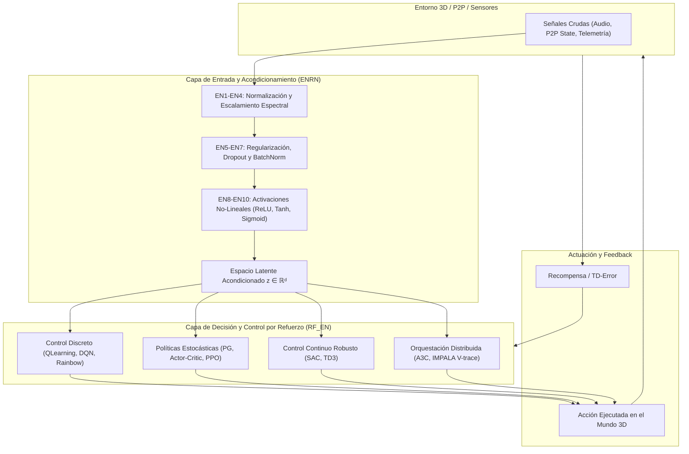

# Plan de Desarrollo Arquitectónico: CELEBRO · BLOK1 · BASE_NEURONAL1

Este documento establece la hoja de ruta y la visión funcional para el primer bloque del sistema neuronal (`CELEBRO/BLOK1/BASE_NEURONAL1.py`), fundamentado en la sinergia de los dos subsistemas ya integrados:
1. **Subsistema Sensorial y Preprocesamiento (`ENRN` · 10 Neuronas)**.
2. **Subsistema de Toma de Decisiones y Aprendizaje por Refuerzo (`RF_EN` · 10 Neuronas)**.

---

## 1. Topología del Bloque 1: Sinergia Bimodal

---

## 2. Capacidades Funcionales de la Agrupación en BLOK1

Al unir las 10 neuronas de entrada (`ENRN`) con los 10 motores de refuerzo (`RF_EN`), este bloque no opera como una simple colección de scripts, sino como un **núcleo cognitivo autónomo** capaz de:

| Capacidad | Neuronas Responsables | Finalidad en el Sistema |
| :--- | :--- | :--- |
| **Acondicionamiento Inmune a Gradientes Explosivos** | `EN1_RN` a `EN7_RN` | Estabiliza dinámicamente cualquier entrada sensorial mediante normalización por lote (`BatchNorm`), inicialización espectral/He y atenuación por `Dropout`. |
| **Control Continuo Reparametrizado** | `EN9_RN` + `RFEN1_RN_7` (SAC) + `RFEN1_RN_8` (TD3) | Movimiento físico suave en el mundo virtual 3D sin saltos bruscos, regulando automáticamente la entropía (exploración vs. explotación). |
| **Evaluación de Riesgo e Incertidumbre** | `EN10_RN` + `RFEN1_RN_9` (Rainbow C51) | En lugar de un valor medio escalar, modela los retornos como una distribución categórica de 51 átomos, previendo caídas de conexión P2P o pérdidas bruscas. |
| **Escalamiento Federado y Distribuido P2P** | `RFEN1_RN_5` (A3C) + `RFEN1_RN_10` (IMPALA) | Permite que diferentes nodos P2P actúen como "Actores" y un nodo agregador central procese los gradientes usando corrección off-policy `V-trace`. |

---

## 3. Plan de Desarrollo por Fases

### Fase 1: Pipeline Integrado de Inferencia (`Forward Pipeline`)
- **Objetivo**: Implementar un método unificado `BLOK1.procesar(estado_crudo) -> accion, diagnostico`.
- **Acción**:
  1. Conectar la salida de `ENRN` directamente como tensor de entrada normalizado para el agente `RF_EN` seleccionado.
  2. Implementar un selector dinámico de modelo (por ejemplo, conmutar entre `PPO` para navegación general y `SAC` para cinemática continua).

### Fase 2: Motor de Aprendizaje Unificado (`Backprop & Replay`)
- **Objetivo**: Conectar el `BufferPriorizadoRainbow` y el `BufferTrayectoria` con la retroalimentación de las neuronas de entrada.
- **Acción**:
  1. Permitir que los gradientes de la pérdida temporal (TD-Error o V-trace) fluyan hacia los pesos de las neuronas sensoriales `ENRN`.
  2. Ajustar los pesos de normalización y escalas en tiempo real sin requerir pausas de inferencia.

### Fase 3: Concurrencia Asíncrona Multi-Actor (P2P Mesh)
- **Objetivo**: Desplegar la topología `IMPALA` nativa del bloque en hilos o procesos paralelos.
- **Acción**:
  1. Asignar cada canal de `BufferActoresIMPALA` a un socket o worker P2P.
  2. Implementar sincronizaciones no bloqueantes (`threading.Lock` optimizado) para mantener la latencia por inferencia en `< 1.5 ms`.

### Fase 4: Telemetría y Auto-Ajuste en Tiempo Real
- **Objetivo**: Extender el informe de terminal a un monitor continuo de sanidad.
- **Acción**:
  1. Detección automática de deriva de gradientes o sobreestimación ($Q$-bias).
  2. Re-inicialización quirúrgica con `reinicializar_con_parametros` si una neurona específica se desestabiliza, sin afectar al resto del bloque.
