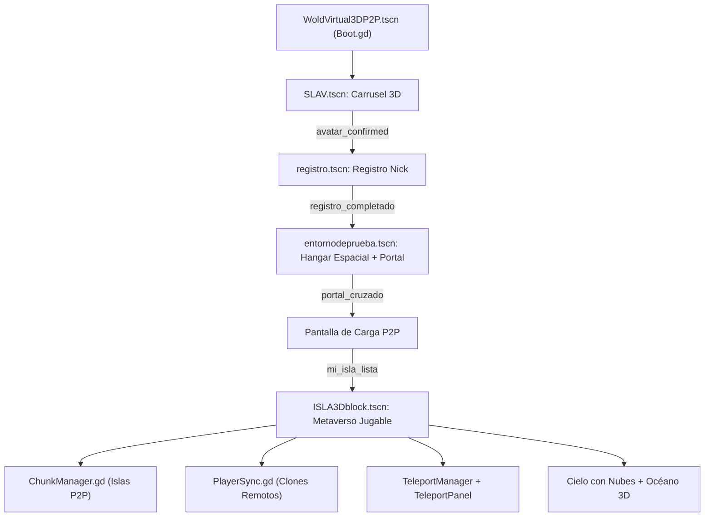

# WoldVirtualP2P3D — Metaverso Optimizado (F:)

Documentación técnica integral del metaverso 3D P2P en Godot 4: arquitectura desarrollada, balance de optimización de peso, auditoría de deuda técnica y hoja de ruta de tareas pendientes.

- **Motor:** Godot 4.7.2 (Forward+, Jolt Physics, D3D12).
- **Escena Principal:** `res://WoldVirtual3DP2P.tscn` (orquestada por `res://gdscrip/Boot.gd`).
- **Proyecto de Origen (Referencia sin optimizar):**
  `C:\Users\User\Desktop\WoldVirtualP2P3D_v0.0.01LCV1\VersionDe_sesion\Sistema_Principal\PRY\actualizacion_94cde656\src\MTBGT\WoldVirtualP2P3D`

---

## 1. Balance de Optimización de Espacio

El objetivo inicial del proyecto era reducir los **3,44 GB** originales a menos de 1,2 GB (−60%) sin perder calidad gráfica ni funcionalidades.

### Comparativa Real Medida

| Métrica | Proyecto Origen (Desktop) | Estado Actual en `F:\` | Reducción Lograda |
|---|---|---|---|
| **Peso Total en disco** | **3.440 MB** (3,20 GiB) | **549,60 MB** | **−84,0 %** |
| **Peso Limpio (sin `.godot`)** | ~2.900 MB | **250,04 MB** | **−92,7 %** |
| **Caché `.godot`** | 536,6 MB | **299,56 MB** | −44,2 % |
| **Modelos Blender (`.blend`)** | 11 archivos (849,2 MB) | **1 archivo** (`hm1.blend`: 3,17 MB) | **−99,6 %** |
| **Backups (`.blend1` + `.bak`)** | 12 archivos (1.115,4 MB) | **0 archivos (0 MB)** | **100 % eliminados** |
| **Archivos Comprimidos (`.zip`)** | 2 archivos (194 MB) | **0 archivos (0 MB)** | **100 % eliminados** |
| **Mapas HDR (`.exr`)** | 4 archivos (82,9 MB) | **0 archivos (0 MB)** | **100 % eliminados** |

---

## 2. Lo que se Desarrolló en Profundidad

El directorio alberga un metaverso 3D multijugador P2P completamente articulado a través de una máquina de estados secuencial:



### Módulos del Sistema

### 1. Núcleo de Arranque y Orquestación (`res://gdscrip/Boot.gd`)
- Gestiona el flujo continuo del jugador sin recargas de escena completas (`queue_free()` de fases anteriores e instanciación dinámica):
  1. **Carrusel:** Selección visual de avatar.
  2. **Registro:** Captura y persistencia de identidad.
  3. **Zona Portal:** Entrada inmersiva al portal.
  4. **Carga P2P:** Overlay 2D mientras se negocia la conexión y se genera la isla.
  5. **Metaverso:** Aparición en la isla con bienvenida personalizada según género del avatar (`BIENVENIDO/A`) y nick.

### 2. Selector 3D de Avatares (`res://SLCAV/AVATARESCONANIMACION/SLAV.tscn` / `SLAV.gd`)
- Carrusel circular 3D giratorio con **8 avatares animados** (4 mujeres `AVMJ1..4` y 4 hombres `AVH1..4`).
- Cúpula cyberpunk procedural (`CUPULA.tscn`) con shader de rejilla emisiva (`cupula_panel.gdshader`).
- Rotación suavizada con `lerp_angle`, escalado dinámico del seleccionado (`1.14` vs `0.86`) y desincronización aleatoria de animaciones idle (`seek(randf())`).

### 3. Registro y Vista Previa (`registro.tscn` / `registro.gd`)
- Interfaz gráfica con `SubViewport` 3D que proyecta de frente el avatar elegido.
- Validación de nick (mínimo 3 caracteres), guardado local en `user://registro.cfg` y emisión de señal `registro_completado`.

### 4. Hangar Espacial y Portal Holográfico (`entornodeprueba.tscn`)
- **Estación procedural (`estacion.gd`):** Construye la estructura completa del hangar (costillas, vigas, zócalos emisivos y compuerta) mediante código y materiales shader (`hangar_panel.gdshader`), logrando un entorno de ciencia ficción que pesa solo **9 KB** en disco.
- **Portal dimensional (`portal_visual.gd`):** Sistema de orbes en órbita matemática tridimensional, anillo giratorio (`portal_ring.gdshader`) y membrana energética pulsante (`portal_energy.gdshader`).
- Detección de colisión volumétrica con `Area3D` en `portal_csgbox5.gd`.

### 5. Metaverso P2P y Gestión de Chunks (`ChunkManager.gd` / `ISLA3Dblock.tscn`)
- Cuadrícula procedural de islas en serpenteo (`chunk_size = 199.5m`, 10 islas por fila).
- Multijugador sobre `ENetMultiplayerPeer` (puerto 8910) sin necesidad de servidor dedicado central: el primer peer asume el rol de host; los siguientes entran como clientes.
- Replicación remota de terreno (`_spawn_island_for_player`), control anti-duplicados y recolocación orbital instantánea de cámara (`snap_camera`).
- **Migración dinámica de anfitrión:** Si el jugador host se desconecta, uno de los clientes asume automáticamente el servidor en el puerto 8910 reconstruyendo el estado del mundo desde el historial de islas.

### 6. Sincronización de Jugadores en Red (`PlayerSync.gd`)
- Bucle de sincronización de 10 Hz (`SYNC_INTERVAL = 0.1s`).
- Emisión de posición, rotación de guiñada (yaw), nick, estado de animación (idle, caminar, correr, aire) y ruta del avatar.
- Instanciación de proxies remotos con el modelo 3D exacto elegido por cada cliente, interpolación suave (`lerp 8.0`) y etiqueta flotante `Label3D` tipo billboard sobre la cabeza.

### 7. Teletransporte y Panel de Islas (`TeleportManager.gd` / `TeleportPanel.gd`)
- Panel colapsable accesible mediante tecla <kbd>T</kbd> o botón de pantalla.
- Registro histórico persistente de islas descubiertas, detección de estados (online / offline) y teletransporte local inmediato del avatar a cualquier isla de la red.

### 8. Renderizado del Mundo, Agua y Atmósfera
- **Océano 3D (`gdshader/OCEANO.gdshader`):** Agua con refracción, mapas normales de ruido procedural (`FastNoiseLite`), mapeo triplanar global y animación de olas en vertex shader.
- **Cielo con nubes procedimentales (`gdshader/cielo_nubes.gdshader` / `cielo_isla_env.tres`):** Shader de cielo con doble capa (cúmulos volumétricos mediante ruido celular Worley + FBM y cirros de alta altitud), iluminación solar interactiva (`DirectionalLight3D`), efecto *silver lining*, sombreado ambiental y desplazamiento continuo por viento.

### 9. Herramientas de Mantenimiento (`addons/limpiar_cache` / `tools/limpiar_cache_godot.ps1`)
- Plugin de editor que intercepta el cierre y detención de escenas para purgar automáticamente archivos huérfanos de `.godot/imported`, `shader_cache` y temporales del editor.

---

## 3. Deuda Técnica Generada en Profundidad

La rapidez de desarrollo y las transformaciones sucesivas desde el proyecto original han dejado áreas críticas de deuda técnica:

### A. Deuda de Assets y Texturas (Duplicación Oculta)
1. **18 Texturas PNG Idénticas (84 MB de PNGs + ~84 MB en caché `.ctex` VRAM = ~170 MB desperdiciados):**
   Un análisis de hashes MD5 en `gltfimport/avatares/av_texturas/` demostró que:
   - `AVH3_Ch31_*` es binariamente idéntico a `AVH2_Ch31_*` (~26 MB duplicados).
   - `AVMJ3_Ch22_*` es binariamente idéntico a `AVMJ2_Ch22_*` (~32,3 MB duplicados).
   - `AVMJ4_Ch07_*` es binariamente idéntico a `AVMJ1_Ch07_*` (~26 MB duplicados).
2. **Textura del Terreno en 4K:**
   - `ISLA3DCHUNK_rocky_terrain_02_diff_4k.png` pesa **25,52 MB** (y 21,33 MB en `.ctex`). Debe reescalarse a 2K como indicaba la Fase 3.
3. **Fuente Blender en `res://`:**
   - `hm1.blend` (3,17 MB) y `hm1.blend.import` (612 KB) continúan dentro de `res://ESCENAS/...`, en vez de estar externalizados fuera del árbol de exportación.

### B. Deuda de Estructura de Directorios y Nomenclatura
1. **Anidamiento Extremo (hasta 9 niveles):**
   - `ESCENAS/sceneOPTM/constructor/UA/UserAnimados/Import_UserAnimados/ctr_tscn_userBS/scenesconstr/userbaseh1.tscn`
   - `SLCAV/AVATARESCONANIMACION/USERBS/sceneuserBS/AVMJRSC/USERSMJ/MDLMJ/gdscripuser/AVMJ1Ch3D.gd`
   Genera rutas frágiles propensas a roturas de dependencias relativas.
2. **Carpetas Huérfanas y Vacías:**
   - `ESCENAS/sceneOPTM/constructor/user/construccionuser/importblender/`
   - `SLCAV/AVATARESCONANIMACION/USERBS/sceneuserBS/AVMJRSC/USERSMJ/`
3. **Inconsistencias y Erratas:**
   - `WoldVirtual3DP2P.tscn` (omite la 'r' de *World*).
   - `gdscrip/` (omite la 't' de *gdscript*).
   - Mezcla desordenada de mayúsculas y minúsculas (`SLCAV`, `chunk3DBLOCK`, `ISLA3Dblock`).

### C. Deuda de Código y Controladores
1. **Triplicación de Controladores de Avatar:**
   - `gdscrip/userbase.gd` (cápsula básica, 53 líneas).
   - `userbaseh_1.gd` (BlendTree para `hm1.blend`, 251 líneas).
   - `AVMJ1Ch3D.gd` (controlador para los 8 avatares glTF, 163 líneas).
2. **Vinculación Cruzada Indebida:**
   - Los avatares masculinos (`AVH1Ch3D.tscn` a `AVH4Ch3D.tscn`) tienen asignado el script `AVMJ1Ch3D.gd`, ubicado dentro de la carpeta de la mujer 1 (`AVMJRSC/USERSMJ/MDLMJ/`).
3. **Código y Escenas Muertas:**
   - `gdscrip/ApplyMaterial.gd`: Script huérfano con código comentado y un `pass`, sin asignación en ninguna escena.
   - `MNCNT.tscn`: Escena de plantilla residual en la raíz.
   - `ESCENAS/sceneOPTM/constructor/user/userbase.tscn`: Prototipo primitivo de cápsula.
   - `mnpr.tscn` y `mnprCPOF.tscn`: Escenas antiguas de cajas CSG. `registro.gd` tiene hardcodeada como fallback `mnpr.tscn` en vez de la estación espacial moderna.
4. **Inversión de Movimiento por Malla:**
   - `AVMJ1Ch3D.gd` invierte los vectores (`Vector3(-input_dir.x, 0, -input_dir.y)`) debido a que las mallas importadas están rotadas 180° (mirando a +Z en vez de -Z).
5. **Detección por Polling:**
   - `TeleportManager` recorre todos los hijos de la raíz cada 1.0s buscando islas, en lugar de recibir una señal cuando `ChunkManager` instancia una.

### D. Deuda de Entrada (InputMap) y Configuración
1. **Ausencia de `[input]` en `project.godot`:**
   - Los controles usan atajos cableados a teclas físicas (`KEY_T`, `KEY_ALT`, `KEY_AT`) o las acciones por defecto del sistema (`ui_left`, `ui_accept`), impidiendo remapeo, soporte de mando o accesibilidad.

### E. Deuda de Red P2P
1. **IP Rígida:**
   - `ChunkManager.gd` conecta rígidamente a `127.0.0.1:8910`, imposibilitando partidas directas en red local (LAN) o internet sin alterar el código fuente.
2. **Autoridad y Anticheat:**
   - La replicación confía ciegamente en las posiciones enviadas por cada cliente sin validación del servidor.

### F. Deuda de Control de Versiones
1. **Inexistencia de `.gitignore`:**
   - No hay archivo `.gitignore` en la raíz, dejando expuesta la caché `.godot/` (300 MB) a ser versionada por error.

---

## 4. Tareas Pendientes (Roadmap Priorizado)

### Fase 1: Prioridad Alta (Inmediata / Rendimiento y Estabilidad)
- [ ] **Deduplicar Texturas de Avatares:** Reasignar los materiales de `AVH3` para que utilicen las texturas de `AVH2`, y los de `AVMJ3/AVMJ4` para que usen las de `AVMJ2/AVMJ1`. Borrar los 18 archivos duplicados y recuperar ~170 MB.
- [ ] **Crear `.gitignore`:** Incluir `.godot/`, `*.blend1`, `*.bak`, `*.tmp` y capturas de prueba.
- [ ] **Unificar Controlador de Avatar:** Crear un único `PlayerController.gd` en `res://gdscrip/` que gestione la cámara orbital, animaciones y movimiento tanto para avatares masculinos como femeninos.
- [ ] **Corregir Fallback de `registro.gd`:** Cambiar la variable `siguiente_escena` para que apunte a `entornodeprueba.tscn` en vez de `mnpr.tscn`.

### Fase 2: Prioridad Media (Arquitectura y Jugabilidad)
- [ ] **Aplanar Estructura de Carpetas:**
  - Reducir rutas a un esquema limpio:
    ```
    res://
    ├── escenas/      (mundo, portal, carrusel, registro)
    ├── scripts/      (boot, red, player, teletransporte)
    ├── shaders/      (agua, cielo, paneles, portal)
    ├── avatares/     (modelos glTF, escenas y texturas deduplicadas)
    └── addons/       (limpieza de caché)
    ```
- [ ] **Configurar InputMap en `project.godot`:** Definir acciones semánticas (`move_forward`, `move_backward`, `move_left`, `move_right`, `sprint`, `jump`, `toggle_teleport`).
- [ ] **Reescalar Textura del Terreno:** Reducir `ISLA3DCHUNK_rocky_terrain_02_diff_4k.png` de 4K a 2K (ahorro de ~18 MB adicionales).
- [ ] **Parámetros de Red en UI:** Añadir campos de entrada de IP y puerto en la pantalla de inicio/carga para conexiones LAN o WAN.
- [ ] **Depuración de Archivos Huérfanos:** Eliminar `ApplyMaterial.gd`, `MNCNT.tscn`, `userbase.tscn`, `mnpr.tscn` y `mnprCPOF.tscn`.
- [ ] **Sustituir Polling por Señales:** Conectar `ChunkManager.isla_creada` con `TeleportManager.registrar_isla` eliminando el bucle de escaneo de 1 segundo.

### Fase 3: Prioridad Baja (Mantenimiento y Publicación)
- [ ] **Externalizar Fuentes:** Extraer `hm1.blend` fuera de `res://` a una carpeta de trabajo `_src_blender/`.
- [ ] **Corregir Erratas en Nombres:** Renombrar `WoldVirtual3DP2P` a `WorldVirtual3DP2P` y `gdscrip` a `gdscript` actualizando las referencias UID.
- [ ] **Configurar Preset de Exportación:** Crear `export_presets.cfg` con compresión PCK (zstd) excluyendo archivos de desarrollo.

Viewed README.md:1-50
Created README.md
Viewed README.md:1-100
Viewed README.md:101-185

He actualizado detalladamente el archivo [README.md](file:///f:/WoldVirtualP2P3D/README.md) en la raíz del proyecto.

El documento ahora contiene una auditoría completa estructurada en 4 secciones clave:

---

### Resumen de lo Documentado en el [README.md](file:///f:/WoldVirtualP2P3D/README.md)

1. **Balance de Optimización de Espacio:**
   - Comparativa detallada frente al proyecto original de **3,44 GB**: el proyecto se redujo a **250,04 MB limpios** (**−92,7%**) y **549,60 MB con caché** (**−84%**), superando la meta inicial de 1,2 GB.
   - Eliminación del 100% de archivos duplicados automáticos (`.blend1`, `.bak`, `.zip`, `.exr`).

2. **Lo Desarrollado en Profundidad:**
   - **Diagrama de flujo completo** de la máquina de estados secuencial ([Boot.gd](file:///f:/WoldVirtualP2P3D/gdscrip/Boot.gd)).
   - **Carrusel 3D:** Selector de 8 avatares animados y cúpula cyberpunk procedural.
   - **Registro:** Previsualización en tiempo real mediante `SubViewport` 3D y guardado local en `user://registro.cfg`.
   - **Hangar Espacial y Portal:** Estación procedural de 9 KB generada por código ([estacion.gd](file:///f:/WoldVirtualP2P3D/ESCENAS/sceneOPTM/constructor/UA/UserAnimados/Import_UserAnimados/ctr_tscn_userBS/gdscrip/estacion.gd)) con shaders de energía y orbes orbitantes.
   - **Metaverso P2P y Chunks:** Generación de islas en cuadrícula (199,5 m) y migración automática de anfitrión si el host se desconecta.
   - **Sincronización en Red:** Clones remotos a 10 Hz con interpolación suave y carteles 3D flotantes con el nick.
   - **Teletransporte e Historial:** Panel interactivo en pantalla con tecla <kbd>T</kbd>.
   - **Renderizado:** Shader de océano con refracción y el nuevo cielo atmosférico con nubes procedimentales (Worley + FBM), iluminación solar interactiva y horizonte suave.
   - **Addon de Mantenimiento:** Limpieza automática de imports huérfanos al salir del editor.

3. **Auditoría de Deuda Técnica:**
   - **18 Texturas PNG Idénticas Duplicadas:** ~84 MB en disco y ~84 MB en caché VRAM (~170 MB desperdiciados) entre `AVH2/3` y `AVMJ1/2/3/4`.
   - **Textura de Terreno en 4K:** 25,5 MB aún sin reescalar a 2K.
   - **Anidamiento Extremo:** Rutas de hasta 9 niveles de profundidad y carpetas vacías intermedias.
   - **Controladores Triplicados:** Convivencia de `userbase.gd`, `userbaseh_1.gd` y `AVMJ1Ch3D.gd`.
   - **Código y Escenas Muertas:** [ApplyMaterial.gd](file:///f:/WoldVirtualP2P3D/gdscrip/ApplyMaterial.gd) (código comentado con `pass`), [MNCNT.tscn](file:///f:/WoldVirtualP2P3D/MNCNT.tscn), `userbase.tscn` y prototipos obsoletos (`mnpr.tscn`).
   - **Controles Cableados:** Ausencia de `[input]` en `project.godot` (uso de `KEY_T`, `KEY_ALT`, `KEY_AT` fijos).
   - **Red Rígida:** IP local fija `127.0.0.1:8910` sin selector en pantalla.
   - **Control de Versiones:** Inexistencia de archivo `.gitignore`.

4. **Tareas Pendientes (Roadmap Priorizado):**
   - **Fase 1 (Alta Prioridad):** Deduplicar texturas de avatares, crear `.gitignore`, unificar controlador de personaje en `PlayerController.gd` y corregir el fallback de [registro.gd](file:///f:/WoldVirtualP2P3D/ESCENAS/sceneOPTM/constructor/UA/UserAnimados/Import_UserAnimados/ctr_tscn_userBS/gdscrip/registro.gd).
   - **Fase 2 (Media Prioridad):** Aplanar estructura de carpetas a máximo 2–3 niveles, configurar el `InputMap`, reescalar textura de terreno a 2K, añadir selector de IP/puerto para LAN/WAN, eliminar archivos huérfanos y cambiar polling por señales.
   - **Fase 3 (Baja Prioridad):** Externalizar `hm1.blend`, corregir erratas de nombres y configurar presets de exportación PCK.