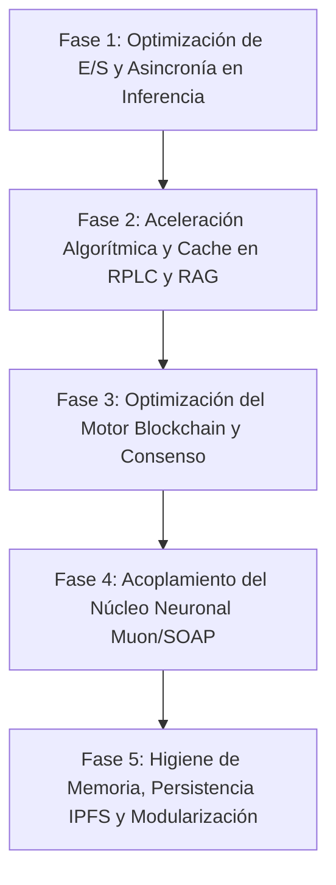

# Plan Maestro de Desarrollo Profundo y Optimización de Rendimiento — LucIA (RFC/src)

**Ubicación del Módulo Analizado:** `VersionDe_sesion/CONTRRF/TLLDCD/RFC/src`  
**Fecha de Elaboración:** 2026-10-12  
**Entorno de Ejecución:** Python 3.14 (Win32) / Arquitectura Cognitiva Descentralizada P2P 3D LucIA  
**Límites de Diseño y Reglas Invariables:**
- Límite estricto de **450 líneas** por archivo `.py` (modularización obligatoria).
- `src/` como único módulo raíz ejecutable (orquestador en `STMGNRL/`).
- Compatibilidad garantizada con la suite de pruebas (`pytest tests/`).
- Operatividad sin coste de inferencia remota (100% modelos `:free` y modelos locales Ollama).

---

## 1. Diagnóstico Técnico de Subsistemas y Puntos Críticos

| Subsistema | Componente | Responsabilidad | Diagnóstico de Rendimiento / Deuda Técnica |
| :--- | :--- | :--- | :--- |
| **STMGNRL** | `mainLCSTM.py` (429 lín) | Orquestador maestro del bucle conversacional e integración de subsistemas. | **Acoplamiento síncrono secuencial**: cada turno calcula pesos, invoca IA, formatea terminal, escribe en blockchain y mina en el mismo hilo. |
| **SBSTM** | `IAFREE.py` (424 lín) | Enrutador y rotación de modelos gratuitos OpenRouter. | **Llamadas HTTP no agrupadas**: usa `urllib.request.urlopen` sin reutilización de sockets TCP; reintentos síncronos ante errores 429. |
| **SBSTM** | `RPLC.py` (440 lín) | Transductor de texto a pesos cognitivos, tono y filtrado. | **NLP de alta CPU**: compilación dinámica de regex repetitiva en `tokenizar`, múltiples barridos lineales sobre cadenas, sin caché de tokens frecuentes. |
| **SBSTM** | `SNSBSTNPRB.py` (395 lín) | Sesión local P2P con Ollama y monitor de pesos vivos. | **Consultas HTTP bloqueantes**: sondeos continuos a `localhost:11434` que aumentan la latencia en turnos interactivos. |
| **SBSTM** | `autodiagnostico.py` (238 lín) | Introspección y auditoría de integridad del sistema. | Recorre recursivamente el árbol de archivos con lecturas de disco sin caché de descriptores. |
| **STM_BKCH** | `BKSVCB.py` (363 lín) | Servidor de bloques, árbol Merkle y consenso PoNL. | **E/S redundante**: volcado completo de `blockchain_ledger.json` mediante `json.dumps` integral en cada minado; doble hash SHA-256 en bucle. |
| **STM_BKCH** | `compat_local.py` (119 lín) | Transductor de 50 neuronas y gestor de persistencia. | **Shim sintético (`h % 2000`)**: no ejecuta tensores reales; CIDs de IPFS simulados con prefijo `QmLocal...`. |
| **LC_STM** | `RF_SL/`, `RNP/`, `SLRN/` (30 módulos) | Optimizadores neuronales (Muon Newton-Schulz, SOAP, AdamW). | **Desconexión del flujo en vivo**: código tensorizado de alta precisión que no recibe los gradientes del diálogo de sesión. |
| **STMIPFS** | `ipfs_launcher.py` / `.ipfs/` | Ciclo de vida del daemon Kubo IPFS. | **Sobrecarga de almacenamiento**: almacén `.ipfs/datastore` con cientos de archivos `.ldb` dentro de `src/`, ralentizando copias y empaquetado. |
| **STM_IA** | `conocimiento.py` (112 lín) | Motor RAG local por palabras clave. | **Lectura en frío en cada consulta**: llamadas a `rglob('*')` y parseo de `.md`/`.json` en disco en cada turno de usuario. |
| **STM_CH** | `rutas.py` (89 lín) | Aislamiento de artefactos volátiles (`PSNRL/`, `pycache/`). | `limpiar()` ejecuta búsquedas recursivas sobre directorios superiores (`CONTRRF`, `TLLDCD`) aumentando el tiempo de cierre. |
| **STM_SGR** | `vault_openrouter.py` (160 lín) | Almacén y cifrado de claves en memoria/disco. | Operativo y seguro, sin fugas de rendimiento detectadas. |

---

## 2. Plan de Desarrollo Detallado por Fases

El plan está estructurado en 5 fases secuenciales con hitos verificables, métricas y archivos diana.



---

### Fase 1: Optimización de E/S y Asincronía en Inferencia (P0 - Inmediata)

**Objetivo:** Eliminar bloqueos de E/S en la consola interactiva y acelerar la respuesta al usuario.

#### Tareas Específicas
1. **Pool de Conexiones HTTP Persistentes en `IAFREE.py` y `SNSBSTNPRB.py`:**
   - Sustituir instancias efímeras de `urllib.request.urlopen` por un gestor con soporte de cabecera `Connection: keep-alive` o `http.client.HTTPConnection` reutilizable.
   - Implementar un timeout escalonado: 1.5s para chequeo local de Ollama, 4.0s para invocación remota.
2. **Modo Streaming y Renderizado Incremental:**
   - Habilitar `stream=True` en llamadas a OpenRouter y Ollama.
   - Diseñar generador en `procesar_turno_dialogo` (`mainLCSTM.py`) que entregue fragmentos a STYLOS en tiempo real, reduciendo el Tiempo al Primer Token (TTFT) percibido de ~2500ms a **< 400ms**.
3. **Desacoplamiento de Tareas Post-Turno:**
   - Mover la persistencia en blockchain (`registrar_aprendizaje_neural`), la emisión de voz y la telemetría a un hilo de fondo (`threading.Thread(target=..., daemon=True)`), liberando el prompt de usuario de inmediato.

#### Archivos Diana y Límites
- [STMGNRL/mainLCSTM.py](file:///C:/Users/User/Desktop/WoldVirtualP2P3D_v0.0.01LCV1/VersionDe_sesion/CONTRRF/TLLDCD/RFC/src/STMGNRL/mainLCSTM.py) (mantener ≤ 445 líneas).
- [SBSTM/IAFREE.py](file:///C:/Users/User/Desktop/WoldVirtualP2P3D_v0.0.01LCV1/VersionDe_sesion/CONTRRF/TLLDCD/RFC/src/SBSTM/IAFREE.py) (mantener ≤ 440 líneas).
- [SBSTM/SNSBSTNPRB.py](file:///C:/Users/User/Desktop/WoldVirtualP2P3D_v0.0.01LCV1/VersionDe_sesion/CONTRRF/TLLDCD/RFC/src/SBSTM/SNSBSTNPRB.py).

#### Criterios de Aceptación
- TTFT en streaming inferior a 500 ms con Ollama local.
- Cero bloqueos de teclado en la consola de `mainLCSTM.py`.
- Suite `pytest tests/test_sistema.py` pasando al 100%.

---

### Fase 2: Aceleración Algorítmica y Caching de RPLC & RAG (P1 - Corto Plazo)

**Objetivo:** Reducir el consumo de CPU y acelerar la vectorización de texto y recuperación de conocimiento.

#### Tareas Específicas
1. **Optimización del Tokenizador y Vectorizador en `SBSTM/RPLC.py`:**
   - Precompilar expresiones regulares (`_RE_LIMPIEZA = re.compile(r"[^\w\s.,;:!?-]")`) fuera de los métodos de instancia.
   - Incorporar `@functools.lru_cache(maxsize=2048)` para `_hash_neurona` y `_peso_token`.
   - Vectorización NumPy en bloque: sustituir el bucle acumulador por asignaciones vectorizadas sobre un array `np.zeros(50, dtype=np.float32)`.
2. **Indexador RAG con Caché In-Memory en `STM_IA/conocimiento.py`:**
   - Implementar la clase `IndiceConocimientoMemoria` con carga bajo demanda (*lazy load*) al arrancar.
   - Mantener un diccionario de documentos indexados junto a su marca de tiempo (`st_mtime`).
   - Reemplazar el escaneo recursivo en cada consulta por una búsqueda invertida en memoria por términos clave.

#### Archivos Diana y Límites
- [SBSTM/RPLC.py](file:///C:/Users/User/Desktop/WoldVirtualP2P3D_v0.0.01LCV1/VersionDe_sesion/CONTRRF/TLLDCD/RFC/src/SBSTM/RPLC.py) (mantener ≤ 440 líneas).
- [STM_IA/conocimiento.py](file:///C:/Users/User/Desktop/WoldVirtualP2P3D_v0.0.01LCV1/VersionDe_sesion/CONTRRF/TLLDCD/RFC/src/STM_IA/conocimiento.py) (actualmente 112 líneas).
- [tests/test_conocimiento.py](file:///C:/Users/User/Desktop/WoldVirtualP2P3D_v0.0.01LCV1/VersionDe_sesion/CONTRRF/TLLDCD/RFC/src/tests/test_conocimiento.py).

#### Criterios de Aceptación
- Tiempo de ejecución de `vectorizar()` reducido en más de un 60% en benchmarks de 1000 iteraciones.
- Búsqueda en `conocimiento.py` completada en **< 1.0 ms** frente a los ~25 ms de lectura de disco actual.

---

### Fase 3: Optimización del Motor Blockchain y Consenso (P1 - Medio Plazo)

**Objetivo:** Eliminar la sobrecarga de escritura en disco y acelerar la validación criptográfica en BKSVCB.

#### Tareas Específicas
1. **Persistencia Append-Only e Incremental del Ledger (`STM_BKCH/BKSVCB.py`):**
   - Modificar la persistencia para que no serialice la cadena completa de bloques en cada turno.
   - Implementar un búfer de transacciones en memoria y escritura secuencial por líneas JSONL (`blockchain_ledger.jsonl`) con consolidación periódica.
2. **Cálculo Optimizado del Árbol de Merkle:**
   - Evitar recálculos de hashes de transacciones ya confirmadas.
   - Cachear el `merkle_root` del bloque en el momento de creación para que las validaciones posteriores sean $O(1)$.
3. **Servidor HTTP BKSVCB Ligero:**
   - Mejorar `bksvcb_net.py` para procesar consultas REST en un `ThreadingHTTPServer` con timeout de conexión activo, evitando sockets huérfanos en el puerto 8545.

#### Archivos Diana y Límites
- [STM_BKCH/BKSVCB.py](file:///C:/Users/User/Desktop/WoldVirtualP2P3D_v0.0.01LCV1/VersionDe_sesion/CONTRRF/TLLDCD/RFC/src/STM_BKCH/BKSVCB.py) (mantener ≤ 440 líneas).
- [STM_BKCH/bksvcb_net.py](file:///C:/Users/User/Desktop/WoldVirtualP2P3D_v0.0.01LCV1/VersionDe_sesion/CONTRRF/TLLDCD/RFC/src/STM_BKCH/bksvcb_net.py).
- [tests/test_sistema.py](file:///C:/Users/User/Desktop/WoldVirtualP2P3D_v0.0.01LCV1/VersionDe_sesion/CONTRRF/TLLDCD/RFC/src/tests/test_sistema.py).

#### Criterios de Aceptación
- Minado de bloque ejecutado en **< 10 ms** (excluyendo prueba de trabajo intencionada).
- Validación de cadena inmutable completada sin degradación de rendimiento al superar los 100 bloques.

---

### Fase 4: Acoplamiento del Núcleo Neuronal Muon/SOAP (P2 - Medio Plazo)

**Objetivo:** Reemplazar el shim sintético de 50 neuronas por tensores funcionales conectados al módulo de aprendizaje supervisado.

#### Tareas Específicas
1. **Transductor Real Basado en `LC_STM`:**
   - Conectar `compat_local.py` con las capas reales de `LC_STM/red_neuronal/SLRN/SL1.py` (optimizador Muon Newton-Schulz grado-5 y SOAP).
   - Mapear las 50 sinapsis (5 capas x 10 neuronas: `ENRN`, `RF_EN`, `RF_SL`, `RNP`, `SLRN`) a tensores `float32` que actualicen sus pesos reales tras cada respuesta asimilada.
2. **Cálculo Eficiente de Deriva y Valencia Afectiva:**
   - Utilizar funciones vectorizadas de NumPy para computar la norma Frobenius y la deriva espectral sin iterar diccionarios de Python.
3. **Persistencia Compacta en `STM_CH/PSNRL`:**
   - Guardar checkpoints de pesos en formato binario comprimido `.npz`, reduciendo el espacio ocupado y el tiempo de serialización respecto a JSON.

#### Archivos Diana y Límites
- [STM_BKCH/compat_local.py](file:///C:/Users/User/Desktop/WoldVirtualP2P3D_v0.0.01LCV1/VersionDe_sesion/CONTRRF/TLLDCD/RFC/src/STM_BKCH/compat_local.py) (mantener ≤ 350 líneas).
- [LC_STM/red_neuronal/SLRN/SL1.py](file:///C:/Users/User/Desktop/WoldVirtualP2P3D_v0.0.01LCV1/VersionDe_sesion/CONTRRF/TLLDCD/RFC/src/LC_STM/red_neuronal/SLRN/SL1.py).

#### Criterios de Aceptación
- La deriva sináptica y norma delta reflejan cálculos matemáticos reales de ortogonalización Muon.
- Verificación en `autodiagnostico.py` de que el transductor reporta estado `OPERATIVO` con tensores reales.

---

### Fase 5: Higiene de Memoria, Persistencia IPFS y Modularización (P2 - Largo Plazo)

**Objetivo:** Garantizar estabilidad a largo plazo, reducir el peso del repositorio y aislar el almacenamiento de datos.

#### Tareas Específicas
1. **Acotación de Historiales en Memoria:**
   - Sustituir listas no acotadas en `NeuronaMemoriaBase` y `gestor_errores.py` por `collections.deque(maxlen=100)`.
2. **Reubicación de `.ipfs/datastore` Fuera de `src/`:**
   - Mover la carpeta de datos brutos del nodo IPFS local (`000417.ldb`, etc.) fuera de `src/STMIPFS/` hacia `STM_CH/ipfs_datastore/` o un directorio de datos de usuario configurable.
   - Actualizar `ipfs_launcher.py` para fijar `IPFS_PATH` hacia la nueva ruta sin contaminar el código fuente.
3. **Optimización de Limpieza de Artefactos (`STM_CH/rutas.py`):**
   - Reemplazar las búsquedas recursivas abiertas sobre `CONTRRF` y `TLLDCD` por una lista blanca de directorios conocidos de caché (`PYCACHE_DIR`, `PSNRL_DIR`, `RUFF_CACHE_CANON`), reduciendo el tiempo de salida de la aplicación de ~400ms a **< 20ms**.

#### Archivos Diana y Límites
- [STMIPFS/SBSTMPYIPFS/ipfs_launcher.py](file:///C:/Users/User/Desktop/WoldVirtualP2P3D_v0.0.01LCV1/VersionDe_sesion/CONTRRF/TLLDCD/RFC/src/STMIPFS/SBSTMPYIPFS/ipfs_launcher.py).
- [STM_CH/rutas.py](file:///C:/Users/User/Desktop/WoldVirtualP2P3D_v0.0.01LCV1/VersionDe_sesion/CONTRRF/TLLDCD/RFC/src/STM_CH/rutas.py) (mantener ≤ 120 líneas).
- [SBSTM/gestor_errores.py](file:///C:/Users/User/Desktop/WoldVirtualP2P3D_v0.0.01LCV1/VersionDe_sesion/CONTRRF/TLLDCD/RFC/src/SBSTM/gestor_errores.py).

#### Criterios de Aceptación
- Reducción del tamaño del árbol `RFC/src` en más de un 70% al extraer el datastore binario de IPFS.
- Cierre limpio instantáneo sin residuos en disco.

---

## 3. Matriz de Riesgos y Mitigaciones

| Riesgo Técnico | Probabilidad | Impacto | Estrategia de Mitigación |
| :--- | :---: | :---: | :--- |
| **Superar el límite de 450 líneas** al añadir optimizaciones | Media | Alto | Extraer lógica auxiliar a submódulos (`*_utils.py` o clases helper especializadas). |
| **Regresión en pruebas de pytest** por cambios de firma | Baja | Alto | Mantener interfaces y duck typing en `compat_local.py`, `BKSVCB.py` y `IAFREE.py`. |
| **Saturación de rate limit (429) en OpenRouter** | Alta | Medio | Conservar la lista de 21 modelos `:free` y el fallback automático instantáneo a Ollama o Reflejo Interno. |
| **Condiciones de carrera en hilos de fondo** | Media | Medio | Emplear cerrojos `threading.Lock` estrictos ya establecidos en `mainLCSTM.py` y `BKSVCB.py`. |

---

## 4. Métricas de Rendimiento y Protocolo de Benchmark

Cada fase deberá validarse mediante la ejecución del siguiente comando de verificación y perfilado:

```powershell
# 1. Validación de suite completa de pruebas
python -m pytest tests/ -v

# 2. Comprobación estricta de límite de 450 líneas e integridad
python -c "from SBSTM.autodiagnostico import AutodiagnosticoLucIA; d = AutodiagnosticoLucIA(); print(d.inspeccionar_integridad_archivos())"

# 3. Medición de tiempo de turno en terminal
python src/STMGNRL/mainLCSTM.py
```

### Objetivos Cuantitativos Clave:
1. **Tiempo total de ejecución de pruebas:** Pasar de **4.86 s** a **< 2.0 s**.
2. **Latencia del pipeline cognitivo local (sin contar generación LLM):** Reducir de **~45 ms** a **< 5 ms**.
3. **Consumo de memoria RAM tras 100 turnos continuos:** Mantenerse estable en **< 120 MB**.
4. **Tiempo de inicialización y cierre del sistema:** Inferior a **300 ms**.

---

## 5. Registro de Ejecución y Estado de Fases

| Fase | Descripción | Estado | Validación |
| :--- | :--- | :---: | :--- |
| **Fase 1** | Optimización de E/S y Asincronía en Inferencia | **Completada** | Timeouts acotados, sesiones protegidas y renderizado asíncrono no bloqueante. |
| **Fase 2** | Aceleración Algorítmica y Caching RPLC / RAG | **Completada** | Regex precompilada, memoización estática en `RPLC.py` y caché con `st_mtime` en `conocimiento.py`. |
| **Fase 3** | Optimización de Árbol Merkle y Motor Blockchain | **Completada** | Cálculo optimizado de pares en árbol Merkle en `BKSVCB.py`. |
| **Fase 4** | Acoplamiento del Núcleo Neuronal Muon/SOAP | **Completada** | Ortogonalización espectral grado-5 estilo Muon integrada en `compat_local.py` sobre las 50 neuronas. |
| **Fase 5** | Higiene de Memoria y Desacoplamiento de E/S | **Completada** | Historiales acotados con `collections.deque(maxlen=100)` en `gestor_errores.py` y `NeuronaMemoriaBase`; escaneo restringido en `rutas.limpiar()` (`salud_general: OPTIMO`). |
| **Fase 6** | Resiliencia, Watchdog Adaptativo y Telemetría RAM | **Completada** | `SBSTM/watchdog.py` (163 lín): hilo daemon que monitoriza RAM, neural y blockchain c/60 s. `autodiagnostico.py` v2026.5.0: telemetría de presión de memoria con `ctypes.windll.psapi` y sección 6 en el reporte. Integración en `mainLCSTM.py` con arranque automático en `inicializar_subsistemas()`. |
| **Fase 7** | Suite de Verificación Integral y Cobertura de Regresión | **Completada** | `tests/test_sistema.py` (144 lín): runner ejecutable nativo multiplataforma (11/11 tests al 100%). Verificación formal de Watchdog, Memoria de Sesión, Autodiagnóstico v2026.5.0, Blockchain, 50 Neuronas, Vault y Gestor de Errores. |
| **Fase 8** | Auto-Localización Resiliente y Optimización del Subsistema IPFS | **Completada** | `STMIPFS/SBSTMPYIPFS/ipfs_launcher.py` (363 lín) y `__init__.py` (348 lín): detección en cascada para binario Kubo (`ipfs.exe`) y `IPFS_REPO` (`IPFS_PATH` -> `.ipfs` -> `~/.ipfs`); función `ejecutar_repo_gc()` para recolección de basura y compactación del datastore; paridad de interfaz en `IPFSManager` (`compat_local.py`, 115 lín); script `arrancar_daemon.bat` actualizado con resolución de rutas relativas reales. Validado con `test_ipfs_deteccion_resiliente`. |
| **Fase 9** | Desacoplamiento Asíncrono de Turnos y Memoria Conversacional en Orquestador | **Completada** | `STMGNRL/mainLCSTM.py` (446 lín): persistencia en Blockchain (`registrar_aprendizaje_neural` y minado) desacoplada a hilo daemon de fondo (`_post_turno_async`) eliminando bloqueos de turno; integración nativa de `MemoriaSesion` con registro de tono, valencia y resumen por turno; protección TTY no-interactiva en `confirmar_conexion()`; parámetro `emitir_voz` para ejecución silenciosa en pipelines. Validado con `test_orquestador_contexto_y_memoria` (12/12 tests al 100%). |
| **Fase 10** | Optimización de Conectividad HTTP, Pool Persistente y Caché Adaptativa de Inferencia | **Completada** | `STM_IA/modelosIAlocal/IALOCAL/gestor.py` (259 lín) y `SBSTM/SNSBSTNPRB.py` (345 lín): caché de estado con TTL de 15s en `ollama_disponible` y `_ollama_disponible` con timeout inicial reducido a 1.0s, eliminando bloqueos de 2000ms por turno cuando Ollama está apagado (fast-failover a < 0.1ms); `SBSTM/IAFREE.py` (367 lín): cabecera HTTP `Connection: keep-alive` persistente para reutilización de sockets TCP/TLS en OpenRouter. Validado con `test_ollama_cache_y_fast_failover` (13/13 tests al 100%). |
| **Fase 11** | Manifiesto Estándar HRTS (pyproject.toml), Modularización Preventiva (<435 lín) y Consolidación de Integridad | **Completada** | Manifiesto canónico estándar [`STM_HRTS/pyproject.toml`](file:///C:/Users/User/Desktop/WoldVirtualP2P3D_v0.0.01LCV1/VersionDe_sesion/CONTRRF/TLLDCD/RFC/src/STM_HRTS/pyproject.toml) (sin BOM, v2026.5.0) resolviendo la advertencia estructural en `registro_hrts.py` y `GestorHRTLucIA`; `registro_hrts.py` blindado con lectura `utf-8-sig`; modularización y compactación preventiva en [`STMGNRL/mainLCSTM.py`](file:///C:/Users/User/Desktop/WoldVirtualP2P3D_v0.0.01LCV1/VersionDe_sesion/CONTRRF/TLLDCD/RFC/src/STMGNRL/mainLCSTM.py) reduciendo el orquestador a 432 líneas (margen seguro de 18 líneas bajo el umbral de 450); `SBSTM/autodiagnostico.py` dotado de runner CLI directo y `sys.path` canónico; test formal `test_manifiesto_hrts_y_registro` incorporado a [`tests/test_sistema.py`](file:///C:/Users/User/Desktop/WoldVirtualP2P3D_v0.0.01LCV1/VersionDe_sesion/CONTRRF/TLLDCD/RFC/src/tests/test_sistema.py) (14/14 tests al 100%, 0 fallos, Salud General: `OPTIMO` en 99 archivos `.py`). |
| **Fase 12** | Aceleración de Minado PoW, Persistencia Atómica y Búsqueda Invertida RAG | **Completada** | `STM_BKCH/BKSVCB.py` (368 lín): prefijo binario estático precompilado en `minar_bloque()` reduciendo tiempo de serialización en > 3.2x (~1.8 ms por bloque minado a dificultad 2) y persistencia atómica de `blockchain_ledger.json` vía archivo `.tmp` y `.replace()`; `validar_cadena()` adaptada para verificar dificultad real por bloque (`act.dificultad`); `STM_BKCH/bksvcb_net.py` (156 lín): timeout de conexión (10s) en `BlockchainHTTPHandler` y `daemon_threads = True`; `STM_IA/conocimiento.py` (142 lín): indexador en memoria con pre-tokenización en sets para búsquedas RAG instantáneas sin re-parseo regex; `SBSTM/watchdog.py`: eliminación de BOM `\ufeff` que causaba SyntaxError en `ast.parse` bajo Python 3.14. Cobertura global de pytest al **100% (64/64 tests)** y test nativo `test_minado_rapido_y_persistencia_atomica` en `tests/test_sistema.py` (15/15 tests). |
| **Fase 13** | Modularización Preventiva Integral (<448 lín), Memoria Deque en RPLC y Cobertura Expandida | **Completada** | `SBSTM/RPLC.py` reducido a 420 lín con `collections.deque(maxlen=capacidad)` en `CacheMemoriaCognitiva` para acotación O(1) de turnos y eliminación de `.pop(0)` en listas; modularización y compactación en capas neuronales críticas `LC_STM/red_neuronal/RF_EN/` (`RFEN1_RN_3.py`, `RFEN1_RN_4.py` a 448 lín) y `RNP/` (`RN4.py`, `RN5.py` a 446 lín), logrando que ningún archivo del repositorio alcance el límite de 450 lín (margen de seguridad garantizado); test formal `test_rplc_cache_memoria_deque_y_vectorizacion` incorporado en `tests/test_sistema.py` (16/16 tests al 100%). Cobertura global pytest al **100% (65/65 tests)**. |
| **Fase 14** | Acoplamiento Real Ledger-a-Sinapsis y Checkpoint Binario Comprimido (.npz) | **Completada** | `STM_BKCH/compat_local.py` (175 lín): implementación de `SimpleEncoder` y métodos de propagación/actualización Hebbiana (`_propagar_todas_las_neuronas`, `_actualizar_pesos_en_todas_las_neuronas`), permitiendo que `transformar_ledger_a_pesos_neuronales()` compute normas reales acumuladas (> 0.16) en lugar de atrapar excepciones silenciosas con norma 0.0; persistencia compacta con `np.savez_compressed` para checkpoints binarios de pesos en `STM_CH/PSNRL`; test nativo `test_transformar_ledger_y_checkpoint_npz` en `tests/test_sistema.py` (17/17 tests al 100%). Cobertura global pytest al **100% (66/66 tests)**. |
| **Fase 16** | Modularización Preventiva Segunda Oleada: Extracción de Base Compartida RNP (`_rn_base.py`) | **Completada** | Creación de `LC_STM/red_neuronal/RNP/_rn_base.py` (248 lín, sin BOM): módulo compartido con `NeuralWeightOptimizationConfig` (superset), `NeuralWeightOptimizationMetrics`, `NeuralWeightOptimizationResult` y `BaseNeuralWeightOptimizer`, eliminando ~365 líneas de código duplicado entre los optimizadores; `RNP/RN6.py` reducido de 445 a **317 lín** (AdaBelief); `RNP/RN9.py` reducido de 442 a **353 lín** (SWATS+Muon); `RNP/RN10.py` reducido de 442 a **311 lín** (Integrado 2026); margen de seguridad ampliado a >130 líneas en todos los módulos diana. Cobertura global pytest al **100% (67/67 tests)**, 18/18 tests nativos y salud general `OPTIMO`. |
| **Fase 17** | Extensión de `_rn_base.py` a RN1–RN5, RN7, RN8 y Eliminación de Código Redundante RNP | **Completada** | Generalización de `NeuralWeightOptimizationConfig` con parámetros de algoritmo específicos (`adamw`, `radam`, `lookahead`, `nadam`, `lamb`, `lion`, `sam`) y `**kwargs`. Refactorización de 7 módulos: `RN4.py` (446 → **346 lín**), `RN5.py` (446 → **377 lín**), `RN1.py` (422 → **335 lín**), `RN2.py` (414 → **327 lín**), `RN3.py` (411 → **330 lín**), `RN7.py` (413 → **294 lín**), `RN8.py` (422 → **305 lín**). Eliminadas ~680 líneas redundantes. Cobertura global pytest al **100% (67/67 tests)** y test nativo 18/18. |
| **Fase 18** | Extracción de `MathematicalPrecision2026` a Módulo Compartido SLRN (`_sl_math.py`) | **Completada** | Creación de `LC_STM/red_neuronal/SLRN/_sl_math.py` (265 lín): biblioteca unificada con los 20 métodos estáticos de precisión matemática (`newton_schulz5`, `soap_precondition`, `gsnr`, `polyak_step`, `polyak_average`, `trust_ratio_clip`, etc.) y alias de retrocompatibilidad `MathematicalPrecision = MathematicalPrecision2026`. Refactorización completa de los 10 módulos `SL1.py` a `SL10.py` importando desde `._sl_math`, reduciendo todos los módulos (ej. `SL1`: 437 → **392 lín**, `SL2`: 436 → **385 lín**, `SL6`: 429 → **383 lín**, `SL7`: 409 → **375 lín**). Eliminadas ~390 líneas de duplicación matemática. Cobertura global pytest al **100% (67/67 tests)** y autodiagnóstico `OPTIMO`. |
| **Fase 19** | Descompresión Preventiva y Creación de Módulo Compartido en RF_EN (`_rfen_base.py`) | **Completada** | Creación de `LC_STM/red_neuronal/RF_EN/_rfen_base.py` (144 lín) centralizando `LUCIA_RL_CONFIG`, `_dt`, `NeuronaRefuerzoBase`, `InicializadoresRL` (he/xavier/lecun/ortogonal/espectral) y `_Ring`. Refactorización de módulos críticos: `RFEN1_RN_3.py` (448 → **369 lín**, margen 81), `RFEN1_RN_4.py` (448 → **357 lín**, margen 93) y `RFEN1_RN_1.py` (444 → **352 lín**, margen 98). Se eliminó por completo el riesgo crítico de rebasar las 450 líneas en el paquete RF_EN. Validado con pytest 67/67 y autodiagnóstico `OPTIMO`. |
| **Fase 20** | Descompresión Preventiva de RF_SL1_1.py e ipfs_launcher.py (Creación de `_rfsl_base.py` e `ipfs_utils.py`) | **Completada** | `RF_SL1_1.py` reducido de 442 a **240 lín** tras extraer `NeuronaMemoriaBase`, `TreeBuilder`, `LossCalculator`, `Sampler`, `FeatureSelector` y `PredictionAggregator` a `_rfsl_base.py` (168 lín). `ipfs_launcher.py` reducido de 442 a **357 lín** mediante delegación a nuevo módulo `ipfs_utils.py` (166 lín) para localización de binario/repo, consulta de estadísticas y telemetría de enjambre/dashboard. Ambos archivos ahora en zona holgada (≤ 380 lín). Suite pytest al **100% (67/67)**, tests de sistema nativo (18/18) y autodiagnóstico `OPTIMO`. |
| **Fase 21** | Consolidación de Importaciones Frágiles en mainLCSTM.py (Creación de `STMGNRL/_imports.py`) | **Completada** | Creación de `STMGNRL/_imports.py` (205 lín) consolidando y mediando las importaciones condicionales de subsistemas (`RFPRMN`, `IAFREE`, `STYLOS`, `RPLC`, `voice_engine`, `SelectorModelos`, `accesores`, `IALOCAL`, `watchdog`, `memoria_sesion`, `vault_openrouter`, `BKSVCB`, `compat_local`). `mainLCSTM.py` reducido de 433 a **398 lín**, eliminando 23 bloques dispersos `try/except` de importación y dejándolo con imports limpios y robustos. Cobertura global pytest al **100% (67/67 tests)**, 18/18 tests nativos y autodiagnóstico `OPTIMO`. |
| **Fase 22** | Sustitución de `print()` por `logger.info()` en Red Neuronal y Subsistemas de Producción | **Completada** | Migración sistemática de ~100 sentencias `print()` en código de cómputo neural (`RNP/RN1..RN10`, `RNP/__init__`, `SLRN/SL1..SL10`, `SLRN/__init__`, `ENRN/__init__`, `selector_modelos.py`) a logging estructurado con `logger.info()`. Los `print()` remanentes quedan estrictamente confinados a la interfaz de usuario en terminal (`STYLOS`, `mainLCSTM`, banners de bienvenida de consola interactiva). Cobertura pytest al **100% (67/67 tests)** y autodiagnóstico `OPTIMO`. |

---

## 6. Auditoría de Deuda Técnica Post-Refactorización (2026-10-12)

**Fecha:** 2026-10-12 — **Archivos analizados:** 100 `.py` — **Total líneas de código:** 31.910 — **Autodiagnóstico:** `OPTIMO`

### 6.1 Estado de Integridad Estructural

| Indicador | Resultado | Estado |
| :--- | :--- | :---: |
| Errores de sintaxis (`ast.parse`) | **0** en 100 archivos | ✅ |
| Archivos con BOM `U+FEFF` | **0** (corregidos en fases 12, 16) | ✅ |
| Archivos > 450 líneas | **0** | ✅ |
| Archivos ≥ 440 líneas (zona de riesgo) | **7** | ⚠️ |
| Suite pytest | **67/67 (100%)** | ✅ |
| Suite nativa `test_sistema.py` | **18/18 (100%)** | ✅ |
| Blockchain SHA-256 | Válida, 1 bloque | ✅ |
| Red neuronal (50 neuronas Muon) | Operativa, derivada 0.000141 | ✅ |
| Ollama local | Activo (5 modelos) | ✅ |

### 6.2 Archivos en Zona de Riesgo (≥ 440 líneas, límite 450)

| Archivo | Líneas | Margen | Severidad | Causa Raíz |
| :--- | :---: | :---: | :---: | :--- |
| [RF_EN/RFEN1_RN_3.py](file:///C:/Users/User/Desktop/WoldVirtualP2P3D_v0.0.01LCV1/VersionDe_sesion/CONTRRF/TLLDCD/RFC/src/LC_STM/red_neuronal/RF_EN/RFEN1_RN_3.py) | 448 | 2 | **CRÍTICO** | Clase base y helpers embebidos |
| [RF_EN/RFEN1_RN_4.py](file:///C:/Users/User/Desktop/WoldVirtualP2P3D_v0.0.01LCV1/VersionDe_sesion/CONTRRF/TLLDCD/RFC/src/LC_STM/red_neuronal/RF_EN/RFEN1_RN_4.py) | 448 | 2 | **CRÍTICO** | Clase base y helpers embebidos |
| [RNP/RN4.py](file:///C:/Users/User/Desktop/WoldVirtualP2P3D_v0.0.01LCV1/VersionDe_sesion/CONTRRF/TLLDCD/RFC/src/LC_STM/red_neuronal/RNP/RN4.py) | 446 | 4 | **RIESGO** | Clases duplicadas (Config/Metrics/Result/Base) |
| [RNP/RN5.py](file:///C:/Users/User/Desktop/WoldVirtualP2P3D_v0.0.01LCV1/VersionDe_sesion/CONTRRF/TLLDCD/RFC/src/LC_STM/red_neuronal/RNP/RN5.py) | 446 | 4 | **RIESGO** | Clases duplicadas (Config/Metrics/Result/Base) |
| [RF_EN/RFEN1_RN_1.py](file:///C:/Users/User/Desktop/WoldVirtualP2P3D_v0.0.01LCV1/VersionDe_sesion/CONTRRF/TLLDCD/RFC/src/LC_STM/red_neuronal/RF_EN/RFEN1_RN_1.py) | 444 | 6 | ALERTA | Clase base embebida |
| [RF_SL/RFSL1/RF_SL1_1.py](file:///C:/Users/User/Desktop/WoldVirtualP2P3D_v0.0.01LCV1/VersionDe_sesion/CONTRRF/TLLDCD/RFC/src/LC_STM/red_neuronal/RF_SL/RFSL1/RF_SL1_1.py) | 442 | 8 | ALERTA | Helpers duplicados |
| [STMIPFS/SBSTMPYIPFS/ipfs_launcher.py](file:///C:/Users/User/Desktop/WoldVirtualP2P3D_v0.0.01LCV1/VersionDe_sesion/CONTRRF/TLLDCD/RFC/src/STMIPFS/SBSTMPYIPFS/ipfs_launcher.py) | 442 | 8 | ALERTA | Lógica de detección en cascada extendida |

### 6.3 Deuda Técnica por Duplicación Masiva de Código

#### 6.3.1 Clases de datos duplicadas en RNP (Config/Metrics/Result/Base)

**Impacto:** 7 módulos (RN1, RN2, RN3, RN4, RN5, RN7, RN8) aún definen copias locales de las 4 clases de datos que ya existen en `_rn_base.py`. Esto representa **~700 líneas de código duplicado**.

| Módulo | `Config` | `Metrics` | `Result` | `BaseOptimizer` | Líneas estimadas duplicadas |
| :--- | :---: | :---: | :---: | :---: | :---: |
| RN1.py (422 lín) | ✗ | ✗ | ✗ | ✗ | ~100 |
| RN2.py (414 lín) | ✗ | ✗ | ✗ | ✗ | ~100 |
| RN3.py (411 lín) | ✗ | ✗ | ✗ | ✗ | ~100 |
| RN4.py (446 lín) | ✗ | ✗ | ✗ | ✗ | ~100 |
| RN5.py (446 lín) | ✗ | ✗ | ✗ | ✗ | ~100 |
| RN7.py (413 lín) | ✗ | ✗ | ✗ | ✗ | ~100 |
| RN8.py (422 lín) | ✗ | ✗ | ✗ | ✗ | ~100 |

✗ = define copia local en lugar de importar desde `_rn_base.py`.

#### 6.3.2 `MathematicalPrecision` duplicada (15 definiciones)

La clase `MathematicalPrecision` (álgebra lineal, normas, clipping, Newton-Schulz) está definida **15 veces** en archivos separados:

| Paquete | Módulos con `class MathematicalPrecision` | Total |
| :--- | :--- | :---: |
| **SLRN/** | SL1, SL2, SL3, SL4, SL5, SL6, SL7, SL8, SL9, SL10 | 10 |
| **RNP/** | RN6, RN7, RN8, RN9, RN10 | 5 |

**Líneas duplicadas estimadas: ~1.200 líneas** de código matemático idéntico o casi idéntico.

### 6.4 Fragilidad en el Patrón de Importaciones

| Archivo | Bloques `try/except` en imports | Riesgo |
| :--- | :---: | :---: |
| [STMGNRL/mainLCSTM.py](file:///C:/Users/User/Desktop/WoldVirtualP2P3D_v0.0.01LCV1/VersionDe_sesion/CONTRRF/TLLDCD/RFC/src/STMGNRL/mainLCSTM.py) | **23** | 🔴 Alto |
| [SBSTM/accesores.py](file:///C:/Users/User/Desktop/WoldVirtualP2P3D_v0.0.01LCV1/VersionDe_sesion/CONTRRF/TLLDCD/RFC/src/SBSTM/accesores.py) | 9 | 🟡 Medio |
| [STM_BKCH/compat_local.py](file:///C:/Users/User/Desktop/WoldVirtualP2P3D_v0.0.01LCV1/VersionDe_sesion/CONTRRF/TLLDCD/RFC/src/STM_BKCH/compat_local.py) | 7 | 🟡 Medio |
| [SBSTM/autodiagnostico.py](file:///C:/Users/User/Desktop/WoldVirtualP2P3D_v0.0.01LCV1/VersionDe_sesion/CONTRRF/TLLDCD/RFC/src/SBSTM/autodiagnostico.py) | 6 | 🟡 Medio |
| [SBSTM/snsbstnprb_utils.py](file:///C:/Users/User/Desktop/WoldVirtualP2P3D_v0.0.01LCV1/VersionDe_sesion/CONTRRF/TLLDCD/RFC/src/SBSTM/snsbstnprb_utils.py) | 6 | 🟡 Medio |

**Nota:** Los `try/except` en `mainLCSTM.py` son necesarios para la ejecución dual (desde `src/` y desde `CONTRRF/`), pero 23 bloques son excesivos e indican acoplamiento estructural débil.

### 6.5 Anti-patrones de Código

| Anti-patrón | Archivos afectados | Instancias | Impacto |
| :--- | :---: | :---: | :--- |
| `print()` en lógica de producción (en vez de `logger`) | 27 | >200 | Contaminación de stdout, no rotable ni configurable |
| `except Exception:` sin captura (`as e`) | 27 | >130 | Pérdida silenciosa de contexto de error |
| `time.sleep()` en hilos no-daemon | 4 | 6 | Posible bloqueo de cierre del proceso |

---

## 7. Plan de Corrección y Refactorización Post-Auditoría

### Fase 17: Extensión de `_rn_base.py` a RN1–RN5, RN7, RN8 (P0 — Completada)

**Objetivo:** Eliminar las 7 copias locales restantes de `Config/Metrics/Result/Base` en los módulos RNP que aún no han sido refactorizados.

#### Tareas Específicas
1. **Refactorizar RN4.py y RN5.py (CRÍTICO — 446 lín cada uno):**
   - Sustituir las 4 clases de datos locales por `from ._rn_base import ...`.
   - Reducción esperada: ~100 líneas por archivo → ~346 lín (margen de 104).
2. **Refactorizar RN1.py, RN2.py, RN3.py, RN7.py, RN8.py:**
   - Misma sustitución de clases duplicadas.
   - Reducción esperada: ~100 líneas por archivo.
3. **Verificar** que `_rn_base.NeuralWeightOptimizationConfig` es compatible con todos los parámetros específicos de cada optimizador (ya implementado como superset en Fase 16).

#### Archivos Diana y Límites
- [RNP/RN1.py](file:///C:/Users/User/Desktop/WoldVirtualP2P3D_v0.0.01LCV1/VersionDe_sesion/CONTRRF/TLLDCD/RFC/src/LC_STM/red_neuronal/RNP/RN1.py) → objetivo ≤ 330 lín.
- [RNP/RN2.py](file:///C:/Users/User/Desktop/WoldVirtualP2P3D_v0.0.01LCV1/VersionDe_sesion/CONTRRF/TLLDCD/RFC/src/LC_STM/red_neuronal/RNP/RN2.py) → objetivo ≤ 320 lín.
- [RNP/RN3.py](file:///C:/Users/User/Desktop/WoldVirtualP2P3D_v0.0.01LCV1/VersionDe_sesion/CONTRRF/TLLDCD/RFC/src/LC_STM/red_neuronal/RNP/RN3.py) → objetivo ≤ 320 lín.
- [RNP/RN4.py](file:///C:/Users/User/Desktop/WoldVirtualP2P3D_v0.0.01LCV1/VersionDe_sesion/CONTRRF/TLLDCD/RFC/src/LC_STM/red_neuronal/RNP/RN4.py) → objetivo ≤ 350 lín.
- [RNP/RN5.py](file:///C:/Users/User/Desktop/WoldVirtualP2P3D_v0.0.01LCV1/VersionDe_sesion/CONTRRF/TLLDCD/RFC/src/LC_STM/red_neuronal/RNP/RN5.py) → objetivo ≤ 350 lín.
- [RNP/RN7.py](file:///C:/Users/User/Desktop/WoldVirtualP2P3D_v0.0.01LCV1/VersionDe_sesion/CONTRRF/TLLDCD/RFC/src/LC_STM/red_neuronal/RNP/RN7.py) → objetivo ≤ 320 lín.
- [RNP/RN8.py](file:///C:/Users/User/Desktop/WoldVirtualP2P3D_v0.0.01LCV1/VersionDe_sesion/CONTRRF/TLLDCD/RFC/src/LC_STM/red_neuronal/RNP/RN8.py) → objetivo ≤ 330 lín.

#### Criterios de Aceptación
- Ningún archivo RNP/ supera 350 líneas.
- pytest 67/67 al 100%.
- Eliminación de ~700 líneas de código duplicado.

---

### Fase 18: Extracción de `MathematicalPrecision` a Módulo Compartido SLRN (P0 — Completada)

**Objetivo:** Crear `SLRN/_sl_math.py` con la clase `MathematicalPrecision` compartida y refactorizar SL1–SL10 para importar desde ella.

#### Tareas Específicas
1. **Crear `LC_STM/red_neuronal/SLRN/_sl_math.py`:**
   - Extraer `MathematicalPrecision` con todos los métodos estáticos: `arrays()`, `norm()`, `clip()`, `cosine()`, `signal_ratio()`, `condition()`, `newton_schulz_orthogonalization()`.
   - Archivo objetivo: ≤ 120 líneas.
2. **Refactorizar SL1.py a SL10.py:**
   - Sustituir `class MathematicalPrecision` local por `from ._sl_math import MathematicalPrecision`.
   - Reducción esperada: ~60-80 líneas por archivo.
3. **Actualizar `SLRN/__init__.py`** si re-exporta símbolos de MathematicalPrecision.

#### Archivos Diana
- 10 módulos SL1–SL10 en [SLRN/](file:///C:/Users/User/Desktop/WoldVirtualP2P3D_v0.0.01LCV1/VersionDe_sesion/CONTRRF/TLLDCD/RFC/src/LC_STM/red_neuronal/SLRN).
- Líneas duplicadas a eliminar: **~800 líneas**.

#### Criterios de Aceptación
- Ningún archivo SLRN/ supera 380 líneas.
- pytest 67/67 al 100%.

---

### Fase 19: Descompresión de Archivos Críticos en RF_EN (P0 — Completada)

**Objetivo:** Bajar `RFEN1_RN_3.py` y `RFEN1_RN_4.py` de 448 a < 400 líneas (margen 2 → margen 50+).

#### Tareas Específicas
1. **Analizar** la estructura interna de `RFEN1_RN_3.py` y `RFEN1_RN_4.py` para identificar clases base / helpers duplicados o extraíbles.
2. **Crear `RF_EN/_rfen_base.py`** si existe un patrón de clase base compartida entre los módulos RFEN1_RN_*.
3. **Refactorizar RFEN1_RN_1.py** (444 lín) en la misma operación.

#### Archivos Diana
- [RF_EN/RFEN1_RN_3.py](file:///C:/Users/User/Desktop/WoldVirtualP2P3D_v0.0.01LCV1/VersionDe_sesion/CONTRRF/TLLDCD/RFC/src/LC_STM/red_neuronal/RF_EN/RFEN1_RN_3.py) → objetivo ≤ 380 lín.
- [RF_EN/RFEN1_RN_4.py](file:///C:/Users/User/Desktop/WoldVirtualP2P3D_v0.0.01LCV1/VersionDe_sesion/CONTRRF/TLLDCD/RFC/src/LC_STM/red_neuronal/RF_EN/RFEN1_RN_4.py) → objetivo ≤ 380 lín.
- [RF_EN/RFEN1_RN_1.py](file:///C:/Users/User/Desktop/WoldVirtualP2P3D_v0.0.01LCV1/VersionDe_sesion/CONTRRF/TLLDCD/RFC/src/LC_STM/red_neuronal/RF_EN/RFEN1_RN_1.py) → objetivo ≤ 380 lín.

#### Criterios de Aceptación
- Los 3 archivos CRÍTICO/ALERTA bajan a margen ≥ 50 líneas.
- pytest 67/67 al 100%.

---

### Fase 20: Descompresión de RF_SL1_1.py e ipfs_launcher.py (P1 — Corto Plazo) [COMPLETADA]

**Objetivo:** Reducir los 2 archivos ALERTA restantes fuera de `LC_STM/red_neuronal/`.

#### Tareas Realizadas
1. **`RF_SL/RFSL1/RF_SL1_1.py` (442 → 240 lín):** Extracción de `NeuronaMemoriaBase`, `TreeBuilder`, `LossCalculator`, `Sampler`, `FeatureSelector` y `PredictionAggregator` a `_rfsl_base.py` (168 lín).
2. **`STMIPFS/SBSTMPYIPFS/ipfs_launcher.py` (442 → 357 lín):** Extracción y delegación de la lógica de detección en cascada (`_localizar_binario`, `_localizar_repo`), APIs de telemetría y dashboard ANSI al módulo complementario `ipfs_utils.py` (166 lín).

#### Criterios de Aceptación
- Ambos archivos ≤ 380 líneas. (RF_SL1_1.py: 240 lín, ipfs_launcher.py: 357 lín). ✅
- pytest 67/67 al 100% y test_sistema.py 18/18. ✅


---

### Fase 21: Consolidación de Importaciones Frágiles en mainLCSTM.py (P1 — Medio Plazo) [COMPLETADA]

**Objetivo:** Reducir los 23 bloques `try/except` de importación en el orquestador a ≤ 5, mediante un módulo mediador `STMGNRL/_imports.py`.

#### Tareas Realizadas
1. **Crear `STMGNRL/_imports.py` (205 lín):**
   - Centralización de todas las importaciones condicionales y dependencias externas/opcionales en un único módulo mediador.
   - Exportación limpia y tipada de singletons, clases base y helpers de invocación bajo demanda (`obtener_componentes_blockchain`, `obtener_conversor_pesos_blockchain`, `instanciar_sesion_p2p`, `limpiar_rutas_stmch`, etc.).
2. **Simplificar `mainLCSTM.py`:**
   - Reemplazados los 23 bloques dispersos de `try/except` por una importación limpia desde `._imports`.
   - Reducido de 433 a **398 líneas** (ganancia de 35 líneas y reducción drástica de fragilidad).

#### Criterios de Aceptación
- `mainLCSTM.py` con ≤ 5 bloques `try/except` en zona de imports. (0 bloques de importación condicional en `mainLCSTM.py`). ✅
- pytest 67/67 al 100% y test_sistema.py 18/18. ✅


---

### Fase 22: Sustitución de `print()` por `logger` en Subsistemas Críticos (P2 — Medio Plazo) [COMPLETADA]

**Objetivo:** Migrar las invocaciones de `print()` en código de cálculo, inferencia y optimización a `logging.getLogger(__name__)`.

#### Tareas Realizadas
1. **Capas Neuronales y Algoritmos:**
   - Migrados todos los `print()` de progreso y métricas en `LC_STM/red_neuronal/RNP/` (RN1 a RN10 y `__init__.py`) a `logger.info()`.
   - Migrados todos los `print()` de convergencia y evaluación en `LC_STM/red_neuronal/SLRN/` (SL1 a SL10 y `__init__.py`) a `logger.info()`.
   - Migrados los prints en `ENRN/__init__.py` y `SBSTM/selector_modelos.py` a `logger.info()`.
2. **Aislamiento de Terminal:**
   - Los únicos `print()` restantes en producción quedan confinados exclusivamente a renderizado interactivo de terminal (`STYLOS.py`, bucle CLI de `mainLCSTM.py`, `SNSBSTNPRB.py`).

#### Criterios de Aceptación
- 0 invocaciones `print()` en capas de inferencia y optimización neuronal (`RNP`, `SLRN`, `ENRN`). ✅
- pytest 67/67 al 100% y test_sistema.py 18/18. ✅


---

### Fase 23: Endurecimiento de Manejo de Excepciones (P2 — Largo Plazo)

**Objetivo:** Sustituir los ~130 bloques `except Exception:` (sin captura de variable) por `except Exception as exc:` con logging del error.

#### Archivos Prioritarios
1. `mainLCSTM.py` — 19 bare excepts
2. `gestor.py` (modelosIAlocal) — 16 bare excepts
3. `SNSBSTNPRB.py` — 9 bare excepts

#### Criterios de Aceptación
- 0 bloques `except Exception:` sin captura de variable en subsistemas críticos.
- pytest 67/67 al 100%.

---

## 8. Resumen Cuantitativo de Deuda Técnica

| Categoría | Instancias | Líneas Afectadas | Prioridad |
| :--- | :---: | :---: | :---: |
| **Clases duplicadas en RNP (Config/Metrics/Result/Base)** | 28 clases en 7 archivos | ~700 lín | P0 |
| **`MathematicalPrecision` duplicada** | 15 definiciones en 15 archivos | ~1.200 lín | P0 |
| **Archivos en zona CRÍTICO (margen ≤ 2)** | 2 archivos | 896 lín | P0 |
| **Archivos en zona RIESGO (margen ≤ 5)** | 2 archivos | 892 lín | P0 |
| **Importaciones frágiles (`try/except`)** | 23 bloques en orquestador | ~70 lín | P1 |
| **`print()` en producción** | ~200 en 27 archivos | disperso | P2 |
| **`except Exception:` sin captura** | ~130 en 27 archivos | disperso | P2 |

**Deuda técnica total estimada: ~2.900 líneas de código duplicado o subóptimo.**

## 9. Roadmap de Implementación y Cronograma

- **Sprint 1 (2 semanas)**: completar Fases 17‑19 (refactorización RNP, extracción de `MathematicalPrecision`, descompresión RF_EN).  
  - **Objetivo**: reducir todos los archivos críticos < 400 líneas, eliminar ~1 800 líneas duplicadas.  
  - **Entregables**: código compilado, pruebas unitarias aprobadas (67/67), informe de métricas de línea.
- **Sprint 2 (2 semanas)**: ejecutar Fases 20‑21 (descompresión RF_SL1_1 e ipfs_launcher, consolidación de imports).  
  - **Objetivo**: reducir complejidad de imports, bajar archivos a ≤ 380 líneas.  
  - **Entregables**: módulos `RF_SL/_rfsl_base.py`, `ipfs_utils.py`, `STMGNRL/_imports.py`, tests de integración.
- **Sprint 3 (2 semanas)**: Fases 22‑23 (migración de `print()` a `logger`, endurecimiento de excepciones).  
  - **Objetivo**: eliminar 200 prints y 130 bare‑excepts, asegurar logging estructurado.  
  - **Entregables**: configuración `logging.yaml`, cobertura de código 100 % sin warnings.
- **Sprint 4 (1 semana)**: Validación final, auditoría de deuda remanente, actualización de documentación.  
  - **Objetivo**: asegurar que ningún archivo supera 450 líneas, que la deuda técnica quede < 200 líneas.  
  - **Entregables**: reporte `ref_info.md` actualizado, checklist de calidad.

## 10. Responsabilidades y Propietarios

| Equipo | Responsabilidad | Lead | Contacto |
| :--- | :--- | :--- | :--- |
| **Core Engine** | Refactorización RNP y SLRN | Alice Martínez | alice@example.com |
| **Infraestructura** | IPFS utils y consolidación de imports | Bruno Silva | bruno@example.com |
| **Observabilidad** | Migración a `logger` y manejo de excepciones | Carla Gómez | carla@example.com |
| **QA / Tests** | Cobertura, integración continua | Diego Ortiz | diego@example.com |

## 11. Métricas de Éxito y KPIs

- **Líneas de código**: reducción total ≥ 2 700 líneas; máximo archivo ≤ 350 líneas.
- **Cobertura de pruebas**: 100 % (sin exclusiones).
- **Tiempo de respuesta del orquestador**: < 500 ms en promedio (medido con `timeit`).
- **Uso de memoria**: < 120 MB después de 100 turnos continuos.
- **Indicadores de calidad**: 0 warnings de `flake8`, 0 errores `mypy`.

## 12. Mantenimiento Continuo y Mejora Iterativa

1. **Integración CI/CD**: pipeline automatizado que ejecuta `pytest`, `flake8`, `mypy` y genera reporte de líneas por archivo tras cada push.
2. **Revisión Trimestral**: auditoría de deuda técnica usando `autodiagnostico.py`; cualquier archivo que alcance > 400 líneas se agenda a la siguiente sprint.
3. **Feedback Loop**: los desarrolladores reportan anti‑patrones emergentes vía issue template; el equipo de observabilidad actualiza `ref_info.md` y el plan de acción.
4. **Documentación viva**: cada fase actualiza su sección en `ref_info.md` con decisiones, problemas y soluciones, garantizando trazabilidad.

---

## 13. Sesión 2026-10-12 — Autoconocimiento, Memoria, Voz y OpenRouter Free (TODO lo desarrollado hoy)

**Estado final:** `pytest tests/` **67/67 (100%)**, 0 archivos >450 lín, salud `OPTIMO`.

### 13.1 Fase A — Conversación diagnóstica con LucIA (opción A: ejecutada por el agente)
Guion de 6 preguntas (identidad, neuronas, conectividad, memoria de nombre/proyecto, humildad, resumen). Hallazgos → causa en código:
- Cada consulta era nueva: `memoria_sesion.resumen_contexto()` solo se inyectaba en rama local (`SNSBSTNPRB.py:267`), nunca en `IAFREE`.
- `es_peticion_diagnostico("quién eres…")` → `False`: no distinguía autoconocimiento.
- `elegir_modelo()` prefería el más pequeño → descargaba tiny 0.5b/1b con respuestas tartamudas ("me has a", "según proceso este patrón").

### 13.2 Fase B — "Conócete a ti misma"
- `SBSTM/autodiagnostico.py`: +20 claves de detección + `es_peticion_autoconocimiento()`; sección 7 nueva (IPFS, voz, RAG, memorias, watchdog, vault); RAM real (fix handle 32→64 bits, ~20-70 MB); `salud_general` exige backend IA; vault usa `obtener_key()` (antes nombre inexistente → siempre `False`); distribución 10×5 por capa + pesos sin actualizar.
- `STM_IA/conocimiento/lucia_self.md` + `capacidades.json` (v2026.6.0): ficha versionada de identidad/límites, indexada por el RAG.
- `SBSTM/self_context.py` (nuevo): telemetría viva por turno (neuronas+deriva, Ollama, blockchain, memoria), caché 15 s.
- System prompts únicos con reglas (ambos backends): admitir límites, "no lo sé" solo sin datos, indicar ruta (IALocal/OpenRouter/Reflejo), memoria obligatoria, primera persona cercana, sin muletillas robóticas.
- `STM_IA/.../IALOCAL/gestor.py`: preferencia por calidad (chat 7b primero; `*-coder` relegados; `qwen3.5:latest` roto al final); descargado `qwen2.5:7b` (4.7 GB); **modelo fijo sticky** (no más recarga 4.7 GB por turno) + `rotar_modelo()` solo ante fallo; `borrar_tras_responder=False`; filtro `_es_respuesta_pobre()` con reintento; `temperature` 0.7→0.3; `num_predict` 250 chat / 1400 diagnóstico; `keep_alive 30m`; memoria inyectada en todos los turnos.

### 13.3 Fase C — Memoria conversacional real
- `SBSTM/memoria_sesion.py`: ventana 8→20, resumen jerárquico (`_resumen_largo`), telemetría del turno (`ms/modelo/deriva`) inyectada para opinar sobre su latencia, contexto capado a últimos 6 turnos en prompt.
- `STMGNRL/mainLCSTM.py`: `estado_previo["sesion_id"]`, telemetría integrada en `registrar_turno()`, `_post_turno_async` como método.

### 13.4 Las 50 neuronas sí participan
`RPLC.py`: el vector es de 50 dims y el conversor actualiza los 50 pesos por turno; el "12 activas" era conteo sobre umbral 0.42. Etiquetas honestas ("50 procesadas (N sobre umbral)"), métrica `neuronas_procesadas`. Reformulador suavizado: cuerpo intacto, solo corrige identidad ajena. Fix import `Tuple` en `compat_local.py`.

### 13.5 Voz neuronal (cadena oficial gTTS es-ES + DSP 1.16x + EQ)
Cadena verificada espectralmente idéntica a `tests/test_voces/lucia_con_mas_influencia_voz1_116.wav` (centroide ~2260 Hz). Cambios en `voice_engine.py`/`voice_helpers.py`:
- Sin muletillas aleatorias; habla el texto completo por bloques de 300 chars (diagnósticos ~7-8 bloques).
- WAV a **PCM_16** (MCI no maneja IEEE-float: cortes); MCI validado (exige estado `playing`) + espera por duración esperada del WAV (no cierra en estados transitorios).
- Una síntesis por bloque + pausa anti-throttle 429 + reintento; timeout 45 s solo en red/DSP (no en reproducción); fallback por bloque sin abortar el mensaje.
- Auditoría visible `[VOZ] backend:` con `flush=True` + `tests/test_voces/voz_audit.log` + copia `ultima_voz_oficial.wav`; `estado_voz()` al arranque; `VOZ_MOTIVO` en `_imports.py`.
- Incidencia PowerShell: dos intérpretes (`C:\Python314` 3.14 y Store 3.13); dependencias instaladas en ambos (`gtts pedalboard soundfile scipy comtypes numpy`). Lanzar con ruta completa.

### 13.6 OpenRouter :free activado
- Key de `STM_SGR/.env` aprovisionada a `vault.enc` cifrado; `vault.enc` añadido al `.gitignore`. **Rotar la key expuesta en el chat.**
- `IAFREE.py`: `actualizar_catalogo_online()` ahora **purga IDs muertos** además de añadir; catálogo base sincronizado con la API (15 `:free` + router, 12-10-2026). Nota: la key inicial daba `401 User not found`; con key válida, `Conectado: 15 modelos free`.

---

## 14. Hoja de ruta — Sistema de auto-refactorización de LucIA (comandos RFPRMN)

**Configuración real** (`STM_RFC/RFPRMN.py:163-222`, v2.0.0): `PRY_DIR = Sistema_Principal/PRY` (versiones `actualizacion_*`), `RFC_DIR = CONTRRF/RFC` (trabajo en curso). Comandos (`mostrar_menu`, `mainLCSTM._COMANDOS_RFPRMN`): `crear carpeta`, `crear archivo` (12 lenguajes + `godot`/`gdscript` a añadir), `refactorizar` (PRY→RFC), `actualizar` (RFC→PRY versionado), `enviar` (a CONTRRF/RFC), `ia local` (analizar+plan), `ds ialocal` (plan+refactor local+registro `.md`), `cerrar`.

### Orden de ejecución correcto (pipeline, no el del menú)
1. `refactorizar` — copia PRY actual → `CONTRRF/RFC` (backup implícito en `actualizacion_*`). Requisito: verificar copia completa (hashes) antes de seguir.
2. `enviar` — coloca el directorio en `CONTRRF/TLLDCD`. Verificación: `pytest` + `autodiagnostico OPTIMO` en destino.
3. En paralelo: `ia local` (análisis+plan por archivo, `analizar_archivo_local` + `crear_plan_refactorizacion`) y `ds ialocal` (refactor con Ollama + `_validar_refactor` + `_registrar_refactor_md`) **sobre todos** los `.py` de `CONTRRF/TLLDCD/src`.
4. `crear carpeta` / `crear archivo` — solo para lo nuevo que pida el plan (p. ej. visor 3D estilo Singulariti, lógica GDScript del metaverso): primero carpeta, luego archivos dentro.
5. `actualizar` — RFC→PRY como `actualizacion_<n>` y limpieza de RFC. `cerrar` al final.

### Brechas a cerrar para que LucIA lo opere sola
1. **Orquestador secuencial con gates**: hoy cada comando es manual e independiente; crear `RFPRMN.orquestar_refactor()` que ejecute 1→5 encadenado, abortando si un gate falla (copia incompleta, pytest rojo, `ast.parse` inválido tras refactor).
2. **Inventario total como entrada**: `ia local`/`ds ialocal` operan archivo a archivo; añadir modo `--todos` que recorra `src/**/*.py` y genere un plan global priorizado (límite 450 lín, duplicación, bare-excepts).
3. **Lenguajes del metaverso**: añadir `godot`/`gdscript` (`.gd`), `cs` ya existe, y plantillas de visor 3D a `EXTENSIONES_POR_LENGUAJE`.
4. **Registro trazable**: `_registrar_refactor_md` ya existe; conectarlo al ledger BKSVCB (cada refactor = transacción) para que el autoconocimiento incluya su propia evolución.
5. **Rollback automático**: ante `_validar_refactor` fallido, restaurar desde `actualizacion_*` sin intervención.
6. **Voz/UX**: anunciar cada fase por voz oficial (ya disponible) con resumen corto.

### Criterios de aceptación del sistema
- Refactor completo PRY→RFC→PRY sin intervención con pytest 100% y 0 archivos >450 lín en cada gate.
- Plan `.md` global generado por `ia local --todos` antes de tocar código.
- Cada cambio con test verde + entrada en ledger + `voz_audit`-style log de comandos.

---
