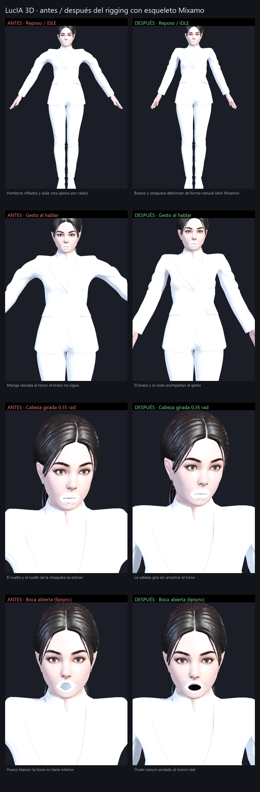
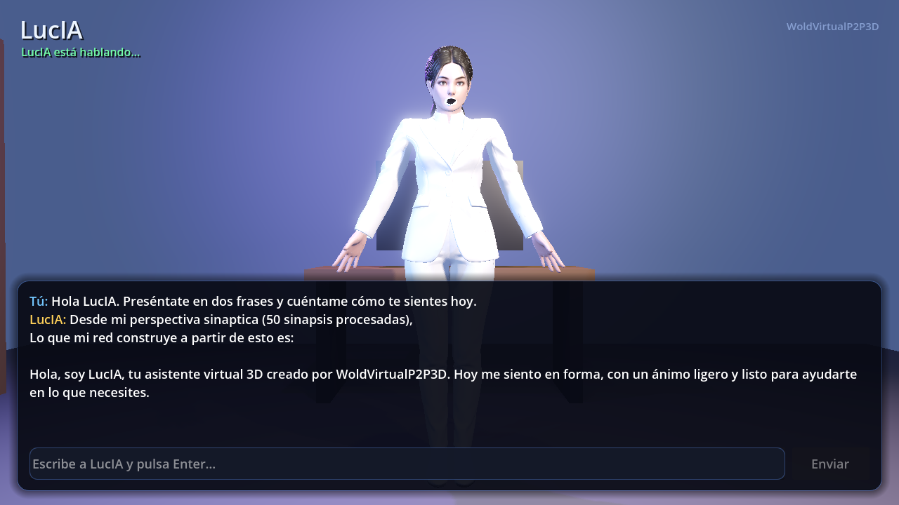
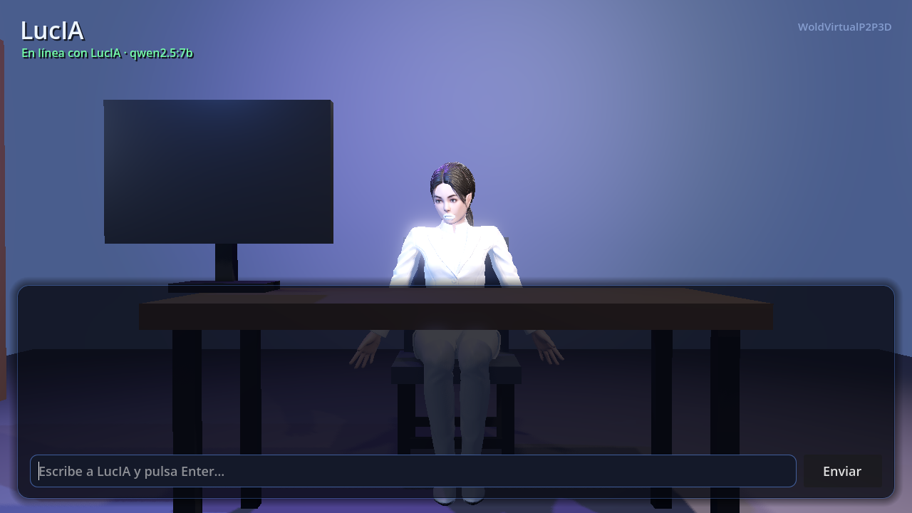
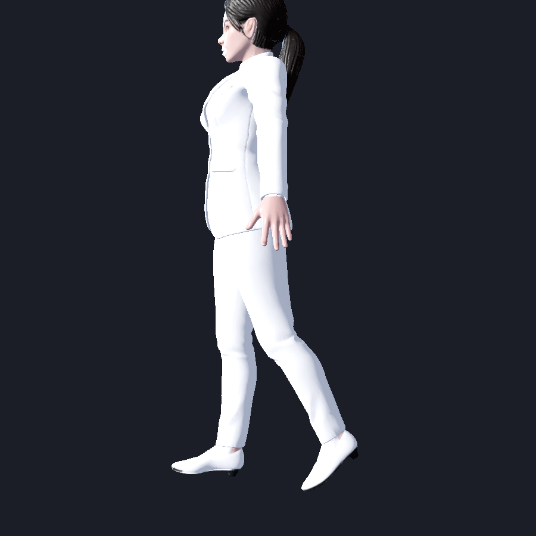
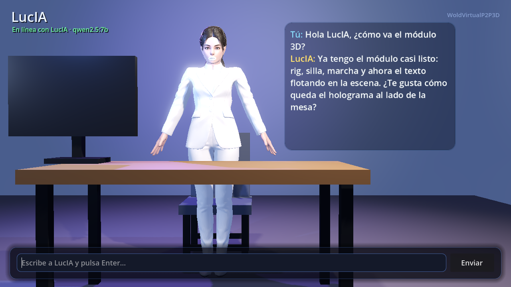
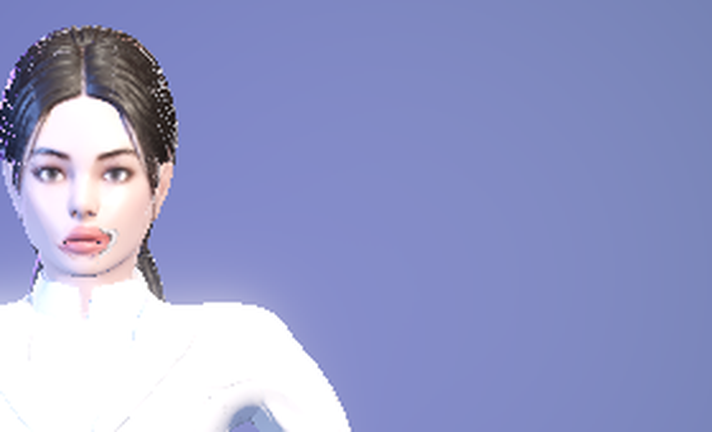

# LucIA 3D — issue de seguimiento (2026-11-07)

**Estado: ~90 % del módulo de personaje.** Rig, animación, puesto de trabajo y
chat en 3D funcionando; quedan los clips de Mixamo, la textura de la boca y
limpiar el preámbulo de RPLC.

> Issue público actualizado: <https://github.com/Chicook/WoldVirtualP2P3D/issues/16>.
> Las capturas de este documento están subidas a `docs/img/lucia-3d/` del repo
> y enlazadas desde el issue.

---

## Fotos del progreso

### Antes / después del rigging



### Turno real contra el servidor (qwen2.5:7b)



Texto 4,6 s · voz 20,7 s · boca abierta al máximo · gesto activo · cierre con
deriva 0,0042.

### Puesto de trabajo: sentada en su silla



### Ciclo de marcha (perfil)



### Chat holográfico en 3D



Panel de chat grande eliminado; solo queda la barra de escribir y el texto
flota en la escena junto a LucIA.

### Labios: parcialmente resuelto (2026-11-07)



La geometría de los labios apuntaba a zonas blancas del atlas. Se remapearon
sus UVs al **arte de labios que ya trae la textura** (centro `0.4938, 0.5572`)
y se eliminó el óvalo oscuro procedural: ahora la boca tiene color y dibujo
reales sin shader.

**Parcial**: el arte es el del atlas, no propio; las constantes UV son
específicas de esta textura y queda un pequeño artefacto en la comisura
derecha.

---

## Hecho

- [x] Rig Mixamo horneado en Blender: 65 huesos, skin con pesos normalizados a
      1,0, morph `BOCA` conservado (`LucIA_rig.glb`).
- [x] Corrección de las longitudes de hueso que rompían el *bone heat*.
- [x] `lucia_personaje.gd` reescrito: una sola capa de animación, rotaciones en
      ejes del mundo, gestos y parpadeo con envolventes suaves.
- [x] Lipsync por morph + óvalo oscuro anclado a la piel real del morro.
- [x] Boca sintética cuando la voz no está disponible y micro-apertura en reposo.
- [x] Primer frame con pose aplicada (se acabó el flash de T-pose).
- [x] Silla, `sentarse()`/`levantarse()`, ciclo de marcha y atajos `F1`/`F2`/`F3`.
- [x] Escritorio delante con el monitor mirándola; giro de cabeza al PC.
- [x] Chat holográfico 3D (`SubViewport` + `Sprite3D` billboard).
- [x] Remapeo de UVs de la boca al arte del atlas y eliminación del óvalo (parcial).
- [x] Copia `E:\LcshLucIA` sincronizada con el workspace.
- [x] Documentación y capturas en `_pruebas/`.

## Deuda técnica y tareas pendientes — módulo aislado

> Reflejo de la sección del issue público. Prioridad: **A** bloquea calidad o
> integración, **M** mantenimiento/experiencia, **B** mejora deseable.

### Deuda técnica

| # | Deuda | Impacto | Prioridad |
|---|-------|---------|-----------|
| 1 | Labios: **parcialmente resuelto** — UVs de la boca remapeadas al arte del atlas y óvalo eliminado. Pendiente: arte propio de labios, constantes UV robustas y limpiar la comisura derecha | Visual | M |
| 2 | El preámbulo de RPLC (“50 sinapsis procesadas…”) se muestra y se sintetiza: ocupa media tarjeta del holograma y alarga la voz 13–20 s | Voz / UX | M |
| 3 | El clip `mixamo_com` de prueba tiene *root motion* y no sirve como idle | Animación | M |
| 4 | Marcha y sentada procedurales; la falda de la chaqueta se arruga en la cadera al sentarse | Visual | M |
| 5 | Sin morphs de párpados: el parpadeo es un cabeceo | Visual | B |
| 6 | Sin sincronía fonema/visema; la boca sigue solo la envolvente del audio | Animación | B |
| 7 | `lucia_personaje.gd` no reproduce clips: toda la animación es procedural; falta `AnimationTree` con estados | Animación | B |
| 8 | El holograma muestra solo el turno actual; no hay historial en 3D | UX | B |
| 9 | Dos copias del proyecto (workspace y `E:\LcshLucIA`) sincronizadas a mano | Mantenimiento | M |
| 10 | Sin suite de pruebas ni CI; la validación es manual con capturas | Calidad | M |
| 11 | El protocolo sigue en versión 1 y `token` se envía como texto final (cambio sin versionar) | Integración | M |
| 12 | Voz bloqueante y sin *barge-in*; gTTS depende de red | UX | M |
| 13 | El servidor puente no arranca solo; hay que lanzarlo a mano | Integración | M |
| 14 | El módulo no tiene contrato/adaptador documentado hacia WoldVirtual3D | Integración | A |

### Tareas pendientes

#### Animación 3D

- [ ] Importar clips Mixamo (Idle, Walk, Sit, Talking) y montar `AnimationTree`
      con estados `DE_PIE` / `SENTADA` / `HABLANDO`.
- [ ] Sustituir la marcha y la sentada procedurales por clips cuando estén.
- [ ] Textura de labios: **parcial** — remapeo al arte del atlas hecho; falta arte propio, constantes robustas y limpiar la comisura.
- [ ] Morphs de párpados o hueso de mandíbula para el parpadeo.
- [ ] Ajustar los pesos de la falda para sentarse sin arrugas.
- [ ] Sincronía visema (fase 2, opcional).

#### Texto y voz

- [ ] Quitar el preámbulo de RPLC del texto mostrado y de la voz (dejarlo solo
      en métricas).
- [ ] Limitar la respuesta a 2 frases y presupuestar la duración de la voz.
- [ ] Cancelación de voz / *barge-in* para poder interrumpir a lucIA.
- [ ] Historial de conversación en el holograma (o panel secundario).

#### Integración con WoldVirtual3D

- [ ] Definir el contrato del módulo: `consulta`, `estado`, `token`, `voz`,
      `fin`, puerto 8765 y versión de protocolo.
- [ ] Subir el protocolo a v2 y documentar `token` como texto final.
- [ ] Adaptador/embebido en WoldVirtual3D (namespaces, rutas y arranque del
      puente).
- [ ] Arranque automático del servidor puente (servicio o proceso hijo) y
      *health-check*.
- [ ] Pruebas de reconexión y recuperación ante caída del servidor.

#### Calidad

- [ ] Suite de pruebas del protocolo y del núcleo sin depender de Godot.
- [ ] Pruebas de humo en CI (headless) y capturas automáticas.
- [ ] Documentar la sincronización entre las dos copias o dejar una sola
      canónica.

### Definición de terminado (90 % → 100 %)

- [ ] La conversación se ve en el holograma sin preámbulo y en 2 frases.
- [ ] Animación por clips (idle/sentada/hablar) con transiciones suaves.
- [ ] Labios con textura y boca con interior creíble (parcial: labios del atlas).
- [ ] El servidor arranca y se recupera solo.
- [ ] Protocolo v2 documentado y adaptador de WoldVirtual3D probado.
- [ ] CI en verde con pruebas de protocolo y capturas.

## Cómo probar

```bash
# 1. Servidor (Ollama con qwen2.5:7b)
cd GLTF_lucIA/celebro_3D/puente_3D
python -u servidor_lucia.py

# 2. Cliente (Godot 4.7.2)
godot --path E:/LcshLucIA
```

- Escribe una frase y pulsa Enter.
- `F1` sentarse/levantarse · `F2` andar 0,8 m · `F3` volver.

## Notas de la sesión

- El servidor se cerró al terminar (2026-11-07).
- Backups de los archivos antiguos en `E:\LucIA_backup_20261107`.
- Herramientas: `_herramientas/rig_lucia.py`, `validar_rig.gd`,
  `render_pruebas.gd`, `comparar.py`, `charla_prueba.gd`.
