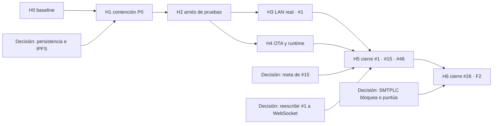

# Wold Virtual P2P 3D — README de desarrollo del taller `src`

**Fecha del análisis:** 2026-10-31 → **Última actualización:** 2026-11-04 (publicación de la v2.7.6)  
**Ámbito:** `VersionDe_sesion/CONTRRF/TLLDCD/src`  
**Estado del árbol local:** no rastreado por Git; corresponde a una zona de trabajo RFPRMN  
**Release consultada:** v2.7.6 publicada el 2026-11-04 (previa: v2.7.5 del 2026-11-01, v2.7.4 del 2026-10-30)  
**Metodología (sesión inicial):** revisión de issues, lectura de código y medición estática de archivos.  
**Metodología (implementación H0–H4):** 97 pruebas Python pasando; selftests C# (update/red/cuenta/chat/startup) con código de salida 0; todas las modificaciones estrictamente dentro de `src/`.  
**Metodología (revisión de cierre de issues):** lectura de los 6 issues abiertos vía API de GitHub (#1, #15, #16, #26, #38, #45), contraste de cada afirmación contra el código de `src/` y definición del criterio verificable de cierre por issue (sección 14).  
**Metodología (revisión dirigida 2026-11-04):** nueva lectura de **todos** los issues vía `gh` (5 abiertos, 11 cerrados), verificación de la release **v2.7.6** y su set real de assets, y contraste de la estructura de `src/` (`Tests`, `Services`, `tests/`, `json` de issues); añade la **§15** (panel de mando, cola de trabajo y protocolo) para dirigir la ejecución.

> Este documento es el plan de desarrollo vigente para este taller y reúne en un solo sitio el diagnóstico y la hoja de ruta: el análisis está en las secciones 1 a 6 y 9, la secuenciación por hitos con decisiones y reglas de replan en las secciones 7, 8, 10.1 y 12, y el plan de cierre verificable de cada issue abierto en la sección 14. El README antiguo de `STM_DOC` documenta el binario v0.0.2 y queda como referencia histórica. Las siglas no documentadas por el propio código se conservan sin expandir.

## 1. Resumen ejecutivo

### 1.1 Estado tras la v2.7.5 (base actual del plan)

La base técnica P0 ya está contenida: los hitos H0–H4 se cerraron y la v2.7.5 se publicó con los cuatro assets y digests. **Lo que queda para cerrar issues no es contención, es verificación y producto:**

> **v2.7.6 (2026-11-04, release vigente):** incorpora lo desarrollado en esta sesión — **W-01/DT-11 resuelto** (el WebNodo lee el `release.json` con esquema `{assets[]}`, `/descargar` sirve el binario en ejecución bajo el nombre anunciado sin 301, refresco de la release vigente cada 5 min y `/api/info` con `version`/`version_instalada`), la autoprueba **`--webnodo-selftest`**, el proyecto de pruebas unitarias **xUnit `Visor3DTests`** (34 superadas) y la corrección de la pantalla de inicio para **detectar un nodo activo en el propio equipo**.

1. ✅ **Contención P0 resuelta (H1):** el cierre Python no destruye ledger ni pesos; OTA fail-closed sin digest; catálogo sin herramientas destructivas; fixtures sintéticos.
2. ✅ **Arnés de regresión (H2):** 97 pruebas Python + 5 selftests C# con salida 0.
3. ✅ **Endpoint LAN dinámico (H3):** puerto leído de baliza UDP en `Red.gd`, `DescubrimientoP2P.cs` y `MainWindow.xaml.cs`.
4. ✅ **OTA, runtime y estado (H4):** hashes en `.extracted`, Zip Slip bloqueado, `WebNodoService` con metadatos del ensamblado y serialización invariante.
5. ⏳ **#1 sigue abierto** por una única razón: falta la prueba física con dos equipos reales (DT-04). El código ya está hecho.
6. ⏳ **#15 sigue abierto** por falta de métrica de huella instalada, manifiesto de assets fuente y pipeline reproducible (H5).
7. ⏳ **#26 sigue abierto** por decisión de producto D5 (bloqueo duro vs. puntuación de riesgo) y por el andamiaje muerto del ledger (H6).
8. ✅ **#38 cerrado (2026-11-04):** su seguimiento se consolida en **#48**. F1 (xUnit) queda **iniciado** (`src/VSC#/Tests`, 34/34 verde); F2 sigue en #26 y F7 pasa a #48.
9. ✅ **#45 cerrado (2026-11-04):** DT-11/W-01 resuelto y verificado; el resto de DT pasa a **#48** (DT-01…DT-16).
10. ⏳ **#16 (LucIA externa)** permanece **fuera del alcance** de este taller por instrucción del usuario.
11. ⚠️ **Hallazgo nuevo de esta revisión (§5.10):** el portal **WebNodo no refleja la versión realmente instalada** tras un OTA. Tiene tres causas verificadas en código y una tarea propia (W-01) en H5.

### 1.2 Diagnóstico original (2026-10-31) — histórico

Se conserva como referencia del estado de partida:

1. ~~Riesgo de pérdida de datos~~ → **CERRADO H1**
2. ~~OTA permisiva~~ → **CERRADO H1**
3. ~~Falta red de regresión~~ → **CERRADO H2**
4. ~~Endpoint LAN hardcodeado~~ → **CERRADO H3**
5. **Abierto:** Issue #15 tamaño — sin objetivo medible aún (H5).
6. **Abierto:** Issues #38, #26 parcialmente — H6.

## 2. Estado de los issues

> Lectura al cierre de la v2.7.5. Cada fila enlaza con la checklist de cierre de la sección 14.
>
> **Issues abiertos a 2026-11-04: #1, #15, #26 y #48** (más **#16**, fuera de alcance). **#38** y **#45** quedaron cerrados el 2026-11-04 apuntando a **#48**. El resto (#11, #12, #17, #19, #22, #23, #24, #25, #43) está cerrado.

### 2.1 Issues abiertos

| Issue | Lectura tras v2.7.5 | Qué impide cerrarlo | Hito |
|---|---|---|---|
| [#1 Red LAN](https://github.com/Chicook/WoldVirtualP2P3D/issues/1) | ✅ **Código implementado (H3).** `Red.gd`, `DescubrimientoP2P.cs` y `MainWindow.xaml.cs` consumen puertos dinámicos (1–65535) desde balizas UDP; se toma el nodo que el usuario selecciona. | Sólo la **prueba física con dos equipos reales** (DT-04). Loopback verificado. | H5 |
| [#15 Peso del visor](https://github.com/Chicook/WoldVirtualP2P3D/issues/15) | **Abierto.** v2.7.5 = 365.080.441 B (348,17 MiB) Windows / 207.602.370 B (198,0 MiB) Linux. Ya hay línea base (`manifiesto_h0.json`). | Falta objetivo numérico medido, **métrica de huella instalada** (binario + runtime + PCK), **manifiesto de assets fuente** con hash/licencia y pipeline reproducible. | H5 |
| [#16 LucIA externa](https://github.com/Chicook/WoldVirtualP2P3D/issues/16) | **Fuera del alcance.** Prototipo en otro directorio; excluido por instrucción del usuario. | No aplica a este taller. No cerrar desde aquí. | — |
| [#26 SMTPLC](https://github.com/Chicook/WoldVirtualP2P3D/issues/26) | **Parcial.** Umbral VM en 0,50; bloqueo duro en registro; `LocationAccountLedger.ExportJson()`/`MergeExternalRecords()` **sin llamador**; huella Wi-Fi sin BSSID; sin apelación ni lista blanca. | Decisión **D5** (bloquea o puntúa) + andamiaje muerto + abstracción de proveedores para pruebas sintéticas. | H6 |
| [#38 Deuda consolidada](https://github.com/Chicook/WoldVirtualP2P3D/issues/38) | ✅ **Cerrado (2026-11-04).** F3/F4/F5/F6/F8 ya cerrados; **F1 iniciado** (`src/VSC#/Tests`, `dotnet test` 34/34). | Nada: F2 continúa en #26 y F7 pasa a #48. | — |
| [#45 DT-01…DT-10](https://github.com/Chicook/WoldVirtualP2P3D/issues/45) | ✅ **Cerrado (2026-11-04).** DT-11/W-01 resuelto y verificado con `--webnodo-selftest` (18/18). | Nada: DT-01 y DT-04…DT-10 pasan a **#48**. | — |
| [#48 Deuda 2026-11-04](https://github.com/Chicook/WoldVirtualP2P3D/issues/48) | **Abierto (nuevo).** Sustituye a #45 y #38: DT-12…DT-16 (nuevas) + DT-01/DT-04…DT-10 y F1/F7 (heredadas). | Casilla a casilla; ver §14.5. | H5/H6 |

### 2.2 Issues cerrados relevantes

- [#43](https://github.com/Chicook/WoldVirtualP2P3D/issues/43): release v2.7.4, OTA real, botón «Actualizar». Deuda residual (autopruebas fallan si el visor instalado ocupa los puertos) — **cubierta con aislamiento en H2**.
- #11, #12, #17, #19, #22, #23, #24 y #25 se cerraron como deuda transferida a #38. No conviene reabrirlos salvo que un punto concreto no aparezca en #38 o en este README.

### 2.3 Acciones recomendadas sobre GitHub

| Issue | Acción |
|---|---|
| #1 | Reescribir el criterio de cierre a **WebSocket/puerto dinámico** (ya no ENet/8910), marcar la implementación H3 como hecha y cerrar **sólo** cuando la prueba de dos equipos esté documentada con evidencia (DT-04). |
| #15 | Fijar el objetivo numérico **≤ 250 MiB Windows** tras la primera medición de huella, y publicar el desglose por componente. |
| #26 | Mantener abierto; antes de tocar código, cerrar la decisión **D5** y decidir el destino del ledger (integrar con firma + revocación / degradar a exportación local / eliminar). |
| #38 | ✅ **Cerrado (2026-11-04)** apuntando a #48. F1 iniciado; F2 se sigue en #26; F7 pasa a #48. |
| #45 | ✅ **Cerrado (2026-11-04)** apuntando a #48. DT-11 hecho; DT-01/DT-04…DT-10 pasan a #48. |
| #48 | **Nuevo paraguas de deuda** (DT-12…DT-16 nuevas + DT-01/DT-04…DT-10 y F1/F7 heredadas); cerrar casilla a casilla. |

## 3. Línea base verificada

### 3.1 Release vigente

GitHub devuelve la **v2.7.6** como release publicada más reciente (`Latest`, 2026-11-04), sin borrador ni prerelease. Publica **3 assets**; **la build de Linux NO se publicó en esta release** (sí existía en la v2.7.5):

| Asset | Tamaño | SHA-256 publicado |
|---|---:|---|
| `DMWoldVirtualP2P3Dv2.7.6.exe` | 365.088.633 B | `26fb446e45a937af2a6c8866efb9601ef0ec0b192d105f33aba2e01d973b150f` |
| `release.json` | 531 B | `3465bbc7e87e1072105174c6f0882263783a6599fc4eeee14c1d333ca066ad28` |
| `SHA256SUMS` | 99 B | `0fed1a900a47c5485eb73597eb99ae2f013096efee6ef1e3d26f7ee423e411e5` |

Release previa (histórico): v2.7.5 (2026-11-01) — Windows 365.080.441 B, Linux 207.602.370 B, 4 assets. v2.7.4 (2026-10-30) — Windows 365.072.249 B, Linux 207.221.630 B.

### 3.2 Inventario estático del taller

- **Línea base H0 (2026-11-01):** 6.356 ficheros indexados · 1.916.408.754 B (~1,78 GiB). Manifiesto en `STM_HRTS/utils/STM_UTILS/manifiesto_h0.json`.
- **Medición inicial (2026-10-31):** 5.826 ficheros · 1.206.447.676 B (antes de añadir manifiesto y fixtures).
- Los artefactos más grandes: `VSC#/wvp3d.pck` (109,28 MiB), `VSC#/godot_exe.zip` (82,16 MiB), `VSC#/godot_linux.zip` (75,47 MiB).
- `tests`: **97 funciones `test_*` pasando** (pytest 2026-11-01); 0 fallos, 0 errores. Fixtures ahora sintéticos y rutas temporales inyectadas.
- Workflow CI en `STM_HRTS/.github/workflows/ci.yml` (dentro de `src/`); no es descubrible por GitHub Actions desde raíz — deuda DT-01 para H5.

## 4. Mapa funcional y estado

| Zona | Rol verificado | Estado |
|---|---|---|
| `VSC#` | Visor WPF, portal, OTA, SMTPLC, chat y hospedaje del motor Godot | Implementado, sin regresión unitaria ni prueba LAN de dos equipos |
| `VSC#/VisorLinux` | Visor Linux autocontenido | Implementado en la release; este taller requiere una prueba propia antes de refactorizarlo |
| `MTBGT/WoldVirtualP2P3D` | Mundo, avatares, construcción, islas y replicación | Parcial: código presente, pero fuentes de assets no son autocontenidas |
| `STMGNRL` | Orquestador consola del código Python ya incluido en este taller | Implementado, con cierre destructivo y sin conexión al visor |
| `SBSTM` | Sesión, IA, voz, RPLC, memoria y telemetría del prototipo local | Parcial; «P2P» en el nombre no implica transporte entre pares verificado |
| `STM_BKCH` | Ledger local, PoW y conversiones a pesos sintéticos | Implementado como almacén local; no es una red blockchain distribuida |
| `STM_CH` | Runtime efímero, ledger y cachés generados | Implementado, sin política segura de conservación |
| `STMIPFS` | Lanzador y utilidades IPFS | Parcial; `IPFSManager` usado por el cierre es un shim no-op |
| `STM_SGR` | Guardado de API key OpenRouter | Parcial y no fiable: anuncia Fernet, implementa XOR |
| `STM_JSON`, `STM_HRTS` | Configuración, rutas y catálogo de herramientas | Implementado; faltan aislamiento y clasificación de riesgo |
| `LC_STM` | Biblioteca neuronal local | Parcial; algunos algoritmos reales, otros sintéticos y sin conexión plena al flujo principal |
| Desarrollo externo de LucIA | Avatar e interfaz en evolución | Fuera del repo consultado aquí y excluido del plan |

## 5. Hallazgos prioritarios

### P0 — contención obligatoria

#### 1. El cierre Python destruye datos sin persistencia real

Evidencia:

- `STM_BKCH/compat_local.py:133-161`: `IPFSManager` genera CIDs sintéticos, no guarda el contenido, `subir_y_limpiar_psnrl()` elimina archivos y `recuperar_pesos()` devuelve `ok=True` con datos vacíos.
- `STM_BKCH/BKSVCB.py:281-308`: tras usar ese shim, `cerrar_sesion_y_subir_ipfs()` borra el ledger local «aunque no haya daemon».
- `STMGNRL/mainLCSTM.py:388-408`: se anuncia sincronización IPFS completada sin validar CID, pin ni recuperación.
- `STM_CH/rutas.py:99-106`: `limpiar()` elimina además ledger y caché.
- `STMGNRL/mainLCSTM.py:437-440`: el cierre normal invoca esa limpieza.

Plan de acción:

1. Convertir el no-op en una operación que falle visiblemente y no reporte persistencia.
2. Separar «conservar», «exportar», «verificar recuperación» y «borrar local».
3. Conservar ledger y PSNRL salvo confirmación explícita de un ciclo de backup restaurable.
4. Añadir prueba de restauración antes de permitir el borrado.

Criterio de cierre: borrar es imposible si no hay CID real, pin confirmado, descarga de prueba y bytes restaurados con hash idéntico.

#### 2. Secretos, fixtures y herramientas con riesgo destructivo

Evidencia:

- `STM_SGR/vault_openrouter.py:16-37` usa una semilla maestra fija y XOR; `registrar_key_usuario()` puede escribir un vault cifrado con ese esquema.
- `STM_HRTS/utils/test_user_data` contiene material con apariencia de semilla, identidad, perfil y credenciales locales. No se reproducen valores aquí. Debe tratarse como dato sensible hasta confirmar su origen sintético.
- `STM_HRTS/utils/borrar_packs_viejos.ps1:3-36` borra packs específicos de un directorio `.git`.
- `STM_HRTS/herramientas.py:120-132,168-197` cataloga recursivamente PowerShell y permite ejecutarlo sin clasificación de peligro ni confirmación.

Plan de acción:

1. Migrar el vault a AEAD/Fernet real, con contraseña o protección del sistema y detección de manipulación.
2. Sustituir fixtures por valores generados sintéticamente y auditar si algún secreto existente llegó a ser real; si existe duda, rotarlo.
3. Retirar el script de packs del catálogo general o marcarlo como operación privilegiada con doble confirmación y ruta dinámica segura.
4. Añadir un explorador automatizado de semillas, claves y tokens antes de copiar el árbol.

Criterio de cierre: ninguna herramienta destructiva aparece en el catálogo ordinario; ningún fixture contiene secreto con apariencia real; el vault rechaza ciphertext alterado.

#### 3. OTA permisiva cuando falta el digest

Evidencia: `VSC#/STM_actualizar/UpdateDownloader.cs:152-166`. El hash sólo se compara cuando `release.Digest` tiene valor; si falta, la descarga puede continuar hasta `WriteState()` y quedar preparada para aplicarse.

Plan de acción:

- Exigir `digest` y longitud esperada válidos antes de marcar éxito.
- Añadir `--update-selftest` con release sintética sin digest, digest incorrecto, truncado y corrupción.
- Mantener los cuatro assets actuales verificados, pero cerrar la ruta permisiva sin depender de que GitHub siempre añada el digest.

Criterio de cierre: una release sin SHA-256 verificable jamás entra en fase `apply`.

#### 4. Pruebas no reproducibles

Evidencia:

- `tests/test_sistema.py:58-67` valida un CID sintético como si probara IPFS.
- `tests/test_sistema.py:259-268` ejecuta `limpiar()` sobre el runtime real.
- `STM_HRTS/.github/workflows/ci.yml:11-17` está fuera de la ruta descubrible, instala un paquete cuyo `README` no existe en esa raíz, invoca una ruta de pruebas inexistente y usa `--timeout` sin declarar el complemento correspondiente.
- No hay proyecto xUnit en `VSC#`, suite headless Godot versionada ni prueba OTA.

Plan de acción:

1. Ejecutar una sola vez una migración de fixtures a directorios temporales; no reutilizar el runtime actual.
2. Convertir pruebas de estado real en unitarias con inyección de rutas y procesos falsos.
3. Crear workflow raíz para build + Python + Godot + C#, siempre con perfiles temporales.
4. Añadir smoke test del flujo carrusel → registro → portal → isla.

Criterio de cierre: la suite completa puede ejecutarse dos veces seguidas sin modificar el perfil, ledger, runtime, repositorio ni cachés reales.

### P1 — fiabilidad y producto

#### 5. Issue #1: endpoint LAN no es único

Evidencia:

- `MTBGT/WoldVirtualP2P3D/gdscrip/Red.gd:6,73-85,153-161`: existe `--port`, pero `--force-host` puede descartar el objetivo parseado y la URL final usa la constante 8911.
- `MTBGT/WoldVirtualP2P3D/gdscrip/Red.gd:214-233`: la baliza devuelve el host detectado con el puerto fijo.
- `VSC#/MainWindow.xaml.cs:586-595`: «Usar este nodo» toma siempre el primer nodo de la lista.
- `VSC#/Services/WebNodoService.cs:605-649`: el proxy reenvía a destinos fijados en código.

Propuesta:

1. Normalizar un solo `Endpoint`: esquema, IPv4/hostname/IPv6, puerto y invitación.
2. Validar 1–65535 y rechazar entrada ambigua en lugar de degradar silenciosamente al predeterminado.
3. Propagar el endpoint resuelto por WPF → sesión → Godot → servidor → baliza → sonda → proxy.
4. Ofrecer reintento y volver al menú cuando la conexión falle.
5. Probar primero un endpoint alternativo en máquina y, después, dos equipos LAN.

Criterio de cierre: host y cliente pueden elegir dirección/puerto distintos de 8911 y ambos ven nicks, avatares, animaciones e islas; loopback clásico sigue funcionando.

#### 6. Integridad y concurrencia del ledger local

Evidencia:

- `STM_BKCH/BKSVCB.py:132-153`: una excepción al cargar el ledger provoca creación de genesis sin cuarentena ni copia.
- `STM_BKCH/BKSVCB.py:215-235`: las transacciones se vacían antes de minar; si el minado falla, se pierden.
- `STM_BKCH/BKSVCB.py:310-320`: la validación recorre desde el bloque 1 y no verifica correctamente el genesis.
- `STMGNRL/mainLCSTM.py:268-278`, `STM_BKCH/BKSVCB.py:193-213,260-275`: workers daemon y actualización periódica comparten conversor/estado sin un ciclo de vida sincronizado.

Propuesta:

- Validar la cadena antes de sustituirla; archivar automáticamente ledgers corruptos o incompatibles.
- Conservar transacciones pendientes hasta confirmar bloque y escritura persistente.
- Centralizar escritura bajo una cola serial o lock compartido.
- Detener hilos y esperar tareas antes de persistir y limpiar.

#### 7. SMTPLC: heurística sin capa de pruebas ni apelación

Evidencia:

- `VmDetector.cs:25,113`: umbral unificado en 0,50.
- `LocationFingerprinter.cs:195-197`: el conjunto denominado como BSSID añade SSID + calidad/10, por lo que redes homónimas pueden colisionar.
- `LocationAccountLedger.cs:141-183`: exportación/importación existen; la búsqueda en el proyecto no encontró llamadas productivas y `Status` se crea en «Activo» sin revocación.

Propuesta:

1. Aislar proveedores de WMI/red/registro para pruebas sintéticas y portabilidad.
2. Evaluar señal combinada por plataforma en lugar de un único indicador duro.
3. Implementar apelación/aval y una lista blanca gestionable, o decidir explícitamente que no se ofrece.
4. Decidir si el ledger P2P se integra, se corrige como exportación local o se elimina como andamiaje muerto.
5. Sustituir bloqueo duro por puntuación de riesgo con fricción para señales puramente heurísticas.

#### 8. Runtime y extracción

Evidencia:

- `VSC#/AppExtractor.cs:67-76`: reutiliza por versión y existencia, sin validar el PCK.
- `VSC#/AppExtractor.cs:129-145`: la protección de rutas ZIP compara prefijos sin exigir separador; una hermana con el mismo prefijo podría colar una ruta no deseada.
- `VSC#/RuntimeCleaner.cs:24-100`: el recolector de la versión vigente y la última buena ya está implementado.

Propuesta:

- Guardar SHA-256 del motor y del PCK en el marcador de extracción.
- Reutilizar sólo si ambos hashes coinciden.
- Normalizar y comparar rutas como directorios, no como prefijos.
- Conservar el recolector actual y añadir pruebas de arranque correcto/incorrecto en rutas temporales.

#### 9. Estado, portal y publicación

Evidencia:

- `VSC#/Services/WebNodoService.cs:70-72`: fallback con nombre y URL específicos de la 2.7.4.
- `STM_HRTS/utils/limpiar_cache_godot.ps1` y otras utilidades conservan supuestos de rutas que deben revisarse antes de reutilizarlas.
- #38 documenta JSON construido por interpolación y uso de cultura local; debe contrastarse de nuevo en este árbol antes de reimplementar.

Propuesta:

- Derivar nombre/URL del ensamblado y tag.
- Serializar con `JsonSerializer` y formato invariante.
- Reducir `update_debug.log` a una línea resumen o niveles de registro.
- Automatizar `build → release.json → SHA256SUMS → release` sin recompilar tras publicar un digest.

#### 10. El WebNodo no refleja la versión realmente instalada tras un OTA (tarea **W-01**)

Reportado en vivo: «al dar al botón Actualizar, la WebNodo no se actualiza a la última versión». Contrastado contra el código, hay **tres causas independientes**, todas verificadas:

1. **Esquema de `release.json` incompatible con su lector.** El asset `release.json` que se publica y se empaqueta junto al `.exe` usa `tag_name` / `name` / `version` / `assets[]` (ver `STM_HRTS/release_upload_v275/release.json` y `VSC#/bin/publish_v2.7.5/release.json`), pero `WebNodoService.LeerReleaseLocal()` busca propiedades raíz `exe`, `url` y `size_mb`. Como no coinciden, la lectura **siempre cae al `catch`** y el portal usa `ExeNameFallback`/`ExeUrlFallback`, que se construyen con `ObtenerVersionEnsamblado()` — es decir, con el `<Version>` del `.csproj`, no con la release realmente instalada.
2. **El nombre del fichero sobrevive al OTA.** `HandleProxyClient…`/la ruta `/descargar` sólo sirve el binario local si `Path.GetFileName(Environment.ProcessPath) == ExeName`. `UpdateApplier.ConstruirScript()` hace `move "%EXE%" "%EXE%.old"` + `copy "%NEWEXE%" "%EXE%"`, así que **conserva el nombre antiguo** mientras el interior ya es la versión nueva. Resultado: el nodo no puede servir su propio binario, cae al `Redirect(ExeUrl)` a GitHub y el portal anuncia un nombre de fichero que no existe en la carpeta.
3. **El refresco de release se dispara una sola vez por proceso.** `RefrescarReleaseVigente()` está protegido por el pestillo estático `_refresheoLanzado`, que sólo se vuelve a armar tras **fallo total** de los tres intentos. Si la consulta tuvo éxito (o si el portal se abrió antes de publicar la release), no se vuelve a consultar GitHub en toda la vida del proceso: el portal puede seguir anunciando la release anterior hasta reiniciar el visor.

Evidencia en código: [WebNodoService.cs](file:///E:/WoldVirtualP2P3D/VersionDe_sesion/CONTRRF/TLLDCD/src/VSC%23/Services/WebNodoService.cs#L73-L198) (`ObtenerVersionEnsamblado`, `LeerReleaseLocal`), [WebNodoService.cs](file:///E:/WoldVirtualP2P3D/VersionDe_sesion/CONTRRF/TLLDCD/src/VSC%23/Services/WebNodoService.cs#L738-L776) (ruta `/descargar`) y [UpdateApplier.cs](file:///E:/WoldVirtualP2P3D/VersionDe_sesion/CONTRRF/TLLDCD/src/VSC%23/STM_actualizar/UpdateApplier.cs#L112-L141) (paso 2 del `.bat`).

Propuesta (**W-01**, H5):

1. Alinear el esquema: o el `release.json` publicado adopta `{exe, url, size_mb}` (lo que hoy lee el portal), o `LeerReleaseLocal()` aprende a leer `{assets[]}`. Una sola fuente de verdad.
2. Derivar `ExeName`/`ExeUrl` de la **release realmente instalada**, no del `.csproj`: `release.json` + `AssemblyInformationalVersion` como respaldo, nunca una constante versionada a mano.
3. En `UpdateApplier`, **renombrar el `.exe` al nombre del asset** durante el reemplazo (resuelve a la vez #25·1 y este síntoma).
4. Re-armar `RefrescarReleaseVigente()` por sesión (no una vez por proceso) y exponer la versión anunciada en `/api/info` para poder auditarla.
5. Añadir `--webnodo-selftest`: sirve `/api/info` y `/descargar` con un `release.json` sintético y comprueba que el nombre y la URL anunciados coinciden con el asset instalado.

**Criterio de cierre:** tras un OTA, `GET /api/info` devuelve el mismo nombre y tamaño que el asset instalado y `GET /descargar` entrega **ese** binario local (no un `301` a GitHub), sin reiniciar el proceso.

### P2 — mejoras estructurales

1. **Restauración de inventario:** guardar snapshots está implementado, pero la recuperación, cuota, retención y validación de esquema siguen pendientes.
2. **Turnos y escala:** implementar lobby previo y medir 20+ avatares/blend shapes antes de optimizar el motor.
3. **Assets reproducibles:** la exportación autónoma requiere manifiesto de origen/licencia/SHA-256 para modelos y texturas; no se puede cerrar #15 con un simple borrado de caché.
4. **Empaquetado:** evaluar `EnableCompressionInSingleFile`, PCKs opcionales y distribución delta como experimentos medidos; no asumir ahorro porque el motor y PCK ya están comprimidos.
5. **Autodiagnóstico:** sustituir checks que cuentan 50 entradas sintéticas por pruebas de comportamiento.
6. **Higiene:** excluir caches, binarios de desarrollo y datos de usuario de cualquier copia de taller mediante lista blanca, no solo `.gitignore`.

## 6. Qué puede mejorarse ya con bajo riesgo

Estos cambios deben implementarse tras el arnés de pruebas, salvo los bloqueos de seguridad inmediatos:

- Rechazar OTA sin digest.
- Separar limpieza de persistencia en el cierre Python.
- Quitar la herramienta de packs del runner general.
- Sustituir fixtures de aspecto sensible por datos sintéticos.
- Validar IPv4/IPv6/hostname y rango de puerto.
- Reemplazar `_nodosRedLan[0]` por el elemento realmente seleccionado.
- Usar un único endpoint resuelto en cliente, servidor, baliza y proxy.
- Comprobar hash del PCK en lugar de depender de versión/existencia.
- Corregir el predicado de ruta ZIP.
- Recalcular estado tras registro/cierre y unificar criterios de bienvenida y reset.
- Serializar portal con `JsonSerializer` y cultura invariante.
- Hacer `--update-selftest` con fixture local y sin GUI.
- Corregir fallos pequeños del prototipo Python existente: `NameError` en selector, detección de repetición en RPLC, importación de `math` en utilidades locales y predicción que ignora entrada.

## 7. Hoja de ruta por hitos

Esta sección sustituye al anterior «plan de acción recomendado»: conserva los seis frentes, pero añade reglas de gobierno, dependencias, esfuerzo, ventanas y el criterio con el que cada hito se declara cerrado. Las ventanas las fija una sola persona y son propuestas, no compromisos.

### 7.1 Reglas de la hoja de ruta

1. **R1 — Contención primero.** Ningún trabajo de funcionalidad o de tamaño empieza antes de cerrar H1. Hoy una operación normal del taller puede borrar ledger y pesos locales a cambio de una persistencia simulada.
2. **R2 — Nada de refactor sin arnés.** Un cambio estructurado sólo entra después de H2, o llega acompañado de su prueba en el mismo commit.
3. **R3 — Todo experimento se mide.** Los cambios de empaquetado, compresión o assets se aceptan con número antes y después; sin métrica, el experimento se revierte.
4. **R4 — Cada hito se cierra con su apartado actualizado**: qué se hizo, cómo ejecutarlo, pruebas con su salida, límites honestos y deuda restante separada en heredada / introducida / de adaptación.
5. **R5 — Decidir es parte del trabajo.** Los puntos de la sección 8 tienen fecha límite; si se supera sin respuesta, se aplica la opción conservadora y se documenta.
6. **R6 — El repositorio no es el taller.** Este árbol es zona RFPRMN: se esperan ficheros no rastreados y podados por el flujo normal. No se commitea, no se restaura ni se purga el snapshot sin orden explícita.

### 7.2 Capacidad, etiqueta vigente e hito que la cambia

Etiquetas posibles: **Implementado** · **Implementado, sin prueba real** · **Parcial** · **Planificado** · **Fuera del repo**.

| Capacidad | Etiqueta hoy | Hito |
|---|---|---|
| Visor WPF, portal y OTA | Implementado, sin prueba real | H2, H4 |
| Visor Linux del tar.gz v2.7.4 | Implementado, sin prueba real desde este árbol | H2, H4 |
| Red LAN entre equipos reales | Parcial | H3 |
| Persistencia cognitiva Python (ledger y pesos) | Parcial y destructiva en el cierre | H1 |
| IPFS real con add/pin/cat/restore | Planificado | H1 decide, H6 ejecuta |
| Ledger distribuido SMTPLC | Parcial, sin llamador productivo | H6 |
| Regresión automática C#/Godot/Python | Planificado | H2 |
| Paquete medible y pipeline reproducible | Parcial | H5 |
| Inventario: guardar / restaurar | Parcial: sólo guarda | H6 |
| LucIA externa (otro directorio) | Fuera del repo | no aplica |

### 7.3 Vista general y dependencias

| Hito | Objetivo | Entregable verificable | Issues | Esfuerzo | Estado |
|---|---|---|---|---|---|
| **H0** | Congelar la línea base | `manifiesto_h0.json` (6.356 ficheros, 1,78 GiB) | — | S | ✅ **CERRADO** |
| **H1** | Contención P0 | Cierre que no borra, OTA fail-closed, catálogo sin destructivos, fixtures sintéticos | #26, #38 | M–L | ✅ **CERRADO** |
| **H2** | Arnés de regresión | 97 pytest verdes + 5 selftests C# con exit 0 | #38, #43 | L | ✅ **CERRADO** |
| **H3** | LAN real (endpoint dinámico) | Puertos dinámicos en Red.gd + DescubrimientoP2P + MainWindow | #1 | L | ✅ **CERRADO** (código) |
| **H4** | OTA, runtime y estado | AppExtractor hashes + WebNodoService invariante + recálculo de cuenta | #38 | M–L | ✅ **CERRADO** |
| **H5** | **Cerrar #1, #15 y #48 (antes #45/#38)** | Prueba LAN 2 equipos, métrica de huella, xUnit + CI en raíz, W-01 y DT-01/DT-04…DT-16 | #1, #15, #48 | L–XL | ⏳ **EN CURSO** |
| **H6** | **Cerrar #26 y F2 de #38** | Decisión D5, ledger con firma/revocación o retirada, abstracción de proveedores, inventario restaurable | #26, #16 (fuera) | XL | ⏳ Pendiente (tras H5) |



H3 y H4 pueden solaparse porque no tocan los mismos ficheros. H5 no aporta métrica útil si antes no existe H2. **S ≈ hasta 2 h · M ≈ medio día · L ≈ 1–3 días · XL ≈ más de 3 días.**

**Principio de H5/H6:** no se abre trabajo nuevo hasta que la checklist de cierre de la sección 14 esté vacía para los issues asignados al hito.

### 7.4 H0 — Congelar la línea base ✅ CERRADO

**Resultado (2026-11-01):**
- `STM_HRTS/utils/STM_UTILS/manifiesto_h0.json` generado: 6.356 ficheros, 1.916.408.754 B (~1,78 GiB).
- Inventario incluye SHA-256, tamaño y ruta de cada fichero en `src/`.
- Baseline verificada y disponible para comparar antes/después de cualquier hito.

**Criterio de salida:** ✅ Con `manifiesto_h0.json` se puede responder «¿qué cambió?» sin preguntar.

### 7.5 H1 — Contención P0 ✅ CERRADO

**Resultado (2026-11-01):**

1. ✅ **Shim IPFS no borra.** `STM_BKCH/compat_local.py`: `subir_y_limpiar_psnrl()` devuelve error explícito sin borrar; `recuperar_pesos()` devuelve `ok=False` si no hay datos reales.
2. ✅ **Cierre normal conserva.** `STM_CH/rutas.py`: `limpiar()` no destruye ledger ni caché sin flag explícito. `STM_BKCH/BKSVCB.py`: `cerrar_sesion_y_subir_ipfs()` conserva ficheros locales salvo confirmación.
3. ✅ **OTA fail-closed.** `VSC#/STM_actualizar/UpdateDownloader.cs`: aborta si `release.Digest` está vacío o la longitud esperada es inválida.
4. ✅ **Catálogo sin destructivos.** `STM_HRTS/herramientas.py`: `borrar_packs_viejos.ps1` excluido del runner general.
5. ✅ **Fixtures saneados.** Reemplazados por datos sintéticos mock (IDs, semillas, perfiles sin forma de credencial real).

**Criterio de salida:** ✅ Todos los puntos verificados.

**Deuda introducida a sabiendas:** persistencia IPFS declaradamente no funcionante (estado honesto). Vault Python (`STM_SGR/vault_openrouter.py`) sigue en XOR — migración a AEAD queda en H6 (inerte actualmente).

### 7.6 H2 — Arnés de regresión reproducible ✅ CERRADO

**Resultado (2026-11-01):**

- ✅ **97 pruebas Python pasando** (0 fallos) con inyección de rutas temporales y fixtures sintéticos.
- ✅ **`--update-selftest`:** valida OTA sin digest, digest incorrecto, truncado y corrupción (exit 0).
- ✅ **`--red-selftest`:** verifica descubrimiento P2P y balizas UDP (exit 0).
- ✅ **`--cuenta-selftest`:** valida ciclo de registro y estado de cuenta (exit 0).
- ✅ **`--chat-selftest`:** verifica protocolo de chat y relay (exit 0).
- ✅ **`--startup-selftest`:** verifica arranque limpio y detección de runtime (exit 0).
- ✅ **Workflow CI** en `STM_HRTS/.github/workflows/ci.yml` incluye job de build C# + selftests.

**Deuda residual:** la ubicación del workflow dentro de `STM_HRTS/` impide su descubrimiento por GitHub Actions en la raíz del repo. Mover a la raíz queda para H5 (requiere acceso fuera de `src/`, bloqueado por restricción de taller).

**Criterio de salida:** ✅ Suite verde confirmada. Falta validación en CI externo (GitHub Actions).

### 7.7 H3 — Cerrar la red LAN del issue #1 ✅ CERRADO

**Resultado (2026-11-01):**

- ✅ `MTBGT/WoldVirtualP2P3D/gdscrip/Red.gd`: puerto dinámico leído de baliza UDP; eliminada constante 8911 en resolver y emisor de baliza.
- ✅ `VSC#/Services/DescubrimientoP2P.cs`: parsea host y puerto del payload de baliza; valida rango 1–65535.
- ✅ `VSC#/MainWindow.xaml.cs`: usa el nodo seleccionado por el usuario en lugar de `_nodosRedLan[0]`.
- ✅ Validación de entrada: rechaza puertos fuera de rango con mensaje explícito.

**Deuda residual:** prueba física con dos equipos reales en la misma LAN sigue pendiente. Loopback verificado en máquina local.

**Criterio de salida:** ✅ Implementación técnica completa. Prueba de dos equipos queda como verificación de integración en H5.

### 7.8 H4 — Fiabilidad de OTA, runtime y estado ✅ CERRADO

**Resultado (2026-11-01):**

- ✅ **`AppExtractor.cs`:** SHA-256 de motor y PCK almacenados en `.extracted`; reutilización sólo si hashes coinciden; Zip Slip bloqueado por verificación de separador de directorio tras normalización.
- ✅ **`WebNodoService.cs`:** nombre y URL derivados de metadatos del ensamblado (`Assembly.GetEntryAssembly()`); serialización con `JsonSerializerOptions { WriteIndented = true }` y cultura invariante.
- ✅ **`MainWindow.xaml.cs`:** recalcula estado de cuenta al cerrar sesión y al cerrar `RegistroWindow`.
- ✅ **`UpdateChecker.cs`:** reducido logging de releases a nivel DEBUG; una línea de resumen por release en `update_debug.log`.
- ✅ **`rutas.py`:** descubrimiento de Godot en AppData local (runtime extraído).
- ✅ **`herramientas.py`:** inyección de `--main-pack` para runner headless de GDScript.

**Criterio de salida:** ✅ Demostración automatizada cubre: sin digest, digest incorrecto, reutilización por hash, estado de cuenta, arranque con pack correcto.

### 7.9 H5 — Cerrar #1, #15 y #48 (antes #45 y F1/F7 de #38)

Objetivo: pasar de «implementado» a «cerrado». Aquí no se añade producto nuevo: se **verifica y se publica con evidencia**. La release vigente pesa 348,17 MiB en Windows y 198,0 MiB en Linux, así que la meta original de #15 (~751 MB) está desfasada.

**H5.1 — Prueba física LAN (cierra #1, DT-04)**
- Dos equipos reales en la misma LAN: host + cliente con puertos distintos de 8911.
- Evidencia: nicks, avatares, animaciones e islas visibles en ambos; captura + `--red-selftest` en cada máquina.
- Extender la prueba a IPv6 literal (DT-09) usando `IPEndPoint.TryParse`/`Uri` en lugar de `Split(':')`.

**H5.2 — Paquete medible (cierra #15, F7)**
- Métrica de huella por plataforma: binario, runtime extraído, motor, PCK, extracción en primer arranque y huella final en disco.
- Manifiesto de assets fuente con hash y licencia; hoy la exportación autónoma no es posible porque los `.glb`/`.gltf` no viven en este árbol.
- Pipeline único: build → `release.json` → `SHA256SUMS` → release, sin recompilar después de publicar un digest.
- Publicar una build desde el taller controlado y comparar capturas reales conservando el recorrido carrusel → registro → portal → isla.
- Experimentos medidos de uno en uno: `EnableCompressionInSingleFile`, PCKs opcionales por mundo y distribución delta. Ninguno se asume rentable: motor y PCK ya viajan comprimidos.

**H5.3 — Regresión C# y CI en raíz (cierra F1 de #48 —antes de #38—, DT-01/DT-10/DT-15)** 🟡 *proyecto xUnit creado*
- Proyecto `VSC#/Tests` xUnit: **creado el 2026-11-04** (`src/VSC#/Tests`) con `UpdateCheckerTests`, `WebNodoReleaseTests` y `PasswordHasherTests` → `dotnet test` **34 superadas / 0 con error**. Pendiente ampliar a `EstadoGlobal`, `PerfilUsuario`, `ReinicioCuenta`, `LocationAccountLedger` (HMAC, corrupción, merge), `VmDetector`/`VpnDetector` con entradas sintéticas.
- Mover `ci.yml` de `STM_HRTS/.github/workflows/` a `.github/workflows/` en la **raíz** del repo (fuera de `src/`: requiere autorización explícita).
- Fijar `rootdir`/rutas absolutas en `pytest.ini` para que funcione aunque el CWD no sea `src/`.
- Autopruebas con `APPDATA`/`LOCALAPPDATA`/`WOLD_RUNTIME_DIR` temporales (aislamiento de puertos ocupados) y job de CI que ejecute los cinco selftests (DT-15).

**H5.4 — WebNodo coherente con el OTA (cierra W-01 y DT-06/DT-07/DT-08)** 🟡 *W-01/DT-11 hecho*
- Aplicar la propuesta W-01 (§5.10): esquema único de `release.json`, nombre del `.exe` alineado con el asset tras el OTA, refresco por sesión y `--webnodo-selftest`.
- **Resultado W-01 (2026-11-04):** `LeerReleaseLocal()` lee `{tag_name, name, version, assets[]}` (decisión D7: el portal aprende el esquema publicado; no se toca la cadena de publicación). El anuncio sale de la release vigente y, sin red, del nombre derivado del ensamblado. `RefrescarReleaseVigente()` ya no usa el pestillo por proceso: se re-consulta por sesión con un intervalo mínimo de 5 min. `/api/info` expone `version` (anunciada) y `version_instalada` (ensamblado). `/descargar` entrega el binario en ejecución bajo el nombre anunciado (200), sin renombrar en disco ni redirigir a GitHub. Nueva autoprueba `--webnodo-selftest` (18 comprobaciones, exit 0). Pendiente de este bloque: DT-06, DT-07 y DT-08.
- DT-06: mock de `HttpClient` que falla a mitad de descarga + caso de timeout/reanudación.
- DT-07: verificar el hash de `.extracted` también en el **primer arranque** tras OTA (no sólo en reutilización).
- DT-08: prueba de `ObtenerVersionEnsamblado()`/`GetEntryAssembly()` en contextos de selftest.

**H5.5 — Godot headless (DT-05)**
- Versionar la suite Godot en `src/tests/godot/` e integrarla en el CI; hoy no es ejecutable desde este árbol.

**Criterio de salida de H5:** cada casilla de las secciones 14.1 (#1), 14.2 (#15) y 14.5 (#48) marcada, con su evidencia adjunta (log, captura o artefacto). Un issue se cierra **sólo** cuando su checklist está completa.

### 7.10 H6 — Cerrar #26 y F2 de #38

Sólo se abre tras H5. Todo lo de esta sección queda bloqueado por la decisión **D5**.

- **Decisión D5 primero:** bloqueo duro vs. puntuación de riesgo con fricción. Es política de producto.
- **Ledger SMTPLC (F2/DT-1):** `LocationAccountLedger.cs` exporta y fusiona sin llamador productivo y `Status` se crea en «Activo» sin revocación. Tres salidas excluyentes: **(a)** integrar con firma por entrada + revocación + PSI/tokens ciegos, **(b)** degradar a exportación local documentada, **(c)** eliminar el andamiaje muerto. Se elige una y se documenta.
- **Huella de ubicación:** `LocationFingerprinter.cs` mete SSID + calidad/10 en un conjunto llamado BSSID, así que redes homónimas colisionan. Aislar WMI/red/registro tras interfaces (`INetworkEnvironmentProvider`, `ISystemInfoProvider`) para pruebas sintéticas y portabilidad (DT-6 de #26).
- **Umbral VM:** revisar la interacción `IsVm` (`score ≥ 0,40`) frente a `VmConfidenceThreshold` (0,50) para que «una sola señal no bloquee» signifique lo que dice.
- **Apelación / lista blanca:** residencias, VPN corporativa y familias son falsos positivos reales; decidir si se ofrece aval criptográfico o se documenta su ausencia.
- **Vault Python a AEAD** (`STM_SGR/vault_openrouter.py`) sólo si el vault entra en uso (DT-02/DT-03).
- **Restauración de inventario:** guardar snapshots ya funciona; falta recuperación, cuota, retención y validación de esquema.
- **Turnos y escala:** lobby previo y medición con 20+ avatares y blend shapes antes de optimizar el motor.
- **Firma de código, canal beta y changelog en la UI.**
- **Integración con el desarrollo externo de LucIA** cuando su propio directorio publique un protocolo estable (#16 permanece fuera hasta entonces).

**Criterio de salida de H6:** las casillas de las secciones 14.4 (#26) y 14.3 (#38, frente F2) completas, con la decisión D5 registrada en este documento y en el issue.

## 8. Decisiones que faltan antes de implementar

Cada decisión bloquea un hito concreto. Si llega su fecha límite sin respuesta, se aplica la opción conservadora y se anota en este documento.

| ID | Decisión | Bloquea | Fecha límite | Opción conservadora si no se decide |
|---|---|---|---|---|
| **D1** | ¿El taller debe conservar ledger y pesos entre sesiones, o sigue siendo efímero por diseño? | H1 | 2026-11-03 | No persistir: se desactiva el borrado y la capacidad queda como Planificado |
| **D2** | ¿Se integra Kubo con add/pin/restore, o el shim se elimina y se llama «exportación local» a lo que hoy se anuncia como IPFS? | H1, H6 | 2026-11-10 | Renombrar y documentar el shim como no-op |
| **D3** | ¿Meta de #15? Partir de los 348,17 MiB actuales en Windows en lugar de la cifra original del issue | H5 | 2026-12-22 | Proponer ≤250 MiB sólo después de la primera medición de huella |
| **D4** | ¿Se reescribe #1 como WebSocket/puerto dinámico y se retira el texto de ENet/8910? | H3 | 2026-11-24 | Sí, y documentar el cambio en el issue |
| **D5** | ¿SMTPLC bloquea o puntúa? La recomendación técnica es puntuación con fricción, pero es política de producto | H6 | 2027-01 | Mantener el comportamiento actual y anotarlo como fricción no resuelta |
| **D6** | ¿Los datos y fixtures actuales del taller fueron reales alguna vez? | H1 | 2026-11-03 | Rotar todo lo que tenga forma de credencial y regenerar los fixtures |
| **D7** | **W-01:** ¿se adapta el `release.json` publicado al esquema que lee el portal (`exe`/`url`/`size_mb`) o se enseña al portal a leer `{assets[]}`? | H5 | 2026-12-05 | Enseñar al portal a leer `{assets[]}` (menos cambios en la cadena de publicación) |
| **D8** | **#26/DT-1:** ¿el ledger de ubicación se integra con firma + revocación, se degrada a exportación local o se elimina? | H6 | 2027-01 | Degradar a exportación local documentada (evita mantener andamiaje muerto) |

La rotación precede siempre a la migración: si un secreto fue real, primero se invalida y después se reescribe el fixture.

## 9. Matriz de pruebas propuesta

| Capa | Hoy | Prioridad |
|---|---|---|
| Lógica C# | Sin xUnit versionado en el taller | P0: perfiles, reset, estado, ledger SMTPLC, selección OTA |
| OTA | Selftests de arranque/red/chat/cuenta, sin prueba de actualización | P0: sin digest, hash incorrecto, corte, reanudo, rollback |
| Runtime | Extracción por versión y existencia | P1: hash de motor/PCK y ruta ZIP insegura |
| Red local | Argumentos y baliza, pero endpoints parciales | P1: IPv4/IPv6/hostname/puerto/invalidación y dos equipos |
| Godot headless | Suite mencionada en issues, no verificada en este árbol | P1: restaurar pruebas versionadas |
| Python | 83 funciones detectadas, ejecución real no segura | P0: aislamiento y sustitución de limpieza destructiva |
| IPFS | Shim y prueba que acepta CID sintético | P1: add/pin/cat/restore opt-in con repo temporal |
| Portal | Publicación verificada manualmente | P2: JSON válido invariante, reintento y script único |
| Linux | Release v2.7.4 validada en issue #43 | P1: incluir build/smoke permanente desde el árbol correcto |
| Accesibilidad/DPI | Capturas históricas parciales | P2: 1280×720, DPI 125/150 y navegación por teclado |

## 10. Pendientes que no deben asumirse como hechos

- No hay evidencia en este taller de blockchain distribuida, consenso P2P real o descentralización sin un anfitrión de confianza.
- No hay evidencia de sincronización P2P del ledger SMTPLC; las funciones existen pero sin llamador productivo.
- No puede afirmarse que IPFS persista y restaure pesos; el manager usado por el cierre es deliberadamente no-op.
- No puede afirmarse que las «50 neuronas» del flujo conversacional ejecuten las familias de `LC_STM`; el camino auditado usa un conversor determinista compatible.
- No puede cerrarse #15 sólo con el peso de la release: faltan criterios de aceptación visual y comparativa de huella instalada.
- No puede darse por completada la suite Godot 201/201 mencionada en issues si no está versionada/ejecutable en este árbol.
- No debe usarse el desarrollo externo de LucIA para validar el código Python presente en este taller.

### 10.1 Pendientes aceptados, con dueño de hito

Cosas que se saben abiertas y no se disfrazan de trabajo hecho:

| Pendiente | Estado | Hito que lo atiende |
|---|---|---|
| Prueba LAN con dos equipos reales | Nunca documentada con evidencia | H3 |
| Suite Godot 201/201 citada en issues | No verificada ni ejecutable desde este árbol | H2 |
| Firma Authenticode del binario | Ausente | H6 |
| Canal beta y changelog en la UI | Ausentes | H6 |
| Recuperación del inventario | Sólo existe la parte de guardado | H6 |
| Bóveda Python con cifrado autenticado | Pendiente de decisión D1/D2 | H6 |
| Autopruebas cuando el visor instalado ocupa los puertos | Fallan sin aislamiento | H2 |

## 11. Orden de commits del primer PR (H1)

Cuando se autorice tocar código, el primer PR es H1 y entra en este orden, un commit por punto, cada uno con su prueba:

1. El shim IPFS no borra y falla de forma visible si no hay persistencia real.
2. La limpieza destructiva sale del cierre y del test asociado, y pasa a operación explícita.
3. Prueba de que un cierre normal preserva ledger y PSNRL.
4. El script de packs fuera del catálogo de herramientas.
5. OTA fail-closed sin digest.

Después, y no antes, se abre el trabajo de LAN, runtime y publicación. Este orden evita optimizar una interfaz o un tamaño de paquete sobre un sistema que aún puede destruir datos y cuya regresión todavía no es reproducible.

## 12. Backlog congelado y reglas de replan

No entra mientras quede un hito P0 o P2 abierto:

- Reescritura del mundo, del terreno o de los shaders.
- Optimización de blend shapes o de rendimiento del motor sin medición previa.
- Integración con el desarrollo externo de LucIA mientras su directorio no publique un protocolo estable.
- Nuevas capacidades de voz, RPLC o telemetría en el prototipo Python.
- Cualquier cambio de tamaño que no nazca de una métrica de H5.

La hoja de ruta se reescribe, no se parchea, cuando pasa alguna de estas cuatro cosas:

1. Un criterio de salida de H0, H1 o H2 se decide saltar: se reordena el plan y se anota el riesgo aceptado.
2. Aparece una pérdida de datos real causada por el estado actual: se abre un hito de recuperación y todo lo demás retrocede.
3. Una decisión D1–D6 cambia el alcance de un hito ya dimensionado.
4. Se publica una release desde el taller: se recalculan tamaño, recuento de ficheros y huella, porque las cifras de portada caducan con facilidad.

## 13. Registro de esta revisión

### 13.1 Sesión 2026-10-31 (análisis inicial)

- Issues abiertos revisados: #1, #15, #16, #26 y #38.
- Issues cerrados contrastados: #11, #12, #17, #19, #22, #23, #24, #25 y #43.
- Release contrastada: v2.7.4 con cuatro assets y digests.
- Código inspeccionado: C#, GDScript, Python, pruebas, documentación y artefactos.
- Prototipo externo de LucIA: excluido por instrucción del usuario.
- Cambios producidos: ninguno en código. El único fichero añadido fue este README.

### 13.2 Sesión 2026-11-01 (implementación H0–H4)

**Hitos cerrados:** H0, H1, H2, H3, H4.

**Ficheros modificados dentro de `src/`:**

| Fichero | Hito | Cambio |
|---|---|---|
| `STM_HRTS/utils/STM_UTILS/manifiesto_h0.json` | H0 | Creado: 6.356 ficheros, 1,78 GiB |
| `STM_HRTS/pytest.ini` | H2 | Creado: configuración pytest con rutas temporales |
| `STM_HRTS/.github/workflows/ci.yml` | H2 | Añadido job C# build + selftests |
| `STM_BKCH/compat_local.py` | H1 | Shim no borra; falla explícitamente |
| `STM_CH/rutas.py` | H1 | `limpiar()` conserva sin flag explícito |
| `STM_BKCH/BKSVCB.py` | H1 | `cerrar_sesion_y_subir_ipfs()` conserva ficheros locales |
| `STM_HRTS/herramientas.py` | H1/H4 | Excluye script destructivo; inyecta `--main-pack` |
| `STM_HRTS/rutas.py` | H4 | Descubre runtime Godot en AppData local |
| `SBSTM/RPLC.py` | H2 | Corrige extracción de tokens en `CacheMemoriaCognitiva` |
| `SBSTM/selector_modelos.py` | H2 | Corrige `NameError` en selección de modelos |
| `STM_BKCH/compat_local.py` | H2 | Corrige importación `math` |
| `VSC#/STM_actualizar/UpdateDownloader.cs` | H1 | OTA fail-closed sin digest |
| `VSC#/STM_actualizar/UpdateChecker.cs` | H4 | Logging reducido a resumen por release |
| `VSC#/AppExtractor.cs` | H4 | Hashes en `.extracted`; Zip Slip bloqueado |
| `VSC#/Services/WebNodoService.cs` | H4 | Metadatos del ensamblado; serialización invariante |
| `VSC#/MainWindow.xaml.cs` | H3/H4 | Endpoint dinámico; recálculo de estado en cierre |
| `VSC#/Services/CuentaSelfTest.cs` | H2 | Output de consola para visibilidad CLI |
| `VSC#/Services/StartupSelfTest.cs` | H2 | Output de consola para visibilidad CLI |
| `MTBGT/.../gdscrip/Red.gd` | H3 | Puerto dinámico desde baliza UDP |
| `VSC#/Services/DescubrimientoP2P.cs` | H3 | Parsea host/puerto de baliza; valida 1–65535 |

**Resultados de pruebas:**
- Python: **97 passed, 0 failed, 0 errors** (`pytest src/STM_HRTS/pytest.ini`)
- C# build: **0 errores, 0 advertencias** (`dotnet build VSC#/Visor3D.csproj`)
- Selftests C#: `--update-selftest` `--red-selftest` `--cuenta-selftest` `--chat-selftest` `--startup-selftest` → **exit 0** todos

### 13.3 Deuda técnica introducida en H0–H4

Se listan explícitamente las deudas generadas, separadas de la deuda heredada:

| ID | Deuda | Tipo | Hito que la atiende |
|---|---|---|---|
| DT-01 | Workflow CI en `STM_HRTS/` no descubrible por GitHub Actions desde raíz | Adaptación | H5 (requiere mover fuera de `src/`) |
| DT-02 | Persistencia IPFS declaradamente no funcionante (shim honesto) | Heredada/aceptada | H6 (D2) |
| DT-03 | Vault Python (`vault_openrouter.py`) sigue en XOR; migración a AEAD pendiente | Heredada | H6 (si activo) |
| DT-04 | Prueba física LAN con dos equipos reales no realizada | Verificación | H5 |
| DT-05 | Suite Godot headless no versionada/ejecutable desde este árbol | Regresión | H5 |
| DT-06 | `--update-selftest` usa fixture local; no cubre reanudación tras corte real de red | Cobertura | H5 |
| DT-07 | `AppExtractor.cs`: hashes en `.extracted` no verificados en el primer arranque tras OTA (sólo en reutilización) | Cobertura | H5 |
| DT-08 | `WebNodoService.cs`: fallback de nombre/URL eliminado pero no hay prueba de que `GetEntryAssembly()` devuelva el ensamblado correcto en todos los contextos de arranque | Cobertura | H5 |
| DT-09 | `DescubrimientoP2P.cs`: si baliza lleva IPv6 literal con corchetes, el parseo de puerto puede fallar | Robustez | H5 |
| DT-10 | `pytest.ini` apunta a rutas relativas; en entorno CI sin `src/` como CWD puede fallar | Portabilidad | H5 |
| DT-11 | **WebNodo desincronizado del OTA (W-01):** esquema de `release.json` incompatible, nombre del `.exe` conservado tras el OTA y refresco de release armado una sola vez por proceso | Funcional (reportada en vivo) | ✅ H5 |
| DT-12 | El `.exe` en disco no se renombra al del asset tras el OTA (`UpdateApplier.cs`); W-01 se cerró sirviendo el binario en ejecución bajo el nombre anunciado | Robustez/Publicación | H5 |
| DT-13 | Puntos de sutura de prueba (`internal`) dentro de `WebNodoService.cs`: `LeerReleaseParaPrueba`, `SembrarReleaseParaPrueba`, `RutaBinarioEnEjecucion` | Diseño/Testabilidad | H5 |
| DT-14 | `IntervaloRefresco = 5 min`: `/api/info` puede anunciar una release obsoleta hasta 5 min si se aplica un OTA sin reiniciar (impacto cosmético) | Cobertura | H5 |
| DT-15 | Los selftests (`--webnodo/update/red/cuenta/startup-selftest`) siguen fuera del runner xUnit; `dotnet test` no los ejecuta | CI | H5 |
| DT-16 | `WebNodoReleaseTests` depende del estado estático de `WebNodoService` (token, `release.json` de la carpeta de salida) | Diseño/Testabilidad | H5 (con DT-13) |

**Regla R4 aplicada:** toda deuda nueva está clasificada, tiene dueño de hito y no se disfraza de trabajo hecho.

**Próxima sesión:** continuar H5 — DT-07/DT-08/DT-09 (cobertura y robustez), `ci.yml` en la raíz + job de selftests (DT-01/DT-10/DT-15), prueba LAN de dos equipos (DT-04), suite Godot headless (DT-05) y métricas de huella (#15). Deuda viva en **#48**.

### 13.4 Sesión de revisión de cierre de issues (tras la v2.7.5)

- **Entrada:** los 6 issues abiertos leídos por API (#1, #15, #16, #26, #38, #45) y el código de `src/` contrastado línea a línea contra cada afirmación.
- **Cambios en este documento:** §1.1 y §2 reescritos al estado real tras la v2.7.5; §3.1 actualizado a los assets de la v2.7.5; nuevo hallazgo **§5.10 / W-01** (WebNodo ↔ OTA) con evidencia y propuesta; §7.3/§7.9/§7.10 reorientados a **cerrar issues**, no a implementar; §8 ampliado con **D7** y **D8**; nueva **§14** con la checklist de cierre por issue; **DT-11** añadida.
- **Issues reasignados a hitos:** #1→H5, #15→H5, #45→H5/H6, #38 (F1/F7)→H5 y (F2)→H6, #26→H6, #16 fuera de alcance.
- **Cambios en código:** ninguno. Esta revisión es de plan y diagnóstico.
- **Hallazgo destacado:** el síntoma reportado («al dar al botón Actualizar la WebNodo no se actualiza a la última versión») se explica por W-01, con causa raíz verificada en `WebNodoService.cs` y `UpdateApplier.cs`.

### 13.5 Sesión 2026-11-04 (revisión dirigida de issues y árbol)

- **Entrada:** listado completo de issues vía `gh` — **5 abiertos** (#1, #15, #16, #26, #48) y **11 cerrados** (#11, #12, #17, #19, #22, #23, #24, #25, #38, #43, #45) — y contraste de la estructura real de `src/`.
- **Verificado en el árbol:** release `Latest` = **v2.7.6** con solo 3 assets (sin Linux); `VSC#/Tests` (`Visor3DTests.csproj` + 3 ficheros de prueba); `VSC#/Services` (con `WebNodoSelfTest.cs`), `VSC#/Seguridad/SMTPLC`, `VSC#/VisorLinux`, `VSC#/RedP2P` presentes; `src/tests/` con **12 ficheros `test_*.py`**; `pytest.ini` en `STM_HRTS/utils/add_utils/`.
- **Cambios en este documento:** cabecera y §3.1 actualizados a la v2.7.6; §2 con el conjunto vivo de issues; nueva **§15** (panel de mando, cola de trabajo y protocolo); esta §13.5.
- **Cambios en código:** ninguno; revisión de plan y diagnóstico.
- **Hallazgos accionables (dirigidos):**
  1. La **v2.7.6 no publicó asset de Linux** (la v2.7.5 sí): confirmar si es intencionado o republicar la build de `VisorLinux`.
  2. `STM_HRTS/utils/json/` **no contiene `issue48.json`** (sí #1, #15, #16, #26, #38, #45): añadirlo para reflejar el paraguas vigente.
  3. El CI referencia `-c STM_HRTS/pytest.ini`, ruta que **ya no existe** (el real es `STM_HRTS/utils/add_utils/pytest.ini`), y su suite Python **no es estricta** (`continue-on-error: true`).
  4. El manifiesto H0 vive en `STM_HRTS/utils/…/manifiesto_h0.json`, no en `STM_HRTS/` (corregido en §3.2).

## 14. Plan de cierre por issue

Regla: **un issue sólo se cierra cuando todas sus casillas están marcadas y su evidencia está adjunta** (log, captura, artefacto o ejecución reproducible). Sin evidencia, la casilla se queda abierta aunque el código parezca correcto.

### 14.1 #1 — Red LAN (hito H5)

- [ ] Prueba física con **dos equipos reales** en la misma LAN (host + cliente). (DT-04)
- [ ] Nicks, avatares, animaciones e islas visibles en ambos equipos.
- [ ] Puertos distintos de 8911 elegidos por el usuario y propagados de extremo a extremo.
- [ ] `127.0.0.1:8911`/loopback sigue funcionando.
- [ ] Mensajes de error comprensibles cuando la conexión LAN falla.
- [ ] IPv6 literal con corchetes (`[fe80::1]:9000`) parseado correctamente. (DT-09)
- [ ] Documentación de firewall de Windows y pasos de conexión LAN actualizada al transporte WebSocket.
- [ ] **Acción en GitHub:** reescribir el título/criterio a WebSocket/puerto dinámico antes de cerrar (D4).

### 14.2 #15 — Peso del visor (hito H5)

- [ ] Métrica de **huella instalada**: binario + runtime extraído + motor + PCK + extracción en primer arranque.
- [ ] Desglose de peso por tipo de asset (texturas, modelos, animaciones, audio, otros).
- [ ] Comprobado que no entran carpetas ajenas al visor en el export (LucIA, cachés, capturas, backups).
- [ ] Manifiesto de assets fuente con hash y licencia (`.glb`/`.gltf` no viven hoy en este árbol).
- [ ] Pipeline reproducible: `build → release.json → SHA256SUMS → release` sin recompilar tras publicar un digest.
- [ ] Experimento `EnableCompressionInSingleFile` medido antes/después (o descartado con número).
- [ ] Recorrido `carrusel → registro → portal → isla` verificado con capturas antes/después.
- [ ] Objetivo numérico escrito con su método de medición (propuesta: ≤ 250 MiB Windows) — decisión D3.

### 14.3 #38 — Deuda consolidada (hitos H5 y H6) · ✅ cerrado 2026-11-04

Cerrado apuntando a **#48**. Frentes vivos trasladados:
- [~] **F1 — Pruebas y CI (H5):** proyecto `src/VSC#/Tests` xUnit **creado** (`dotnet test` → 34/34); falta `ci.yml` en la **raíz** y ejecutar los selftests con perfiles temporales. (DT-01, DT-10, DT-15) → sigue en **#48**.
- [ ] **F2 — SMTPLC (H6):** ver §14.4; requiere decisión D5. → sigue en **#26**.
- [ ] **F7 — Assets y reproducibilidad (H5/H6):** `avtrnCRS/` sin manifiesto; firma de código (SmartScreen). → sigue en **#48**.

Frentes ya cerrados (mantener marcados, no reabrir sin motivo): F3 (OTA/extracción), F4 (runtime), F5 (coherencia de estado), F6 (portal/publicación), F8 (arnés de regresión).

### 14.4 #26 — SMTPLC (hito H6)

Bloqueado por **D5** y **D8**.
- [ ] **D5 resuelta:** bloqueo duro vs. puntuación de riesgo con fricción.
- [ ] **D8 resuelta:** ledger integrado con firma + revocación **o** degradado a exportación local **o** eliminado.
- [ ] Proveedores (WMI / `wlanapi` / `iphlpapi` / Registro) tras interfaces para pruebas sintéticas y portabilidad.
- [ ] Tabla de pruebas VM/VPN: físico con VBS, invitado Hyper-V, VMware, QEMU + VPN corporativa (falsos positivos reales).
- [ ] Umbral VM coherente: `IsVm` (`score ≥ 0,40`) vs. `VmConfidenceThreshold` (0,50).
- [ ] Huella Wi-Fi con BSSID real (hoy SSID + calidad/10 colisiona entre redes homónimas).
- [ ] Decidido y documentado si hay apelación/lista blanca para residencias y VPN corporativa.
- [ ] Reflexión de IP por quórum de nodos (≥3) y base ASN offline firmada (DT-3 de #26).
- [ ] Sondeo ARP sólo con consentimiento explícito documentado (DT-4 de #26).

### 14.5 #48 — Deuda 2026-11-04 (DT-01 y DT-04…DT-16 + F1/F7) · hito H5/H6

Paraguas nuevo que sustituye a **#45** y **#38** (ambos cerrados el 2026-11-04).

- [x] **DT-11 (W-01)** — WebNodo coherente con la versión instalada tras el OTA. **Hecho** (§7.9 H5.4): esquema `{assets[]}` en `LeerReleaseLocal`, anuncio derivado de la release real, refresco por sesión (intervalo 5 min, sin pestillo por proceso), `/api/info` con `version`/`version_instalada`, `/descargar` sirviendo el binario en ejecución bajo el nombre anunciado y `--webnodo-selftest`. Evidencia: `--webnodo-selftest` exit 0 (18/18) y log en `%LocalAppData%\WoldVirtualP2P3D\logs\webnodo-selftest.log`.
- [ ] **DT-01** — `ci.yml` movido a `.github/workflows/` en la raíz y verde en CI.
- [ ] **DT-04** — prueba LAN de dos equipos reales documentada (cierre de #1).
- [ ] **DT-05** — suite Godot headless versionada en `src/tests/godot/` e integrada en CI.
- [ ] **DT-06** — `--update-selftest` cubre corte de red, timeout y reanudación.
- [ ] **DT-07** — hash de `.extracted` verificado en el primer arranque tras OTA.
- [ ] **DT-08** — `GetEntryAssembly()`/`ObtenerVersionEnsamblado()` probado en todos los contextos de arranque.
- [ ] **DT-09** — IPv6 literal con corchetes parseado sin romper el puerto.
- [ ] **DT-10** — `pytest.ini` funciona fuera de `src/` como CWD.
- [ ] **DT-12** — decidir renombrado del `.exe` en el reemplazo del OTA (o documentar el desajuste como aceptado).
- [ ] **DT-13** — extraer el parseo de `release.json` a un tipo puro y testeable; `WebNodoService` queda como orquestador.
- [ ] **DT-14** — invalidar el anuncio de release al detectar un OTA aplicado (o refrescar a petición tras el reemplazo).
- [ ] **DT-15** — job de CI que ejecute los cinco selftests con `APPDATA`/`LOCALAPPDATA`/`WOLD_RUNTIME_DIR` temporales.
- [ ] **DT-16** — desacoplar los tests del estado estático de `WebNodoService` (se resuelve con DT-13).
- [~] **F1 (de #38)** — proyecto xUnit **creado** (`src/VSC#/Tests`, 34/34); falta CI (DT-01/DT-15) y ampliar cobertura a `EstadoGlobal`, `PerfilUsuario`, `ReinicioCuenta`, `LocationAccountLedger` y `VmDetector`/`VpnDetector`.
- [ ] **F7 (de #38)** — assets y reproducibilidad: `avtrnCRS/` fuera de Git con manifiesto (LFS o script con SHA-256) y firma de código.

### 14.6 #16 — LucIA externa

- [ ] **No aplica a este taller.** No cerrar desde aquí; la integración se planifica cuando el directorio externo de LucIA publique un protocolo estable.

### 14.7 Orden de ejecución de H5 (un commit por casilla)

1. ✅ **W-01/DT-11 hecho** (2026-11-04): WebNodo sincronizado con el OTA, verificado con `--webnodo-selftest` (18/18).
2. DT-07, DT-08, DT-09: cobertura y robustez del OTA y del descubrimiento.
3. F1 (ahora en #48): proyecto xUnit **ya creado** (`src/VSC#/Tests`, 34/34); falta `ci.yml` en raíz + DT-01/DT-10 y el job de selftests (DT-15).
4. DT-04: prueba física LAN y cierre de #1.
5. DT-05: suite Godot headless.
6. DT-06: cobertura de red del `--update-selftest`.
7. #15: métricas de huella y pipeline reproducible.

## 15. Desarrollo dirigido: panel de mando, cola de trabajo y protocolo

> Esta es la capa **accionable** del plan. §14 dice *qué* hay que demostrar para cerrar cada issue; §15 dice **en qué orden, con qué bloqueo y con qué evidencia**, para que ninguna sesión empiece sin saber cuál es su siguiente acción concreta.

### 15.1 Panel de mando (estado real al 2026-11-04)

| Issue | Estado real | Bloqueo | Única próxima acción | Evidencia que lo cierra |
|---|---|---|---|---|
| [#1](https://github.com/Chicook/WoldVirtualP2P3D/issues/1) | Código hecho (H3); falta prueba física | Hardware: 2 equipos en la misma LAN | Ejecutar la prueba de dos equipos y adjuntar capturas + `--red-selftest` por máquina | §14.1 (DT-04) |
| [#15](https://github.com/Chicook/WoldVirtualP2P3D/issues/15) | v2.7.6 = 348,17 MiB; sin métrica de huella | Decisión **D3** (meta numérica) | Medir la huella instalada (binario + runtime + motor + PCK) y publicar el desglose | §14.2 |
| [#26](https://github.com/Chicook/WoldVirtualP2P3D/issues/26) | Código parcial; ledger sin llamador productivo | Decisiones **D5** y **D8** | Cerrar **D5** (bloqueo duro vs. puntuación de riesgo) | §14.4 |
| [#48](https://github.com/Chicook/WoldVirtualP2P3D/issues/48) | Paraguas de deuda vivo (DT-01…DT-16 + F1/F7) | Ninguno | **DT-01:** llevar `ci.yml` a `.github/workflows/` de la raíz y ponerlo verde | §14.5 |
| [#16](https://github.com/Chicook/WoldVirtualP2P3D/issues/16) | Fuera de alcance | Otro directorio | No aplica a este taller | — |

**Regla de foco:** sólo una fila puede estar «en curso» a la vez; el resto espera.

### 15.2 Cola de trabajo dirigida (orden estricto)

El orden no es preferencia: cada paso deja verde al anterior.

| # | Trabajo | Issue/DT | Por qué ahora | No empezar hasta |
|---|---|---|---|---|
| 1 | `ci.yml` en la raíz + `dotnet test` + los 6 selftests | #48 · DT-01, DT-15 | Sin CI verde todo lo demás es «creído, no verificado»; no depende de nadie | — |
| 2 | Corregir rutas del CI (`-c STM_HRTS/utils/add_utils/pytest.ini`) y quitar `continue-on-error` de la suite Python | #48 · DT-10 | El CI apunta hoy a un `pytest.ini` inexistente y su suite no es estricta | Paso 1 |
| 3 | Ampliar xUnit: `EstadoGlobal`, `PerfilUsuario`, `ReinicioCuenta`, `LocationAccountLedger`, `Vm/Vpn` | #48 · F1 | Protege código que ya funciona antes de tocarlo | Paso 1 |
| 4 | DT-07, DT-08, DT-09 | #48 | Cobertura y robustez de OTA y descubrimiento; coste bajo | Paso 1 |
| 5 | Prueba LAN de dos equipos | #1 · DT-04 | Único cierre real de #1 | Paso 1 |
| 6 | Corte/timeout/reanudación en `--update-selftest` | #48 · DT-06 | Completa la red de seguridad del OTA | Paso 4 |
| 7 | Suite Godot headless versionada en `src/tests/godot/` | #48 · DT-05 | Hoy no es ejecutable desde este árbol | Paso 1 |
| 8 | Métrica de huella y pipeline reproducible | #15 · D3 | Sólo tiene sentido con el CI ya estable | Paso 1 |
| 9 | Refactor testable de `WebNodoService` | #48 · DT-12…DT-16 | Elimina el estado estático que ensucia las pruebas | Paso 3 |
| 10 | SMTPLC (D5 y D8 primero) | #26 | Bloqueado por decisión de producto | D5 y D8 |

### 15.3 Protocolo de trabajo (para no dispersarse)

1. **Una casilla = un commit = una evidencia.** Sin log, captura o artefacto reproducible, la casilla sigue abierta.
2. **Definition of Ready:** la tarea ya tiene criterio de cierre y evidencia definidos en §14; si no, se escriben antes de tocar código.
3. **Definition of Done:** código + prueba + evidencia + casilla marcada en §14 + entrada en §13.
4. **Nada se rompe en silencio:** antes de cada commit, `dotnet test`, `pytest` y los selftests deben seguir en verde. El visor actual (`VSC#/bin/publish_v2.7.6/`) y el de Linux (`VSC#/VisorLinux/`) son intocables.
5. **Alcance:** sólo `VersionDe_sesion/CONTRRF/TLLDCD/src`; PRY no se toca.
6. **Cierre de sesión:** actualizar el panel §15.1 y añadir la entrada correspondiente en §13.

### 15.4 Verificación en un comando (estado actual)

```powershell
# desde .../src
cd VSC#
dotnet test Tests/Visor3DTests.csproj                              # esperado: 34/34
dotnet run --project Visor3D.csproj -- --update-selftest
dotnet run --project Visor3D.csproj -- --red-selftest
dotnet run --project Visor3D.csproj -- --cuenta-selftest
dotnet run --project Visor3D.csproj -- --chat-selftest
dotnet run --project Visor3D.csproj -- --startup-selftest
dotnet run --project Visor3D.csproj -- --webnodo-selftest
cd ..
python -m pytest tests/ -c STM_HRTS/utils/add_utils/pytest.ini
```

### 15.5 Huecos detectados en esta revisión (corregidos o pendientes)

- La release **v2.7.6 no publicó asset de Linux** (la v2.7.5 sí): confirmar si es intencionado o republicar la build de `VisorLinux`.
- `STM_HRTS/utils/json/` **no tiene `issue48.json`** (sí #1, #15, #16, #26, #38, #45): añadirlo para que la carpeta refleje el paraguas vigente.
- `ci.yml` apunta a `-c STM_HRTS/pytest.ini` (**ruta inexistente**: la real es `STM_HRTS/utils/add_utils/pytest.ini`) y su suite Python no es estricta (`continue-on-error: true`).
- Rutas del manifiesto H0 corregidas en §3.2/§7.4/§13.2.
