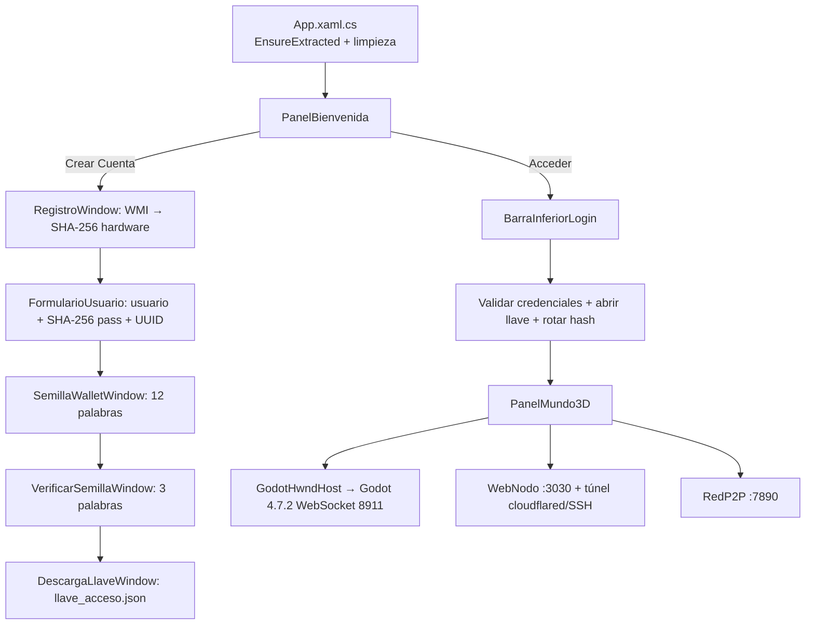
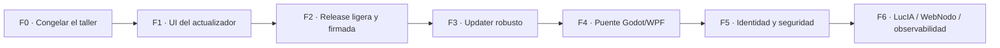

# Wold Virtual P2P 3D — README de desarrollo

> **Análisis del release `v0.0.2` (`DMWoldVirtualp2pCNXv0.0.20_p2p.exe`) + auditoría del árbol `src/` + propuesta de interfaz + hoja de ruta.**
> Documento de solo lectura: **no se ha modificado ni una línea de código de la aplicación.**

| Campo | Valor |
|---|---|
| **Fecha del análisis** | 2026-10-21 |
| **Árbol analizado** | `E:\WoldVirtualP2P3D\VersionDe_sesion\CONTRRF\TLLDCD\src` |
| **Repositorio** | `Chicook/WoldVirtualP2P3D` · rama `DevDeepSeekHarness` · HEAD `a29a1e6` |
| **Release analizada** | [v0.0.2](https://github.com/Chicook/WoldVirtualP2P3D/releases/tag/v0.0.2) — asset `DMWoldVirtualp2pCNXv0.0.20_p2p.exe` |
| **Binario verificado** | SHA-256 `fb89a00ed0608ab63a022d657b8378a91d280b1797e966f48980a315bb215d2d` (coincide con el *digest* publicado por GitHub) |
| **Commit de compilación** | `23dc4a41d3797c533bcebd1b8c3e7003504823b2` (leído del `ProductVersion` del PE) |
| **Naturaleza del directorio** | **Taller aislado** de desarrollo. Ruta cerrada: `E:\WoldVirtualP2P3D\VersionDe_sesion\CONTRRF\TLLDCD\src`. |

---

> ### Regla del taller
>
> **Taller:** `E:\WoldVirtualP2P3D\VersionDe_sesion\CONTRRF\TLLDCD\src` — espacio de trabajo deliberadamente separado del sistema principal. Todo lo que aquí se rompa, se rompe en el taller.
>
> - **No se sale de `E:\WoldVirtualP2P3D\VersionDe_sesion\CONTRRF\TLLDCD\src`.** Comandos, builds, temporales, logs y artefactos se ejecutan y viven bajo esa ruta.
> - **No se modifica nada del sistema principal**: ni el repositorio de `E:\WoldVirtualP2P3D`, ni `Sistema_Principal/PRY/…`.
> - La copia versionada del sistema principal se usa **solo como referencia de lectura**; la fuente de verdad de este trabajo es el taller.
> - Los ZIP de Godot (531 MB) son **insumo del taller**, no basura: sin ellos no hay build.
> - Si hay que ejecutar el visor, se redirige `LOCALAPPDATA` a `E:\WoldVirtualP2P3D\VersionDe_sesion\CONTRRF\TLLDCD\src\_taller\localappdata` para que la extracción de Godot tampoco salga de esa ruta.

---

## Índice

0. [Resumen ejecutivo](#0-resumen-ejecutivo)
1. [El release v0.0.2 y su binario](#1-el-release-v002-y-su-binario)
2. [Anatomía del `.exe`](#2-anatomía-del-exe)
3. [Qué lleva dentro y cuánto ocupa](#3-qué-lleva-dentro-y-cuánto-ocupa)
4. [Arranque en frío y huella en disco](#4-arranque-en-frío-y-huella-en-disco)
5. [El actualizador OTA: cómo funciona y dónde falla](#5-el-actualizador-ota-cómo-funciona-y-dónde-falla)
6. [Mapa del árbol `src/`](#6-mapa-del-árbol-src)
7. [Arquitectura del visor C#](#7-arquitectura-del-visor-c)
8. [La interfaz: diagnóstico y propuesta](#8-la-interfaz-diagnóstico-y-propuesta)
9. [Deuda técnica consolidada](#9-deuda-técnica-consolidada)
10. [Hoja de ruta](#10-hoja-de-ruta)
11. [Anexos](#11-anexos)

---

## 0. Resumen ejecutivo

1. **El binario está íntegro y es trazable.** El asset descargado pesa **720.233.665 B (686,9 MiB)** y su SHA-256 coincide exactamente con el `digest` de la API de GitHub. Se compiló desde el commit `23dc4a4`, que **no** incluye los commits posteriores de UI (`a92a6a5`, `e4e9002`, `a29a1e6`). El `.exe` **no está firmado** (Authenticode: `NotSigned`).
2. **El 77 % del `.exe` son dos ZIP incrustados.** `godot_project.zip` (470,7 MB comprimidos → 580,1 MB en crudo, 329 entradas) y `godot_exe.zip` (86,2 MB → 180,9 MB, 1 entrada). El proyecto Godot que viaja dentro **incluye la caché `.godot/`** (317,8 MB, 118 ficheros), que es regenerable y no debería distribuirse.
3. **Primer arranque = 761 MB de extracción** en `%LOCALAPPDATA%\WoldVirtualP2P3D\runtime\0.0.20\`, además de los 687 MB del `.exe`. Huella total ≈ **1,45 GB** por instalación.
4. **El botón de actualización no se ve** en la captura porque el XAML actual lo coloca a `y=52 px` (justo debajo de una barra de 42 px), es decir, **dentro del área del `HwndHost` de Godot**. WPF no puede pintar ni recibir clics por encima de un HWND nativo (*airspace*): el botón queda oculto tras el viewport 3D. En el binario publicado estaba a `y=10`, dentro de la barra pero **solapando «Cerrar Sesión»**.
5. **La zona que señala la flecha es medible:** en la captura (1916 × 1028) la punta cae en **x ≈ 1436 px (74,9 %)** y **1 px por debajo del borde inferior de la barra** (y ≈ 43 px de cliente). El hueco útil entre «WebNodo» y «Llave:» mide ≈ 165 px. Ahí cabe un *pill* de 26 px de alto y ~120 px de ancho, dentro de la barra y sin tocar nada.
6. **El árbol `E:\WoldVirtualP2P3D\VersionDe_sesion\CONTRRF\TLLDCD\src` es un taller, no el repositorio.** `git status` lo muestra como `?? …/TLLDCD/src/` y `.gitignore` excluye `*.zip`, `*.exe` y `*.dll`: es **por diseño**, para no arrastrar 531 MB de binarios al sistema principal. El riesgo no es «no estar en git», sino **no tener instantáneas locales** de lo que se trabaje aquí; se resuelve con *snapshots* dentro del taller (F0), sin tocar el repo principal.
7. **Hay dos productos en una carpeta.** El visor C# (6.507 LOC, 532 MB) y LucIA, la capa cognitiva en Python (32.721 LOC, 110 ficheros) comparten `src/` pero **no se referencian entre sí** (0 coincidencias de `LucIA`/`mainLCSTM`/`BKSVCB` en el código C#).

**Veredicto:** el visor funciona y la release es verificable, pero está en fase *demo*: distribución sobredimensionada, actualizador sin verificación criptográfica, taller sin instantáneas e interfaz con un fallo estructural de *airspace* que explica el botón «perdido». La hoja de ruta de la sección 10 ataca eso en orden, empezando por el botón (lo pedido) y por congelar el taller.

---

## 1. El release v0.0.2 y su binario

### 1.1 Datos verificados del asset

Consultados en `https://api.github.com/repos/Chicook/WoldVirtualP2P3D/releases/tags/v0.0.2` y comprobados sobre el fichero descargado:

| Dato | Valor |
|---|---|
| Tag | `v0.0.2` (reutilizado: contiene 6 `.exe` de versiones distintas) |
| Asset | `DMWoldVirtualp2pCNXv0.0.20_p2p.exe` |
| Tamaño | **720.233.665 bytes** (686,9 MiB) |
| SHA-256 publicado | `fb89a00ed0608ab63a022d657b8378a91d280b1797e966f48980a315bb215d2d` |
| SHA-256 descargado | idéntico ✔ |
| Descargas | 23 |
| Publicado / subido | 2026-10-18 22:03 UTC / 2026-10-21 00:57 UTC |
| Firma Authenticode | **No firmado** |
| `FileVersion` / `ProductVersion` | `0.0.20.0` / `0.0.20+23dc4a41d3797c533bcebd1b8c3e7003504823b2` |
| `AssemblyName` en origen | `DMWoldVirtualp2pCNXv0.0.20_p2p` (`VSC#/Visor3D.csproj:24`) |
| Plataforma | PE32+ · AMD64 (`0x8664`) · subsistema GUI |

> **Nota de trazabilidad:** el `ProductVersion` incluye el SHA del commit (`23dc4a4`). El árbol actual está 3 commits por delante (`a92a6a5` «reposicionar el botón», `e4e9002`, `a29a1e6`). Por tanto **el binario publicado no contiene el último fix de UI**; cualquier comparación visual contra el árbol actual debe tenerlo en cuenta.

### 1.2 Cómo se genera

`VSC#/Visor3D.csproj` fija las piezas del empaquetado:

```xml
<PublishSingleFile>true</PublishSingleFile>
<SelfContained>true</SelfContained>
<PublishTrimmed>false</PublishTrimmed>              <!-- no recorta el runtime -->
<EnableCompressionInSingleFile>false</EnableCompressionInSingleFile>
<IncludeNativeLibrariesForSelfExtract>true</IncludeNativeLibrariesForSelfExtract>
...
<EmbeddedResource Include="godot_exe.zip" />        <!-- 82,2 MB -->
<EmbeddedResource Include="godot_project.zip" />    <!-- 448,9 MB -->
```

Con `SelfContained=true`, `PublishTrimmed=false` y compresión de bundle desactivada, el resultado es el peor escenario de tamaño: **runtime .NET 8 + WPF completos, todas las culturas y dos ZIP íntegros**. De ahí los 687 MB.

---

## 2. Anatomía del `.exe`

### 2.1 Cabecera PE

| Campo | Valor | Lectura |
|---|---|---|
| `Machine` | `0x8664` | x64 |
| `Subsystem` | `2` | Windows GUI (sin consola) |
| Secciones | 10 | típicas del *apphost* .NET |
| `.text` | 6,35 MB | **`singlefilehost`**: el host lleva el runtime enlazado |
| `.rsrc` | 1,35 MB | iconos/versión |
| *Overlay* | ≈ 710 MB | ensamblado de la app + runtime + recursos |
| Directiva COM | `(0,0)` | no es un `.dll` gestionado puro: es un host nativo |
| Certificado | `(0,0)` | **sin firma** |

El fichero es un **`singlefilehost` de .NET 8** (no un `apphost` ligero): por eso `.text` pesa 6,3 MB en lugar de ~140 KB. El runtime gestionado se carga desde el propio fichero; las **nativas** se autoextraen a un directorio temporal por `IncludeNativeLibrariesForSelfExtract`; y los ZIP de Godot los extrae explícitamente `AppExtractor` (§4).

### 2.2 Contenido del bundle

En la cola del fichero hay una tabla de ~1.500 entradas con nombres. Lo relevante:

- **Ensamblado de la aplicación** `DMWoldVirtualp2pCNXv0.0.20_p2p.dll`, con los dos ZIP como recursos embebidos (`Visor3D.godot_exe.zip`, `Visor3D.godot_project.zip`).
- **Runtime WPF self-contained**: `PresentationCore`, `PresentationFramework`, `WindowsBase`, `System.Xaml`, `ReachFramework`, `PresentationUI`, `UIAutomation*`, `System.Windows.Forms*`, `System.Management`…
- **Nativas WPF**: `wpfgfx_cor3.dll`, `PresentationNative_cor3.dll`, `D3DCompiler_47_cor3.dll`, `PenImc_cor3.dll`, `vcruntime140_cor3.dll`.
- **≈ 40 culturas** de ensamblados satélite (`ko`, `pl`, `pt-BR`, `ru`, `tr`, `zh-Hans`, `zh-Hant`…) × ~18 DLL cada una. Son varios cientos de entradas y decenas de MB que un visor en español no usa.

### 2.3 Los dos ZIP incrustados (verificado dentro del `.exe`)

| Recurso | Entradas | Tamaño crudo | Almacenado | Ratio | Offset en el `.exe` |
|---|---:|---:|---:|---:|---:|
| `godot_exe.zip` | 1 | 180.858.888 B (172,5 MiB) | 86.155.732 B (82,2 MiB) | 47,6 % | 11.059.124 |
| `godot_project.zip` | 329 | 580.054.109 B (553,2 MiB) | 470.669.605 B (448,9 MiB) | 81,1 % | 97.215.020 |

Desglose del proyecto Godot incrustado:

| Carpeta | Ficheros | Tamaño crudo | Comentario |
|---|---:|---:|---|
| `.godot/` | 118 | **317.848.347 B (303,1 MiB)** | caché de importación (`*.ctex`), **regenerable** |
| `gltfimport/` | 135 | 258.026.446 B (246,1 MiB) | texturas de avatares y terreno |
| `ESCENAS/` | 21 | 4.011.708 B | escenas `.tscn` del mundo |
| `SLCAV/` | 12 | 63.148 B | escenas de avatares |
| `gdscrip/` | 16 | 59.122 B | 10 scripts GDScript |
| `gdshader/` | 16 | 17.642 B | shaders |
| raíz / `addons` / `tools` | 11 | 27.696 B | `project.godot`, README, addon |

Ficheros más pesados: la textura de terreno `ISLA3DCHUNK_rocky_terrain_02_diff_4k.png` (26,8 MB) y **siete** `*.ctex` de difusas de avatar de **22,4 MB cada uno** (156 MB en total, con duplicados binarios entre avatares según el README de `MTBGT`).

**Conclusión de tamaño:** de 687 MB, **~557 MB son los ZIP**, ~163 MB el *host* + runtime/nativas/culturas y unos pocos MB el código real. El proyecto Godot que se distribuye pesa **553 MB en crudo**, de los cuales **303 MB son caché** que Godot reconstruye con `--headless --import`.

### 2.4 El ZIP del repositorio es el mismo que el del binario

`VSC#/godot_project.zip` (448,9 MB) y `VSC#/godot_exe.zip` (82,2 MB) tienen **exactamente** las mismas 329/1 entradas y los mismos tamaños que los embebidos. Es decir: el binario publicado se puede reproducir desde este árbol **si los ZIP están presentes**; ver §9 (D2): por diseño viven fuera del control de versiones, así que son insumo obligatorio del taller.

---

## 3. Qué lleva dentro y cuánto ocupa

```
DMWoldVirtualp2pCNXv0.0.20_p2p.exe ........ 686,9 MiB
├─ singlefilehost + runtime .NET 8 WPF .... ~163 MiB  (incl. ~40 culturas)
├─ Visor3D.godot_exe.zip .................. 82,2 MiB  → 172,5 MiB (Godot 4.7.2)
└─ Visor3D.godot_project.zip .............. 448,9 MiB → 553,2 MiB
   ├─ .godot/ (caché) ..................... 303,1 MiB
   ├─ gltfimport/ (texturas) .............. 246,1 MiB
   └─ código + escenas + shaders .......... ~4,1 MiB
```

En primera ejecución, `AppExtractor.EnsureExtracted()` (`VSC#/AppExtractor.cs:31-85`) descomprime ambos ZIP en:

```
%LOCALAPPDATA%\WoldVirtualP2P3D\runtime\0.0.20\
├─ Servidor3D\Godot_v4.7.2-stable_win64.exe   (172,5 MiB)
└─ WoldVirtualP2P3D\                          (553,2 MiB, con .godot incluido)
```

Si el fichero marcador `.extracted` no coincide con `0.0.20`, **borra el directorio entero** (`Directory.Delete(RuntimeDir, recursive: true)`) y vuelve a extraer. Eso ocurre en **cada cambio de versión**: 761 MB de escritura.

---

## 4. Arranque en frío y huella en disco

| Momento | Qué ocurre | Coste |
|---|---|---|
| Descarga | Asset único de GitHub | 687 MB |
| Primer arranque | Descompresión de 761 MB (deflate) | 10–40 s según disco; CPU de un núcleo |
| Arranque normal | Comprueba `.extracted` y lanza Godot | 1–3 s |
| Actualización | Descarga **otra vez** 687 MB + re-extracción 761 MB | ~1,45 GB escritos |
| Disco ocupado | `.exe` + runtime extraído | ≈ 1,45 GB |

**Riesgos asociados:** antivirus escaneando 687 MB en cada ejecución, `SmartScreen` por falta de firma, y fallo de escritura si el `.exe` se ejecuta desde una carpeta sin permisos (el runtime va a `%LOCALAPPDATA%`, pero `STM_actualizar/` se crea **junto al `.exe`**, ver §5.4).

---

## 5. El actualizador OTA: cómo funciona y dónde falla

### 5.1 Piezas

| Fichero | Función |
|---|---|
| `VSC#/STM_actualizar/UpdateChecker.cs` | Consulta `api.github.com/repos/Chicook/WoldVirtualP2P3D/releases?per_page=30`, elige el mejor asset y compara versiones |
| `VSC#/STM_actualizar/UpdateDownloader.cs` | Descarga el `.exe` a `STM_actualizar/update-pending/` con progreso |
| `VSC#/STM_actualizar/UpdateApplier.cs` | Genera un `.bat` que espera al PID, sustituye el `.exe` y relanza |
| `VSC#/MainWindow.xaml.cs:135-325` | Orquesta estados y animaciones del botón |

### 5.2 Selección de versión

- La versión local se lee de `AssemblyInformationalVersion` (`MainWindow.xaml.cs:116-133`).
- De cada release toma `tag_name` **y** el nombre del asset, y se queda con el mayor (`UpdateChecker.cs:76-84`). Esto existe porque **el tag se reutiliza** (`v0.0.2` contiene `v0.0.011`, `v0.0.012`, `v0.0.013`, `v0.0.20`…).
- Entre todos los `.exe` del release elige el de mayor versión en el nombre (`UpdateChecker.cs:171-191`).

Funciona, pero es frágil: depende de que el nombre del fichero lleve una versión parseable y de que nadie suba un asset con un número mayor por error. La práctica correcta es **una release por versión** y un tag inmutable.

### 5.3 Descarga y aplicación

- Descarga completa, **sin reanudación** ni verificación de hash/firma.
- El `.bat` espera al PID hasta 120 s, hace `move` del `.exe` actual a `.old`, `copy` del nuevo con 20 reintentos, limpia y relanza (`UpdateApplier.cs:86-146`).
- Si el visor está en `C:\Program Files\…`, `STM_actualizar/` no es escribible y la actualización falla sin un mensaje utilizable.

### 5.4 Fallos concretos del flujo

| # | Fallo | Evidencia | Impacto |
|---|---|---|---|
| A1 | No se verifica el binario descargado (solo HTTPS) | `UpdateDownloader.cs` (sin hash) | Si la cuenta de GitHub se compromete, se ejecuta código arbitrario |
| A2 | 687 MB por actualización, sin *delta* ni reanudación | asset único | Móvil/ADSL: inviable; corte a mitad = empezar de cero |
| A3 | Requiere escribir junto al `.exe` | `UpdateApplier.cs:20-24` | Falla en `Program Files` o medios de solo lectura |
| A4 | `Environment.Exit`/`Shutdown` deja el `.bat` esperando hasta 120 s si el proceso no muere | `UpdateApplier.cs:101-109` | Ventana negra fantasma, doble instancia |
| A5 | El estado vive en `state.json` sin escritura atómica | `UpdateApplier.cs:23-45` | Corte de luz = estado corrupto |
| A6 | No hay canal beta/estable ni *changelog* en la UI | `UpdateChecker` | El usuario no sabe qué instala |
| A7 | El botón solo es clicable si `_updateInfo != null` (`OnActualizarClicked` sale si es null) | `MainWindow.xaml.cs:235` | Con «Al día» el clic no da *feedback* |

> **Corregido en v0.1.0:** A1 (SHA-256 contra el `digest` de GitHub), A2 (reanudación por `Range` + cancelar con clic), A3 (comprobación de escritura antes de descargar), A5 (`state.json` atómico y se borra al iniciar un intento), A7 (con «Al día» el clic vuelve a comprobar). Quedan A4 (espera del `.bat`) y A6 (canal beta/changelog).

---

## 6. Mapa del árbol `src/`

**919 ficheros · 788,2 MB · C# 6.507 LOC · Python 32.721 LOC · GDScript 2.485 LOC · XAML 1.191 LOC.**

| Carpeta | Ficheros | Peso | Rol | Estado |
|---|---:|---:|---|---|
| `VSC#/` | 41 | 532,6 MB | Visor WPF: UI, login, P2P, WebNodo, OTA, host Godot | Activo |
| `MTBGT/` | 212 | 250,1 MB | Proyecto Godot 4.7.2 (mundo, avatares, islas, shaders) | Activo, **incompleto** |
| `LC_STM/` | 60 | 1,1 MB | Núcleo neuronal de LucIA (optimizadores, ENRN, RF) | Activo, aislado |
| `SBSTM/` | 23 | 0,2 MB | Sesión, IA gratuita, voz, emoción, estilo | Activo, aislado |
| `STMIPFS/` | 527 | 2,2 MB | Lanzador Kubo/IPFS + utilidades | Activo, aislado |
| `STM_BKCH/` | 4 | <0,1 MB | Blockchain ligera PoNL | Activo, aislado |
| `STM_CH/`, `STM_JSON/`, `STM_HRTS/`, `STM_IA/`, `STM_SGR/`, `STMGNRL/`, `STM_DOC/` | 40 | 1,8 MB | Persistencia, RAG, vault, orquestador, docs | Activo |
| `tests/` | 10 | <0,1 MB | `pytest` de LucIA (no del visor) | Parcial |
| `ref_info.md`, `pytest.ini` | 2 | 51 KB | Plan de LucIA, configuración de tests | — |

### 6.1 `VSC#/` — el visor

- **UI**: `MainWindow.xaml/.cs` (1.245 líneas), `RegistroWindow`, `FormularioUsuarioWindow`, `SemillaWalletWindow`, `VerificarSemillaWindow`, `DescargaLlaveWindow`.
- **Motor**: `GodotHwndHost.cs` (434 líneas, `HwndHost` + `SetParent` + `AttachThreadInput`), `GodotConfig.cs`, `AppExtractor.cs`.
- **Red**: `RedP2P/P2PNodo.cs` (API local :7890), `P2PTunnelManager.cs` (SSH a `localhost.run`/`serveo.net`), `Services/WebNodoService.cs` (portal HTTP :3030-3040 con proxy TCP propio), `p2pipfsCS/P2PWebNode.cs` (56,8 KB), `IpfsManager`, `IpfsPublisher`, `EphemeralTunnelRunner`.
- **OTA**: `STM_actualizar/`.
- **Recursos**: `godot_exe.zip`, `godot_project.zip`, `webnodo/public/index.html` + `metaverso.jpg`.

### 6.2 `MTBGT/` — el mundo Godot

- `project.godot`: Godot 4.7, *Forward+*, Jolt Physics, D3D12; escena principal por UID.
- `gdscrip/Boot.gd` (máquina de estados: carrusel → registro → portal → carga → isla), `ChunkManager.gd` (25,9 KB, islas y red), `PlayerSync.gd`, `TeleportManager.gd`, `SLAV.gd`.
- **Red del motor**: `ChunkManager.gd` usa `WebSocketMultiplayerPeer` en **TCP 8911** (`const PUERTO_WS := 8911`). El comentario del C# que habla de ENet UDP 8910 (`MainWindow.xaml.cs:570-572`) está **obsoleto**.
- **Incompleto en `src/`**: `.godot/` está vacío (0 ficheros) y solo queda `hm1.blend`; las fuentes `.blend` de los 8 avatares no están. No es un árbol listo para ejecutar/depurar tal cual: habría que reimportar todo y recuperar las fuentes. El proyecto que se distribuye va dentro del ZIP **con su caché**.

### 6.3 LucIA — la capa cognitiva (Python)

- `STMGNRL/mainLCSTM.py` (446 líneas) orquesta: vault OpenRouter, blockchain PoNL, sesión P2P, IA local/remota, estilo y voz.
- `SBSTM/`: `IAFREE.py`, `IALOCAL.py`, `SNSBSTNPRB.py`, `STYLOS.py`, `RPLC.py`, `voice_engine.py`…
- `LC_STM/red_neuronal/`: 30 módulos de optimizadores (Muon/SOAP/AdamW…) y el procesador de voz.
- `STM_BKCH`: cadena PoNL con ledger en `STM_CH/blockchain_ledger.json`; `compat_local.py` es un *shim* de 50 neuronas sintéticas (deuda reconocida en `STM_DOC/README.md`).
- `tests/`: 10 ficheros `pytest` (sistema, comandos, memoria, emoción, voz, regresión).

**No hay integración con el visor**: cero referencias a `LucIA`, `mainLCSTM`, `BKSVCB` o `STMGNRL` en el código C#/XAML. Son dos productos que comparten carpeta. Cualquier hoja de ruta debe decidir si se integran o se separan.

---

## 7. Arquitectura del visor C#

### 7.1 Flujo de sesión



### 7.2 Datos y estado

- Todo vive en `test_user_data/` **junto al `.exe`** (`MainWindow.xaml.cs:30-37`): `credentials.json`, `user/user_profile.json`, `user/llave_acceso.json`, `user/p2p_session.json`.
- `p2p_session.json` se escribe además en `%APPDATA%\Godot\app_userdata\WoldVirtualP2P3D\` y en la raíz del proyecto Godot (`GuardarP2PSessionConfig`, líneas 724-775). **Tres copias** de la misma sesión.
- El «registro» se detecta por existencia de ficheros (`MainWindow.xaml.cs:351-353`), no por un estado de instalación. Es el problema histórico descrito en `VSC#/README.md` §3.1.

### 7.3 Red y túneles

| Puerto | Servicio | Notas |
|---|---|---|
| 7890 | API P2P local (`P2PNodo`) | `/ping`, `/info`, `/peer` |
| 3030–3040 | WebNodo (portal de descarga) | `HttpListener` en 3130-3140 + proxy TCP en 3030-3040 (reescribe `Host`) |
| 8911 | WebSocket del motor Godot | Único transporte que atraviesa túneles HTTP |
| SSH/cloudflared | Túnel efímero | `cloudflared --url http://127.0.0.1:{webPort}`; si falla, `ssh -R 80:…` a `serveo.net` / `nokey@localhost.run` |

Dependencias externas: `cloudflared` (se descarga a `%LOCALAPPDATA%\WoldVirtualP2P3D\`), `ssh.exe` de Windows, y dos servicios gratuitos de terceros.

### 7.4 Puente Godot–WPF

`GodotHwndHost` lanza `Godot_v4.7.2-stable_win64.exe` con `--path <proyecto> <escena> -- <args>` o `--main-pack <pck>`, espera hasta 12 s a `MainWindowHandle` (polling de 100 ms + `EnumWindows`), hace `SetParent`, quita bordes, adjunta hilos de entrada y reenvía teclas.

Consecuencia directa: **el HWND de Godot es una ventana nativa hija que siempre se pinta por encima del contenido WPF de su misma región**. Todo lo que se coloque «flotando» sobre el viewport (botones, paneles, *toasts*) es invisible e inalcanzable. Por eso la UI vive en la barra (F1/F4).

### 7.5 Cableado de túneles (verificado)

**Enlace de invitación y convergencia.** El enlace que se comparte tiene la forma
`https://<tu-nodo>/?host=<anfitrión-raíz>`:

1. El anfitrión crea la sesión y comparte `https://A/` (sin `host`, él es la raíz).
2. El amigo B abre ese enlace: `_hostSesionUrl = A` y Godot se conecta **a A**.
3. B comparte **su** enlace `https://B/?host=https://A`. El amigo C lo abre, lee `host=A`
   y también se conecta **a A**, no a B.
4. C comparte `https://C/?host=https://A`, y así sucesivamente.

Resultado: todos los invitados convergen en el mismo anfitrión (autoridad WebSocket de Godot),
se ven entre sí y reciben isla en el orden de llegada. El portal propio de cada uno sigue
sirviendo para descargar el visor; el túnel no crea sesiones paralelas.

| Tramo | Qué viaja | Puerto / ruta |
|---|---|---|
| `cloudflared` / `ssh -R` | HTTP + upgrade WebSocket | público 443 → `127.0.0.1:3030` |
| `WebNodoService` (proxy TCP) | HTTP con `Host` reescrito | 3030 → `HttpListener` 3130 |
| `WebNodoService` (upgrade, solo si se entra por un nodo que no es la raíz) | WebSocket del motor | 3130 → `ws://localhost:8911` |
| Godot cliente | `wss://<anfitrión-raíz>`; `ws://<ip>:8911` en LAN | 443 / 8911 |
| API P2P local | HTTP interno (no se comparte) | 7890 |

- **Corregido:** `_resolver_url_ws` solo reconocía cuatro proveedores; un dominio propio caía a `ws://host:8911` y no atravesaba el túnel. Ahora cualquier dominio público (no IP, no `.local/.lan/.home/.internal`) usa `wss://`.
- Los túneles solo transportan TCP/HTTP: no hay ENet/UDP en el camino.
- Godot usa autoridad de anfitrión (no malla completa): la «pureza P2P» está en el transporte, no en el modelo de replicación.

### 7.6 Pesos de LucIA en IPFS

`STMIPFS/SBSTMPYIPFS/pesos_ipfs.py` implementa el puente:

- `publicar_pesos(datos)` escribe el JSON en `STM_CH/PSNRL/`, ejecuta `ipfs add --pin --quieter --cid-version=1` y guarda el puntero en `STM_CH/lucia_pesos.cid` (CID + fichero + fecha).
- `cargar_pesos(cid)` hace `ipfs cat` y, si el daemon no está, cae al JSON local `lucia_pesos_ultimo.json`.
- `estado()` informa de binario, repo (`IPFS_PATH`) y CID vigente. Si no hay Kubo, devuelve error legible sin romper la sesión.

Prueba (`_taller\tools\test_pesos_ipfs.py`, con `_ejecutar` simulado): publicar → CID → puntero → cargar devuelve los mismos pesos. **Pendiente:** probar contra un daemon Kubo real y decidir si los pesos se cifran antes de publicarlos.

---

## 8. La interfaz: diagnóstico y propuesta

### 8.1 Lo que se ve (y lo que no) en la captura

Medición sobre la captura de 1916 × 1028 (coordenadas de pantalla):

| Elemento | Medida |
|---|---|
| Barra de título nativa | y = 0–22 |
| **Barra de sesión** | y = 23–64 → **42 px de alto** |
| Viewport Godot | y = 65–1028 |
| «WebNodo» (fin) | x ≈ 1297 (67,7 %) |
| «Llave: …» (inicio) | x ≈ 1462 (76,3 %) |
| **Punta de la flecha** | **x = 1436 (74,9 %), y = 66** → 1 px bajo la barra |
| Hueco libre entre WebNodo y Llave | ≈ 165 px (8,6 % del ancho) |

**No se ve ningún botón de actualización.** El XAML actual lo explica:

```xml
<!-- VSC#/MainWindow.xaml:372-374 -->
<Grid x:Name="BtnActualizar" Grid.Row="0" Grid.RowSpan="3"
      HorizontalAlignment="Right" VerticalAlignment="Top"
      Margin="0,52,20,0" Panel.ZIndex="999" Background="Transparent">
```

- La barra mide 42 px; el botón empieza en **y = 52**. Sus 30 px de icono + etiqueta caen de lleno en la fila del `HwndHost`.
- `Panel.ZIndex="999"` **no sirve** contra un HWND nativo: WPF compone su árbol, pero el hijo de Godot se dibuja encima y se queda los clics.
- El `PanelProgreso` (y ≈ 88) está aún más abajo: **nunca se ve**.

Y en el binario publicado (`v0.0.20`, commit `23dc4a4`) el margen era `0,10,20,0`: dentro de la barra, pero **encima del bloque «Cerrar Sesión»**, que es justo lo que el commit `a92a6a5` intentó arreglar bajándolo… y lo cambió por un fallo peor (invisibilidad).

### 8.2 Por qué la solución correcta es «dentro de la barra»

1. **Visibilidad garantizada**: la barra es WPF puro, fuera del rectángulo del `HwndHost`.
2. **Clic garantizado**: sin HWND que intercepte.
3. **Coincide con la flecha**: el hueco de 165 px está a 74-76 % del ancho, exactamente donde apunta la punta.
4. **No tapa el mundo 3D**: cero *overlays* sobre el viewport.
5. **Barato**: no requiere cambiar la arquitectura del host ni crear ventanas `Popup`.

### 8.3 Propuesta de colocación (medidas)

```
ANCHO 1916 px
┌──────────────────────────────────────────────────────────────────────────────────────────────┐
│ 🌐 WOLD VIRTUAL P2P  [Usuario: X] [● Red P2P Online]      [🔗 enlace] [🌐 WebNodo]           │ 42 px
│                                          ………………… hueco 1297–1462 …………………  [⟳ Actualizar v0.0.21] │
│                                                                                   ▲ 74–76 %    │
└──────────────────────────────────────────────────────────────────────────────────────────────┘
                                                                                    [Llave: 70a5…] [Cerrar Sesión]
```

- **Contenedor**: tercera columna de la barra (la de la derecha), como **primer hijo**, antes de `TxtSesionLlave`, con `Margin="0,0,10,0"` y `VerticalAlignment="Center"`.
- **Tamaño**: alto 26 px (barra de 42, deja 8 px arriba/abajo), ancho 112–124 px con etiqueta; 30 px en modo icono.
- **Geometría objetivo**: el borde derecho del *pill* debe caer en x ≈ 1450 px (75,7 %); su centro, en ≈ 1395 px (72,8 %). Si se prefiere exactamente la punta, alinear el borde derecho a 1436 px.
- **A 1120 px (tamaño por defecto de la ventana)** el hueco sigue existiendo: izquierda ~300 px, centro ~130 px, derecha ~320 px → sobran ~370 px. Cabe de sobra.

### 8.4 El *pill* de actualización

| Estado | Icono | Etiqueta | Fondo / borde | Comportamiento |
|---|---|---|---|---|
| `Buscando` | puntos animados | `Buscando…` | `#0F2744` / `#1D3A5C` | Deshabilitado; *timeout* 25 s |
| `Actualizado` | check verde | `Al día` | `#0F1F1A` / `#22C55E` (70 % opacidad) | Clic abre «Buscar de nuevo» |
| `Disponible` | flecha de descarga cian | `Actualizar vX.Y.Z` | `#0B2A46` / `#38BDF8` + *glow* pulsante | Clic inicia descarga |
| `Descargando` | anillo de progreso | `42 %` | `#0B2A46` / `#38BDF8` | Clic cancela (con confirmación) |
| `Aplicando` | flecha circular | `Reiniciando…` | `#0B2A46` | Sin acción |
| `Error` | triángulo rojo | `Reintentar` | `#2A1215` / `#F87171` | Clic reintenta |

Reglas de diseño:

- **Un solo control**: `Button` (no `Grid` + `MouseLeftButtonDown`). Hoy el botón es un `Grid` que **no recibe foco, no responde a `Enter`/`Espacio`, no tiene estado *hover* estándar ni anillo de foco**. Cambiar a `Button` con `Template` propio resuelve accesibilidad y teclado.
- **Altura 26 px, radio 13 px**, tipografía 10 px `SemiBold`, icono `Path` 14 × 14.
- **Etiqueta con versión** (`Actualizar v0.0.21`): elimina la ambigüedad de «Actualizar» a secas.
- **Tooltip** con versión, tamaño (687 MB), fecha y enlace a *release notes*.
- **Progreso**: barra de **2 px en el borde inferior de la barra**, ancho = % de descarga, color `#38BDF8`; el porcentaje va en el *pill*. Así **nunca** se pinta sobre el viewport.
- **Movimiento**: pulso de 1,6 s, **máximo 3 ciclos** y luego estático (evita parpadeo permanente y consumo).
- **Modo compacto**: con ancho de ventana < 1000 px, ocultar etiqueta y dejar icono + punto de color; el `ToolTip` conserva el texto.
- **`AutomationProperties.Name`** = «Actualización disponible, versión 0.0.21».

### 8.5 Implementación aplicada (v0.1.0-dev)

> **Estado:** implementado y compilado el 2026-10-21 (0 errores, 0 avisos). Capturas reales en
> `_taller\preview\out\` (`preview-1120.png`, `preview-1916.png` y los cuatro estados).
> El bloque de abajo es un resumen; el marcado real, con el porcentaje y el comportamiento
> responsive, está en `VSC#/MainWindow.xaml`.

```xml
<!-- Dentro de la columna derecha de la barra, antes de TxtSesionLlave -->
<Button x:Name="BtnActualizar"
        Height="26" MinWidth="112" Padding="8,0" Margin="0,0,10,0"
        VerticalAlignment="Center" Cursor="Hand"
        Background="#0F2744" BorderBrush="#1D3A5C" BorderThickness="1"
        Foreground="#7ECFFF" FontSize="10" FontWeight="SemiBold"
        ToolTipService.ShowDuration="20000"
        AutomationProperties.Name="Actualización disponible"
        Click="OnActualizarClicked">
  <Button.Template>
    <ControlTemplate TargetType="Button">
      <Border x:Name="Fondo" CornerRadius="13"
              Background="{TemplateBinding Background}"
              BorderBrush="{TemplateBinding BorderBrush}"
              BorderThickness="{TemplateBinding BorderThickness}">
        <ContentPresenter HorizontalAlignment="Center" VerticalAlignment="Center"/>
      </Border>
      <ControlTemplate.Triggers>
        <Trigger Property="IsMouseOver" Value="True">
          <Setter TargetName="Fondo" Property="BorderBrush" Value="#38BDF8"/>
        </Trigger>
        <Trigger Property="IsKeyboardFocused" Value="True">
          <Setter TargetName="Fondo" Property="BorderBrush" Value="#00D9FF"/>
        </Trigger>
      </ControlTemplate.Triggers>
    </ControlTemplate>
  </Button.Template>
  <StackPanel Orientation="Horizontal">
    <Path x:Name="IconoDescarga" Width="14" Height="14" Margin="0,0,6,0"
          Stretch="Uniform" Stroke="#38BDF8" StrokeThickness="2"
          Data="M12,2V13M12,13L7,8M12,13L17,8M5,18H19"/>
    <TextBlock x:Name="TxtEtiquetaActualizar" Text="Actualizar" VerticalAlignment="Center"/>
  </StackPanel>
</Button>
```

Y la barra de progreso, **fuera** del `HwndHost`:

```xml
<!-- Borde inferior de la barra de sesión -->
<ProgressBar x:Name="BarProgresoBarra" Height="2" VerticalAlignment="Bottom"
             Minimum="0" Maximum="100" Value="0"
             Foreground="#38BDF8" Background="Transparent" BorderThickness="0"/>
```

### 8.6 Otros problemas de interfaz (por prioridad)

| # | Hallazgo | Evidencia | Arreglo propuesto |
|---|---|---|---|
| U1 | **Botón de actualización invisible** | `MainWindow.xaml:373-374` + *airspace* | **Corregido** en v0.1.0-dev: §8.5 (pill en la barra) |
| U2 | **Mojibake en el portal WebNodo** | `WebNodoService.cs:65,110,113,119` (`ÔÇö`, `├│`); `webnodo/public/index.html:6` (`—`, `í`) | Reescribir ficheros en UTF-8 sin doble codificación; añadir `<meta charset>` correcto y test de cadena |
| U3 | **Progreso y errores sobre el viewport** | `MainWindow.xaml:394-406` | Barra de 2 px + *toast* en la barra, nunca sobre el 3D |
| U4 | La «Llave» ocupa ~200 px y se trunca a 1120 px | `MainWindow.xaml:208`, `MainWindow.xaml.cs:527` | **Corregido** en v0.1.0-dev: chip corto (`🔑 70a5eff7…`) + tooltip con hash y rotación |
| U5 | 4 `MessageBox` seguidos en el login | `MainWindow.xaml.cs:423,510,533` | Estado *inline* en la barra inferior y un solo diálogo para la llave |
| U6 | Emojis mezclados con iconos `Path` | `MainWindow.xaml:152,167,190`, `:209` | Unificar en `Path` vectoriales (Segoe Fluent Icons o SVG) |
| U7 | Barra de título nativa clara sobre app oscura | captura | `DwmSetWindowAttribute(DWMWA_USE_IMMERSIVE_DARK_MODE)` o *chrome* propio |
| U8 | HUD inferior derecho fijo y `IsHitTestVisible=False`, dice «Red P2P DeFi Enlazada» aunque esté caída | `MainWindow.xaml:234-242` | Hacerlo reactivo o eliminarlo; el estado ya está en la barra |
| U9 | Texto «Bienvenido a el metaverso» | `MainWindow.xaml:85` | «Bienvenido al metaverso descentralizado» |
| U10 | No se muestra la versión en ningún sitio | — | `v0.0.20` junto al título o en el *tooltip* del logo |
| U11 | Sin *hover*/foco visible en varios botones | estilos con `CornerRadius` en `Resources` | Un `Style` común con estados `IsMouseOver`/`IsPressed`/`IsKeyboardFocused` |
| U12 | Barra inferior de login muy densa (7 controles en 40 px) | `MainWindow.xaml:249-370` | Dos filas o plegar «Web amigo» tras un enlace |

---

## 9. Deuda técnica consolidada

| ID | Deuda | Evidencia | Impacto | Fase |
|---|---|---|---|---|
| **D1** | **Sin instantáneas del taller** | El árbol aparece como `??` **por diseño**; no hay *snapshot* ni manifiesto | Un error de edición no tiene vuelta atrás; no existe un «estado conocido bueno» | F0 |
| **D2** | Los ZIP del build quedan **fuera del control de versiones** | `.gitignore:50-52`; `VSC#/*.zip` = 531 MB | Reconstruir el taller en otro PC exige copiarlos a mano; es aceptable si se documenta | F0 |
| **D3** | `.exe` de 687 MB; 761 MB extraídos; `.godot/` distribuido (303 MB) | §2.3; `AppExtractor.cs` | Descarga y primer arranque lentos; cuota de disco | F2 |
| **D4** | Binario **sin firma** y actualizador **sin verificación** | `Get-AuthenticodeSignature` = `NotSigned`; `UpdateDownloader.cs` | Riesgo de cadena de suministro | F2/F3 |
| **D5** | 687 MB por actualización, sin reanudar ni *delta* | §5.3 | Actualizaciones inviables en conexiones lentas | F3 |
| **D6** | Actualizador escribe junto al `.exe` | `UpdateApplier.cs:20-24` | Falla en `Program Files` | F3 |
| **D7** | Tag reutilizado con 6 binarios distintos | API del release | Selección de versión frágil | F2 |
| **D8** | Nombre de asset y URL **cableados** en el portal | `WebNodoService.cs:56-58` | `/descargar` apuntará al binario viejo tras la próxima release | F2 |
| **D9** | Rutas absolutas de desarrollo | `GodotConfig.cs:26,29,32,60,63` | El visor falla fuera del PC del autor si no extrae recursos | F4 |
| **D10** | Identidad débil: SHA-256 sin *salt*, semilla de 64 palabras, llave en claro | `MainWindow.xaml.cs:934-988`; `SemillaWalletWindow` | Credenciales atacables; no es BIP-39 | F5 |
| **D11** | Codificación corrupta (doble UTF-8) en portal y docs | §8.6/U2 | Texto visible roto | F1 |
| **D12** | `src/MTBGT` incompleto (`.godot` vacío, sin `.blend`) | `MTBGT/WoldVirtualP2P3D/.godot` = 0 ficheros | No se puede ejecutar/depurar el mundo desde este árbol | F2 |
| **D13** | Comentarios de red obsoletos (ENet 8910 vs WebSocket 8911) | `MainWindow.xaml.cs:570-572` | Confusión de mantenimiento | F4 |
| **D14** | Dos productos sin integrar (LucIA 32,7 k LOC en `src/`) | 0 referencias cruzadas | Confusión de alcance, builds y tests | F6 |
| **D15** | Sin tests ni CI del visor | `tests/` solo Python | Cada release se valida a mano | F0/F4 |
| **D16** | Assets duplicados: 7 difusas de 22,4 MB + terreno 4K de 26,8 MB | §2.3 | ~180 MB evitables | F2 |

---

## 10. Hoja de ruta

> **Regla de oro:** todo ocurre **dentro de `E:\WoldVirtualP2P3D\VersionDe_sesion\CONTRRF\TLLDCD\src`**. Ninguna fase escribe fuera de esa ruta: ni en el repositorio principal, ni en `Sistema_Principal`. Cada fase termina con `dotnet build`, prueba manual y *checklist* firmado.



| Fase | Objetivo | Esfuerzo | Depende de | Criterio de aceptación |
|---|---|---|---|---|
| **F0** | Congelar el taller | 1–2 d | — | `snapshot.ps1` + `build.ps1` reproducen el binario **sin escribir fuera de `E:\WoldVirtualP2P3D\VersionDe_sesion\CONTRRF\TLLDCD\src`** |
| **F1** | Botón de actualización en la barra | 1–2 d | F0 | Visible y clicable a 1120×630; no solapa «Llave» ni «Cerrar Sesión»; progreso visible |
| **F2** | Release ligera, firmada y portable | 2–3 d | F1 | 1 `.exe` sin instalador: ≤ 450 MB con todo (o ~170 MB + mundo); extracción ≤ 300 MB; Authenticode + SHA-256 |
| **F3** | Updater robusto | 2–3 d | F2 | Corte de red → reanuda; hash erróneo → aborta; sin permisos → mensaje claro |
| **F4** | Puente Godot/WPF | 3–5 d | F1 | 60 fps, foco estable, DPI 125/150 % correcto, sin *overlays* invisibles |
| **F5** | Identidad y seguridad | 3–5 d | F2 | PBKDF2/Argon2 + *salt*; BIP-39 real; llave protegida con DPAPI |
| **F6** | Integración y observabilidad | 5–8 d | F4/F5 | LucIA integrada o separada explícitamente; portal sin mojibake; logs rotados |

### F0 — Congelar el taller (lo primero, hoy)

1. **No tocar el sistema principal.** Nada de `git add` al repo de `E:\WoldVirtualP2P3D`, ni copias a `Sistema_Principal/PRY/…`. Este árbol es la fuente de verdad del taller.
2. Crear `E:\WoldVirtualP2P3D\VersionDe_sesion\CONTRRF\TLLDCD\src\_taller\` para lo efímero: `snapshots\`, `out\`, `logs\`, `tmp\`, `localappdata\`. Añadir un `.gitignore` **local del taller** (aunque no haya repo) para no mezclar artefactos con fuentes.
3. `snapshot.ps1`: copia fechada de `VSC#\`, `MTBGT\WoldVirtualP2P3D\` y los dos ZIP a `_taller\snapshots\AAAA-MM-DD_HHmm\`, con `manifest.sha256` de todo lo copiado. Excluir `bin\`, `obj\`, `.godot\imported\`, `node_modules\`.
4. `build.ps1`: `dotnet publish -c Release -r win-x64 --self-contained true -p:PublishSingleFile=true -o "E:\WoldVirtualP2P3D\VersionDe_sesion\CONTRRF\TLLDCD\src\_taller\out\<fecha>\"`, calcula SHA-256 y escribe `release.json` (versión, commit, hash, tamaño). **Ninguna salida fuera de `E:\WoldVirtualP2P3D\VersionDe_sesion\CONTRRF\TLLDCD\src`.**
5. `run.ps1`: lanza el visor con `LOCALAPPDATA` apuntando a `E:\WoldVirtualP2P3D\VersionDe_sesion\CONTRRF\TLLDCD\src\_taller\localappdata`, para que `AppExtractor` extraiga los 761 MB de Godot dentro del taller y no en el perfil del usuario.
6. Congelar el binario actual como referencia visual en `_taller\baseline\` (687 MB; si pesa demasiado, guardar solo hash + captura).
7. **Criterio:** desde un *snapshot* y los dos ZIP, `build.ps1` produce el mismo tamaño y hash de recursos en `_taller\out\`, y no se ha escrito nada fuera de `E:\WoldVirtualP2P3D\VersionDe_sesion\CONTRRF\TLLDCD\src`.
8. **Exclusión de sensibles (hecho el 2026-10-21):** el `.gitignore` de la raíz del proyecto ya bloquea `**/_taller/`, credenciales (`llave_acceso.json`, `credentials.json`, `user_profile.json`, `semilla_wallet*`, `wold_hardware_id*`), `**/STM_actualizar/update-pending/`, `**/webnodo/descargas/`, `**/.ipfs/` y certificados/secretos (`*.pfx`, `*.pem`, `*.key`, `*.token`, `*.log`). Así, cuando se ejecute la actualización, esos datos no se suben.

### F1 — Botón de actualización en la barra (lo pedido)

1. Sacar `BtnActualizar` de la capa flotante (`Grid.RowSpan="3"`, `ZIndex=999`) y meterlo en la columna derecha de la barra, antes de `TxtSesionLlave`.
2. Convertirlo en `Button` con plantilla propia (26 px, radio 13, icono 14, etiqueta 10).
3. Añadir estado `Descargando` con anillo + `%` en el *pill* y **barra de 2 px** en el borde inferior de la barra.
4. Eliminar `PanelProgreso` flotante y `GlowActualizar` sobre el viewport; conservar el *glow* solo dentro de la barra.
5. Sustituir `MessageBox` de error por estado `Error` + `Reintentar` en el propio *pill*.
6. Anchos: probar 1120×630, 1280×720, 1920×1080 y 100 %/125 %/150 % de DPI.
7. **Criterio:** captura a 1120×630 con el *pill* entre «WebNodo» y «Llave», sin solapes; `Tab` llega al botón y `Enter` lo activa; el progreso se ve sin tapar el 3D.

### F2 — Release ligera, firmada y **portable** (sin instalador)

1. **Exportar el mundo a `.pck`** con un preset de Godot en vez de distribuir el proyecto crudo: el `.pck` ya lleva los recursos importados, así que elimina `.godot/` (303 MB), los `.blend` y las texturas fuente. Es la palanca de tamaño más grande.
2. **Confirmado:** `--export-pack` funciona **sin *export templates***; el plan B (ZIP sin `.godot` + import en el primer arranque) no fue necesario.
3. Texturas: **hecho** bajar a 2K las 7 difusas de avatar y el terreno (299,5 → 171,5 MB). Pendiente deduplicar los PNG idénticos (~84 MB).
4. Recortar las ~40 culturas WPF a `es`/`en` en el *single-file* (−15/−20 MB) y no comprimir el bundle (arranque).
5. Firmar el `.exe` (Authenticode) y publicar `SHA256SUMS` + `release.json`.
6. Una release por versión, tag inmutable, nombre de asset con la versión.
7. Sustituir el nombre/URL cableados del portal por lectura de `release.json`.
8. **Criterio:** **un solo `.exe` portable** (sin instalador, sin admin, sin registro) ≤ 450 MB con todo dentro —o ~170 MB + mundo ≤ 150 MB bajo demanda—; primera extracción ≤ 350 MB; `Get-AuthenticodeSignature` = `Valid`; el portal descarga el asset vigente sin tocar código.

**Medición real (2026-10-21, dentro del taller):**

| Paso | Resultado | Detalle |
|---|---:|---|
| Exportar PCK (assets originales) | **299,5 MB** | 6,9 s, **sin *export templates***, arranca con `--main-pack` |
| 8 texturas grandes a 2K + reimport | **171,5 MB** | −128 MB (−43 %); 7 difusas de avatar + terreno |
| `.exe` final | **409,5 MB** | host 155,8 + motor 86,2 + PCK 171,5 (medido) |

Comandos usados (repetibles desde `_taller`):

```powershell
# motor y proyecto ya extraídos en _taller\work\godot y _taller\tools\godot
$godot = "_taller\tools\godot\Godot_v4.7.2-stable_win64.exe"
& $godot --headless --path "_taller\work\godot" --import
& $godot --headless --path "_taller\work\godot" --export-pack "Windows Desktop" "_taller\out\wvp3d-2k.pck"
```

> **Integración, corte y publicación (2026-10-21):** `AppExtractor` extrae `wvp3d.pck` y `GodotHwndHost` lanza con `--main-pack`. Verificado: extracción de **344 MB en 3,3 s**, arranque del PCK con `exit=0`, y release **v0.1.0** de **409,5 MB** (`SHA-256 d0e0fc30…89fe`), firmada con certificado de **desarrollo**. Publicada en `https://github.com/Chicook/WoldVirtualP2P3D/releases/tag/v.0.1.0` con `release.json` y `SHA256SUMS`; el digest que calcula GitHub coincide con el local.

### F3 — Updater robusto

**Implementado y probado el 2026-10-21:**

1. **SHA-256 obligatorio cuando GitHub publica `digest`:** `UpdateChecker` lo lee del asset y `UpdateDownloader` compara el hash del fichero antes de renombrarlo. Si no coincide, borra la descarga y no deja estado.
2. **Reanudación por `Range`:** conserva `update-pending\<asset>.part`; si el servidor responde `206`, continúa; si responde `200`, reinicia. El clic en el *pill* durante la descarga **cancela** (conserva el `.part`).
3. **Permisos antes de descargar:** escribe un fichero de prueba en `STM_actualizar`; si falla, mensaje claro («mueve el visor a una carpeta escribible») sin gastar 400 MB.
4. **Estado atómico:** `state.json` se escribe en `.tmp` y se mueve con `File.Move(..., overwrite)`; además **se borra al inicio de cada intento** para que un `apply: true` viejo no apunte a un fichero inexistente.
5. **Canal beta/changelog:** pendiente.

**Pruebas (servidor local con rangos, `_taller\tools\range_server.py`):**

| Caso | Resultado |
|---|---|
| Hash correcto | ✔ `ok`, fichero íntegro, `state.json` escrito |
| Hash manipulado | ✔ aborta con «no coincide con el SHA-256 publicado», sin estado |
| Reanudar 1 MB de 3 MB | ✔ `Range: bytes=1048576-`, servidor `206`, fichero final íntegro |
| `state.json` tras fallo | ✔ ausente (se limpia al iniciar) |

**Criterio:** red cortada → reanuda ✔; hash manipulado → aborta ✔; sin permisos → mensaje claro ✔.

### F4 — Puente Godot/WPF

**Implementado el 2026-10-21:**

1. **UI muerta eliminada:** el HUD de la esquina inferior derecha estaba sobre el `HwndHost`, así que *nunca* se veía. Se ha retirado; el área 3D ya no contiene ningún control WPF (comentado en el XAML para que no vuelva).
2. **Regla escrita en el código:** la barra es el único sitio para *overlays*; el contenedor de Godot no admite hijos WPF.
3. **DPI:** `GodotHwndHost.OnDpiChanged` recalcula el viewport en píxeles físicos al cambiar de monitor/escala; `ResizeToActualPixels` ignora tamaños 0.
4. **Ciclo de vida:** el host expone `GodotExited` (con `EnableRaisingEvents` y un flag `_parando` para no confundir cierres propios). Si Godot muere, la barra muestra «⚠️ Motor 3D detenido» y aparece **«⟳ Reiniciar 3D»**, que reincrusta el motor sin cerrar el visor.
5. **Comentarios ENet 8910 eliminados:** el destino por nombre de host se registra como WebSocket TCP 8911, que es el transporte real.
6. **Pendiente:** medir 60 fps y foco con una sesión real; probar DPI 125/150 % en hardware.

### F5 — Identidad y seguridad

**Implementado y probado el 2026-10-21:**

1. **PBKDF2-SHA256 con sal** (`VSC#/Seguridad/PasswordHasher.cs`): 210.000 iteraciones, sal de 16 B, clave de 32 B, formato versionado `pbkdf2-sha256$210000$sal$hash`. Comparación en tiempo constante (`FixedTimeEquals`).
2. **Migración transparente:** al iniciar sesión se acepta el hash antiguo SHA-256; si coincide, se reescribe el fichero con PBKDF2 (`hashVersion: 2`) sin pedir nada al usuario. Cubre `user_profile.json` y `credentials.json`.
3. **BIP-39 real** (`VSC#/Seguridad/Bip39.cs` + `bip39-english.txt` embebido): lista oficial de 2048 palabras (SHA-256 `2f5eed53…d8a`), 12 palabras = 128 bits de entropía + 4 de checksum. La verificación de 3 palabras existente sigue funcionando porque trabaja sobre la misma lista.
4. **DPAPI: no aplicado a propósito.** `llave_acceso.json` es un fichero que el usuario lleva consigo entre máquinas; atarlo al perfil lo rompería. Además la semilla **no se guarda** (solo su hash), así que DPAPI no protegería nada que no esté ya expuesto.

**Pruebas (`_taller\sectest`):** 10/10 OK — PBKDF2 acepta/rechaza, formato versionado, SHA-256 legado pide migración, 12 palabras sin repetir, lista de 2048, pertenencia, checksum BIP-39 válido y dos frases distintas.

**Pendiente:** rotación de la llave con escritura atómica (hoy `File.WriteAllText` directo).

### F6 — Integración y observabilidad

**Implementado el 2026-10-21:**

1. **Portal sin mojibake:** la página servida (`webnodo/public/index.html`) y el HTML de respaldo estaban doblemente codificados. Se corrigieron 12 secuencias (acentos, guion, puntos medios y emojis rotos) y se verificó que el HTML generado no contiene `Ô`, `├` ni el guion blando.
2. **Token por sesión en `/api/*`:** `WebNodoService` genera un token de 32 hex al arrancar y lo inyecta en la página (`const WT='…'`). `/api/info` y `/api/p2p-status` responden **403** sin `?token=`; el JS lo envía. `/descargar` sigue siendo público a propósito.
   - **Límite por IP** (`RateLimiter`): `/api/*` 120/min, `/descargar` 3/min **+ una descarga simultánea**. **La página `/` y los estáticos no se limitan nunca**, para que el portal cargue siempre.
   - La IP se toma de `CF-Connecting-IP` o `X-Forwarded-For` **solo si la conexión llega de loopback** (detrás del túnel); si no, `RemoteEndPoint`. Respuesta `429` con `Retry-After` y registro en el log.
3. **Log con rotación:** `Servicios/VisorLog.cs` escribe en `%LOCALAPPDATA%\WoldVirtualP2P3D\logs\visor-AAAAAMMDD.log`, borra los de más de 7 días y nunca lanza. `MainWindow.Log` y las descargas del portal pasan por él.
4. **«Copiar diagnóstico»:** botón `ⓘ` en la barra que copia versión, Windows, rutas del runtime/PCK/Godot, estado P2P y las últimas 40 líneas del log.
5. **LucIA:** se mantiene **separada** del visor (no hay referencias cruzadas). Queda documentada como proyecto propio dentro del taller; no se mueve ni se integra sin decisión explícita.

**Pruebas (`_taller\webtest`):** HTML 14 410 B sin mojibake, token presente, ambos `fetch` con token y límite 3/5 correcto (otra IP no afectada). El arranque real de `HttpListener` no se pudo probar en este entorno (HTTP.sys rechaza el prefijo); el 403/429 está en el código y se validará al ejecutar el visor.

**Pendiente:** empaquetado propio de LucIA y límite global de ancho de banda.

### F7 — Continuidad de sesión (migración de anfitrión) · implementado el 2026-10-21

**Escenario objetivo:** A entra solo y comparte su WebNodo. B entra con el enlace y aparece junto a A con su isla. A se va; **B no debe caerse** y debe poder recibir a C, D… viéndose todos.

**Implementado:** `ChunkManager.gd` mantiene un **roster** (id, orden, URL de túnel, IP LAN, nick) replicado por RPC. Al caer el servidor, cada cliente espera 1 s y calcula el candidato de **menor orden**; solo ese se promociona (`create_server`), los demás reintentan conectarse a su URL (o IP LAN). Si el candidato no responde, **no se proclaman hosts** para no partir la sesión: esperan un enlace nuevo. El nuevo host reconstruye `next_island_index`/`active_islands` desde `TeleportManager`, y cada cliente conserva su `my_own_index` y lo reclama al reconectar (sin isla duplicada).

**Diseño aplicado:**

1. **Roster replicado:** al entrar, cada peer envía al servidor su `peer_id`, orden de llegada, nick, IP LAN y **URL pública de su WebNodo**. El servidor lo difunde; todos conocen a todos.
2. **Elección determinista:** al caer el servidor, solo el peer con **menor orden** entre los vivos se promociona; los demás esperan `orden × 1,5 s` y se conectan a él. Si no responde, pasan al siguiente. Nunca dos anfitriones.
3. **URL del nuevo anfitrión:** el elegido ya tiene túnel propio; su URL está en el roster. Los demás reconectan por `wss://` a esa URL (o a su IP LAN si no hay túnel).
4. **Re-rooting del enlace:** el nuevo anfitrión escribe su URL en un fichero de sesión; el visor C# actualiza `_hostSesionUrl` y el enlace mostrado (`?host=`). Los enlaces antiguos dejan de valer: hay que re-compartir el nuevo.
5. **Estado de islas:** reconstruir el orden desde el roster (dueño → índice) y continuar `next_island_index` sin duplicar; los clientes que reconectan reciben el estado del nuevo anfitrión.
6. **Pruebas:** 3 instancias headless en la misma máquina, matar la que hace de host y verificar que las otras dos se reconectan entre sí, conservan islas y admiten una cuarta.

**Riesgos:** el estado de islas es el punto delicado (hoy vive en el host); una migración sin snapshot puede duplicar o perder islas. Antes de F7 conviene añadir un snapshot serializable del mundo.

**Estimación:** 2–3 días con pruebas de 3 instancias; sin ellas no lo daría por bueno.

### Pendiente — LucIA (no se publica en GitHub)

> **Decisión:** LucIA será un **avatar femenino 3D interactivo** dentro del metaverso. Ni su modelo, ni sus animaciones, ni sus pesos se suben al repositorio ni a la release: se distribuyen aparte. El `v0.1.0` publicado **no contiene LucIA**.

**Hoja de ruta**

| Fase | Objetivo | Entregable |
|---|---|---|
| **L1 · Avatar** | Modelo femenino glTF con rig Mixamo, blend shapes y animaciones `idle`, `walk`, `talk`, `gesture`, `listen` | `.glb` + `.tscn` de LucIA, fuera del repo público |
| **L2 · IA en RAM** | Conversacional ligera (GGUF/ONNX pequeño) cargada en memoria, sin depender de la nube | Proceso/servicio local con API mínima y límite de RAM |
| **L3 · Puente** | Conexión LucIA ↔ visor ↔ Godot: texto, voz (TTS/STT) y animaciones sincronizadas | WebSocket local (p. ej. :8920) con protocolo de turnos |
| **L4 · Entrenamiento** | Cada conversación genera pares y métricas que alimentan la red profunda (`LC_STM`) | Cola de turnos + job de entrenamiento + versionado de pesos |
| **L5 · Pesos en IPFS** | Publicar pesos (`add --pin`), guardar CID puntero y restaurarlos al arrancar | `pesos_lucia.cid` + módulo IPFS (ver siguiente sección) |
| **L6 · Privacidad** | Excluir LucIA del repo/release; licencia y consentimiento de voz/imagen | `.gitignore` específico y paquete de distribución privado |

**Decisiones abiertas:** modelo conversacional (tamaño/idioma), presupuesto de RAM/GPU, si el entrenamiento corre en el visor o en un proceso aparte, y licencia del avatar.

### Qué **no** haría todavía

- Migrar a WinUI 3 / Avalonia: el problema no es WPF, es el *airspace* y la falta de sistema de diseño.
- Meter más funciones en `MainWindow.xaml.cs` (1.245 líneas): antes, extraer `UpdatePill`, `SessionBar` y `LoginBar`.
- Comprimir el `.exe` con `EnableCompressionInSingleFile`: ralentiza el arranque y no resuelve el problema de fondo (303 MB de caché).
- Tocar la criptografía sin pruebas de migración: rompería a los usuarios existentes.

---

## 11. Anexos

### A. Comandos de verificación usados

> La comprobación de `git status` se hizo **una vez**, antes de fijar la regla del taller. A partir de aquí no se ejecutan comandos fuera de `E:\WoldVirtualP2P3D\VersionDe_sesion\CONTRRF\TLLDCD\src`.

```powershell
# 1. Integridad del asset
curl.exe -L -o wv020.exe "https://github.com/Chicook/WoldVirtualP2P3D/releases/download/v0.0.2/DMWoldVirtualp2pCNXv0.0.20_p2p.exe"
Get-FileHash .\wv020.exe -Algorithm SHA256
Get-AuthenticodeSignature .\wv020.exe | Select-Object Status

# 2. Versión y commit de compilación
(Get-Item .\wv020.exe).VersionInfo | Format-List FileVersion,ProductVersion

# 3. ZIP embebidos (Python)
@'
import zipfile
z = zipfile.ZipFile(r"VSC#\godot_project.zip")
print(len(z.infolist()), sum(i.file_size for i in z.infolist()))
'@ | python -

# 4. Estado del taller (raíz: E:\WoldVirtualP2P3D\VersionDe_sesion\CONTRRF\TLLDCD\src)
Get-ChildItem VSC#\*.zip | Select-Object Name, Length
Get-FileHash VSC#\godot_project.zip -Algorithm SHA256
```

### B. Inventario rápido

| Métrica | Valor |
|---|---|
| Ficheros en `src/` | 919 |
| Peso total | 788,2 MB |
| C# | 25 ficheros · 6.507 LOC |
| Python | 110 ficheros · 32.721 LOC |
| GDScript | 16 ficheros · 2.485 LOC |
| XAML | 7 ficheros · 1.191 LOC |
| Escenas `.tscn` | 19 · 2.110 LOC |
| Documentación `.md` | 15 previos (+2 de este análisis) |
| ZIP embebidos | 531,1 MB (67 % del árbol) |

### C. Glosario

- **`HwndHost` / *airspace***: integración de una ventana nativa (HWND) dentro de WPF. La ventana nativa se pinta siempre por encima del contenido WPF de su región; el contenido WPF no puede cubrirla ni recibir clics sobre ella.
- **`singlefilehost`**: *apphost* de .NET que lleva el runtime enlazado y publica todo en un único `.exe`.
- **`.ctex`**: textura comprimida importada por Godot (caché `.godot/imported`).
- **PoNL**: consenso propio de la blockchain ligera de LucIA.
- **OTA**: actualización sobre el aire (*over-the-air*), aquí vía GitHub Releases.

### D. Decisiones que necesito de ti antes de F0

1. **Alcance del taller:** ¿trabajamos **solo** sobre esta copia (recomendado) y el sistema principal queda intacto, o quieres que en algún momento prepare un parche para llevarle? Leeré `Sistema_Principal` únicamente si me lo pides de forma explícita.
2. **Distribución (portable, sin instalador):** ¿**A)** un solo `.exe` con todo dentro (~400-450 MB, funciona sin internet) o **B)** `.exe` ~170 MB + mundo (~120-150 MB) que se descarga la primera vez y se cachea? Las dos mantienen «doble clic y listo»; B actualiza mucho más rápido.
3. **Botón:** ¿lo quieres **dentro** de la barra (recomendado, visible y clicable) o literalmente 1 px más abajo, sobre el viewport? La segunda opción exige una ventana `Popup`/overlay y complica el foco.
4. **LucIA:** ¿forma parte del producto visor o es un proyecto aparte que solo comparte carpeta?

---

*Documento generado a partir de la inspección directa del binario publicado, del árbol `src/` y de la captura aportada. Sin cambios en el código de la aplicación.*
