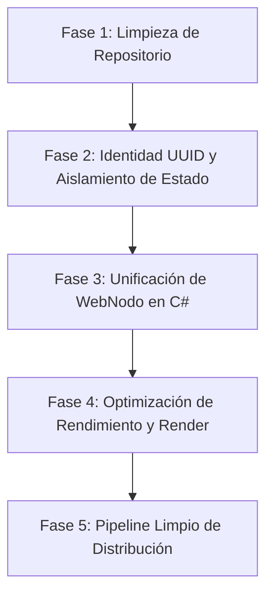

# 🌐 Wold Virtual P2P 3D — Visor C# (.NET 8 WPF) & WebNodo

> **Ubicación:** `VersionDe_sesion/CONTRRF/TLLDCD/src/VSC#`  
> **Versión Actual:** `2.6.4` — EXE: `DMWoldVirtualP2P3Dv2.6.4.exe` (publicada como v2.6.4 el 2026-10-28, *Latest*; la v2.6.3 sigue publicada como release anterior).
> **Tecnologías:** C# 12, .NET 8 WPF, Win32 P/Invoke (`HwndHost`), Godot Engine 4 (incrustado), WebNodo nativo en C# (`HttpListener`), WMI (`System.Management`).

---

## 📋 Tabla de Contenidos

1. [Visión General del Módulo](#1-visión-general-del-módulo)
2. [Arquitectura y Componentes Desarrollados](#2-arquitectura-y-componentes-desarrollados)
3. [Diagnóstico a Fondo de los Problemas Críticos](#3-diagnóstico-a-fondo-de-los-problemas-críticos)
   - [3.1. Problema Persistente: Reconocimiento Automático de PC como Usuario Registrado](#31-problema-persistente-reconocimiento-automático-de-pc-como-usuario-registrado)
   - [3.2. Solución Propuesta por el Usuario: Registro Interno mediante UUID de PC / Instancia](#32-solución-propuesta-por-el-usuario-registro-interno-mediante-uuid-de-pc--instancia)
   - [3.3. Por qué no Carga la Web Nodo (WebNodo)](#33-por-qué-no-carga-la-web-nodo-webnodo)
4. [Auditoría Integral de Deuda Técnica](#4-auditoría-integral-de-deuda-técnica)
   - [Deuda 1: Binarios y DLLs Gigantes en el Repositorio Git](#deuda-1-binarios-y-dlls-gigantes-en-el-repositorio-git)
   - [Deuda 2: Código Zombi y Carpetas Duplicadas (`version_prueba`)](#deuda-2-código-zombi-y-carpetas-duplicadas-version_prueba)
   - [Deuda 3: Rutas Absolutas Cableadas (Hardcoded)](#deuda-3-rutas-absolutas-cableadas-hardcoded)
   - [Deuda 4: Arquitectura Híbrida Win32 Frágil (`SetParent` + `AttachThreadInput`)](#deuda-4-arquitectura-híbrida-win32-frágil-setparent--attachthreadinput)
   - [Deuda 5: Criptografía y Seguridad No Estándar](#deuda-5-criptografía-y-seguridad-no-estándar)
   - [Deuda 6: Dependencia Crítica de `ssh` y Servicio Externo `localhost.run`](#deuda-6-dependencia-crítica-de-ssh-y-servicio-externo-localhostrun)
5. [Inventario de Archivos y Código Sin Usar](#5-inventario-de-archivos-y-código-sin-usar)
6. [Hoja de Ruta (Roadmap) para la Refactorización Total](#6-hoja-de-ruta-roadmap-para-la-refactorización-total)
   - [Fase 1: Saneamiento Inmediato del Repositorio y Eliminación de Basura](#fase-1-saneamiento-inmediato-del-repositorio-y-eliminación-de-basura)
   - [Fase 2: Unificación de Estado, Identidad por UUID y Aislamiento de Sesión](#fase-2-unificación-de-estado-identidad-por-uuid-y-aislamiento-de-sesión)
   - [Fase 3: Reparación y Unificación de WebNodo en C# Nativo (Sin Node.js)](#fase-3-reparación-y-unificación-de-webnodo-en-c-nativo-sin-nodejs)
   - [Fase 4: Optimización del Render y Puente Godot-WPF](#fase-4-optimización-del-render-y-puente-godot-wpf)
   - [Fase 5: Pipeline de Empaquetado Limpio y Release Automatizado](#fase-5-pipeline-de-empaquetado-limpio-y-release-automatizado)

---

## 1. Visión General del Módulo

La carpeta `src/VSC#` implementa la capa de escritorio del cliente-visor del metaverso descentralizado **Wold Virtual P2P 3D**. Su propósito principal es:
- Proveer un asistente gráfico paso a paso en WPF para el registro de identidad descentralizada.
- Vincular la máquina del usuario mediante un hash de hardware (`WMI`).
- Generar y verificar una frase semilla de 12 palabras para una billetera DeFi simulada.
- Generar "La Llave Maestra" criptográfica con rotación de hashes en cada sesión.
- Incrustar la ventana gráfica de **Godot 4** (`WoldVirtual3DP2P.tscn`) dentro del marco WPF mediante manipulación de ventanas nativas Win32.
- Iniciar un micro-servidor HTTP local y un túnel inverso SSH para compartir la sesión P2P con amigos sin requerir apertura manual de puertos (NAT traversal).
- Exponer un portal web de descarga (`WebNodo`) para que otros usuarios descarguen el visor directamente desde la máquina anfitriona.
- Al arrancar (2.6.3), comprobar si el PC tiene una cuenta local utilizable: si sólo quedan restos a medias, archivarlos en `respaldo_cuenta` y arrancar el ciclo de registro completo (`Seguridad/Seguridad_sesion_unica/ArranqueCuenta.cs`).
- Al primer arranque de la (2.6.4), archivar **una sola vez** toda la base local en `respaldo_cuenta\reset-total-<fecha>` y dejar el equipo sin identidad; después anotar el estado global en `estado.json` (`Seguridad/EstadoGlobal.cs`) y, si no hay nada de lo necesario, abrir el ciclo de registro completo sin pasar por la bienvenida (`MainWindow.AbrirRegistroInicial`).

---

## 2. Arquitectura y Componentes Desarrollados

```
┌────────────────────────────────────────────────────────────────────────┐
│                        WPF Host (Visor3D.exe)                          │
├────────────────────────────────┬───────────────────────────────────────┤
│    Flujo de Identidad & UI     │           Servicios de Red            │
│  • App.xaml / App.xaml.cs      │  • P2PNodo.cs (HttpListener :7890)    │
│  • MainWindow.xaml / .cs       │  • P2PTunnelManager.cs (SSH localhost)│
│  • RegistroWindow.xaml / .cs   │  • RedP2PServicio.cs (Coordinador)    │
│  • FormularioUsuarioWindow     ├───────────────────────────────────────┤
│  • SemillaWalletWindow         │           Motor 3D Embebido           │
│  • VerificarSemillaWindow      │  • GodotHwndHost.cs (Win32 SetParent) │
│  • DescargaLlaveWindow         │  • GodotConfig.cs (Rutas del motor)   │
│                                │  • AppExtractor.cs (Descompresor)     │
└────────────────────────────────┴───────────────────────────────────────┘
                                     │
           ┌─────────────────────────┴────────────────────────┐
           ▼                                                  ▼
┌───────────────────────────────┐              ┌─────────────────────────┐
│     Godot 4 Sub-proceso       │              │  WebNodo (Express.js)   │
│  • Godot_v4.7.2-stable.exe    │              │  • server.js (:3030)    │
│  • WoldVirtual3DP2P.tscn      │              │  • public/index.html    │
│  • user://registro.cfg        │              │  • descargas/*.exe      │
└───────────────────────────────┘              └─────────────────────────┘
```

### Componentes Principales:

1. **`App.xaml.cs`**: Punto de entrada de la aplicación. Ejecuta `AppExtractor.EnsureExtracted()` e intenta limpiar datos antiguos mediante `LimpiarDatosDeUsuario()`.
2. **`MainWindow.xaml / .cs`**: Orquestador principal con 3 vistas conmutables:
   - `PanelBienvenida`: Selección entre "Crear Cuenta" o "Acceder".
   - `BarraInferiorLogin`: Formulario de credenciales, carga del archivo `llave_acceso.json`, verificación criptográfica, rotación de hash y conexión a URL de amigo.
   - `PanelMundo3D`: Contenedor del visor 3D Godot incrustado con banner de estado P2P y botón de copia de enlace.
3. **Flujo de Registro Criptográfico (5 Pantallas)**:
   - `RegistroWindow`: Inspección de hardware por WMI (SO, Motherboard, CPU) -> `SHA-256` -> Exportación de `wold_hardware_id_*.zip`.
   - `FormularioUsuarioWindow`: Nombre de usuario, contraseña, hash SHA-256, generación de UUID v4.
   - `SemillaWalletWindow`: Generador de 12 palabras aleatorias a partir de un diccionario de 64 términos -> Exportación de `semilla_wallet_*.zip`.
   - `VerificarSemillaWindow`: Validación de 3 palabras aleatorias seleccionadas para confirmar que el usuario respaldó su frase semilla.
   - `DescargaLlaveWindow`: Generación del objeto `WoldVirtual_MasterKey_DeFi_v1`, hash inicial con timestamp y exportación de `llave_acceso.json`.
4. **`GodotHwndHost.cs`**: Control WPF personalizado derivado de `HwndHost`. Lanza el proceso Godot, busca su `HWND` mediante `EnumWindows`, aplica `SetParent`, elimina bordes (`WS_CAPTION`, `WS_THICKFRAME`) y reenvía pulsaciones de teclado mediante `AttachThreadInput` y `TranslateAcceleratorCore`.
5. **`AppExtractor.cs`**: Extrae archivos ZIP embebidos (`godot_exe.zip` y `godot_project.zip`) hacia `%LOCALAPPDATA%\WoldVirtualP2P3D\runtime\8d6b09d4_v4`.
6. **Módulo `RedP2P/`**:
   - `P2PNodo.cs`: Servidor HTTP en `localhost:7890` con rutas `/ping`, `/info`, `/peer`.
   - `P2PTunnelManager.cs`: Proceso `ssh` hacia `localhost.run` con expresión regular para capturar la URL pública asignada (`https://*.lhr.life`).
   - `RedP2PServicio.cs`: Orquestador que sincroniza el nodo local con el túnel.
7. **`webnodo/`**: Servidor Node.js Express para servir el archivo instalador `.exe` en red local o a través de internet en el puerto 3030.

---

## 3. Diagnóstico a Fondo de los Problemas Críticos

### 3.1. Problema Persistente: Reconocimiento Automático de PC como Usuario Registrado

**Síntoma:** Al descargar una versión nueva o limpia del visor desde GitHub, al abrirlo en el PC éste detecta que ya existe un usuario registrado (omite la pantalla de bienvenida o bloquea "Crear Cuenta", o Godot entra directamente a una isla antigua).

#### Causas Técnicas Concretas:

1. **Ubicación Global de Datos de Godot (`user://`):**
   Godot almacena su archivo de registro en:
   ```
   %APPDATA%\Godot\app_userdata\WoldVirtualP2P3D\registro.cfg
   ```
   Esta ruta **no pertenece a la carpeta donde descomprimes el .exe**, sino al perfil global del usuario de Windows (`C:\Users\<Usuario>\AppData\Roaming\...`).  
   En `Boot.gd`:
   ```gdscript
   var cfg := ConfigFile.new()
   if cfg.load("user://registro.cfg") == OK:
       var saved_avatar: String = str(cfg.get_value("jugador", "avatar_scene", ""))
       var saved_nick: String   = str(cfg.get_value("jugador", "nick", ""))
       if not saved_avatar.is_empty() and not saved_nick.is_empty():
           _entrar_a_isla()
           return
   ```
   Aunque descargues un `.exe` nuevo desde GitHub en otra carpeta, **Godot sigue leyendo el `registro.cfg` persistido meses atrás en tu `%APPDATA%`**.

2. **Doble Fuente de Verdad Incompatible (WPF vs Godot):**
   - El visor C# verifica la existencia de archivos en `AppDomain.CurrentDomain.BaseDirectory\test_user_data\`:
     ```csharp
     bool estaRegistrado = (File.Exists(UserProfilePath) || File.Exists(CredentialsPath)) &&
         File.Exists(Path.Combine(TestUserDataDir, "user", "llave_acceso.json"));
     ```
   - Mientras que Godot verifica `OS.get_user_data_dir().path_join("registro.cfg")`.
   - Si uno de los dos archivos existe y el otro no, la aplicación entra en un estado corrupto/desfasado.

3. **Efecto Secundario de la "Solución Parche" `LimpiarDatosDeUsuario()`:**
   En el commit `90688d5` se intentó solucionar esto borrando archivos en el arranque de `App.xaml.cs`:
   ```csharp
   private void OnStartup(object sender, StartupEventArgs e)
   {
       LimpiarDatosDeUsuario(); // ¡Borra los datos en CADA inicio!
       ...
   }
   ```
   **Consecuencia desastrosa:** Borra los datos del usuario legítimo cada vez que cierra y abre el visor, impidiendo mantener sesiones persistentes, mientras que en ejecutables descargados de releases antiguas este método ni siquiera existía.

4. **Persistencia en Salidas Compiladas (`publish_out`):**
   En `DescargaLlaveWindow.xaml.cs` (línea 90), se descubrió que el código escribe automáticamente copias de la llave en la carpeta `publish_out`:
   ```csharp
   string publishUserDir = Path.Combine(AppDomain.CurrentDomain.BaseDirectory, "publish_out", "test_user_data", "user");
   ```
   Si el desarrollador compila la release después de registrarse, la carpeta `publish_out` o el zip publicado ya contiene el usuario registrado empaquetado en el release de GitHub.

---

### 3.2. Solución Propuesta por el Usuario: Registro Interno mediante UUID de PC / Instancia

> **Propuesta del Usuario:** *"al descargar el .exe al iniciarlo el visor registre internamente mediante una uuid el pc, que descargo el .exe y asi todo el registro inicial esta mas controlado."*

#### Análisis y Diseño de Implementación de la Solución:

La propuesta es **totalmente acertada y profesional**. Para implementarla de forma robusta y evitar tanto el falso registro como el reseteo involuntario:

1. **Generación de un `installation_id` (UUID v4) al primer arranque:**
   En lugar de buscar carpetas sueltas o confiar ciegamente en el hardware estático, el visor creará un archivo de estado local en una ruta aislada:
   ```csharp
   // Estado de Instalación
   public class InstallationState
   {
       public string InstallationId { get; set; } = Guid.NewGuid().ToString("D");
       public string HardwareId { get; set; } = "";
       public bool IsRegistered { get; set; } = false;
       public DateTime InstalledAtUtc { get; set; } = DateTime.UtcNow;
       public string RegisteredUser { get; set; } = "";
   }
   ```

2. **Detección Determinista de Primer Uso:**
   - Si no existe `installation_state.json` en el directorio de la aplicación, es una **instalación virgen**.
   - Al detectarse virgen, el visor genera su `InstallationId`, notifica a Godot (pasando el argumento `--new-install <InstallationId>`) para que Godot use un directorio de datos independiente o limpie su estado antiguo.
   - Si el usuario decide registrarse, el estado pasa a `IsRegistered = true` asociado a ese `InstallationId`.

3. **Desacoplamiento del Hardware Estático:**
   El hash de hardware WMI actual nunca cambia en el mismo PC, por lo que usarlo como comprobador de sesión hacía imposible simular un usuario nuevo en la misma máquina. Combinando `InstallationId` + `HardwareHash`, cada descarga del `.exe` es un nodo independiente y limpio.

---

### 3.3. Por qué no Carga la Web Nodo (WebNodo)

La funcionalidad de "WebNodo" presenta 4 fallos estructurales que impiden su funcionamiento:

1. **Desconexión Total entre C# y Node.js:**
   El visor C# **nunca ejecuta ni arranca** `webnodo/server.js`. Requiere que el usuario abra una consola, instale Node.js, ejecute `npm install` y luego `npm start`. Para un usuario final que descarga un `.exe`, esto hace que WebNodo esté 100% inactivo.
2. **Botón Desaparecido en la Interfaz Actual:**
   En `version_prueba\nuevaversion_sinusers\LEEME.txt` se menciona el botón `[🌐 WebNodo]` en la barra superior. Sin embargo, en el archivo activo `MainWindow.xaml` de `actualizacion_2069d33a`, dicho botón fue borrado o no fue incorporado en la fusión de ramas.
3. **Incongruencia de Rutas en `server.js`:**
   En `webnodo/server.js`:
   ```javascript
   const sessionFile = path.join(process.env.APPDATA || '', 'WoldVirtualP2P3D', 'usuario', 'p2p_session.json');
   ```
   `server.js` busca la sesión P2P en `%APPDATA%\WoldVirtualP2P3D\usuario\p2p_session.json`. Pero el visor C# (`MainWindow.xaml.cs`) escribe en:
   - `test_user_data\user\p2p_session.json`
   - `%APPDATA%\Godot\app_userdata\WoldVirtualP2P3D\p2p_session.json`  
   Por tanto, `webnodo` **nunca encuentra el archivo de sesión** y siempre reporta `"Sin sesion P2P activa"`.
4. **Conflicto de Puertos y Túnel Inverso:**
   - `P2PNodo.cs` (C#) escucha en el puerto `7890`.
   - `P2PTunnelManager.cs` crea un túnel SSH apuntando al puerto `7890`.
   - `webnodo` (Node.js) escucha en el puerto `3030`.
   - Cuando el anfitrión comparte su enlace público de `localhost.run`, el tráfico va dirigido al puerto `7890` (la API interna de C#), **no a la página web de descargas de WebNodo (puerto 3030)**.

---

## 4. Auditoría Integral de Deuda Técnica

### Deuda 1: Binarios y DLLs Gigantes en el Repositorio Git
- **Problema:** Se han subido directamente al control de versiones ejecutables y zips masivos:
  - `Visor3D.exe` (~68 MB)
  - `godot_exe.zip` (~86 MB)
  - `godot_project.zip` (~460 MB)
  - `Servidor3D/Godot_v4.7.2-stable_win64.exe` (~180 MB)
  - `publish_2069d33a/DMWoldVirtualp2pCNX...exe` (~708 MB)
  - `publish_release/...exe` (~708 MB)
  - `publish_standalone/Visor3D.exe` (~708 MB)
  - `webnodo/descargas/*.exe` (~870 MB)
  - DLLs nativas de WPF en la raíz (`D3DCompiler_47_cor3.dll`, `wpfgfx_cor3.dll`, etc.).
- **Impacto:** El repositorio pesa varios gigabytes innecesarios, ralentizando la clonación, rompiendo los límites recomendados de GitHub y mezclando artefactos transitorios con código fuente.

### Deuda 2: Código Zombi y Carpetas Duplicadas (`version_prueba`)
- La carpeta `version_prueba/` es un duplicado completo del proyecto C# que se dejó abandonado dentro del propio árbol fuente.
- En `Visor3D.csproj` se tuvieron que añadir exclusiones manuales (`<Compile Remove="version_prueba\**" />`) para evitar que el compilador fallase por clases duplicadas.
- Contiene una subcarpeta `nuevaversion_sinusers/` con binarios viejos de 162 MB (`DMWoldVirtualp2pCNX.exe`).

### Deuda 3: Rutas Absolutas Cableadas (Hardcoded)
En `GodotConfig.cs`:
```csharp
string repoPath = @"C:\Users\User\Desktop\WoldVirtualP2P3D\VersionDe_sesion\Sistema_Principal\PRY\actualizacion_2069d33a\src\VSC#\Servidor3D\" + godotName;
string repoPath = @"C:\Users\User\Desktop\WoldVirtualP2P3D\VersionDe_sesion\Sistema_Principal\PRY\actualizacion_2069d33a\src\MTBGT\WoldVirtualP2P3D";
```
Si cualquier otro usuario o desarrollador clona el proyecto en otra ruta o máquina, el visor falla o recurre a heurísticas complejas.

### Deuda 4: Arquitectura Híbrida Win32 Frágil (`SetParent` + `AttachThreadInput`)
- Embeber un proceso 3D externo (Godot) dentro de una ventana WPF mediante `SetParent` es una técnica conocida por causar:
  - Fugas de foco de teclado (resueltas parcialmente con P/Invoke de mensajes de teclado).
  - Problemas severos con escalado DPI en monitores de alta resolución.
  - Bloqueos si el proceso de Godot crashea independientemente.

### Deuda 5: Criptografía y Seguridad No Estándar
- **Contraseñas:** Se utiliza `SHA-256` directo sin sal (`Salt`) ni funciones de derivación lentas (PBKDF2 / Argon2).
- **Semilla de Recuperación:** Se utiliza un diccionario arbitrario de solo 64 palabras inglesas (`Diccionario` en `SemillaWalletWindow.cs`) con $64^{12} \approx 4.7 \times 10^{21}$ combinaciones (~72 bits de entropía), en lugar del estándar criptográfico internacional **BIP-39** (2048 palabras, 128 a 256 bits de entropía).
- **Rotación de Llave:** La rotación de hash en un archivo JSON local sufre riesgo de corrupción ante cortes de energía o cierres inesperados durante la escritura.

### Deuda 6: Dependencia Crítica de `ssh` y Servicio Externo `localhost.run`
- `P2PTunnelManager.cs` invoca directamente `ssh.exe` asumiendo que OpenSSH Client está instalado en Windows y configurado en el `PATH`.
- Depender de `nokey@localhost.run` expone el funcionamiento del visor a que un servicio gratuito de terceros se caiga, cambie su formato de salida o bloquee las conexiones.

---

## 5. Inventario de Archivos y Código Sin Usar

| Archivo / Carpeta | Tamaño | Estado | Motivo / Diagnóstico |
|---|---|---|---|
| `version_prueba/` | > 180 MB | **Código Zombi** | Copia duplicada entera del proyecto. No se compila ni se usa. Debe eliminarse. |
| `publish_2069d33a/` | > 708 MB | **Artefacto Huérfano** | Salida de compilación vieja subida por error al repositorio. |
| `publish_release/` | > 708 MB | **Artefacto Huérfano** | Salida de compilación vieja de actualización anterior (`8d6b09d4`). |
| `publish_out/` | > 70 MB | **Artefacto Huérfano** | Salida temporal de compilación de pruebas. |
| `publish_standalone/` | > 708 MB | **Artefacto Huérfano** | Salida de publicación single-file. |
| `webnodo/descargas/` | > 870 MB | **Artefacto Huérfano** | Binarios empaquetados dentro del módulo web. |
| `webnodo/node_modules/` | Variable | **Dependencias** | Debe gestionarse por `.gitignore` y no commitearse. |
| `D3DCompiler_47_cor3.dll` | ~4.7 MB | **DLL en Raíz** | Archivo de runtime generado por dotnet publish, no pertenece a `src/`. |
| `PenImc_cor3.dll` | ~158 KB | **DLL en Raíz** | Archivo de runtime generado por dotnet publish, no pertenece a `src/`. |
| `PresentationNative_cor3.dll` | ~1.2 MB | **DLL en Raíz** | Archivo de runtime generado por dotnet publish, no pertenece a `src/`. |
| `vcruntime140_cor3.dll` | ~124 KB | **DLL en Raíz** | Archivo de runtime generado por dotnet publish, no pertenece a `src/`. |
| `wpfgfx_cor3.dll` | ~1.9 MB | **DLL en Raíz** | Archivo de runtime generado por dotnet publish, no pertenece a `src/`. |
| `Visor3D.exe` (raíz) | ~68 MB | **Binario en Raíz** | Ejecutable precompilado que bloquea git. |
| `godot_exe.zip` | ~86 MB | **Zip en Raíz** | Debe descargarse por script o alojarse en GitHub Releases LFS. |
| `godot_project.zip` | ~460 MB | **Zip en Raíz** | Proyecto Godot comprimido duplicado; ya existe en `src/MTBGT`. |

---

## 6. Hoja de Ruta (Roadmap) para la Refactorización Total



---

### Fase 1: Saneamiento Inmediato del Repositorio y Eliminación de Basura
**Objetivo:** Reducir el tamaño de `src/VSC#` de varios GB a menos de 5 MB de código limpio.

1. **Eliminar carpetas de compilación y duplicados:**
   - Borrar completamente `version_prueba/`.
   - Borrar `publish_2069d33a/`, `publish_release/`, `publish_out/`, `publish_standalone/`.
   - Borrar ejecutables y DLLs sueltas de la raíz de `src/VSC#/`.
   - Borrar `webnodo/descargas/*.exe` y `webnodo/node_modules/`.
2. **Actualizar `.gitignore`:**
   Asegurar que nunca más se suban binarios:
   ```gitignore
   bin/
   obj/
   publish*/
   *.exe
   *.dll
   *.pdb
   *.zip
   test_user_data/
   datos_usuario/
   node_modules/
   ```
3. **Limpiar `Visor3D.csproj`:**
   Eliminar las líneas de exclusión de `version_prueba` y los recursos embebidos gigantescos de 500 MB (`godot_project.zip`).

---

### Fase 2: Unificación de Estado, Identidad por UUID y Aislamiento de Sesión
**Objetivo:** Resolver definitivamente el fallo de "PC reconocido como registrado" e implementar la propuesta del usuario.

1. **Crear `InstallationManager.cs`:**
   - Al iniciar la app, comprueba si existe un archivo `instance_identity.json` en una carpeta local de la aplicación (`%LOCALAPPDATA%\WoldVirtualP2P3D\instance\`).
   - Si no existe:
     - Genera un nuevo `InstallationUuid = Guid.NewGuid().ToString()`.
     - Guarda el archivo con estado `IsRegistered = false`.
     - Borra cualquier sesión residual previa de Godot pasando argumentos limpios.
   - Si existe:
     - Lee el estado del usuario local correspondiente a esa instancia.
2. **Aislamiento de Godot (`user://` aislado):**
   - Modificar la invocación de Godot en `GodotHwndHost.cs` para indicarle un directorio de datos propio o pasar flags `--user-data-dir`:
     ```csharp
     string localUserData = Path.Combine(AppDomain.CurrentDomain.BaseDirectory, "user_data", installUuid);
     string args = $"--path \"{_projectPath}\" --user-data-dir \"{localUserData}\"";
     ```
   - Esto garantiza que **descargar el visor en una carpeta nueva siempre será una experiencia 100% limpia**, sin colisiones con sesiones previas.
3. **Eliminar el hack destructivo de `LimpiarDatosDeUsuario()`:**
   - Retirar la llamada destructiva en `App.xaml.cs`. El estado debe preservarse si la instancia ya fue registrada, y ser nuevo solo si es una instalación virgen.

---

### Fase 3: Reparación y Unificación de WebNodo en C# Nativo (Sin Node.js)
**Objetivo:** Hacer que WebNodo funcione inmediatamente al hacer doble clic en el `.exe`, sin requerir Node.js ni comandos manuales.

1. **Eliminar la dependencia de Node.js:**
   - Reemplazar `server.js` de Express con un servidor web embebido ligero en C# utilizando `HttpListener` o **ASP.NET Core Kestrel Minimal API** embebido directamente en `Visor3D`.
2. **Compartir el Mismo Puerto y Túnel:**
   - Unificar `P2PNodo.cs` y `WebNodo`:
     - `GET /` -> Sirve `public/index.html` (portal web futurista).
     - `GET /descargar` -> Descarga el `.exe` directamente.
     - `GET /api/info` -> Retorna información del visor y estado P2P.
     - `GET /ping` -> Keepalive P2P.
     - `POST /peer` -> Registro de amigos.
   - De este modo, **el mismo túnel de `localhost.run` que se comparte con un amigo sirve tanto para conectar su avatar como para que descargue el visor desde su navegador**.
3. **Restaurar el Botón `[🌐 WebNodo]` en `MainWindow.xaml`:**
   - Añadir el botón en la barra superior junto a "Copiar enlace P2P".
   - Al pulsarlo, abrir automáticamente el navegador predeterminado con `Process.Start(new ProcessStartInfo(urlTunel) { UseShellExecute = true });`.

---

### Fase 4: Optimización del Render y Puente Godot-WPF
**Objetivo:** Mejorar la tasa de cuadros por segundo, reducir consumo de RAM y evitar cuelgues del visor.

1. **Eliminar polling de búsqueda de ventana en `GodotHwndHost.cs`:**
   - En lugar de hacer `Thread.Sleep(100)` y buscar con `EnumWindows` hasta 12 segundos, utilizar eventos de procesos nativos o pasar el handle del host de WPF como argumento en la línea de comandos a Godot (`--embed-parent-hwnd <HWND>`).
2. **Ajuste de DPI Dinámico:**
   - Manejar el mensaje `WM_DPICHANGED` en `GodotHwndHost` para reajustar el viewport de Godot automáticamente cuando el usuario mueve la ventana entre monitores 1080p y 4K.
3. **Limpieza de Recursos (Garbage Collection & Process Exit):**
   - Garantizar que al cerrar WPF, el proceso de Godot reciba la señal de terminación limpia para guardar estado y liberar los 500 MB+ de memoria de video y texturas inmediatamente.

---

### Fase 5: Pipeline de Empaquetado Limpio y Release Automatizado
**Objetivo:** Generar releases de GitHub pequeñas, reproducibles y profesionales.

1. **Script de Publicación Automatizado (`build_release.ps1`):**
   - Compilación con `dotnet publish -c Release -r win-x64 --self-contained false` (o self-contained optimizado con trim si aplica).
   - Separar el motor Godot y el proyecto 3D en assets de descarga inicial bajo demanda en lugar de meter 460 MB de un zip dentro del ensamblado C#.
2. **Verificación de Calidad Pre-Release:**
   - Comprobación automática de que no existen archivos `credentials.json`, `llave_acceso.json` ni `registro.cfg` en las carpetas a distribuir.

---

## 7. Chat del metaverso (texto, voz y webcam)

Implementado en `Chat/` y expuesto como **barra inferior** a todo el ancho del visor
(`💬 Chat` en la barra superior abre y cierra la barra). La barra ocupa una fila propia
debajo del `HwndHost` de Godot para no cruzarse con el *airspace* nativo del motor. Desde la 2.6.1
la **fila superior del marco** es una franja horizontal de vídeos
(`MarcoVideosChat` → `PanelVideos`): vista previa local de 160×90 más un tile por emisor, con
desplazamiento horizontal y dentro del propio marco; la franja se oculta sola cuando no hay cámara.
La **2.6.2** corrige la vista local: al iniciar la sesión se vaciaba `PanelVideos` y con ello se
expulsaba del árbol el tile `MarcoCamLocal` definido en XAML, así que la franja aparecía pero sin
imagen; ahora la limpieza conserva el tile local y, al encender la cámara, se reinserta si faltara.
La **2.6.3** añade el diagnóstico de cuenta al arrancar (ver §6): con restos a medias archiva en
`respaldo_cuenta` y vuelve al ciclo de registro completo. La **2.6.4** da un paso más: el primer
arranque archiva toda la base local (una sola vez, con marcador permanente `reset_total.txt`), y si
el PC no tiene nada de lo necesario abre directamente el registro completo; desde ese registro en
adelante la cuenta persiste en esta y futuras versiones.
Debajo quedan el historial y, al final, los controles de voz, cámara y envío. No usa un túnel propio:
reutiliza el túnel público del WebNodo con la ruta `/chat`.

```
Invitado ──wss://host/chat──► WebNodo del anfitrión ──ws──► ChatRelayServer :8920
                                                              │
                                              audio/vídeo/texto a todos los pares
```

| Archivo | Responsabilidad |
|---|---|
| `Chat/ChatProtocol.cs` | Límites y tramas: texto JSON; audio/vídeo binario `[tipo][id emisor][payload]`. |
| `Chat/ChatRelayServer.cs` | Relay WebSocket del anfitrión (TcpListener en 8920-8929, sin URL ACL). Máx. 16 clientes, tramas enmascaradas, ping/pong, límites de tamaño y tasa. |
| `Chat/ChatClient.cs` | Cliente `ClientWebSocket` con reconexión gestionada desde `MainWindow`. |
| `Chat/ChatVoice.cs` | Micrófono NAudio 16 kHz/16 bits/mono en tramas de 20 ms y mezcla de voces remotas. |
| `Chat/ChatWebcam.cs` | Captura DirectShow (AForge) a 320×180, JPEG calidad 55, ~4 fps. |
| `MainWindow.xaml(.cs)` | Panel, estados de micrófono/cámara, tiles de vídeo, avisos y reconexión. |
| `Services/WebNodoService.cs` | Enruta `WS /chat` al relay; el resto sigue yendo al motor Godot (8911). |

**Funcionamiento:** cada visor levanta su propio relay, de modo que cualquiera pueda
asumir el rol de anfitrión tras una migración. El cliente elige relay local si es el
anfitrión de la sesión (sin enlace de invitación, o `session_host.txt` apunta a su
portal) y, si no, `wss://<anfitrión>/chat`. La reconexión se reintenta cada pocos
segundos y se reevalúa cuando Godot cambia de anfitrión.

**Privacidad:** micrófono y webcam solo se activan al pulsar sus botones; no hay
captura automática.

**Validación real (2026-10-26, ampliada el 2026-10-28):** `--chat-selftest` (sin interfaz) supera
**25/25** comprobaciones: relay, dos clientes, identificadores, texto con emisor, audio de 640 bytes,
vídeo JPEG, recorte a 500 caracteres, texto cruzando el proxy `/chat` del WebNodo, presencia con uid,
solicitudes de amistad, mensajes privados dirigidos y **rechazo del proxy `/chat` a una URL sin
`?invitacion=`** (detalle en la sección 9). `dotnet build -p:SkipGodotAssets=true -c Debug`
termina sin errores ni avisos. La franja de webcams **no** está cubierta por esa suite: no se ha
visto todavía con una sesión autenticada real ni con dos cámaras.

**Límites conocidos (pendientes de prueba entre dos máquinas):**

- En la primera conexión entrante Windows puede pedir permiso de firewall para el
  relay (puerto 8920). Por túnel no hace falta: el tráfico llega por localhost.
- Sin auriculares hay eco (el micrófono capta el altavoz).
- El ancho de banda crece con cada par: el vídeo se reenvía a todos (~20-30 KB por
  trama, 4 fps) y el audio ~32 KB/s por emisor.
- La captura usa el primer micrófono y la primera webcam del sistema; no hay selector
  de dispositivo.
- El audio no se transcodifica: si un driver no acepta 16 kHz mono, el micrófono
  muestra error en vez de remuestrear.
- Tras una migración de anfitrión, el chat se reconecta en el siguiente ciclo (≈2 s
  más el tiempo de conexión); durante ese hueco no hay mensajes.
- El chat no pide contraseña: quien tenga el **enlace de invitación completo** (con
  `?invitacion=`) puede entrar (máx. 16 clientes y límites de tasa como única
  protección). Desde la 2.6.1 el proxy rechaza una URL sin token; no lo uses para
  conversaciones privadas.

---

### 7.1. Acceso por invitación e instancia única (2.6.1)

- **Token de sesión:** el WebNodo genera `TokenInvitacion` (32 hex en minúsculas) por proceso
  (`Services/WebNodoService.cs:132`) y rechaza con `403` todo handshake WebSocket sin
  `?invitacion=` válida, tanto hacia el motor (8911) como hacia `/chat` (`WebNodoService.cs:595-601`).
  El token viaja en el enlace (`?host=…&invitacion=…`), en `--peer-url`, en el endpoint del chat y en
  `p2p_session.json`; Godot lo aplica sólo a `wss://` (`gdscrip/Red.gd:153-180`).
- **Alcance:** una LAN directa `ws://<ip>:8911` y el relay `:8920` no pasan por el WebNodo y quedan
  fuera de la puerta, por diseño. Un portal abierto en limpio no expone el token.
- **Instancia única:** `Services/InstanciaUnica.cs` toma un mutex por proceso; una segunda ejecución
  restaura y enfoca la ventana existente en lugar de abrir otro login. Con `--reset-cuenta` y el
  visor abierto se avisa y no se reinicia.
- **Evidencia:** `--chat-selftest` 25/25 incluye el rechazo sin token; en el equipo de compilación la
  segunda ejecución sale con código 0 en ~1 s, queda un solo proceso y el handle en primer plano
  coincide con el de la primera ventana (probado con el visor minimizado y el foco en otra aplicación).

---

## 8. Control del avatar y foco del teclado

Desde la 2.5.8 el avatar responde a las flechas y a WASD **desde el arranque**, sin
clic previo. El control se suelta solo en dos situaciones: mientras el teclado está
en un `TextBox` del visor (Godot pierde el foco) y mientras el modo construcción está
activo. Al recuperar el foco o al salir de construcción, el control vuelve **sin
exigir otro clic**.

| Archivo | Cambio |
|---|---|
| `.../gdscripuser/AVMJ1Ch3D.gd` | `control_avatar := true` por defecto; `FOCUS_OUT` suelta el control y las `ui_*`; `FOCUS_IN` lo recupera salvo con `construccion_activa`. |
| `.../ctr_tscn_userBS/gdscrip/userbaseh_1.gd` | Mismo modelo para el avatar por defecto `userbaseh1`. |
| `gdscrip/userbase.gd` | Cápsula en primera persona con el mismo modelo de foco. |
| `gdscrip/Construccion.gd` | `_bloquear_avatar()` marca `construccion_activa` y devuelve `control_avatar = true` al cerrar el modo. |
| `GodotHwndHost.cs` | Devuelve el teclado a Godot al pulsar en el área 3D (`WM_PARENTNOTIFY`) y no reenvía teclas mientras se escribe en un `TextBox` WPF. |
| `MainWindow.xaml` | El cuadro de texto del chat se ilumina (fondo `#0D2137`, borde turquesa) al recibir el foco. |

**Comportamiento:** el clic izquierdo sobre el cuerpo del avatar sigue lanzando un
rayo desde la cámara y devuelve el control (útil tras escribir en el chat); un clic
en otro punto ya **no** lo quita. Al perder el foco de Godot se suelta el avatar, se
detiene la velocidad horizontal y se liberan las acciones `ui_*` para que ninguna
flecha retenida lo mueva. Los botones de voz y cámara se marcan en verde al quedarse
activos.

**Validación real (2026-10-26):** `tools/probar_control_clic.gd` en headless supera
**35/35** comprobaciones sobre `userbaseh1`, `AVMJ1Ch3D` y la cápsula: se mueven sin
clic, perder el foco los detiene, recuperarlo les devuelve el control y el rayo
selecciona al acertar en el cuerpo. `tools/probar_construccion.gd` supera **85/85**,
incluida la comprobación de que al salir de construcción se devuelve el control sin
otro clic. `dotnet publish -c Release -r win-x64 --self-contained true` termina con
0 errores y 0 avisos.

**Límites conocidos:**

- No se ha validado el foco real dentro del visor embebido con el túnel activo: la
  comprobación es headless y se apoya en `WM_PARENTNOTIFY` y en `TextBoxBase`, no en
  una prueba E2E de escritorio.
- El rayo usa la cápsula de colisión del avatar (torso); un clic en la cabeza o los
  pies, fuera de la cápsula, no devuelve el control.
- Con el modo construcción activo el avatar no camina por diseño hasta salir de él.

---

## 9. Amigos y chat privado

Los usuarios pueden enviarse solicitudes de amistad, aceptarlas o rechazarlas,
mantener una lista local de amigos y abrir una conversación privada uno a uno
desde esa lista. No hay servidor central: las solicitudes y los privados viajan
por el mismo relay de la sesión que ya usa el chat.

```
Ana ──wss://host/chat──► relay del anfitrión ──solo al uid de Beto──► Beto
                                │
                     código de amigo (8 caracteres) → uid estable
```

| Archivo | Responsabilidad |
|---|---|
| `Chat/ChatProtocol.cs` | Normaliza el `uid`, calcula el código de amigo y define los mensajes `friend_req`, `friend_sent`, `friend_ok`, `friend_no`, `friend_fail`, `dm` y `dm_fail`. |
| `Chat/ChatRelayServer.cs` | Resuelve el destino por uid o por código y entrega solo a las sesiones de esa persona. Límite adicional de 20 acciones sociales cada 10 s. |
| `Chat/ChatClient.cs` | Envía y recibe solicitudes, respuestas y privados; la presencia (`join`/`bye`) incluye el uid. |
| `Chat/FriendsStore.cs` | Persistencia local: `%LocalAppData%\WoldVirtualP2P3D\user\friends_<uid>.json` con amigos, solicitudes entrantes y salientes. |
| `PrivateChatWindow.xaml(.cs)` | Ventana de conversación privada con estado en línea, historial en memoria y mensajes de error. |
| `MainWindow.xaml(.cs)` | Botón `👥 Amigos`, código copiable, alta por código, personas de la sesión, aceptar/rechazar, no leídos y apertura del chat privado. |

**Identidad y códigos.** El uid sale del `uuid` del perfil (o de un hash estable del
alias si el perfil es antiguo). El código de amigo son 8 caracteres derivados del
uid; se comparte y el relay lo traduce al uid real del cliente conectado. El chat
sigue usando identificadores numéricos por conexión para las funciones de voz y
webcam, pero las amistades y los privados usan el uid.

**Funcionamiento.** `👥 Amigos` despliega el panel dentro del chat. Muestra tu
código, un campo para pegar el de otra persona, las solicitudes pendientes, tus
amigos con punto verde/gris y un botón `Chat`. También lista a las personas
conectadas en la sesión para enviarles una solicitud sin intercambiar códigos. El
privado se abre en una ventana aparte; si no la tienes delante, el botón de amigos
muestra el número de solicitudes y mensajes sin leer. Los privados de alguien que
no es amigo se descartan y solo dejan un aviso.

**Validación real (2026-10-26, ampliada el 2026-10-28):**

- `--chat-selftest` supera **25/25** comprobaciones, incluidas: código de amigo estable
  de 8 caracteres, persistencia y recarga de amigos/solicitudes, resolución de una
  solicitud por código al uid real, presencia con uid, solicitud entregada solo al
  destino, aceptación entregada al remitente, privado entregado solo al
  destinatario, privado que no se difunde a la sala, avisos cuando el destino no
  está conectado y rechazo del proxy `/chat` a una URL sin `?invitacion=`.
- `dotnet build -p:SkipGodotAssets=true -c Debug`: 0 errores, 0 avisos.
- Arranque real del visor durante 8 s: ventana «Wold Virtual p2p 3D» viva, sin
  excepción de XAML y sin procesos residuales. No se ha probado el flujo visual
  completo con dos visores autenticados en máquinas distintas.

**Límites conocidos:**

- **No hay servidor central ni cola offline.** Solicitudes y privados solo se
  entregan mientras ambas personas están conectadas al mismo relay de sesión. Las
  solicitudes pendientes se reintentan al aparecer el destino en la sesión, pero
  el remitente también tiene que estar conectado.
- La lista de amigos es **local al equipo**: no se sincroniza entre PCs ni entre
  instalaciones del mismo usuario. El archivo es JSON plano, sin cifrar.
- El historial del chat privado vive en memoria y se pierde al cerrar el visor. No
  se guarda en disco.
- El relay no comprueba la amistad: enruta por uid. La ventana del visor descarta
  los privados de desconocidos, pero un cliente modificado podría enviarlos.
- No hay bloqueo, denuncia, borrado remoto ni estado «escribiendo».
- Un código de 8 caracteres puede colisionar en teoría; el relay no entrega si el
  código coincide con varias personas distintas.
- Si el perfil no tiene `uuid`, la identidad cae al hash del alias: dos personas con
  el mismo nombre comparten identidad.
- El chat no está autenticado (ver límite de la sección 7). No lo uses para
  información sensible.
