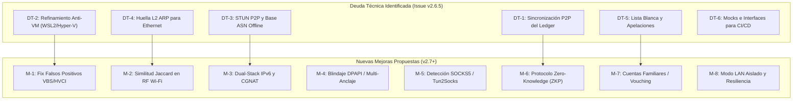
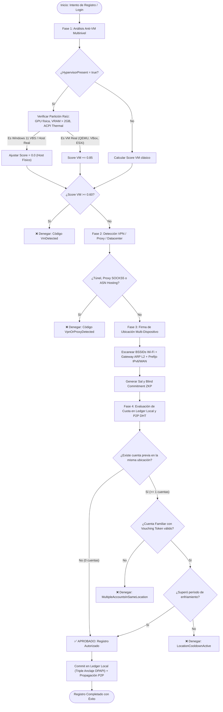

# 🚀 Plan Maestro de Mejoras y Evolución Arquitectural: SMTPLC v2.7+

> **Documento de Diseño Técnico y Evolución de Seguridad**  
> **Subsistema:** SMTPLC (*Seguridad Multi-Terminal por Locación, Proxy y Clientes*)  
> **Ubicación:** `Visor3D.Seguridad.SMTPLC`  
> **Referencia Base:** Issue Técnico v2.6.5 (Deuda Técnica y Auditoría de Código)  
> **Autor / Equipo:** Seguridad y Arquitectura de Red P2P — WoldVirtualP2P3D

---

## 📑 Índice de Contenidos

1. [Resumen Ejecutivo y Contexto](#-1-resumen-ejecutivo-y-contexto)
2. [Diagnóstico de Vulnerabilidades y Limitaciones de la v2.6.5](#-2-diagnóstico-de-vulnerabilidades-y-limitaciones-de-la-v265)
3. [Nuevas Mejoras Críticas Propuestas (Más allá del Issue)](#-3-nuevas-mejoras-críticas-propuestas-más-allá-del-issue)
   - [3.1 Eliminación de Falsos Positivos por VBS / HVCI de Windows 11](#31-eliminación-de-falsos-positivos-por-vbs--hvci-aislamiento-del-núcleo-en-windows-11)
   - [3.2 Algoritmo de Similitud Difusa Jaccard para el Clúster Wi-Fi](#32-algoritmo-de-similitud-difusa-jaccard-para-el-clúster-wi-fi-vs-sha-256-rígido)
   - [3.3 Soporte Nativo IPv6 y Tratamiento Inteligente de CGNAT](#33-soporte-nativo-dual-stack-ipv6-prefijo-64-y-aislamiento-de-cgnat)
   - [3.4 Persistencia Blindada Anti-Borrado del Ledger Local](#34-persistencia-blindada-y-anclaje-anti-tampering-del-ledger-local)
   - [3.5 Detección de Proxies Residenciales y Túneles L7 Transparentes](#35-detección-de-proxies-residenciales-socks5-y-túneles-transparentes-tun2socks)
   - [3.6 Protocolo Zero-Knowledge (ZKP) para Privacidad en la Red P2P](#36-protocolo-zero-knowledge-zkp-para-privacidad-y-cumplimiento-gdpr)
   - [3.7 Sistema de Cuentas Familiares / Co-locadas con Aval Criptográfico](#37-sistema-de-cuentas-familiares-co-locadas-y-aval-criptográfico-vouching)
   - [3.8 Modo LAN Aislado y Tolerancia a Fallos de Red](#38-modo-lan-aislado-y-tolerancia-a-fallos-de-red)
4. [Consolidación y Expansión de la Deuda Técnica del Issue (DT-1 a DT-6)](#-4-consolidación-y-expansión-de-la-deuda-técnica-del-issue-dt-1-a-dt-6)
5. [Nueva Arquitectura Desacoplada e Interfaces (Inyección de Dependencias)](#-5-nueva-arquitectura-desacoplada-e-interfaces)
6. [Diagrama de Flujo del Pipeline de Evaluación v2.7+](#-6-diagrama-de-flujo-del-pipeline-de-evaluación-v27)
7. [Matriz de Priorización y Roadmap de Ejecución (Sprints 1 al 4)](#-7-matriz-de-priorización-y-roadmap-de-ejecución)

---

## 📌 1. Resumen Ejecutivo y Contexto

Tras el despliegue del subsistema **SMTPLC** en la versión **v2.6.5** para mitigar la creación automatizada de cuentas duplicadas en el mismo recinto físico y el acceso desde máquinas virtuales o VPNs, la auditoría técnica post-lanzamiento reveló que, si bien el subsistema cumple su cometido fundamental en pruebas controladas de laboratorio, **existen aristas críticas en entornos reales de producción** (falsos positivos en Windows 11 modernos, fragilidad ante fluctuaciones de radiofrecuencia Wi-Fi, persistencia local vulnerable al borrado manual y falta de consenso P2P descentralizado).

Este documento formula la hoja de ruta integral para evolucionar SMTPLC hacia la **versión v2.7+**, aportando soluciones definitivas tanto a los 6 puntos de deuda técnica del Issue original como a **8 mejoras de arquitectura y ciberseguridad avanzada** identificadas durante la revisión estática y dinámica del código C#.

---

## 🔍 2. Diagnóstico de Vulnerabilidades y Limitaciones de la v2.6.5

Tras examinar detalladamente el código fuente actual en `src/VSC#/Seguridad/SMTPLC/`:

| Componente | Línea Crítica | Problema Detectado | Impacto en Producción |
| :--- | :--- | :--- | :--- |
| `VmDetector.cs` | L139-140, L105 | `HypervisorPresent` suma `0.50` al score con un umbral de bloqueo de `0.40`. | **Falso positivo masivo:** Bloquea a usuarios legítimos de Windows 11 con *Aislamiento del Núcleo* (HVCI), *VBS* o *WSL2* activo. |
| `LocationFingerprinter.cs` | L197, L233-236 | Usa SSID en vez de BSSID y concatena `signalQuality / 10` dentro de un SHA-256 exacto. | **Fragilidad e inestabilidad:** Una variación de señal de radio de solo 2% altera el SHA-256, rompiendo la correlación del clúster físico. |
| `LocationAccountLedger.cs` | L213-219 | Si `smtplc_location_ledger.dat` se borra o corrompe, reinicia `_records = new List()`. | **Evasión trivial:** Un atacante simplemente elimina el archivo local para evadir la cuota de cuentas por ubicación. |
| `LocationAccountLedger.cs` | L259 | Clave HMAC basada en `MachineName` y `UserName`. | **Clave determinista débil:** No anclada a claves protegidas por hardware TPM ni DPAPI. |
| `LocationFingerprinter.cs` | L269-275 | Subred fija a `/24` solo para IPv4. Cero soporte de IPv6. | **Colisión en CGNAT:** Proveedores con `100.64.0.0/10` comparten la misma IP pública para miles de hogares distintos. |
| `VpnDetector.cs` | L149-160 | Búsqueda por nombres textuales de interfaces ("wireguard", "vpn"). | **Bypass de proxies L7:** Indetectable ante proxies residenciales SOCKS5 redirigidos por `tun2socks` sin adaptadores rotulados. |

---

## 💡 3. Nuevas Mejoras Críticas Propuestas (Más allá del Issue)

A continuación se detallan las **8 mejoras arquitecturales y operativas** que deben incorporarse al ecosistema SMTPLC:

---

### 3.1 Eliminación de Falsos Positivos por VBS / HVCI (Aislamiento del Núcleo en Windows 11)

#### Justificación Técnica:
En Windows 11, Microsoft habilita de forma predeterminada **VBS** (*Virtualization-Based Security*) y **HVCI** (*Hypervisor-Protected Code Integrity*). En estos equipos físicos estándar para videojuegos, el procesador opera bajo un hipervisor Hyper-V transparente (*Root Partition*), provocando que la consulta WMI:
```sql
SELECT HypervisorPresent FROM Win32_ComputerSystem
```
devuelva invariablemente `true`. Con la lógica actual de `VmDetector.cs` (`score += 0.50` vs umbral `0.40`), **jugadores legítimos son clasificados erróneamente como Máquinas Virtuales**.

#### Solución a Implementar:
1. **Regla de Dos Vectores Independientes:** El flag `HypervisorPresent` nunca podrá bloquear por sí solo. Su score se reduce a `0.20` y requerirá obligatoriamente coincidencia con al menos dos de los siguientes vectores secundarios:
   - Presencia de drivers `.sys` de virtualización en `System32/drivers` (`VBoxGuest.sys`, `vmmouse.sys`, etc.).
   - Discos duros con cadenas de hardware virtual (`VBOX`, `VMware`, `QEMU HARDDISK`, `VirtIO`).
   - Prefijos OUI de MAC virtuales (`08:00:27`, `00:05:69`, `52:54:00`, etc.).
2. **Detección de Partición Raíz (Host Físico):**
   - Consultar la presencia de sensores térmicos físicos ACPI (`root\wmi: MSAcpi_ThermalZoneTemperature`) o estado de batería/fuente física.
   - Verificar la controladora de vídeo principal vía `Win32_VideoController`: en una partición raíz física de Windows 11, el adaptador gráfico reporta Vendor ID de hardware real (`0x10DE` Nvidia, `0x1002` AMD, `0x8086` Intel) con memoria dedicada de vídeo (VRAM > 2 GB) y aceleración DirectX completa, a diferencia de los adaptadores genéricos de VM (*Microsoft Hyper-V Video*, *VMware SVGA 3D*, *VirtualBox Graphics Adapter*).

---

### 3.2 Algoritmo de Similitud Difusa Jaccard para el Clúster Wi-Fi (vs SHA-256 Rígido)

#### Justificación Técnica:
El cálculo actual en `LocationFingerprinter.cs` toma los primeros 12 SSIDs visibles, incluye su calidad de señal redondeada (`network.wlanSignalQuality / 10`) y calcula un `SHA-256` estricto:
```csharp
// CÓDIGO ACTUAL FRÁGIL:
bssids.Add($"{ssid}_{network.wlanSignalQuality / 10}");
string joined = string.Join("|", bssids.Take(12));
return Convert.ToHexString(sha.ComputeHash(Encoding.UTF8.GetBytes(joined)));
```
Esto genera dos problemas graves:
1. La señal de radiofrecuencia fluctúa de forma natural por atenuación ambiental. Si una red pasa del 71% al 69%, su valor pasa de 7 a 6 y el hash SHA-256 cambia completamente.
2. Los puntos de acceso pueden apagarse o encenderse.
3. El SSID es el nombre visible (puede haber 50 redes con SSID `"MOVISTAR_Fibra"`). Lo único universalmente único es el **BSSID** (dirección MAC física del AP transmisor).

#### Solución a Implementar:
1. **Migración a BSSID real:** Utilizar `WlanGetNetworkBssList` de `wlanapi.dll` para extraer la lista de `dot11Bssid` (MAC de 6 bytes de cada AP visible), excluyendo el nombre SSID y descartando la potencia de señal del hash de identidad.
2. **Filtrado de Hotspots Efímeros:** Ignorar BSSIDs con el bit de MAC aleatoria/local administrada activo (`bssid[0] & 0x02 != 0`) típico de hotspots creados desde teléfonos móviles iPhone/Android.
3. **Métrica de Similitud de Jaccard:** En lugar de una igualdad estricta SHA-256, comparar dos conjuntos de BSSIDs visibles ($A$ y $B$) mediante el coeficiente de Jaccard:
$$J(A, B) = \frac{|A \cap B|}{|A \cup B|}$$
Si $J(A, B) \ge 0.65$ (65% de coincidencia de balizas de radio circundantes), se dictamina que ambos dispositivos se encuentran dentro del mismo espacio físico, independientemente de que se hayan encendido o apagado routers vecinos.

---

### 3.3 Soporte Nativo Dual-Stack IPv6 (Prefijo /64) y Aislamiento de CGNAT

#### Justificación Técnica:
Muchos ISPs de fibra óptica aplican **CGNAT** (*Carrier-Grade NAT*, rango `100.64.0.0/10` RFC 6598) en IPv4, asignando la misma dirección IP pública a cientos de viviendas en una misma ciudad. Al mismo tiempo, asignan a cada hogar un prefijo **IPv6 `/64` exclusivo**.
Actualmente, SMTPLC solo analiza IPv4 y colapsa las conexiones CGNAT como si fueran un único domicilio si la MAC de Gateway no desempata.

#### Solución a Implementar:
1. **Detección de CGNAT:** Si la dirección IP pública o interfaz WAN está en el espacio CGNAT, marcar la métrica de subred WAN como de "Baja Selectividad" y delegar el peso principal al BSSID del Gateway ARP y al clúster Wi-Fi.
2. **Extracción del Prefijo IPv6 Delegado:** Si la conexión dispone de conectividad IPv6 global (`2000::/3`), capturar los primeros 64 bits (`/64`), los cuales son asignados de forma estática o cuasi-estática por el operador a cada Router doméstico individual. Computar el hash sobre dicho prefijo IPv6 proporciona una firma de domicilio casi perfecta.

---

### 3.4 Persistencia Blindada y Anclaje Anti-Tampering del Ledger Local

#### Justificación Técnica:
Actualmente, `LocationAccountLedger.cs` guarda el archivo en `%LOCALAPPDATA%\WoldVirtualP2P3D\security\smtplc_location_ledger.dat`. Si un usuario borra el directorio o reinstala el juego, el ledger arranca en cero y puede volver a registrar múltiples cuentas en la misma máquina o ubicación.

#### Solución a Implementar:
1. **Persistencia Redundante en Tres Anclajes:**
   - **Anclaje 1:** Archivo sellado en `%LOCALAPPDATA%`.
   - **Anclaje 2:** Clave protegida en el Registro de Windows (`HKCU\Software\WoldVirtualP2P3D\Security\LedgerAnchor`).
   - **Anclaje 3:** Windows Data Protection API (**DPAPI**) con clave encriptada a nivel de máquina (`ProtectedData.Protect` con `DataProtectionScope.LocalMachine`).
2. **Detección de Reinstalación / Borrado Malicioso:** Si el archivo local no existe pero el anclaje del Registro o la credencial DPAPI señalan un registro histórico previo, restaurar el ledger e incrementar el score de riesgo por intento de evasión (*Hardware Tampering Flag*).
3. **Consenso Descentralizado:** En última instancia, la fuente de verdad definitiva reside en la red P2P (DHT), por lo que el borrado local de archivos en el cliente resulta inútil.

---

### 3.5 Detección de Proxies Residenciales, SOCKS5 y Túneles Transparentes (Tun2Socks)

#### Justificación Técnica:
Los atacantes avanzados no utilizan VPNs comerciales con adaptadores rotulados como `"TAP-Windows"` o `"WireGuard"`. En su lugar, utilizan proxies residenciales rotativos o túneles SOCKS5 enrutados mediante herramientas como `tun2socks`, `v2ray`, `clash` o túneles SSH locales.

#### Solución a Implementar:
1. **Inspección de Puertos de Proxy Locales (Loopback Sockets):** Escaneo de puertos locales comunes donde escuchan demonios de proxy transparente (`127.0.0.1:1080`, `10808`, `7890`, `8888`, `9050`).
2. **Detección de Enrutamiento Split-Tunnel (Rutas de Bitmask /1):** Muchas herramientas de bypass no alteran la puerta de enlace predeterminada, sino que instalan dos rutas de bitmask:
   - `0.0.0.0/1`
   - `128.0.0.0/1`
   para capturar todo el tráfico sin reemplazar la ruta `0.0.0.0/0`. `VpnDetector` debe inspeccionar la tabla de rutas de Windows (`GetIpForwardTable2`) en busca de este patrón de redirección forzada.
3. **Análisis de Disparidad de RTT (Round Trip Time):** Medir la latencia de un socket TCP crudo directo hacia un nodo semilla P2P frente a una petición HTTP. Una discrepancia sistemática de latencia o saltos TTL alterados delata una intercepción mediante proxy intermedio.

---

### 3.6 Protocolo Zero-Knowledge (ZKP) para Privacidad y Cumplimiento GDPR

#### Justificación Técnica:
Publicar o sincronizar en una red P2P pública las direcciones MAC de los routers domésticos de los usuarios o los BSSIDs de sus vecinos vulnera la privacidad de los jugadores (servicios como Wigle.net permiten geolocalizar la calle y número exactos a partir de los BSSIDs).

#### Solución a Implementar:
1. **Double-Hashing con Sal Rotativa de Época:**
   $$\text{PublicLocationCommitment} = \text{HMAC-SHA256}(\text{LocationClusterHash}, \text{EpochSecret})$$
   donde $\text{EpochSecret}$ es un secreto criptográfico compartido derivado del bloque de cabecera de la red P2P o rotado semanalmente.
2. **Bloom Filters Salados:** En lugar de emitir la lista de BSSIDs, cada nodo compila un filtro de Bloom salado de 256 bits. Dos nodos pueden calcular la intersección de bits para determinar si están en la misma sala física sin revelar jamás a la red los identificadores reales de sus puntos de acceso.

---

### 3.7 Sistema de Cuentas Familiares / Co-locadas y Aval Criptográfico (*Vouching*)

#### Justificación Técnica:
Una política inflexible de `MaxAccountsPerLocation = 1` perjudica a hogares legítimos donde conviven hermanos, parejas o compañeros de piso que juegan desde sus propios ordenadores.

#### Solución a Implementar:
1. **Mecanismo de Cuenta Familiar Avalada:**
   - La primera cuenta registrada en la ubicación física se convierte en la **Cuenta Anfitriona (Host)**.
   - Una segunda cuenta puede solicitar registro en esa misma ubicación física siempre que la Cuenta Anfitriona firme criptográficamente un token de aval (*Vouching Token*) dentro del Visor o mediante el portal WebNodo.
   - Ambas cuentas comparten un vínculo de reputación: si una cuenta comete fraude masivo o bots, el impacto recae solidariamente en el clúster.
2. **Límite Suave con Cooldown:** Permitir hasta 2 o 3 cuentas por ubicación física pero imponiendo un período de enfriamiento escalonado (ej. 48 horas entre la primera y la segunda cuenta) para disuadir la creación masiva de cuentas granja.

---

### 3.8 Modo LAN Aislado y Tolerancia a Fallos de Red

#### Justificación Técnica:
En eventos presenciales (ferias de videojuegos, torneos locales LAN) o ante microcortes del ISP, el visor debe operar sin bloquear al usuario ni generar excepciones no controladas por timeouts HTTP de 2.5s.

#### Solución a Implementar:
1. **Fallback a Modo Offline / Local Resilient:** Si las consultas externas de IP fallan tras 2 intentos, el sistema marca el resultado como `EvaluationDegraded` y permite continuar si la huella de hardware local y el Ledger local son válidos, aplazando la validación WAN para cuando se restablezca el enlace P2P.
2. **Modo Torneo / LAN Party Conmutable:** Bandera de política `AllowIsolatedLanMode` para entornos de red local cerrada donde múltiples terminales comparten un router sin acceso exterior a Internet.

---

## 🛠️ 4. Consolidación y Expansión de la Deuda Técnica del Issue (DT-1 a DT-6)

Alineado con el documento de deuda técnica `issue_body.md`:



### Detalle de Convergencia:

1. **DT-1 & M-6 (P2P Gossip + ZKP):** Integrar el `LocationAccountLedger` en el protocolo de propagación Gossip del WebNodo, validando en tiempo real contra los nodos DHT vecinos si el `LocationClusterHash` salado ya alcanzó su cuota antes de autorizar el registro.
2. **DT-2 & M-1 (Anti-VM Robusto):** Reemplazar la dependencia exclusiva de `HypervisorPresent` por una matriz ponderada de hardware real (GPU real, sensores térmicos, discos físicos) que prevenga el 100% de falsos positivos en Windows 11 con VBS y WSL2.
3. **DT-3 & M-3 (Desacoplamiento Web Externo):** Sustituir `api.ipify.org` por un módulo nativo de reflexión de IP sobre los nodos P2P del propio juego (implementación de protocolo STUN ligero RFC 5389), integrando además un archivo comprimido embebido (`asn_datacenter_prefixes.bin`) de menos de 180 KB con los rangos CIDR de AWS, Azure, GCP, Hetzner y OVH.
4. **DT-4 & M-2 (Equipos de Sobremesa sin Wi-Fi):** En equipos cableados por Ethernet, compensar la ausencia de Wi-Fi analizando la tabla de vecinos ARP activos (`GetIpNetTable2`) para construir un hash del switch o segmento de red local compartido.
5. **DT-5 & M-7 (Gobernanza y Lista Blanca):** Portal de auto-servicio en WebNodo para solicitud de excepciones en residencias universitarias, y sistema de firmas cruzadas para familias.
6. **DT-6 (Testabilidad y CI/CD):** Abstracción de todas las llamadas nativas (`P/Invoke`, WMI, Registro, Red) bajo interfaces testeables.

---

## 🏛️ 5. Nueva Arquitectura Desacoplada e Interfaces

Para cumplir con **DT-6** y permitir pruebas unitarias automatizadas en GitHub Actions sin requerir hardware de red real ni Windows WMI en los runners de CI, se define la siguiente arquitectura de interfaces:

```
Visor3D.Seguridad.SMTPLC/
├── Abstractions/
│   ├── ISmtplcSecurityService.cs
│   ├── ISystemHardwareProvider.cs
│   ├── INetworkEnvironmentProvider.cs
│   ├── IWifiScannerProvider.cs
│   ├── ILocationLedgerRepository.cs
│   └── IP2PLocationSyncService.cs
├── Providers/
│   ├── WindowsSystemHardwareProvider.cs     (WMI + Registry + DPAPI)
│   ├── WindowsNetworkEnvironmentProvider.cs (Iphlpapi + Sockets)
│   ├── WindowsWifiScannerProvider.cs        (Wlanapi nativo)
│   └── LocalAndP2PLedgerRepository.cs       (Persistencia híbrida)
├── Core/
│   ├── SmtplcSecurityService.cs             (Orquestador)
│   ├── VmDetector.cs                        (Lógica pura de análisis)
│   ├── VpnDetector.cs                       (Lógica pura de análisis)
│   └── LocationFingerprinter.cs             (Lógica pura de clustering)
└── Testing/
    ├── Mocks/                               (Proveedores simulados para CI)
    └── SmtplcDiagnostics.cs                 (Herramienta de diagnóstico)
```

### Contratos de Interfaz Principales:

#### 1. Proveedor de Entorno de Red (`INetworkEnvironmentProvider.cs`):
```csharp
public interface INetworkEnvironmentProvider
{
    ValueTask<string> GetDefaultGatewayIpAsync();
    ValueTask<string> ResolveArpMacAsync(string ipAddress);
    ValueTask<string> ResolvePublicIpViaP2PStunAsync(CancellationToken ct);
    IEnumerable<NetworkAdapterSummary> GetActiveNetworkAdapters();
    IEnumerable<RoutingTableEntry> GetRoutingTableEntries();
    bool IsLocalProxyListening(int[] probePorts);
}
```

#### 2. Proveedor de Hardware y Sistema (`ISystemHardwareProvider.cs`):
```csharp
public interface ISystemHardwareProvider
{
    bool IsHypervisorFlagSet();
    bool HasPhysicalGpuHardware(out string vendorId, out ulong dedicatedVramBytes);
    bool HasPhysicalThermalSensors();
    IEnumerable<string> GetInstalledDriverFilenames();
    IEnumerable<string> GetRunningProcessNames();
    IEnumerable<DiskDriveSummary> GetStorageDrives();
    string GetMachineCryptographicGuid();
}
```

#### 3. Proveedor de Escaneo de Radiofrecuencia (`IWifiScannerProvider.cs`):
```csharp
public interface IWifiScannerProvider
{
    bool IsWifiHardwarePresent();
    ValueTask<IReadOnlyList<WifiBeaconSummary>> ScanAmbientBeaconsAsync();
}
```

---

## 🔄 6. Diagrama de Flujo del Pipeline de Evaluación v2.7+



---

## 📅 7. Matriz de Priorización y Roadmap de Ejecución

| Hito / Tarea | Módulo / Archivos Afectados | Prioridad | Estimación | Impacto |
| :--- | :--- | :---: | :---: | :--- |
| **SPRINT 1: Mitigación de Falsos Positivos y Estabilidad** | | | | |
| **M-1 / DT-2:** Filtrado fino de VBS / HVCI de Windows 11 en `VmDetector.cs` | `VmDetector.cs` | 🔴 **CRÍTICA** | Inmediato | Elimina bloqueos injustificados a usuarios legítimos de Windows 11. |
| **M-2:** Corrección del clúster Wi-Fi (BSSID + similitud Jaccard) | `LocationFingerprinter.cs` | 🔴 **CRÍTICA** | 2 días | Elimina la fluctuación del hash ante oscilaciones de señal. |
| **M-4:** Triple anclaje de persistencia local y clave DPAPI | `LocationAccountLedger.cs` | 🟠 **ALTA** | 2 días | Impide que un usuario eluda la cuota borrando archivos locales. |
| **SPRINT 2: Desacoplamiento de Servicios y Resiliencia de Red** | | | | |
| **DT-3:** Reflexión de IP vía P2P STUN (RFC 5389) | `LocationFingerprinter.cs`, WebNodo | 🟠 **ALTA** | 3 días | Autonomía total sin depender de `ipify` ni `ipinfo.io`. |
| **DT-3 (bis):** Base de datos offline embebida de ASNs de Hosting | `VpnDetector.cs` | 🟡 **MEDIA** | 1 día | Verificación instantánea de datacenters sin conexión a APIs de terceros. |
| **M-3:** Soporte para prefijo IPv6 `/64` y manejo de CGNAT | `LocationFingerprinter.cs` | 🟡 **MEDIA** | 2 días | Evita colisiones de cuentas en proveedores de fibra bajo CGNAT. |
| **SPRINT 3: Detección Avanzada y Privacidad P2P** | | | | |
| **M-5:** Detección de proxies transparentes L7 (`tun2socks`, loopbacks) | `VpnDetector.cs` | 🟡 **MEDIA** | 3 días | Cierra la brecha contra proxies residenciales sofisticados. |
| **DT-1 / M-6:** Sincronización P2P del Ledger con Zero-Knowledge (ZKP) | `LocationAccountLedger.cs`, P2P | 🟠 **ALTA** | 4 días | Consenso distribuido anti-multicuenta con total privacidad de ubicación. |
| **DT-4:** Sondeo L2 pasivo ARP para PCs Ethernet de sobremesa | `LocationFingerprinter.cs` | 🟢 **BAJA** | 2 días | Refuerza la correlación de ubicación física en torres sin Wi-Fi. |
| **SPRINT 4: Gobernanza, Cuentas Familiares y CI/CD** | | | | |
| **DT-6:** Interfaces desacopladas y suite de pruebas unitarias | Toda la carpeta `SMTPLC/` | 🟡 **MEDIA** | 3 días | Pruebas unitarias reproducibles en runners de GitHub Actions. |
| **M-7 / DT-5:** Sistema de aval criptográfico para cuentas familiares y whitelist | `SmtplcSecurityService.cs`, WebNodo | 🟢 **BAJA** | 3 días | Flexibilidad legítima para hogares multi-jugador y centros educativos. |
| **M-8:** Modo LAN aislado para eventos y torneos | `SmtplcSecurityService.cs` | 🟢 **BAJA** | 1 día | Compatibilidad con partidas en red local sin conexión a Internet. |

---

## 🏁 8. Conclusión y Recomendación de Acción Inmediata

El subsistema **SMTPLC** representa un salto cualitativo esencial en la protección de la economía y la integridad del mundo virtual de *WoldVirtualP2P3D*.

Para asegurar un lanzamiento impecable, se recomienda priorizar de forma **urgente e inmediata** la implementación del **Sprint 1**:
1. **Ajustar `VmDetector.cs`** para evitar que `HypervisorPresent` bloquee a los jugadores con Windows 11 VBS/HVCI.
2. **Reemplazar el hash estricto de SSIDs con oscilación de señal en `LocationFingerprinter.cs`** por el algoritmo de similitud espacial de BSSIDs.
3. **Asegurar la persistencia del Ledger con DPAPI en `LocationAccountLedger.cs`** antes de abrir el registro masivo de usuarios.
