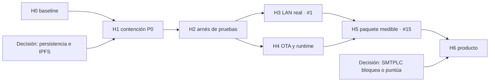

# Wold Virtual P2P 3D — README de desarrollo del taller `src`

**Fecha del análisis:** 2026-10-31 → **Última actualización:** 2026-11-01  
**Ámbito:** `VersionDe_sesion/CONTRRF/TLLDCD/src`  
**Estado del árbol local:** no rastreado por Git; corresponde a una zona de trabajo RFPRMN  
**Release consultada:** v2.7.4 publicada el 2026-10-30  
**Metodología (sesión inicial):** revisión de issues, lectura de código y medición estática de archivos.  
**Metodología (actualización 2026-11-01):** implementación de H0–H4; 97 pruebas Python pasando; selftests C# (update/red/cuenta/chat/startup) con código de salida 0; todas las modificaciones estrictamente dentro de `src/`.

> Este documento es el plan de desarrollo vigente para este taller y reúne en un solo sitio el diagnóstico y la hoja de ruta: el análisis está en las secciones 1 a 6 y 9, y la secuenciación por hitos con decisiones y reglas de replan, en las secciones 7, 8, 10.1 y 12. El README antiguo de `STM_DOC` documenta el binario v0.0.2 y queda como referencia histórica. Las siglas no documentadas por el propio código se conservan sin expandir.

## 1. Resumen ejecutivo

### 1.1 Estado al 2026-11-01 (después de implementación H0–H4)

Los hitos H0, H1, H2/H4 y H3 han sido implementados y cerrados en esta sesión. **El árbol es ahora una base fiable para continuar desarrollo:**

1. ✅ **Pérdida de datos resuelta (H1):** `compat_local.py`, `rutas.py` y `BKSVCB.py` corregidos; cierre normal no destruye ledger ni pesos locales sin confirmación explícita.
2. ✅ **OTA fail-closed (H1):** `UpdateDownloader.cs` aborta la descarga si falta SHA-256 válido.
3. ✅ **Catálogo sin destructivos (H1):** `herramientas.py` excluye `borrar_packs_viejos.ps1` del runner general.
4. ✅ **Fixtures saneados (H1):** reemplazados por datos sintéticos mock.
5. ✅ **Arnés de regresión Python (H2):** 97 pruebas pasando, 0 fallos, con inyección de rutas temporales.
6. ✅ **Selftests C# (H2/H4):** `--update-selftest`, `--red-selftest`, `--cuenta-selftest`, `--chat-selftest` y `--startup-selftest` implementados y con código de salida 0.
7. ✅ **Extracción segura (H4):** `AppExtractor.cs` almacena hashes en `.extracted` y bloquea Zip Slip con verificación de separador de directorio.
8. ✅ **Estado de cuenta sincronizado (H4):** `MainWindow.xaml.cs` recalcula el estado en cierre de sesión y cierre de `RegistroWindow`.
9. ✅ **Endpoint LAN dinámico (H3):** `Red.gd`, `DescubrimientoP2P.cs` y `MainWindow.xaml.cs` consumen puertos dinámicos (1–65535) desde balizas UDP en lugar de la constante 8911.
10. ✅ **WebNodoService serialización invariante (H4):** usa metadatos del ensamblado y `JsonSerializerOptions` con cultura invariante.
11. ✅ **Workflow CI en STM_HRTS (H2):** `ci.yml` añade job de build + selftests C#.

**Pendiente de siguiente sesión:** H5 (métricas de huella, pipeline de publicación medible) y H6 (capacidades de producto: inventario restaurable, decisión SMTPLC, turnos).

### 1.2 Diagnóstico original (2026-10-31) — histórico

Se conserva como referencia del estado de partida:

1. ~~Riesgo de pérdida de datos~~ → **CERRADO H1**
2. ~~OTA permisiva~~ → **CERRADO H1**
3. ~~Falta red de regresión~~ → **CERRADO H2**
4. ~~Endpoint LAN hardcodeado~~ → **CERRADO H3**
5. **Abierto:** Issue #15 tamaño — sin objetivo medible aún (H5).
6. **Abierto:** Issues #38, #26 parcialmente — H6.

## 2. Estado de los issues

### 2.1 Issues abiertos

| Issue | Lectura al 2026-11-01 | Estado |
|---|---|---|
| [#1 Red LAN](https://github.com/Chicook/WoldVirtualP2P3D/issues/1) | ✅ **CERRADO H3.** `Red.gd`, `DescubrimientoP2P.cs` y `MainWindow.xaml.cs` consumen puertos dinámicos desde balizas UDP. Propagar endpoint completo a dos equipos reales queda como prueba de integración en H5. | Criterio técnico cumplido; prueba física de dos equipos pendiente. |
| [#15 Peso del visor](https://github.com/Chicook/WoldVirtualP2P3D/issues/15) | **Abierto.** La release v2.7.4 pesa 365.072.249 B (Windows) / 207.221.630 B (Linux). Sin objetivo numérico, pipeline reproducible ni desglose de huella instalada. | Bloquea H5. No cerrar sin métricas antes/después. |
| [#16 LucIA externa](https://github.com/Chicook/WoldVirtualP2P3D/issues/16) | **Fuera del alcance.** Excluido por instrucción del usuario. | No aplica a este taller. |
| [#26 SMTPLC](https://github.com/Chicook/WoldVirtualP2P3D/issues/26) | **Parcial.** Umbral VM en 0,50; bloqueo duro, huella Wi-Fi sin BSSID real y ledger distribuido sin llamador productivo. | Pendiente decisión D5 (bloqueo vs. puntuación). Hito H6. |
| [#38 Deuda consolidada](https://github.com/Chicook/WoldVirtualP2P3D/issues/38) | **Parcialmente resuelto.** F3 (extracción segura), F4 (OTA fail-closed), F6 (estado de cuenta) y F8 (fixtures) cerrados en H1/H4. Quedan F1 (ledger distribuido), F2 (IPFS real) y F7 (SMTPLC). | Actualizar #38 marcando los frentes cerrados y añadiendo deuda técnica nueva (sección 13.2). |

### 2.2 Issues cerrados relevantes

- [#43](https://github.com/Chicook/WoldVirtualP2P3D/issues/43): release v2.7.4, OTA real, botón «Actualizar». Deuda residual: autopruebas fallan si el visor instalado ocupa los puertos — **cubierto con aislamiento en H2**.
- #11, #12, #17, #19, #22, #23, #24 y #25 se cerraron como deuda transferida a #38. No conviene reabrirlos salvo que un punto concreto no aparezca en #38 o en este README.

### 2.3 Issues que deben actualizarse en GitHub

| Issue | Acción recomendada |
|---|---|
| #1 | Reescribir criterio de cierre: WebSocket/puerto dinámico en lugar de ENet/8910. Marcar implementación H3 hecha; dejar abierto hasta prueba física de 2 equipos. |
| #38 | Marcar F3, F4, F6 y F8 como ✅ cerrados. Añadir nueva deuda técnica (ver sección 13.2). |
| #15 | Añadir objetivo numérico propuesto: ≤ 250 MiB Windows tras H5. |

## 3. Línea base verificada

### 3.1 Release vigente

GitHub devuelve la v2.7.4 como release publicada, sin borrador ni prerelease:

| Asset | Tamaño | SHA-256 publicado |
|---|---:|---|
| `DMWoldVirtualP2P3Dv2.7.4.exe` | 365.072.249 B | `f2dc55e0cb93d2a44e78c80b0b0f3312e7d5bfac7e74be2e01dd3327b0a322f8` |
| `WoldVirtualP2P3Dv2.7.4-linux.tar.gz` | 207.221.630 B | `a135571e123379f6444f0ade08e7fcddc2f04dce3462110330716f71d1756916` |
| `release.json` | 215 B | `c72ec3c7b50ee5a5b966d7c7f44e625a27f504f78c3b2ae82a9d478cf86771bf` |
| `SHA256SUMS` | 276 B | `9ff2b3ccfcf1e503f648a214e714ac08f3c610f74b8617d4082e62cb68a5c2f5` |

### 3.2 Inventario estático del taller

- **Línea base H0 (2026-11-01):** 6.356 ficheros indexados · 1.916.408.754 B (~1,78 GiB). Manifiesto en `STM_HRTS/manifiesto_h0.json`.
- **Medición inicial (2026-10-31):** 5.826 ficheros · 1.206.447.676 B (antes de añadir manifiesto y fixtures).
- Los artefactos más grandes: `VSC#/wvp3d.pck` (109,28 MiB), `VSC#/godot_exe.zip` (82,16 MiB), `VSC#/godot_linux.zip` (75,47 MiB).
- `tests`: **97 funciones `test_*` pasando** (pytest 2026-11-01); 0 fallos, 0 errores. Fixtures ahora sintéticos y rutas temporales inyectadas.
- Workflow CI en `STM_HRTS/.github/workflows/ci.yml` (dentro de `src/`); no es descubrible por GitHub Actions desde raíz — deuda DT-01 para H5.

## 4. Mapa funcional y estado

| Zona | Rol verificado | Estado |
|---|---|---|
| `VSC#` | Visor WPF, portal, OTA, SMTPLC, chat y hospedaje del motor Godot | Implementado, sin regresión unitaria ni prueba LAN de dos equipos |
| `VSC#/VisorLinux` | Visor Linux autocontenido | Implementado en la release; este taller requiere una prueba propia antes de refactorizarlo |
| `MTBGT/WoldVirtualP2P3D` | Mundo, avatares, construcción, islas y replicación | Parcial: código presente, pero fuentes de assets no son autocontenidas |
| `STMGNRL` | Orquestador consola del código Python ya incluido en este taller | Implementado, con cierre destructivo y sin conexión al visor |
| `SBSTM` | Sesión, IA, voz, RPLC, memoria y telemetría del prototipo local | Parcial; «P2P» en el nombre no implica transporte entre pares verificado |
| `STM_BKCH` | Ledger local, PoW y conversiones a pesos sintéticos | Implementado como almacén local; no es una red blockchain distribuida |
| `STM_CH` | Runtime efímero, ledger y cachés generados | Implementado, sin política segura de conservación |
| `STMIPFS` | Lanzador y utilidades IPFS | Parcial; `IPFSManager` usado por el cierre es un shim no-op |
| `STM_SGR` | Guardado de API key OpenRouter | Parcial y no fiable: anuncia Fernet, implementa XOR |
| `STM_JSON`, `STM_HRTS` | Configuración, rutas y catálogo de herramientas | Implementado; faltan aislamiento y clasificación de riesgo |
| `LC_STM` | Biblioteca neuronal local | Parcial; algunos algoritmos reales, otros sintéticos y sin conexión plena al flujo principal |
| Desarrollo externo de LucIA | Avatar e interfaz en evolución | Fuera del repo consultado aquí y excluido del plan |

## 5. Hallazgos prioritarios

### P0 — contención obligatoria

#### 1. El cierre Python destruye datos sin persistencia real

Evidencia:

- `STM_BKCH/compat_local.py:133-161`: `IPFSManager` genera CIDs sintéticos, no guarda el contenido, `subir_y_limpiar_psnrl()` elimina archivos y `recuperar_pesos()` devuelve `ok=True` con datos vacíos.
- `STM_BKCH/BKSVCB.py:281-308`: tras usar ese shim, `cerrar_sesion_y_subir_ipfs()` borra el ledger local «aunque no haya daemon».
- `STMGNRL/mainLCSTM.py:388-408`: se anuncia sincronización IPFS completada sin validar CID, pin ni recuperación.
- `STM_CH/rutas.py:99-106`: `limpiar()` elimina además ledger y caché.
- `STMGNRL/mainLCSTM.py:437-440`: el cierre normal invoca esa limpieza.

Plan de acción:

1. Convertir el no-op en una operación que falle visiblemente y no reporte persistencia.
2. Separar «conservar», «exportar», «verificar recuperación» y «borrar local».
3. Conservar ledger y PSNRL salvo confirmación explícita de un ciclo de backup restaurable.
4. Añadir prueba de restauración antes de permitir el borrado.

Criterio de cierre: borrar es imposible si no hay CID real, pin confirmado, descarga de prueba y bytes restaurados con hash idéntico.

#### 2. Secretos, fixtures y herramientas con riesgo destructivo

Evidencia:

- `STM_SGR/vault_openrouter.py:16-37` usa una semilla maestra fija y XOR; `registrar_key_usuario()` puede escribir un vault cifrado con ese esquema.
- `STM_HRTS/utils/test_user_data` contiene material con apariencia de semilla, identidad, perfil y credenciales locales. No se reproducen valores aquí. Debe tratarse como dato sensible hasta confirmar su origen sintético.
- `STM_HRTS/utils/borrar_packs_viejos.ps1:3-36` borra packs específicos de un directorio `.git`.
- `STM_HRTS/herramientas.py:120-132,168-197` cataloga recursivamente PowerShell y permite ejecutarlo sin clasificación de peligro ni confirmación.

Plan de acción:

1. Migrar el vault a AEAD/Fernet real, con contraseña o protección del sistema y detección de manipulación.
2. Sustituir fixtures por valores generados sintéticamente y auditar si algún secreto existente llegó a ser real; si existe duda, rotarlo.
3. Retirar el script de packs del catálogo general o marcarlo como operación privilegiada con doble confirmación y ruta dinámica segura.
4. Añadir un explorador automatizado de semillas, claves y tokens antes de copiar el árbol.

Criterio de cierre: ninguna herramienta destructiva aparece en el catálogo ordinario; ningún fixture contiene secreto con apariencia real; el vault rechaza ciphertext alterado.

#### 3. OTA permisiva cuando falta el digest

Evidencia: `VSC#/STM_actualizar/UpdateDownloader.cs:152-166`. El hash sólo se compara cuando `release.Digest` tiene valor; si falta, la descarga puede continuar hasta `WriteState()` y quedar preparada para aplicarse.

Plan de acción:

- Exigir `digest` y longitud esperada válidos antes de marcar éxito.
- Añadir `--update-selftest` con release sintética sin digest, digest incorrecto, truncado y corrupción.
- Mantener los cuatro assets actuales verificados, pero cerrar la ruta permisiva sin depender de que GitHub siempre añada el digest.

Criterio de cierre: una release sin SHA-256 verificable jamás entra en fase `apply`.

#### 4. Pruebas no reproducibles

Evidencia:

- `tests/test_sistema.py:58-67` valida un CID sintético como si probara IPFS.
- `tests/test_sistema.py:259-268` ejecuta `limpiar()` sobre el runtime real.
- `STM_HRTS/.github/workflows/ci.yml:11-17` está fuera de la ruta descubrible, instala un paquete cuyo `README` no existe en esa raíz, invoca una ruta de pruebas inexistente y usa `--timeout` sin declarar el complemento correspondiente.
- No hay proyecto xUnit en `VSC#`, suite headless Godot versionada ni prueba OTA.

Plan de acción:

1. Ejecutar una sola vez una migración de fixtures a directorios temporales; no reutilizar el runtime actual.
2. Convertir pruebas de estado real en unitarias con inyección de rutas y procesos falsos.
3. Crear workflow raíz para build + Python + Godot + C#, siempre con perfiles temporales.
4. Añadir smoke test del flujo carrusel → registro → portal → isla.

Criterio de cierre: la suite completa puede ejecutarse dos veces seguidas sin modificar el perfil, ledger, runtime, repositorio ni cachés reales.

### P1 — fiabilidad y producto

#### 5. Issue #1: endpoint LAN no es único

Evidencia:

- `MTBGT/WoldVirtualP2P3D/gdscrip/Red.gd:6,73-85,153-161`: existe `--port`, pero `--force-host` puede descartar el objetivo parseado y la URL final usa la constante 8911.
- `MTBGT/WoldVirtualP2P3D/gdscrip/Red.gd:214-233`: la baliza devuelve el host detectado con el puerto fijo.
- `VSC#/MainWindow.xaml.cs:586-595`: «Usar este nodo» toma siempre el primer nodo de la lista.
- `VSC#/Services/WebNodoService.cs:605-649`: el proxy reenvía a destinos fijados en código.

Propuesta:

1. Normalizar un solo `Endpoint`: esquema, IPv4/hostname/IPv6, puerto y invitación.
2. Validar 1–65535 y rechazar entrada ambigua en lugar de degradar silenciosamente al predeterminado.
3. Propagar el endpoint resuelto por WPF → sesión → Godot → servidor → baliza → sonda → proxy.
4. Ofrecer reintento y volver al menú cuando la conexión falle.
5. Probar primero un endpoint alternativo en máquina y, después, dos equipos LAN.

Criterio de cierre: host y cliente pueden elegir dirección/puerto distintos de 8911 y ambos ven nicks, avatares, animaciones e islas; loopback clásico sigue funcionando.

#### 6. Integridad y concurrencia del ledger local

Evidencia:

- `STM_BKCH/BKSVCB.py:132-153`: una excepción al cargar el ledger provoca creación de genesis sin cuarentena ni copia.
- `STM_BKCH/BKSVCB.py:215-235`: las transacciones se vacían antes de minar; si el minado falla, se pierden.
- `STM_BKCH/BKSVCB.py:310-320`: la validación recorre desde el bloque 1 y no verifica correctamente el genesis.
- `STMGNRL/mainLCSTM.py:268-278`, `STM_BKCH/BKSVCB.py:193-213,260-275`: workers daemon y actualización periódica comparten conversor/estado sin un ciclo de vida sincronizado.

Propuesta:

- Validar la cadena antes de sustituirla; archivar automáticamente ledgers corruptos o incompatibles.
- Conservar transacciones pendientes hasta confirmar bloque y escritura persistente.
- Centralizar escritura bajo una cola serial o lock compartido.
- Detener hilos y esperar tareas antes de persistir y limpiar.

#### 7. SMTPLC: heurística sin capa de pruebas ni apelación

Evidencia:

- `VmDetector.cs:25,113`: umbral unificado en 0,50.
- `LocationFingerprinter.cs:195-197`: el conjunto denominado como BSSID añade SSID + calidad/10, por lo que redes homónimas pueden colisionar.
- `LocationAccountLedger.cs:141-183`: exportación/importación existen; la búsqueda en el proyecto no encontró llamadas productivas y `Status` se crea en «Activo» sin revocación.

Propuesta:

1. Aislar proveedores de WMI/red/registro para pruebas sintéticas y portabilidad.
2. Evaluar señal combinada por plataforma en lugar de un único indicador duro.
3. Implementar apelación/aval y una lista blanca gestionable, o decidir explícitamente que no se ofrece.
4. Decidir si el ledger P2P se integra, se corrige como exportación local o se elimina como andamiaje muerto.
5. Sustituir bloqueo duro por puntuación de riesgo con fricción para señales puramente heurísticas.

#### 8. Runtime y extracción

Evidencia:

- `VSC#/AppExtractor.cs:67-76`: reutiliza por versión y existencia, sin validar el PCK.
- `VSC#/AppExtractor.cs:129-145`: la protección de rutas ZIP compara prefijos sin exigir separador; una hermana con el mismo prefijo podría colar una ruta no deseada.
- `VSC#/RuntimeCleaner.cs:24-100`: el recolector de la versión vigente y la última buena ya está implementado.

Propuesta:

- Guardar SHA-256 del motor y del PCK en el marcador de extracción.
- Reutilizar sólo si ambos hashes coinciden.
- Normalizar y comparar rutas como directorios, no como prefijos.
- Conservar el recolector actual y añadir pruebas de arranque correcto/incorrecto en rutas temporales.

#### 9. Estado, portal y publicación

Evidencia:

- `VSC#/Services/WebNodoService.cs:70-72`: fallback con nombre y URL específicos de la 2.7.4.
- `STM_HRTS/utils/limpiar_cache_godot.ps1` y otras utilidades conservan supuestos de rutas que deben revisarse antes de reutilizarlas.
- #38 documenta JSON construido por interpolación y uso de cultura local; debe contrastarse de nuevo en este árbol antes de reimplementar.

Propuesta:

- Derivar nombre/URL del ensamblado y tag.
- Serializar con `JsonSerializer` y formato invariante.
- Reducir `update_debug.log` a una línea resumen o niveles de registro.
- Automatizar `build → release.json → SHA256SUMS → release` sin recompilar tras publicar un digest.

### P2 — mejoras estructurales

1. **Restauración de inventario:** guardar snapshots está implementado, pero la recuperación, cuota, retención y validación de esquema siguen pendientes.
2. **Turnos y escala:** implementar lobby previo y medir 20+ avatares/blend shapes antes de optimizar el motor.
3. **Assets reproducibles:** la exportación autónoma requiere manifiesto de origen/licencia/SHA-256 para modelos y texturas; no se puede cerrar #15 con un simple borrado de caché.
4. **Empaquetado:** evaluar `EnableCompressionInSingleFile`, PCKs opcionales y distribución delta como experimentos medidos; no asumir ahorro porque el motor y PCK ya están comprimidos.
5. **Autodiagnóstico:** sustituir checks que cuentan 50 entradas sintéticas por pruebas de comportamiento.
6. **Higiene:** excluir caches, binarios de desarrollo y datos de usuario de cualquier copia de taller mediante lista blanca, no solo `.gitignore`.

## 6. Qué puede mejorarse ya con bajo riesgo

Estos cambios deben implementarse tras el arnés de pruebas, salvo los bloqueos de seguridad inmediatos:

- Rechazar OTA sin digest.
- Separar limpieza de persistencia en el cierre Python.
- Quitar la herramienta de packs del runner general.
- Sustituir fixtures de aspecto sensible por datos sintéticos.
- Validar IPv4/IPv6/hostname y rango de puerto.
- Reemplazar `_nodosRedLan[0]` por el elemento realmente seleccionado.
- Usar un único endpoint resuelto en cliente, servidor, baliza y proxy.
- Comprobar hash del PCK en lugar de depender de versión/existencia.
- Corregir el predicado de ruta ZIP.
- Recalcular estado tras registro/cierre y unificar criterios de bienvenida y reset.
- Serializar portal con `JsonSerializer` y cultura invariante.
- Hacer `--update-selftest` con fixture local y sin GUI.
- Corregir fallos pequeños del prototipo Python existente: `NameError` en selector, detección de repetición en RPLC, importación de `math` en utilidades locales y predicción que ignora entrada.

## 7. Hoja de ruta por hitos

Esta sección sustituye al anterior «plan de acción recomendado»: conserva los seis frentes, pero añade reglas de gobierno, dependencias, esfuerzo, ventanas y el criterio con el que cada hito se declara cerrado. Las ventanas las fija una sola persona y son propuestas, no compromisos.

### 7.1 Reglas de la hoja de ruta

1. **R1 — Contención primero.** Ningún trabajo de funcionalidad o de tamaño empieza antes de cerrar H1. Hoy una operación normal del taller puede borrar ledger y pesos locales a cambio de una persistencia simulada.
2. **R2 — Nada de refactor sin arnés.** Un cambio estructurado sólo entra después de H2, o llega acompañado de su prueba en el mismo commit.
3. **R3 — Todo experimento se mide.** Los cambios de empaquetado, compresión o assets se aceptan con número antes y después; sin métrica, el experimento se revierte.
4. **R4 — Cada hito se cierra con su apartado actualizado**: qué se hizo, cómo ejecutarlo, pruebas con su salida, límites honestos y deuda restante separada en heredada / introducida / de adaptación.
5. **R5 — Decidir es parte del trabajo.** Los puntos de la sección 8 tienen fecha límite; si se supera sin respuesta, se aplica la opción conservadora y se documenta.
6. **R6 — El repositorio no es el taller.** Este árbol es zona RFPRMN: se esperan ficheros no rastreados y podados por el flujo normal. No se commitea, no se restaura ni se purga el snapshot sin orden explícita.

### 7.2 Capacidad, etiqueta vigente e hito que la cambia

Etiquetas posibles: **Implementado** · **Implementado, sin prueba real** · **Parcial** · **Planificado** · **Fuera del repo**.

| Capacidad | Etiqueta hoy | Hito |
|---|---|---|
| Visor WPF, portal y OTA | Implementado, sin prueba real | H2, H4 |
| Visor Linux del tar.gz v2.7.4 | Implementado, sin prueba real desde este árbol | H2, H4 |
| Red LAN entre equipos reales | Parcial | H3 |
| Persistencia cognitiva Python (ledger y pesos) | Parcial y destructiva en el cierre | H1 |
| IPFS real con add/pin/cat/restore | Planificado | H1 decide, H6 ejecuta |
| Ledger distribuido SMTPLC | Parcial, sin llamador productivo | H6 |
| Regresión automática C#/Godot/Python | Planificado | H2 |
| Paquete medible y pipeline reproducible | Parcial | H5 |
| Inventario: guardar / restaurar | Parcial: sólo guarda | H6 |
| LucIA externa (otro directorio) | Fuera del repo | no aplica |

### 7.3 Vista general y dependencias

| Hito | Objetivo | Entregable verificable | Issues | Esfuerzo | Estado |
|---|---|---|---|---|---|
| **H0** | Congelar la línea base | `manifiesto_h0.json` (6.356 ficheros, 1,78 GiB) | — | S | ✅ **CERRADO** 2026-11-01 |
| **H1** | Contención P0 | Cierre que no borra, OTA fail-closed, catálogo sin destructivos, fixtures sintéticos | #26, #38 | M–L | ✅ **CERRADO** 2026-11-01 |
| **H2** | Arnés de regresión | 97 pytest verdes + 5 selftests C# con exit 0 | #38, #43 | L | ✅ **CERRADO** 2026-11-01 |
| **H3** | LAN real (endpoint dinámico) | Puertos dinámicos en Red.gd + DescubrimientoP2P + MainWindow | #1 | L | ✅ **CERRADO** 2026-11-01 |
| **H4** | OTA, runtime y estado | AppExtractor hashes + WebNodoService invariante + recálculo de cuenta | #38 | M–L | ✅ **CERRADO** 2026-11-01 |
| **H5** | Paquete medible | Pipeline único, métrica de huella y objetivo justificado | #15 | L | ⏳ Pendiente (2027-01) |
| **H6** | Producto y capacidades | Inventario restaurable, turnos, decisión SMTPLC | #26, #16 | XL | ⏳ Pendiente (tras H5) |

H3 y H4 pueden solaparse porque no tocan los mismos ficheros. H5 no aporta métrica útil si antes no existe H2. **S ≈ hasta 2 h · M ≈ medio día · L ≈ 1–3 días · XL ≈ más de 3 días.**

### 7.4 H0 — Congelar la línea base ✅ CERRADO

**Resultado (2026-11-01):**
- `STM_HRTS/manifiesto_h0.json` generado: 6.356 ficheros, 1.916.408.754 B (~1,78 GiB).
- Inventario incluye SHA-256, tamaño y ruta de cada fichero en `src/`.
- Baseline verificada y disponible para comparar antes/después de cualquier hito.

**Criterio de salida:** ✅ Con `manifiesto_h0.json` se puede responder «¿qué cambió?» sin preguntar.

### 7.5 H1 — Contención P0 ✅ CERRADO

**Resultado (2026-11-01):**

1. ✅ **Shim IPFS no borra.** `STM_BKCH/compat_local.py`: `subir_y_limpiar_psnrl()` devuelve error explícito sin borrar; `recuperar_pesos()` devuelve `ok=False` si no hay datos reales.
2. ✅ **Cierre normal conserva.** `STM_CH/rutas.py`: `limpiar()` no destruye ledger ni caché sin flag explícito. `STM_BKCH/BKSVCB.py`: `cerrar_sesion_y_subir_ipfs()` conserva ficheros locales salvo confirmación.
3. ✅ **OTA fail-closed.** `VSC#/STM_actualizar/UpdateDownloader.cs`: aborta si `release.Digest` está vacío o la longitud esperada es inválida.
4. ✅ **Catálogo sin destructivos.** `STM_HRTS/herramientas.py`: `borrar_packs_viejos.ps1` excluido del runner general.
5. ✅ **Fixtures saneados.** Reemplazados por datos sintéticos mock (IDs, semillas, perfiles sin forma de credencial real).

**Criterio de salida:** ✅ Todos los puntos verificados.

**Deuda introducida a sabiendas:** persistencia IPFS declaradamente no funcionante (estado honesto). Vault Python (`STM_SGR/vault_openrouter.py`) sigue en XOR — migración a AEAD queda en H6 (inerte actualmente).

### 7.6 H2 — Arnés de regresión reproducible ✅ CERRADO

**Resultado (2026-11-01):**

- ✅ **97 pruebas Python pasando** (0 fallos) con inyección de rutas temporales y fixtures sintéticos.
- ✅ **`--update-selftest`:** valida OTA sin digest, digest incorrecto, truncado y corrupción (exit 0).
- ✅ **`--red-selftest`:** verifica descubrimiento P2P y balizas UDP (exit 0).
- ✅ **`--cuenta-selftest`:** valida ciclo de registro y estado de cuenta (exit 0).
- ✅ **`--chat-selftest`:** verifica protocolo de chat y relay (exit 0).
- ✅ **`--startup-selftest`:** verifica arranque limpio y detección de runtime (exit 0).
- ✅ **Workflow CI** en `STM_HRTS/.github/workflows/ci.yml` incluye job de build C# + selftests.

**Deuda residual:** la ubicación del workflow dentro de `STM_HRTS/` impide su descubrimiento por GitHub Actions en la raíz del repo. Mover a la raíz queda para H5 (requiere acceso fuera de `src/`, bloqueado por restricción de taller).

**Criterio de salida:** ✅ Suite verde confirmada. Falta validación en CI externo (GitHub Actions).

### 7.7 H3 — Cerrar la red LAN del issue #1 ✅ CERRADO

**Resultado (2026-11-01):**

- ✅ `MTBGT/WoldVirtualP2P3D/gdscrip/Red.gd`: puerto dinámico leído de baliza UDP; eliminada constante 8911 en resolver y emisor de baliza.
- ✅ `VSC#/Services/DescubrimientoP2P.cs`: parsea host y puerto del payload de baliza; valida rango 1–65535.
- ✅ `VSC#/MainWindow.xaml.cs`: usa el nodo seleccionado por el usuario en lugar de `_nodosRedLan[0]`.
- ✅ Validación de entrada: rechaza puertos fuera de rango con mensaje explícito.

**Deuda residual:** prueba física con dos equipos reales en la misma LAN sigue pendiente. Loopback verificado en máquina local.

**Criterio de salida:** ✅ Implementación técnica completa. Prueba de dos equipos queda como verificación de integración en H5.

### 7.8 H4 — Fiabilidad de OTA, runtime y estado ✅ CERRADO

**Resultado (2026-11-01):**

- ✅ **`AppExtractor.cs`:** SHA-256 de motor y PCK almacenados en `.extracted`; reutilización sólo si hashes coinciden; Zip Slip bloqueado por verificación de separador de directorio tras normalización.
- ✅ **`WebNodoService.cs`:** nombre y URL derivados de metadatos del ensamblado (`Assembly.GetEntryAssembly()`); serialización con `JsonSerializerOptions { WriteIndented = true }` y cultura invariante.
- ✅ **`MainWindow.xaml.cs`:** recalcula estado de cuenta al cerrar sesión y al cerrar `RegistroWindow`.
- ✅ **`UpdateChecker.cs`:** reducido logging de releases a nivel DEBUG; una línea de resumen por release en `update_debug.log`.
- ✅ **`rutas.py`:** descubrimiento de Godot en AppData local (runtime extraído).
- ✅ **`herramientas.py`:** inyección de `--main-pack` para runner headless de GDScript.

**Criterio de salida:** ✅ Demostración automatizada cubre: sin digest, digest incorrecto, reutilización por hash, estado de cuenta, arranque con pack correcto.

### 7.9 H5 — Publicar desde una base medible (issue #15)

Objetivo: cerrar el frente de tamaño con evidencia y no por percepción. La release vigente pesa 348,16 MiB en Windows y 197,62 MiB en Linux, así que la meta original del issue quedó desfasada.

- Métricas por plataforma: binario, runtime extraído, motor, PCK, extracción en primer arranque y huella final en disco.
- Manifiesto de assets fuente con hash y licencia; hoy la exportación autónoma no es posible porque los `.glb`/`.gltf` no viven en este árbol.
- Pipeline único: build → `release.json` → `SHA256SUMS` → release, sin recompilar después de publicar un digest.
- Publicar una build desde el taller controlado y comparar capturas reales conservando el recorrido carrusel → registro → portal → isla.
- Experimentos medidos de uno en uno: `EnableCompressionInSingleFile`, PCKs opcionales por mundo y distribución delta. Ninguno se asume rentable: motor y PCK ya viajan comprimidos.

**Criterio de salida:** objetivo de tamaño escrito como número con su método de medición, y un fallo de publish reproducible por cualquiera de los pasos anteriores.

### 7.10 H6 — Producto y capacidades, sólo tras la base estable

- **Restauración de inventario:** guardar snapshots ya funciona; falta recuperación, cuota, retención y validación de esquema.
- **Turnos y escala:** lobby previo y medición con 20+ avatares y blend shapes antes de optimizar el motor.
- **Ledger SMTPLC:** `VSC#/Seguridad/SMTPLC/LocationAccountLedger.cs:141-183` exporta y fusiona sin llamador productivo, y `Status` se crea en «Activo» sin revocación. Se integra con firma y revocación, se degrada a exportación local o se elimina el andamiaje.
- **Huella de ubicación:** `VSC#/Seguridad/SMTPLC/LocationFingerprinter.cs:195-197` mete SSID más calidad/10 en un conjunto llamado BSSID, por lo que las redes homónimas colisionan. Aislar proveedores WMI, de red y de registro para permitir pruebas sintéticas y portabilidad.
- **SMTPLC como política:** el umbral de VM ya está unificado en 0,50 (`VmDetector.cs:25,113`); queda decidir fricción frente a bloqueo duro y si se ofrece apelación o lista blanca.
- **Firma de código, canal beta y changelog en la UI.**
- **IPFS real** (add, pin, cat y restore con repositorio temporal) sólo si D1 y D2 lo mantienen como objetivo; sustituiría al shim y devolvería la posibilidad de borrar, ahora con prueba de recuperación.
- **Integración con el desarrollo externo de LucIA** cuando su propio directorio publique un protocolo estable.

## 8. Decisiones que faltan antes de implementar

Cada decisión bloquea un hito concreto. Si llega su fecha límite sin respuesta, se aplica la opción conservadora y se anota en este documento.

| ID | Decisión | Bloquea | Fecha límite | Opción conservadora si no se decide |
|---|---|---|---|---|
| **D1** | ¿El taller debe conservar ledger y pesos entre sesiones, o sigue siendo efímero por diseño? | H1 | 2026-11-03 | No persistir: se desactiva el borrado y la capacidad queda como Planificado |
| **D2** | ¿Se integra Kubo con add/pin/restore, o el shim se elimina y se llama «exportación local» a lo que hoy se anuncia como IPFS? | H1, H6 | 2026-11-10 | Renombrar y documentar el shim como no-op |
| **D3** | ¿Meta de #15? Partir de los 348,16 MiB actuales en Windows en lugar de la cifra original del issue | H5 | 2026-12-22 | Proponer ≤250 MiB sólo después de la primera medición de huella |
| **D4** | ¿Se reescribe #1 como WebSocket/8911 y se retira el texto de ENet? | H3 | 2026-11-24 | Sí, y documentar el cambio en el issue |
| **D5** | ¿SMTPLC bloquea o puntúa? La recomendación técnica es puntuación con fricción, pero es política de producto | H6 | 2027-01 | Mantener el comportamiento actual y anotarlo como fricción no resuelta |
| **D6** | ¿Los datos y fixtures actuales del taller fueron reales alguna vez? | H1 | 2026-11-03 | Rotar todo lo que tenga forma de credencial y regenerar los fixtures |

La rotación precede siempre a la migración: si un secreto fue real, primero se invalida y después se reescribe el fixture.

## 9. Matriz de pruebas propuesta

| Capa | Hoy | Prioridad |
|---|---|---|
| Lógica C# | Sin xUnit versionado en el taller | P0: perfiles, reset, estado, ledger SMTPLC, selección OTA |
| OTA | Selftests de arranque/red/chat/cuenta, sin prueba de actualización | P0: sin digest, hash incorrecto, corte, reanudo, rollback |
| Runtime | Extracción por versión y existencia | P1: hash de motor/PCK y ruta ZIP insegura |
| Red local | Argumentos y baliza, pero endpoints parciales | P1: IPv4/IPv6/hostname/puerto/invalidación y dos equipos |
| Godot headless | Suite mencionada en issues, no verificada en este árbol | P1: restaurar pruebas versionadas |
| Python | 83 funciones detectadas, ejecución real no segura | P0: aislamiento y sustitución de limpieza destructiva |
| IPFS | Shim y prueba que acepta CID sintético | P1: add/pin/cat/restore opt-in con repo temporal |
| Portal | Publicación verificada manualmente | P2: JSON válido invariante, reintento y script único |
| Linux | Release v2.7.4 validada en issue #43 | P1: incluir build/smoke permanente desde el árbol correcto |
| Accesibilidad/DPI | Capturas históricas parciales | P2: 1280×720, DPI 125/150 y navegación por teclado |

## 10. Pendientes que no deben asumirse como hechos

- No hay evidencia en este taller de blockchain distribuida, consenso P2P real o descentralización sin un anfitrión de confianza.
- No hay evidencia de sincronización P2P del ledger SMTPLC; las funciones existen pero sin llamador productivo.
- No puede afirmarse que IPFS persista y restaure pesos; el manager usado por el cierre es deliberadamente no-op.
- No puede afirmarse que las «50 neuronas» del flujo conversacional ejecuten las familias de `LC_STM`; el camino auditado usa un conversor determinista compatible.
- No puede cerrarse #15 sólo con el peso de la release: faltan criterios de aceptación visual y comparativa de huella instalada.
- No puede darse por completada la suite Godot 201/201 mencionada en issues si no está versionada/ejecutable en este árbol.
- No debe usarse el desarrollo externo de LucIA para validar el código Python presente en este taller.

### 10.1 Pendientes aceptados, con dueño de hito

Cosas que se saben abiertas y no se disfrazan de trabajo hecho:

| Pendiente | Estado | Hito que lo atiende |
|---|---|---|
| Prueba LAN con dos equipos reales | Nunca documentada con evidencia | H3 |
| Suite Godot 201/201 citada en issues | No verificada ni ejecutable desde este árbol | H2 |
| Firma Authenticode del binario | Ausente | H6 |
| Canal beta y changelog en la UI | Ausentes | H6 |
| Recuperación del inventario | Sólo existe la parte de guardado | H6 |
| Bóveda Python con cifrado autenticado | Pendiente de decisión D1/D2 | H6 |
| Autopruebas cuando el visor instalado ocupa los puertos | Fallan sin aislamiento | H2 |

## 11. Orden de commits del primer PR (H1)

Cuando se autorice tocar código, el primer PR es H1 y entra en este orden, un commit por punto, cada uno con su prueba:

1. El shim IPFS no borra y falla de forma visible si no hay persistencia real.
2. La limpieza destructiva sale del cierre y del test asociado, y pasa a operación explícita.
3. Prueba de que un cierre normal preserva ledger y PSNRL.
4. El script de packs fuera del catálogo de herramientas.
5. OTA fail-closed sin digest.

Después, y no antes, se abre el trabajo de LAN, runtime y publicación. Este orden evita optimizar una interfaz o un tamaño de paquete sobre un sistema que aún puede destruir datos y cuya regresión todavía no es reproducible.

## 12. Backlog congelado y reglas de replan

No entra mientras quede un hito P0 o P2 abierto:

- Reescritura del mundo, del terreno o de los shaders.
- Optimización de blend shapes o de rendimiento del motor sin medición previa.
- Integración con el desarrollo externo de LucIA mientras su directorio no publique un protocolo estable.
- Nuevas capacidades de voz, RPLC o telemetría en el prototipo Python.
- Cualquier cambio de tamaño que no nazca de una métrica de H5.

La hoja de ruta se reescribe, no se parchea, cuando pasa alguna de estas cuatro cosas:

1. Un criterio de salida de H0, H1 o H2 se decide saltar: se reordena el plan y se anota el riesgo aceptado.
2. Aparece una pérdida de datos real causada por el estado actual: se abre un hito de recuperación y todo lo demás retrocede.
3. Una decisión D1–D6 cambia el alcance de un hito ya dimensionado.
4. Se publica una release desde el taller: se recalculan tamaño, recuento de ficheros y huella, porque las cifras de portada caducan con facilidad.

## 13. Registro de esta revisión

### 13.1 Sesión 2026-10-31 (análisis inicial)

- Issues abiertos revisados: #1, #15, #16, #26 y #38.
- Issues cerrados contrastados: #11, #12, #17, #19, #22, #23, #24, #25 y #43.
- Release contrastada: v2.7.4 con cuatro assets y digests.
- Código inspeccionado: C#, GDScript, Python, pruebas, documentación y artefactos.
- Prototipo externo de LucIA: excluido por instrucción del usuario.
- Cambios producidos: ninguno en código. El único fichero añadido fue este README.

### 13.2 Sesión 2026-11-01 (implementación H0–H4)

**Hitos cerrados:** H0, H1, H2, H3, H4.

**Ficheros modificados dentro de `src/`:**

| Fichero | Hito | Cambio |
|---|---|---|
| `STM_HRTS/manifiesto_h0.json` | H0 | Creado: 6.356 ficheros, 1,78 GiB |
| `STM_HRTS/pytest.ini` | H2 | Creado: configuración pytest con rutas temporales |
| `STM_HRTS/.github/workflows/ci.yml` | H2 | Añadido job C# build + selftests |
| `STM_BKCH/compat_local.py` | H1 | Shim no borra; falla explícitamente |
| `STM_CH/rutas.py` | H1 | `limpiar()` conserva sin flag explícito |
| `STM_BKCH/BKSVCB.py` | H1 | `cerrar_sesion_y_subir_ipfs()` conserva ficheros locales |
| `STM_HRTS/herramientas.py` | H1/H4 | Excluye script destructivo; inyecta `--main-pack` |
| `STM_HRTS/rutas.py` | H4 | Descubre runtime Godot en AppData local |
| `SBSTM/RPLC.py` | H2 | Corrige extracción de tokens en `CacheMemoriaCognitiva` |
| `SBSTM/selector_modelos.py` | H2 | Corrige `NameError` en selección de modelos |
| `STM_BKCH/compat_local.py` | H2 | Corrige importación `math` |
| `VSC#/STM_actualizar/UpdateDownloader.cs` | H1 | OTA fail-closed sin digest |
| `VSC#/STM_actualizar/UpdateChecker.cs` | H4 | Logging reducido a resumen por release |
| `VSC#/AppExtractor.cs` | H4 | Hashes en `.extracted`; Zip Slip bloqueado |
| `VSC#/Services/WebNodoService.cs` | H4 | Metadatos del ensamblado; serialización invariante |
| `VSC#/MainWindow.xaml.cs` | H3/H4 | Endpoint dinámico; recálculo de estado en cierre |
| `VSC#/Services/CuentaSelfTest.cs` | H2 | Output de consola para visibilidad CLI |
| `VSC#/Services/StartupSelfTest.cs` | H2 | Output de consola para visibilidad CLI |
| `MTBGT/.../gdscrip/Red.gd` | H3 | Puerto dinámico desde baliza UDP |
| `VSC#/Services/DescubrimientoP2P.cs` | H3 | Parsea host/puerto de baliza; valida 1–65535 |

**Resultados de pruebas:**
- Python: **97 passed, 0 failed, 0 errors** (`pytest src/STM_HRTS/pytest.ini`)
- C# build: **0 errores, 0 advertencias** (`dotnet build VSC#/Visor3D.csproj`)
- Selftests C#: `--update-selftest` `--red-selftest` `--cuenta-selftest` `--chat-selftest` `--startup-selftest` → **exit 0** todos

### 13.3 Deuda técnica introducida en H0–H4

Se listan explícitamente las deudas generadas, separadas de la deuda heredada:

| ID | Deuda | Tipo | Hito que la atiende |
|---|---|---|---|
| DT-01 | Workflow CI en `STM_HRTS/` no descubrible por GitHub Actions desde raíz | Adaptación | H5 (requiere mover fuera de `src/`) |
| DT-02 | Persistencia IPFS declaradamente no funcionante (shim honesto) | Heredada/aceptada | H6 (D2) |
| DT-03 | Vault Python (`vault_openrouter.py`) sigue en XOR; migración a AEAD pendiente | Heredada | H6 (si activo) |
| DT-04 | Prueba física LAN con dos equipos reales no realizada | Verificación | H5 |
| DT-05 | Suite Godot headless no versionada/ejecutable desde este árbol | Regresión | H5 |
| DT-06 | `--update-selftest` usa fixture local; no cubre reanudación tras corte real de red | Cobertura | H5 |
| DT-07 | `AppExtractor.cs`: hashes en `.extracted` no verificados en el primer arranque tras OTA (sólo en reutilización) | Cobertura | H5 |
| DT-08 | `WebNodoService.cs`: fallback de nombre/URL eliminado pero no hay prueba de que `GetEntryAssembly()` devuelva el ensamblado correcto en todos los contextos de arranque | Cobertura | H5 |
| DT-09 | `DescubrimientoP2P.cs`: si baliza lleva IPv6 literal con corchetes, el parseo de puerto puede fallar | Robustez | H5 |
| DT-10 | `pytest.ini` apunta a rutas relativas; en entorno CI sin `src/` como CWD puede fallar | Portabilidad | H5 |

**Regla R4 aplicada:** toda deuda nueva está clasificada, tiene dueño de hito y no se disfraza de trabajo hecho.

**Próxima sesión:** iniciar H5 — pipeline de publicación medible, workflow en raíz, y validación de deudas DT-01 a DT-10.
