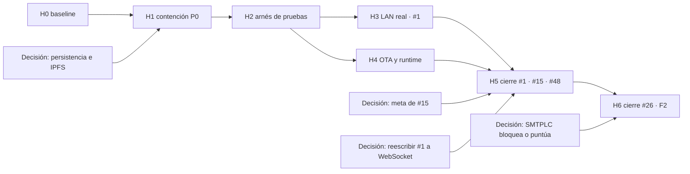

# Wold Virtual P2P 3D — README de desarrollo del taller `src`

**Fecha del análisis:** 2026-10-31 → **Última actualización:** 2026-11-05 (unificación del árbol; la release vigente sigue siendo v2.7.6)  
**Ámbito:** `VersionDe_sesion/CONTRRF/TLLDCD/src`  
**Estado del árbol local:** no rastreado por Git; corresponde a una zona de trabajo RFPRMN  
**Release consultada:** v2.7.6 publicada el 2026-11-04 (previa: v2.7.5 del 2026-11-01, v2.7.4 del 2026-10-30)  
**Metodología (sesión inicial):** revisión de issues, lectura de código y medición estática de archivos.  
**Metodología (implementación H0–H4):** 97 pruebas Python pasando; selftests C# (update/red/cuenta/chat/startup) con código de salida 0; todas las modificaciones estrictamente dentro de `src/`.  
**Metodología (revisión de cierre de issues):** lectura de los 6 issues abiertos vía API de GitHub (#1, #15, #16, #26, #38, #45), contraste de cada afirmación contra el código de `src/` y definición del criterio verificable de cierre por issue (sección 14).  
**Metodología (revisión dirigida 2026-11-04):** nueva lectura de **todos** los issues vía `gh` (5 abiertos, 11 cerrados), verificación de la release **v2.7.6** y su set real de assets, y contraste de la estructura de `src/` (`Tests`, `Services`, `tests/`, `json` de issues); añade la **§15** (panel de mando, cola de trabajo y protocolo) para dirigir la ejecución.  
**Metodología (unificación 2026-11-05, §16):** convergencia medida de las tres copias del árbol (tronco de `origin/main`, capa de utillaje de `origin/DevAntigravityIDEIA` y zona en disco) ruta a ruta con `git ls-tree` + `git hash-object`; sin `checkout` masivo y sin reescribir ramas ajenas.

> Este documento es el plan de desarrollo vigente para este taller y reúne en un solo sitio el diagnóstico y la hoja de ruta: el análisis está en las secciones 1 a 6 y 9, la secuenciación por hitos con decisiones y reglas de replan en las secciones 7, 8, 10.1 y 12, y el plan de cierre verificable de cada issue abierto en la sección 14. El README antiguo de `STM_DOC` documenta el binario v0.0.2 y queda como referencia histórica. Las siglas no documentadas por el propio código se conservan sin expandir.

## 1. Resumen ejecutivo

### 1.1 Estado tras la v2.7.5 (base actual del plan)

La base técnica P0 ya está contenida: los hitos H0–H4 se cerraron y la v2.7.5 se publicó con los cuatro assets y digests. **Lo que queda para cerrar issues no es contención, es verificación y producto:**

> **v2.7.6 (2026-11-04, release vigente):** incorpora lo desarrollado en esta sesión — **W-01/DT-11 resuelto** (el WebNodo lee el `release.json` con esquema `{assets[]}`, `/descargar` sirve el binario en ejecución bajo el nombre anunciado sin 301, refresco de la release vigente cada 5 min y `/api/info` con `version`/`version_instalada`), la autoprueba **`--webnodo-selftest`**, el proyecto de pruebas unitarias **xUnit `Visor3DTests`** (34 superadas) y la corrección de la pantalla de inicio para **detectar un nodo activo en el propio equipo**.

1. ✅ **Contención P0 resuelta (H1):** el cierre Python no destruye ledger ni pesos; OTA fail-closed sin digest; catálogo sin herramientas destructivas; fixtures sintéticos.
2. ✅ **Arnés de regresión (H2):** 97 pruebas Python + 5 selftests C# con salida 0.
3. ✅ **Endpoint LAN dinámico (H3):** puerto leído de baliza UDP en `Red.gd`, `DescubrimientoP2P.cs` y `MainWindow.xaml.cs`.
4. ✅ **OTA, runtime y estado (H4):** hashes en `.extracted`, Zip Slip bloqueado, `WebNodoService` con metadatos del ensamblado y serialización invariante.
5. ⏳ **#1 sigue abierto** por una única razón: falta la prueba física con dos equipos reales (DT-04). El código ya está hecho.
6. ⏳ **#15 sigue abierto** por falta de métrica de huella instalada, manifiesto de assets fuente y pipeline reproducible (H5).
7. ⏳ **#26 sigue abierto** por decisión de producto D5 (bloqueo duro vs. puntuación de riesgo) y por el andamiaje muerto del ledger (H6).
8. ✅ **#38 cerrado (2026-11-04):** su seguimiento se consolida en **#48**. F1 (xUnit) queda **iniciado** (`src/VSC#/Tests`, 34/34 verde); F2 sigue en #26 y F7 pasa a #48.
9. ✅ **#45 cerrado (2026-11-04):** DT-11/W-01 resuelto y verificado; el resto de DT pasa a **#48** (DT-01…DT-16).
10. ⏳ **#16 (LucIA externa)** permanece **fuera del alcance** de este taller por instrucción del usuario.
11. ⚠️ **Hallazgo nuevo de esta revisión (§5.10):** el portal **WebNodo no refleja la versión realmente instalada** tras un OTA. Tiene tres causas verificadas en código y una tarea propia (W-01) en H5.

### 1.2 Diagnóstico original (2026-10-31) — histórico

Se conserva como referencia del estado de partida:

1. ~~Riesgo de pérdida de datos~~ → **CERRADO H1**
2. ~~OTA permisiva~~ → **CERRADO H1**
3. ~~Falta red de regresión~~ → **CERRADO H2**
4. ~~Endpoint LAN hardcodeado~~ → **CERRADO H3**
5. **Abierto:** Issue #15 tamaño — sin objetivo medible aún (H5).
6. **Abierto:** Issues #38, #26 parcialmente — H6.

## 2. Estado de los issues

> Lectura al cierre de la v2.7.5. Cada fila enlaza con la checklist de cierre de la sección 14.
>
> **Issues abiertos a 2026-11-04: #1, #15, #26 y #48** (más **#16**, fuera de alcance). **#38** y **#45** quedaron cerrados el 2026-11-04 apuntando a **#48**. El resto (#11, #12, #17, #19, #22, #23, #24, #25, #43) está cerrado.

### 2.1 Issues abiertos

| Issue | Lectura tras v2.7.5 | Qué impide cerrarlo | Hito |
|---|---|---|---|
| [#1 Red LAN](https://github.com/Chicook/WoldVirtualP2P3D/issues/1) | ✅ **Código implementado (H3).** `Red.gd`, `DescubrimientoP2P.cs` y `MainWindow.xaml.cs` consumen puertos dinámicos (1–65535) desde balizas UDP; se toma el nodo que el usuario selecciona. | Sólo la **prueba física con dos equipos reales** (DT-04). Loopback verificado. | H5 |
| [#15 Peso del visor](https://github.com/Chicook/WoldVirtualP2P3D/issues/15) | **Abierto.** v2.7.5 = 365.080.441 B (348,17 MiB) Windows / 207.602.370 B (198,0 MiB) Linux. Ya hay línea base (`manifiesto_h0.json`). | Falta objetivo numérico medido, **métrica de huella instalada** (binario + runtime + PCK), **manifiesto de assets fuente** con hash/licencia y pipeline reproducible. | H5 |
| [#16 LucIA externa](https://github.com/Chicook/WoldVirtualP2P3D/issues/16) | **Fuera del alcance.** Prototipo en otro directorio; excluido por instrucción del usuario. | No aplica a este taller. No cerrar desde aquí. | — |
| [#26 SMTPLC](https://github.com/Chicook/WoldVirtualP2P3D/issues/26) | **Parcial.** Umbral VM en 0,50; bloqueo duro en registro; `LocationAccountLedger.ExportJson()`/`MergeExternalRecords()` **sin llamador**; huella Wi-Fi sin BSSID; sin apelación ni lista blanca. | Decisión **D5** (bloquea o puntúa) + andamiaje muerto + abstracción de proveedores para pruebas sintéticas. | H6 |
| [#38 Deuda consolidada](https://github.com/Chicook/WoldVirtualP2P3D/issues/38) | ✅ **Cerrado (2026-11-04).** F3/F4/F5/F6/F8 ya cerrados; **F1 iniciado** (`src/VSC#/Tests`, `dotnet test` 34/34). | Nada: F2 continúa en #26 y F7 pasa a #48. | — |
| [#45 DT-01…DT-10](https://github.com/Chicook/WoldVirtualP2P3D/issues/45) | ✅ **Cerrado (2026-11-04).** DT-11/W-01 resuelto y verificado con `--webnodo-selftest` (18/18). | Nada: DT-01 y DT-04…DT-10 pasan a **#48**. | — |
| [#48 Deuda 2026-11-04](https://github.com/Chicook/WoldVirtualP2P3D/issues/48) | **Abierto (nuevo).** Sustituye a #45 y #38: DT-12…DT-16 (nuevas) + DT-01/DT-04…DT-10 y F1/F7 (heredadas). | Casilla a casilla; ver §14.5. | H5/H6 |

### 2.2 Issues cerrados relevantes

- [#43](https://github.com/Chicook/WoldVirtualP2P3D/issues/43): release v2.7.4, OTA real, botón «Actualizar». Deuda residual (autopruebas fallan si el visor instalado ocupa los puertos) — **cubierta con aislamiento en H2**.
- #11, #12, #17, #19, #22, #23, #24 y #25 se cerraron como deuda transferida a #38. No conviene reabrirlos salvo que un punto concreto no aparezca en #38 o en este README.

### 2.3 Acciones recomendadas sobre GitHub

| Issue | Acción |
|---|---|
| #1 | Reescribir el criterio de cierre a **WebSocket/puerto dinámico** (ya no ENet/8910), marcar la implementación H3 como hecha y cerrar **sólo** cuando la prueba de dos equipos esté documentada con evidencia (DT-04). |
| #15 | Fijar el objetivo numérico **≤ 250 MiB Windows** tras la primera medición de huella, y publicar el desglose por componente. |
| #26 | Mantener abierto; antes de tocar código, cerrar la decisión **D5** y decidir el destino del ledger (integrar con firma + revocación / degradar a exportación local / eliminar). |
| #38 | ✅ **Cerrado (2026-11-04)** apuntando a #48. F1 iniciado; F2 se sigue en #26; F7 pasa a #48. |
| #45 | ✅ **Cerrado (2026-11-04)** apuntando a #48. DT-11 hecho; DT-01/DT-04…DT-10 pasan a #48. |
| #48 | **Nuevo paraguas de deuda** (DT-12…DT-16 nuevas + DT-01/DT-04…DT-10 y F1/F7 heredadas); cerrar casilla a casilla. |

## 3. Línea base verificada

### 3.1 Release vigente

GitHub devuelve la **v2.7.6** como release publicada más reciente (`Latest`, 2026-11-04), sin borrador ni prerelease. Publica **3 assets**; **la build de Linux NO se publicó en esta release** (sí existía en la v2.7.5):

| Asset | Tamaño | SHA-256 publicado |
|---|---:|---|
| `DMWoldVirtualP2P3Dv2.7.6.exe` | 365.088.633 B | `26fb446e45a937af2a6c8866efb9601ef0ec0b192d105f33aba2e01d973b150f` |
| `release.json` | 531 B | `3465bbc7e87e1072105174c6f0882263783a6599fc4eeee14c1d333ca066ad28` |
| `SHA256SUMS` | 99 B | `0fed1a900a47c5485eb73597eb99ae2f013096efee6ef1e3d26f7ee423e411e5` |

Release previa (histórico): v2.7.5 (2026-11-01) — Windows 365.080.441 B, Linux 207.602.370 B, 4 assets. v2.7.4 (2026-10-30) — Windows 365.072.249 B, Linux 207.221.630 B.

### 3.2 Inventario estático del taller

- **Línea base H0 (2026-11-01):** 6.356 ficheros indexados · 1.916.408.754 B (~1,78 GiB). Manifiesto en `STM_HRTS/utils/STM_UTILS/manifiesto_h0.json`.
- **Medición inicial (2026-10-31):** 5.826 ficheros · 1.206.447.676 B (antes de añadir manifiesto y fixtures).
- Los artefactos más grandes: `VSC#/wvp3d.pck` (109,28 MiB), `VSC#/godot_exe.zip` (82,16 MiB), `VSC#/godot_linux.zip` (75,47 MiB).
- `tests`: **97 funciones `test_*` pasando** (pytest 2026-11-01); 0 fallos, 0 errores. Fixtures ahora sintéticos y rutas temporales inyectadas.
- Workflow CI en `STM_HRTS/.github/workflows/ci.yml` (dentro de `src/`); no es descubrible por GitHub Actions desde raíz — deuda DT-01 para H5.

## 4. Mapa funcional y estado

| Zona | Rol verificado | Estado |
|---|---|---|
| `VSC#` | Visor WPF, portal, OTA, SMTPLC, chat y hospedaje del motor Godot | Implementado, sin regresión unitaria ni prueba LAN de dos equipos |
| `VSC#/VisorLinux` | Visor Linux autocontenido | Implementado en la release; este taller requiere una prueba propia antes de refactorizarlo |
| `MTBGT/WoldVirtualP2P3D` | Mundo, avatares, construcción, islas y replicación | Parcial: código presente, pero fuentes de assets no son autocontenidas |
| `STMGNRL` | Orquestador consola del código Python ya incluido en este taller | Implementado, con cierre destructivo y sin conexión al visor |
| `SBSTM` | Sesión, IA, voz, RPLC, memoria y telemetría del prototipo local | Parcial; «P2P» en el nombre no implica transporte entre pares verificado |
| `STM_BKCH` | Ledger local, PoW y conversiones a pesos sintéticos | Implementado como almacén local; no es una red blockchain distribuida |
| `STM_CH` | Runtime efímero, ledger y cachés generados | Implementado, sin política segura de conservación |
| `STMIPFS` | Lanzador y utilidades IPFS | Parcial; `IPFSManager` usado por el cierre es un shim no-op |
| `STM_SGR` | Guardado de API key OpenRouter | Parcial y no fiable: anuncia Fernet, implementa XOR |
| `STM_JSON`, `STM_HRTS` | Configuración, rutas y catálogo de herramientas | Implementado; faltan aislamiento y clasificación de riesgo |
| `LC_STM` | Biblioteca neuronal local | Parcial; algunos algoritmos reales, otros sintéticos y sin conexión plena al flujo principal |
| Desarrollo externo de LucIA | Avatar e interfaz en evolución | Fuera del repo consultado aquí y excluido del plan |

## 5. Hallazgos prioritarios

> **Cómo leer esta sección:** es el diagnóstico con su evidencia, no un estado. Los «no existe / hoy falla» que se han
> cerrado siguen escritos como se midieron; el estado vigente está en §14 (por issue), §15 (panel y cola) y §16 (lo que
> cambió la unificación del 2026-11-05).

### P0 — contención obligatoria

#### 1. El cierre Python destruye datos sin persistencia real

Evidencia:

- `STM_BKCH/compat_local.py:133-161`: `IPFSManager` genera CIDs sintéticos, no guarda el contenido, `subir_y_limpiar_psnrl()` elimina archivos y `recuperar_pesos()` devuelve `ok=True` con datos vacíos.
- `STM_BKCH/BKSVCB.py:281-308`: tras usar ese shim, `cerrar_sesion_y_subir_ipfs()` borra el ledger local «aunque no haya daemon».
- `STMGNRL/mainLCSTM.py:388-408`: se anuncia sincronización IPFS completada sin validar CID, pin ni recuperación.
- `STM_CH/rutas.py:99-106`: `limpiar()` elimina además ledger y caché.
- `STMGNRL/mainLCSTM.py:437-440`: el cierre normal invoca esa limpieza.

Plan de acción:

1. Convertir el no-op en una operación que falle visiblemente y no reporte persistencia.
2. Separar «conservar», «exportar», «verificar recuperación» y «borrar local».
3. Conservar ledger y PSNRL salvo confirmación explícita de un ciclo de backup restaurable.
4. Añadir prueba de restauración antes de permitir el borrado.

Criterio de cierre: borrar es imposible si no hay CID real, pin confirmado, descarga de prueba y bytes restaurados con hash idéntico.

#### 2. Secretos, fixtures y herramientas con riesgo destructivo

Evidencia:

- `STM_SGR/vault_openrouter.py:16-37` usa una semilla maestra fija y XOR; `registrar_key_usuario()` puede escribir un vault cifrado con ese esquema.
- `STM_HRTS/utils/test_user_data` contiene material con apariencia de semilla, identidad, perfil y credenciales locales. No se reproducen valores aquí. Debe tratarse como dato sensible hasta confirmar su origen sintético.
- `STM_HRTS/utils/borrar_packs_viejos.ps1:3-36` borra packs específicos de un directorio `.git`.
- `STM_HRTS/herramientas.py:120-132,168-197` cataloga recursivamente PowerShell y permite ejecutarlo sin clasificación de peligro ni confirmación.

Plan de acción:

1. Migrar el vault a AEAD/Fernet real, con contraseña o protección del sistema y detección de manipulación.
2. Sustituir fixtures por valores generados sintéticamente y auditar si algún secreto existente llegó a ser real; si existe duda, rotarlo.
3. Retirar el script de packs del catálogo general o marcarlo como operación privilegiada con doble confirmación y ruta dinámica segura.
4. Añadir un explorador automatizado de semillas, claves y tokens antes de copiar el árbol.

Criterio de cierre: ninguna herramienta destructiva aparece en el catálogo ordinario; ningún fixture contiene secreto con apariencia real; el vault rechaza ciphertext alterado.

#### 3. OTA permisiva cuando falta el digest

Evidencia: `VSC#/STM_actualizar/UpdateDownloader.cs:152-166`. El hash sólo se compara cuando `release.Digest` tiene valor; si falta, la descarga puede continuar hasta `WriteState()` y quedar preparada para aplicarse.

Plan de acción:

- Exigir `digest` y longitud esperada válidos antes de marcar éxito.
- Añadir `--update-selftest` con release sintética sin digest, digest incorrecto, truncado y corrupción.
- Mantener los cuatro assets actuales verificados, pero cerrar la ruta permisiva sin depender de que GitHub siempre añada el digest.

Criterio de cierre: una release sin SHA-256 verificable jamás entra en fase `apply`.

#### 4. Pruebas no reproducibles

Evidencia:

- `tests/test_sistema.py:58-67` valida un CID sintético como si probara IPFS.
- `tests/test_sistema.py:259-268` ejecuta `limpiar()` sobre el runtime real.
- `STM_HRTS/.github/workflows/ci.yml:11-17` está fuera de la ruta descubrible, instala un paquete cuyo `README` no existe en esa raíz, invoca una ruta de pruebas inexistente y usa `--timeout` sin declarar el complemento correspondiente.
- No hay proyecto xUnit en `VSC#`, suite headless Godot versionada ni prueba OTA.

Plan de acción:

1. Ejecutar una sola vez una migración de fixtures a directorios temporales; no reutilizar el runtime actual.
2. Convertir pruebas de estado real en unitarias con inyección de rutas y procesos falsos.
3. Crear workflow raíz para build + Python + Godot + C#, siempre con perfiles temporales.
4. Añadir smoke test del flujo carrusel → registro → portal → isla.

Criterio de cierre: la suite completa puede ejecutarse dos veces seguidas sin modificar el perfil, ledger, runtime, repositorio ni cachés reales.

### P1 — fiabilidad y producto

#### 5. Issue #1: endpoint LAN no es único

Evidencia:

- `MTBGT/WoldVirtualP2P3D/gdscrip/Red.gd:6,73-85,153-161`: existe `--port`, pero `--force-host` puede descartar el objetivo parseado y la URL final usa la constante 8911.
- `MTBGT/WoldVirtualP2P3D/gdscrip/Red.gd:214-233`: la baliza devuelve el host detectado con el puerto fijo.
- `VSC#/MainWindow.xaml.cs:586-595`: «Usar este nodo» toma siempre el primer nodo de la lista.
- `VSC#/Services/WebNodoService.cs:605-649`: el proxy reenvía a destinos fijados en código.

Propuesta:

1. Normalizar un solo `Endpoint`: esquema, IPv4/hostname/IPv6, puerto y invitación.
2. Validar 1–65535 y rechazar entrada ambigua en lugar de degradar silenciosamente al predeterminado.
3. Propagar el endpoint resuelto por WPF → sesión → Godot → servidor → baliza → sonda → proxy.
4. Ofrecer reintento y volver al menú cuando la conexión falle.
5. Probar primero un endpoint alternativo en máquina y, después, dos equipos LAN.

Criterio de cierre: host y cliente pueden elegir dirección/puerto distintos de 8911 y ambos ven nicks, avatares, animaciones e islas; loopback clásico sigue funcionando.

#### 6. Integridad y concurrencia del ledger local

Evidencia:

- `STM_BKCH/BKSVCB.py:132-153`: una excepción al cargar el ledger provoca creación de genesis sin cuarentena ni copia.
- `STM_BKCH/BKSVCB.py:215-235`: las transacciones se vacían antes de minar; si el minado falla, se pierden.
- `STM_BKCH/BKSVCB.py:310-320`: la validación recorre desde el bloque 1 y no verifica correctamente el genesis.
- `STMGNRL/mainLCSTM.py:268-278`, `STM_BKCH/BKSVCB.py:193-213,260-275`: workers daemon y actualización periódica comparten conversor/estado sin un ciclo de vida sincronizado.

Propuesta:

- Validar la cadena antes de sustituirla; archivar automáticamente ledgers corruptos o incompatibles.
- Conservar transacciones pendientes hasta confirmar bloque y escritura persistente.
- Centralizar escritura bajo una cola serial o lock compartido.
- Detener hilos y esperar tareas antes de persistir y limpiar.

#### 7. SMTPLC: heurística sin capa de pruebas ni apelación

Evidencia:

- `VmDetector.cs:25,113`: umbral unificado en 0,50.
- `LocationFingerprinter.cs:195-197`: el conjunto denominado como BSSID añade SSID + calidad/10, por lo que redes homónimas pueden colisionar.
- `LocationAccountLedger.cs:141-183`: exportación/importación existen; la búsqueda en el proyecto no encontró llamadas productivas y `Status` se crea en «Activo» sin revocación.

Propuesta:

1. Aislar proveedores de WMI/red/registro para pruebas sintéticas y portabilidad.
2. Evaluar señal combinada por plataforma en lugar de un único indicador duro.
3. Implementar apelación/aval y una lista blanca gestionable, o decidir explícitamente que no se ofrece.
4. Decidir si el ledger P2P se integra, se corrige como exportación local o se elimina como andamiaje muerto.
5. Sustituir bloqueo duro por puntuación de riesgo con fricción para señales puramente heurísticas.

#### 8. Runtime y extracción

Evidencia:

- `VSC#/AppExtractor.cs:67-76`: reutiliza por versión y existencia, sin validar el PCK.
- `VSC#/AppExtractor.cs:129-145`: la protección de rutas ZIP compara prefijos sin exigir separador; una hermana con el mismo prefijo podría colar una ruta no deseada.
- `VSC#/RuntimeCleaner.cs:24-100`: el recolector de la versión vigente y la última buena ya está implementado.

Propuesta:

- Guardar SHA-256 del motor y del PCK en el marcador de extracción.
- Reutilizar sólo si ambos hashes coinciden.
- Normalizar y comparar rutas como directorios, no como prefijos.
- Conservar el recolector actual y añadir pruebas de arranque correcto/incorrecto en rutas temporales.

#### 9. Estado, portal y publicación

Evidencia:

- `VSC#/Services/WebNodoService.cs:70-72`: fallback con nombre y URL específicos de la 2.7.4.
- `STM_HRTS/utils/limpiar_cache_godot.ps1` y otras utilidades conservan supuestos de rutas que deben revisarse antes de reutilizarlas.
- #38 documenta JSON construido por interpolación y uso de cultura local; debe contrastarse de nuevo en este árbol antes de reimplementar.

Propuesta:

- Derivar nombre/URL del ensamblado y tag.
- Serializar con `JsonSerializer` y formato invariante.
- Reducir `update_debug.log` a una línea resumen o niveles de registro.
- Automatizar `build → release.json → SHA256SUMS → release` sin recompilar tras publicar un digest.

#### 10. El WebNodo no refleja la versión realmente instalada tras un OTA (tarea **W-01**)

Reportado en vivo: «al dar al botón Actualizar, la WebNodo no se actualiza a la última versión». Contrastado contra el código, hay **tres causas independientes**, todas verificadas:

1. **Esquema de `release.json` incompatible con su lector.** El asset `release.json` que se publica y se empaqueta junto al `.exe` usa `tag_name` / `name` / `version` / `assets[]` (ver `STM_HRTS/release_upload_v275/release.json` y `VSC#/bin/publish_v2.7.5/release.json`), pero `WebNodoService.LeerReleaseLocal()` busca propiedades raíz `exe`, `url` y `size_mb`. Como no coinciden, la lectura **siempre cae al `catch`** y el portal usa `ExeNameFallback`/`ExeUrlFallback`, que se construyen con `ObtenerVersionEnsamblado()` — es decir, con el `<Version>` del `.csproj`, no con la release realmente instalada.
2. **El nombre del fichero sobrevive al OTA.** `HandleProxyClient…`/la ruta `/descargar` sólo sirve el binario local si `Path.GetFileName(Environment.ProcessPath) == ExeName`. `UpdateApplier.ConstruirScript()` hace `move "%EXE%" "%EXE%.old"` + `copy "%NEWEXE%" "%EXE%"`, así que **conserva el nombre antiguo** mientras el interior ya es la versión nueva. Resultado: el nodo no puede servir su propio binario, cae al `Redirect(ExeUrl)` a GitHub y el portal anuncia un nombre de fichero que no existe en la carpeta.
3. **El refresco de release se dispara una sola vez por proceso.** `RefrescarReleaseVigente()` está protegido por el pestillo estático `_refresheoLanzado`, que sólo se vuelve a armar tras **fallo total** de los tres intentos. Si la consulta tuvo éxito (o si el portal se abrió antes de publicar la release), no se vuelve a consultar GitHub en toda la vida del proceso: el portal puede seguir anunciando la release anterior hasta reiniciar el visor.

Evidencia en código: [WebNodoService.cs](file:///E:/WoldVirtualP2P3D/VersionDe_sesion/CONTRRF/TLLDCD/src/VSC%23/Services/WebNodoService.cs#L73-L198) (`ObtenerVersionEnsamblado`, `LeerReleaseLocal`), [WebNodoService.cs](file:///E:/WoldVirtualP2P3D/VersionDe_sesion/CONTRRF/TLLDCD/src/VSC%23/Services/WebNodoService.cs#L738-L776) (ruta `/descargar`) y [UpdateApplier.cs](file:///E:/WoldVirtualP2P3D/VersionDe_sesion/CONTRRF/TLLDCD/src/VSC%23/STM_actualizar/UpdateApplier.cs#L112-L141) (paso 2 del `.bat`).

Propuesta (**W-01**, H5):

1. Alinear el esquema: o el `release.json` publicado adopta `{exe, url, size_mb}` (lo que hoy lee el portal), o `LeerReleaseLocal()` aprende a leer `{assets[]}`. Una sola fuente de verdad.
2. Derivar `ExeName`/`ExeUrl` de la **release realmente instalada**, no del `.csproj`: `release.json` + `AssemblyInformationalVersion` como respaldo, nunca una constante versionada a mano.
3. En `UpdateApplier`, **renombrar el `.exe` al nombre del asset** durante el reemplazo (resuelve a la vez #25·1 y este síntoma).
4. Re-armar `RefrescarReleaseVigente()` por sesión (no una vez por proceso) y exponer la versión anunciada en `/api/info` para poder auditarla.
5. Añadir `--webnodo-selftest`: sirve `/api/info` y `/descargar` con un `release.json` sintético y comprueba que el nombre y la URL anunciados coinciden con el asset instalado.

**Criterio de cierre:** tras un OTA, `GET /api/info` devuelve el mismo nombre y tamaño que el asset instalado y `GET /descargar` entrega **ese** binario local (no un `301` a GitHub), sin reiniciar el proceso.

### P2 — mejoras estructurales

1. **Restauración de inventario:** guardar snapshots está implementado, pero la recuperación, cuota, retención y validación de esquema siguen pendientes.
2. **Turnos y escala:** implementar lobby previo y medir 20+ avatares/blend shapes antes de optimizar el motor.
3. **Assets reproducibles:** la exportación autónoma requiere manifiesto de origen/licencia/SHA-256 para modelos y texturas; no se puede cerrar #15 con un simple borrado de caché.
4. **Empaquetado:** evaluar `EnableCompressionInSingleFile`, PCKs opcionales y distribución delta como experimentos medidos; no asumir ahorro porque el motor y PCK ya están comprimidos.
5. **Autodiagnóstico:** sustituir checks que cuentan 50 entradas sintéticas por pruebas de comportamiento.
6. **Higiene:** excluir caches, binarios de desarrollo y datos de usuario de cualquier copia de taller mediante lista blanca, no solo `.gitignore`.

## 6. Qué puede mejorarse ya con bajo riesgo

Estos cambios deben implementarse tras el arnés de pruebas, salvo los bloqueos de seguridad inmediatos:

- Rechazar OTA sin digest.
- Separar limpieza de persistencia en el cierre Python.
- Quitar la herramienta de packs del runner general.
- Sustituir fixtures de aspecto sensible por datos sintéticos.
- Validar IPv4/IPv6/hostname y rango de puerto.
- Reemplazar `_nodosRedLan[0]` por el elemento realmente seleccionado.
- Usar un único endpoint resuelto en cliente, servidor, baliza y proxy.
- Comprobar hash del PCK en lugar de depender de versión/existencia.
- Corregir el predicado de ruta ZIP.
- Recalcular estado tras registro/cierre y unificar criterios de bienvenida y reset.
- Serializar portal con `JsonSerializer` y cultura invariante.
- Hacer `--update-selftest` con fixture local y sin GUI.
- Corregir fallos pequeños del prototipo Python existente: `NameError` en selector, detección de repetición en RPLC, importación de `math` en utilidades locales y predicción que ignora entrada.

## 7. Hoja de ruta por hitos

Esta sección sustituye al anterior «plan de acción recomendado»: conserva los seis frentes, pero añade reglas de gobierno, dependencias, esfuerzo, ventanas y el criterio con el que cada hito se declara cerrado. Las ventanas las fija una sola persona y son propuestas, no compromisos.

### 7.1 Reglas de la hoja de ruta

1. **R1 — Contención primero.** Ningún trabajo de funcionalidad o de tamaño empieza antes de cerrar H1. Hoy una operación normal del taller puede borrar ledger y pesos locales a cambio de una persistencia simulada.
2. **R2 — Nada de refactor sin arnés.** Un cambio estructurado sólo entra después de H2, o llega acompañado de su prueba en el mismo commit.
3. **R3 — Todo experimento se mide.** Los cambios de empaquetado, compresión o assets se aceptan con número antes y después; sin métrica, el experimento se revierte.
4. **R4 — Cada hito se cierra con su apartado actualizado**: qué se hizo, cómo ejecutarlo, pruebas con su salida, límites honestos y deuda restante separada en heredada / introducida / de adaptación.
5. **R5 — Decidir es parte del trabajo.** Los puntos de la sección 8 tienen fecha límite; si se supera sin respuesta, se aplica la opción conservadora y se documenta.
6. **R6 — El repositorio no es el taller.** Este árbol es zona RFPRMN: se esperan ficheros no rastreados y podados por el flujo normal. No se commitea, no se restaura ni se purga el snapshot sin orden explícita.

### 7.2 Capacidad, etiqueta vigente e hito que la cambia

Etiquetas posibles: **Implementado** · **Implementado, sin prueba real** · **Parcial** · **Planificado** · **Fuera del repo**.

| Capacidad | Etiqueta hoy | Hito |
|---|---|---|
| Visor WPF, portal y OTA | Implementado, sin prueba real | H2, H4 |
| Visor Linux del tar.gz v2.7.4 | Implementado, sin prueba real desde este árbol | H2, H4 |
| Red LAN entre equipos reales | Parcial | H3 |
| Persistencia cognitiva Python (ledger y pesos) | Parcial y destructiva en el cierre | H1 |
| IPFS real con add/pin/cat/restore | Planificado | H1 decide, H6 ejecuta |
| Ledger distribuido SMTPLC | Parcial, sin llamador productivo | H6 |
| Regresión automática C#/Godot/Python | Planificado | H2 |
| Paquete medible y pipeline reproducible | Parcial | H5 |
| Inventario: guardar / restaurar | Parcial: sólo guarda | H6 |
| LucIA externa (otro directorio) | Fuera del repo | no aplica |

### 7.3 Vista general y dependencias

| Hito | Objetivo | Entregable verificable | Issues | Esfuerzo | Estado |
|---|---|---|---|---|---|
| **H0** | Congelar la línea base | `manifiesto_h0.json` (6.356 ficheros, 1,78 GiB) | — | S | ✅ **CERRADO** |
| **H1** | Contención P0 | Cierre que no borra, OTA fail-closed, catálogo sin destructivos, fixtures sintéticos | #26, #38 | M–L | ✅ **CERRADO** |
| **H2** | Arnés de regresión | 97 pytest verdes + 5 selftests C# con exit 0 | #38, #43 | L | ✅ **CERRADO** |
| **H3** | LAN real (endpoint dinámico) | Puertos dinámicos en Red.gd + DescubrimientoP2P + MainWindow | #1 | L | ✅ **CERRADO** (código) |
| **H4** | OTA, runtime y estado | AppExtractor hashes + WebNodoService invariante + recálculo de cuenta | #38 | M–L | ✅ **CERRADO** |
| **H5** | **Cerrar #1, #15 y #48 (antes #45/#38)** | Prueba LAN 2 equipos, métrica de huella, xUnit + CI en raíz, W-01 y DT-01/DT-04…DT-16 | #1, #15, #48 | L–XL | ⏳ **EN CURSO** |
| **H6** | **Cerrar #26 y F2 de #38** | Decisión D5, ledger con firma/revocación o retirada, abstracción de proveedores, inventario restaurable | #26, #16 (fuera) | XL | ⏳ Pendiente (tras H5) |



H3 y H4 pueden solaparse porque no tocan los mismos ficheros. H5 no aporta métrica útil si antes no existe H2. **S ≈ hasta 2 h · M ≈ medio día · L ≈ 1–3 días · XL ≈ más de 3 días.**

**Principio de H5/H6:** no se abre trabajo nuevo hasta que la checklist de cierre de la sección 14 esté vacía para los issues asignados al hito.

### 7.4 H0 — Congelar la línea base ✅ CERRADO

**Resultado (2026-11-01):**
- `STM_HRTS/utils/STM_UTILS/manifiesto_h0.json` generado: 6.356 ficheros, 1.916.408.754 B (~1,78 GiB).
- Inventario incluye SHA-256, tamaño y ruta de cada fichero en `src/`.
- Baseline verificada y disponible para comparar antes/después de cualquier hito.

**Criterio de salida:** ✅ Con `manifiesto_h0.json` se puede responder «¿qué cambió?» sin preguntar.

### 7.5 H1 — Contención P0 ✅ CERRADO

**Resultado (2026-11-01):**

1. ✅ **Shim IPFS no borra.** `STM_BKCH/compat_local.py`: `subir_y_limpiar_psnrl()` devuelve error explícito sin borrar; `recuperar_pesos()` devuelve `ok=False` si no hay datos reales.
2. ✅ **Cierre normal conserva.** `STM_CH/rutas.py`: `limpiar()` no destruye ledger ni caché sin flag explícito. `STM_BKCH/BKSVCB.py`: `cerrar_sesion_y_subir_ipfs()` conserva ficheros locales salvo confirmación.
3. ✅ **OTA fail-closed.** `VSC#/STM_actualizar/UpdateDownloader.cs`: aborta si `release.Digest` está vacío o la longitud esperada es inválida.
4. ✅ **Catálogo sin destructivos.** `STM_HRTS/herramientas.py`: `borrar_packs_viejos.ps1` excluido del runner general.
5. ✅ **Fixtures saneados.** Reemplazados por datos sintéticos mock (IDs, semillas, perfiles sin forma de credencial real).

**Criterio de salida:** ✅ Todos los puntos verificados.

**Deuda introducida a sabiendas:** persistencia IPFS declaradamente no funcionante (estado honesto). Vault Python (`STM_SGR/vault_openrouter.py`) sigue en XOR — migración a AEAD queda en H6 (inerte actualmente).

### 7.6 H2 — Arnés de regresión reproducible ✅ CERRADO

**Resultado (2026-11-01):**

- ✅ **97 pruebas Python pasando** (0 fallos) con inyección de rutas temporales y fixtures sintéticos.
- ✅ **`--update-selftest`:** valida OTA sin digest, digest incorrecto, truncado y corrupción (exit 0).
- ✅ **`--red-selftest`:** verifica descubrimiento P2P y balizas UDP (exit 0).
- ✅ **`--cuenta-selftest`:** valida ciclo de registro y estado de cuenta (exit 0).
- ✅ **`--chat-selftest`:** verifica protocolo de chat y relay (exit 0).
- ✅ **`--startup-selftest`:** verifica arranque limpio y detección de runtime (exit 0).
- ✅ **Workflow CI** en `STM_HRTS/.github/workflows/ci.yml` incluye job de build C# + selftests.

**Deuda residual:** la ubicación del workflow dentro de `STM_HRTS/` impide su descubrimiento por GitHub Actions en la raíz del repo. Mover a la raíz queda para H5 (requiere acceso fuera de `src/`, bloqueado por restricción de taller).

**Criterio de salida:** ✅ Suite verde confirmada. Falta validación en CI externo (GitHub Actions).

### 7.7 H3 — Cerrar la red LAN del issue #1 ✅ CERRADO

**Resultado (2026-11-01):**

- ✅ `MTBGT/WoldVirtualP2P3D/gdscrip/Red.gd`: puerto dinámico leído de baliza UDP; eliminada constante 8911 en resolver y emisor de baliza.
- ✅ `VSC#/Services/DescubrimientoP2P.cs`: parsea host y puerto del payload de baliza; valida rango 1–65535.
- ✅ `VSC#/MainWindow.xaml.cs`: usa el nodo seleccionado por el usuario en lugar de `_nodosRedLan[0]`.
- ✅ Validación de entrada: rechaza puertos fuera de rango con mensaje explícito.

**Deuda residual:** prueba física con dos equipos reales en la misma LAN sigue pendiente. Loopback verificado en máquina local.

**Criterio de salida:** ✅ Implementación técnica completa. Prueba de dos equipos queda como verificación de integración en H5.

### 7.8 H4 — Fiabilidad de OTA, runtime y estado ✅ CERRADO

**Resultado (2026-11-01):**

- ✅ **`AppExtractor.cs`:** SHA-256 de motor y PCK almacenados en `.extracted`; reutilización sólo si hashes coinciden; Zip Slip bloqueado por verificación de separador de directorio tras normalización.
- ✅ **`WebNodoService.cs`:** nombre y URL derivados de metadatos del ensamblado (`Assembly.GetEntryAssembly()`); serialización con `JsonSerializerOptions { WriteIndented = true }` y cultura invariante.
- ✅ **`MainWindow.xaml.cs`:** recalcula estado de cuenta al cerrar sesión y al cerrar `RegistroWindow`.
- ✅ **`UpdateChecker.cs`:** reducido logging de releases a nivel DEBUG; una línea de resumen por release en `update_debug.log`.
- ✅ **`rutas.py`:** descubrimiento de Godot en AppData local (runtime extraído).
- ✅ **`herramientas.py`:** inyección de `--main-pack` para runner headless de GDScript.

**Criterio de salida:** ✅ Demostración automatizada cubre: sin digest, digest incorrecto, reutilización por hash, estado de cuenta, arranque con pack correcto.

### 7.9 H5 — Cerrar #1, #15 y #48 (antes #45 y F1/F7 de #38)

Objetivo: pasar de «implementado» a «cerrado». Aquí no se añade producto nuevo: se **verifica y se publica con evidencia**. La release vigente pesa 348,17 MiB en Windows y 198,0 MiB en Linux, así que la meta original de #15 (~751 MB) está desfasada.

**H5.1 — Prueba física LAN (cierra #1, DT-04)**
- Dos equipos reales en la misma LAN: host + cliente con puertos distintos de 8911.
- Evidencia: nicks, avatares, animaciones e islas visibles en ambos; captura + `--red-selftest` en cada máquina.
- Extender la prueba a IPv6 literal (DT-09) usando `IPEndPoint.TryParse`/`Uri` en lugar de `Split(':')`.

**H5.2 — Paquete medible (cierra #15, F7)**
- Métrica de huella por plataforma: binario, runtime extraído, motor, PCK, extracción en primer arranque y huella final en disco.
- Manifiesto de assets fuente con hash y licencia; hoy la exportación autónoma no es posible porque los `.glb`/`.gltf` no viven en este árbol.
- Pipeline único: build → `release.json` → `SHA256SUMS` → release, sin recompilar después de publicar un digest.
- Publicar una build desde el taller controlado y comparar capturas reales conservando el recorrido carrusel → registro → portal → isla.
- Experimentos medidos de uno en uno: `EnableCompressionInSingleFile`, PCKs opcionales por mundo y distribución delta. Ninguno se asume rentable: motor y PCK ya viajan comprimidos.

**H5.3 — Regresión C# y CI en raíz (cierra F1 de #48 —antes de #38—, DT-01/DT-10/DT-15)** 🟡 *proyecto xUnit creado*
- Proyecto `VSC#/Tests` xUnit: **creado el 2026-11-04** (`src/VSC#/Tests`) con `UpdateCheckerTests`, `WebNodoReleaseTests` y `PasswordHasherTests` → `dotnet test` **34 superadas / 0 con error**. Pendiente ampliar a `EstadoGlobal`, `PerfilUsuario`, `ReinicioCuenta`, `LocationAccountLedger` (HMAC, corrupción, merge), `VmDetector`/`VpnDetector` con entradas sintéticas.
- Mover `ci.yml` de `STM_HRTS/.github/workflows/` a `.github/workflows/` en la **raíz** del repo (fuera de `src/`: requiere autorización explícita).
- Fijar `rootdir`/rutas absolutas en `pytest.ini` para que funcione aunque el CWD no sea `src/`.
- Autopruebas con `APPDATA`/`LOCALAPPDATA`/`WOLD_RUNTIME_DIR` temporales (aislamiento de puertos ocupados) y job de CI que ejecute los cinco selftests (DT-15).

**H5.4 — WebNodo coherente con el OTA (cierra W-01 y DT-06/DT-07/DT-08)** 🟡 *W-01/DT-11 hecho*
- Aplicar la propuesta W-01 (§5.10): esquema único de `release.json`, nombre del `.exe` alineado con el asset tras el OTA, refresco por sesión y `--webnodo-selftest`.
- **Resultado W-01 (2026-11-04):** `LeerReleaseLocal()` lee `{tag_name, name, version, assets[]}` (decisión D7: el portal aprende el esquema publicado; no se toca la cadena de publicación). El anuncio sale de la release vigente y, sin red, del nombre derivado del ensamblado. `RefrescarReleaseVigente()` ya no usa el pestillo por proceso: se re-consulta por sesión con un intervalo mínimo de 5 min. `/api/info` expone `version` (anunciada) y `version_instalada` (ensamblado). `/descargar` entrega el binario en ejecución bajo el nombre anunciado (200), sin renombrar en disco ni redirigir a GitHub. Nueva autoprueba `--webnodo-selftest` (18 comprobaciones, exit 0). Pendiente de este bloque: DT-06, DT-07 y DT-08.
- DT-06: mock de `HttpClient` que falla a mitad de descarga + caso de timeout/reanudación.
- DT-07: verificar el hash de `.extracted` también en el **primer arranque** tras OTA (no sólo en reutilización).
- DT-08: prueba de `ObtenerVersionEnsamblado()`/`GetEntryAssembly()` en contextos de selftest.

**H5.5 — Godot headless (DT-05)**
- Versionar la suite Godot en `src/tests/godot/` e integrarla en el CI; hoy no es ejecutable desde este árbol.
  **Hecho el 2026-11-05** (§17.6): la suite está versionada y ejecuta desde este árbol; lo que no está verificado es
  el job en GitHub, porque el workflow sigue anidado (DT-01).

**Criterio de salida de H5:** cada casilla de las secciones 14.1 (#1), 14.2 (#15) y 14.5 (#48) marcada, con su evidencia adjunta (log, captura o artefacto). Un issue se cierra **sólo** cuando su checklist está completa.

### 7.10 H6 — Cerrar #26 y F2 de #38

Sólo se abre tras H5. Todo lo de esta sección queda bloqueado por la decisión **D5**.

- **Decisión D5 primero:** bloqueo duro vs. puntuación de riesgo con fricción. Es política de producto.
- **Ledger SMTPLC (F2/DT-1):** `LocationAccountLedger.cs` exporta y fusiona sin llamador productivo y `Status` se crea en «Activo» sin revocación. Tres salidas excluyentes: **(a)** integrar con firma por entrada + revocación + PSI/tokens ciegos, **(b)** degradar a exportación local documentada, **(c)** eliminar el andamiaje muerto. Se elige una y se documenta.
- **Huella de ubicación:** `LocationFingerprinter.cs` mete SSID + calidad/10 en un conjunto llamado BSSID, así que redes homónimas colisionan. Aislar WMI/red/registro tras interfaces (`INetworkEnvironmentProvider`, `ISystemInfoProvider`) para pruebas sintéticas y portabilidad (DT-6 de #26).
- **Umbral VM:** revisar la interacción `IsVm` (`score ≥ 0,40`) frente a `VmConfidenceThreshold` (0,50) para que «una sola señal no bloquee» signifique lo que dice.
- **Apelación / lista blanca:** residencias, VPN corporativa y familias son falsos positivos reales; decidir si se ofrece aval criptográfico o se documenta su ausencia.
- **Vault Python a AEAD** (`STM_SGR/vault_openrouter.py`) sólo si el vault entra en uso (DT-02/DT-03).
- **Restauración de inventario:** guardar snapshots ya funciona; falta recuperación, cuota, retención y validación de esquema.
- **Turnos y escala:** lobby previo y medición con 20+ avatares y blend shapes antes de optimizar el motor.
- **Firma de código, canal beta y changelog en la UI.**
- **Integración con el desarrollo externo de LucIA** cuando su propio directorio publique un protocolo estable (#16 permanece fuera hasta entonces).

**Criterio de salida de H6:** las casillas de las secciones 14.4 (#26) y 14.3 (#38, frente F2) completas, con la decisión D5 registrada en este documento y en el issue.

## 8. Decisiones que faltan antes de implementar

Cada decisión bloquea un hito concreto. Si llega su fecha límite sin respuesta, se aplica la opción conservadora y se anota en este documento.

| ID | Decisión | Bloquea | Fecha límite | Opción conservadora si no se decide |
|---|---|---|---|---|
| **D1** | ¿El taller debe conservar ledger y pesos entre sesiones, o sigue siendo efímero por diseño? | H1 | 2026-11-03 | No persistir: se desactiva el borrado y la capacidad queda como Planificado |
| **D2** | ¿Se integra Kubo con add/pin/restore, o el shim se elimina y se llama «exportación local» a lo que hoy se anuncia como IPFS? | H1, H6 | 2026-11-10 | Renombrar y documentar el shim como no-op |
| **D3** | ¿Meta de #15? Partir de los 348,17 MiB actuales en Windows en lugar de la cifra original del issue | H5 | 2026-12-22 | Proponer ≤250 MiB sólo después de la primera medición de huella |
| **D4** | ¿Se reescribe #1 como WebSocket/puerto dinámico y se retira el texto de ENet/8910? | H3 | 2026-11-24 | Sí, y documentar el cambio en el issue |
| **D5** | ¿SMTPLC bloquea o puntúa? La recomendación técnica es puntuación con fricción, pero es política de producto | H6 | 2027-01 | Mantener el comportamiento actual y anotarlo como fricción no resuelta |
| **D6** | ¿Los datos y fixtures actuales del taller fueron reales alguna vez? | H1 | 2026-11-03 | Rotar todo lo que tenga forma de credencial y regenerar los fixtures |
| **D7** | **W-01:** ¿se adapta el `release.json` publicado al esquema que lee el portal (`exe`/`url`/`size_mb`) o se enseña al portal a leer `{assets[]}`? | H5 | 2026-12-05 | Enseñar al portal a leer `{assets[]}` (menos cambios en la cadena de publicación) |
| **D8** | **#26/DT-1:** ¿el ledger de ubicación se integra con firma + revocación, se degrada a exportación local o se elimina? | H6 | 2027-01 | Degradar a exportación local documentada (evita mantener andamiaje muerto) |

La rotación precede siempre a la migración: si un secreto fue real, primero se invalida y después se reescribe el fixture.

## 9. Matriz de pruebas propuesta

| Capa | Hoy | Prioridad |
|---|---|---|
| Lógica C# | Sin xUnit versionado en el taller | P0: perfiles, reset, estado, ledger SMTPLC, selección OTA |
| OTA | Selftests de arranque/red/chat/cuenta, sin prueba de actualización | P0: sin digest, hash incorrecto, corte, reanudo, rollback |
| Runtime | Extracción por versión y existencia | P1: hash de motor/PCK y ruta ZIP insegura |
| Red local | Argumentos y baliza, pero endpoints parciales | P1: IPv4/IPv6/hostname/puerto/invalidación y dos equipos |
| Godot headless | Suite mencionada en issues, no verificada en este árbol | P1: restaurar pruebas versionadas |
| Python | 83 funciones detectadas, ejecución real no segura | P0: aislamiento y sustitución de limpieza destructiva |
| IPFS | Shim y prueba que acepta CID sintético | P1: add/pin/cat/restore opt-in con repo temporal |
| Portal | Publicación verificada manualmente | P2: JSON válido invariante, reintento y script único |
| Linux | Release v2.7.4 validada en issue #43 | P1: incluir build/smoke permanente desde el árbol correcto |
| Accesibilidad/DPI | Capturas históricas parciales | P2: 1280×720, DPI 125/150 y navegación por teclado |

## 10. Pendientes que no deben asumirse como hechos

- No hay evidencia en este taller de blockchain distribuida, consenso P2P real o descentralización sin un anfitrión de confianza.
- No hay evidencia de sincronización P2P del ledger SMTPLC; las funciones existen pero sin llamador productivo.
- No puede afirmarse que IPFS persista y restaure pesos; el manager usado por el cierre es deliberadamente no-op.
- No puede afirmarse que las «50 neuronas» del flujo conversacional ejecuten las familias de `LC_STM`; el camino auditado usa un conversor determinista compatible.
- No puede cerrarse #15 sólo con el peso de la release: faltan criterios de aceptación visual y comparativa de huella instalada.
- No puede darse por completada la suite Godot 201/201 mencionada en issues si no está versionada/ejecutable en este árbol.
- No debe usarse el desarrollo externo de LucIA para validar el código Python presente en este taller.

### 10.1 Pendientes aceptados, con dueño de hito

Cosas que se saben abiertas y no se disfrazan de trabajo hecho:

| Pendiente | Estado | Hito que lo atiende |
|---|---|---|
| Prueba LAN con dos equipos reales | Nunca documentada con evidencia | H3 |
| Suite Godot 201/201 citada en issues | No verificada ni ejecutable desde este árbol | H2 |
| Firma Authenticode del binario | Ausente | H6 |
| Canal beta y changelog en la UI | Ausentes | H6 |
| Recuperación del inventario | Sólo existe la parte de guardado | H6 |
| Bóveda Python con cifrado autenticado | Pendiente de decisión D1/D2 | H6 |
| Autopruebas cuando el visor instalado ocupa los puertos | Fallan sin aislamiento | H2 |

## 11. Orden de commits del primer PR (H1)

Cuando se autorice tocar código, el primer PR es H1 y entra en este orden, un commit por punto, cada uno con su prueba:

1. El shim IPFS no borra y falla de forma visible si no hay persistencia real.
2. La limpieza destructiva sale del cierre y del test asociado, y pasa a operación explícita.
3. Prueba de que un cierre normal preserva ledger y PSNRL.
4. El script de packs fuera del catálogo de herramientas.
5. OTA fail-closed sin digest.

Después, y no antes, se abre el trabajo de LAN, runtime y publicación. Este orden evita optimizar una interfaz o un tamaño de paquete sobre un sistema que aún puede destruir datos y cuya regresión todavía no es reproducible.

## 12. Backlog congelado y reglas de replan

No entra mientras quede un hito P0 o P2 abierto:

- Reescritura del mundo, del terreno o de los shaders.
- Optimización de blend shapes o de rendimiento del motor sin medición previa.
- Integración con el desarrollo externo de LucIA mientras su directorio no publique un protocolo estable.
- Nuevas capacidades de voz, RPLC o telemetría en el prototipo Python.
- Cualquier cambio de tamaño que no nazca de una métrica de H5.

La hoja de ruta se reescribe, no se parchea, cuando pasa alguna de estas cuatro cosas:

1. Un criterio de salida de H0, H1 o H2 se decide saltar: se reordena el plan y se anota el riesgo aceptado.
2. Aparece una pérdida de datos real causada por el estado actual: se abre un hito de recuperación y todo lo demás retrocede.
3. Una decisión D1–D6 cambia el alcance de un hito ya dimensionado.
4. Se publica una release desde el taller: se recalculan tamaño, recuento de ficheros y huella, porque las cifras de portada caducan con facilidad.

## 13. Registro de esta revisión

### 13.1 Sesión 2026-10-31 (análisis inicial)

- Issues abiertos revisados: #1, #15, #16, #26 y #38.
- Issues cerrados contrastados: #11, #12, #17, #19, #22, #23, #24, #25 y #43.
- Release contrastada: v2.7.4 con cuatro assets y digests.
- Código inspeccionado: C#, GDScript, Python, pruebas, documentación y artefactos.
- Prototipo externo de LucIA: excluido por instrucción del usuario.
- Cambios producidos: ninguno en código. El único fichero añadido fue este README.

### 13.2 Sesión 2026-11-01 (implementación H0–H4)

**Hitos cerrados:** H0, H1, H2, H3, H4.

**Ficheros modificados dentro de `src/`:**

| Fichero | Hito | Cambio |
|---|---|---|
| `STM_HRTS/utils/STM_UTILS/manifiesto_h0.json` | H0 | Creado: 6.356 ficheros, 1,78 GiB |
| `STM_HRTS/pytest.ini` | H2 | Creado: configuración pytest con rutas temporales |
| `STM_HRTS/.github/workflows/ci.yml` | H2 | Añadido job C# build + selftests |
| `STM_BKCH/compat_local.py` | H1 | Shim no borra; falla explícitamente |
| `STM_CH/rutas.py` | H1 | `limpiar()` conserva sin flag explícito |
| `STM_BKCH/BKSVCB.py` | H1 | `cerrar_sesion_y_subir_ipfs()` conserva ficheros locales |
| `STM_HRTS/herramientas.py` | H1/H4 | Excluye script destructivo; inyecta `--main-pack` |
| `STM_HRTS/rutas.py` | H4 | Descubre runtime Godot en AppData local |
| `SBSTM/RPLC.py` | H2 | Corrige extracción de tokens en `CacheMemoriaCognitiva` |
| `SBSTM/selector_modelos.py` | H2 | Corrige `NameError` en selección de modelos |
| `STM_BKCH/compat_local.py` | H2 | Corrige importación `math` |
| `VSC#/STM_actualizar/UpdateDownloader.cs` | H1 | OTA fail-closed sin digest |
| `VSC#/STM_actualizar/UpdateChecker.cs` | H4 | Logging reducido a resumen por release |
| `VSC#/AppExtractor.cs` | H4 | Hashes en `.extracted`; Zip Slip bloqueado |
| `VSC#/Services/WebNodoService.cs` | H4 | Metadatos del ensamblado; serialización invariante |
| `VSC#/MainWindow.xaml.cs` | H3/H4 | Endpoint dinámico; recálculo de estado en cierre |
| `VSC#/Services/CuentaSelfTest.cs` | H2 | Output de consola para visibilidad CLI |
| `VSC#/Services/StartupSelfTest.cs` | H2 | Output de consola para visibilidad CLI |
| `MTBGT/.../gdscrip/Red.gd` | H3 | Puerto dinámico desde baliza UDP |
| `VSC#/Services/DescubrimientoP2P.cs` | H3 | Parsea host/puerto de baliza; valida 1–65535 |

**Resultados de pruebas:**
- Python: **97 passed, 0 failed, 0 errors** (`pytest src/STM_HRTS/pytest.ini`)
- C# build: **0 errores, 0 advertencias** (`dotnet build VSC#/Visor3D.csproj`)
- Selftests C#: `--update-selftest` `--red-selftest` `--cuenta-selftest` `--chat-selftest` `--startup-selftest` → **exit 0** todos

### 13.3 Deuda técnica introducida en H0–H4

Se listan explícitamente las deudas generadas, separadas de la deuda heredada:

| ID | Deuda | Tipo | Hito que la atiende |
|---|---|---|---|
| DT-01 | Workflow CI en `STM_HRTS/` no descubrible por GitHub Actions desde raíz | Adaptación | H5 (requiere mover fuera de `src/`): el workflow está reescrito y es independiente de la ruta del snapshot (§16.9), pero sigue dentro del taller |
| DT-02 | Persistencia IPFS declaradamente no funcionante (shim honesto) | Heredada/aceptada | H6 (D2) |
| DT-03 | Vault Python (`vault_openrouter.py`) sigue en XOR; migración a AEAD pendiente | Heredada | H6 (si activo) |
| DT-04 | Prueba física LAN con dos equipos reales no realizada | Verificación | H5 |
| DT-05 | Suite Godot headless no versionada/ejecutable desde este árbol | Regresión | H5 |
| DT-06 | `--update-selftest` usa fixture local; no cubre reanudación tras corte real de red | Cobertura | H5 |
| DT-07 | `AppExtractor.cs`: hashes en `.extracted` no verificados en el primer arranque tras OTA (sólo en reutilización) | Cobertura | H5 |
| DT-08 | `WebNodoService.cs`: fallback de nombre/URL eliminado pero no hay prueba de que `GetEntryAssembly()` devuelva el ensamblado correcto en todos los contextos de arranque | Cobertura | H5 |
| DT-09 | `DescubrimientoP2P.cs`: si baliza lleva IPv6 literal con corchetes, el parseo de puerto puede fallar | Robustez | H5 |
| DT-10 | `pytest.ini` apunta a rutas relativas; en entorno CI sin `src/` como CWD puede fallar | Portabilidad | 🟡 medio cerrado en la unificación (§16.9): `tests/conftest.py` fija la raíz de import y la suite corre sin `-c`; mover el `pytest.ini` a la raíz quedó descartado porque `test_regresion.py:99-115` y `test_hrts_rutas.py:124` protegen la regla contraria |
| DT-11 | **WebNodo desincronizado del OTA (W-01):** esquema de `release.json` incompatible, nombre del `.exe` conservado tras el OTA y refresco de release armado una sola vez por proceso | Funcional (reportada en vivo) | ✅ H5 |
| DT-12 | El `.exe` en disco no se renombra al del asset tras el OTA (`UpdateApplier.cs`); W-01 se cerró sirviendo el binario en ejecución bajo el nombre anunciado | Robustez/Publicación | H5 |
| DT-13 | Puntos de sutura de prueba (`internal`) dentro de `WebNodoService.cs`: `LeerReleaseParaPrueba`, `SembrarReleaseParaPrueba`, `RutaBinarioEnEjecucion` | Diseño/Testabilidad | H5 |
| DT-14 | `IntervaloRefresco = 5 min`: `/api/info` puede anunciar una release obsoleta hasta 5 min si se aplica un OTA sin reiniciar (impacto cosmético) | Cobertura | H5 |
| DT-15 | Los selftests (`--webnodo/update/red/cuenta/startup-selftest`) siguen fuera del runner xUnit; `dotnet test` no los ejecuta | CI | ✅ en el `ci.yml` reescrito (§16.9): las seis banderas corren como pasos propios, cada una con `WOLD_RUNTIME_DIR` y `WOLD_LOG_DIR` temporales. Sigue sin activarse hasta que el workflow llegue a la raíz (DT-01) |
| DT-16 | `WebNodoReleaseTests` depende del estado estático de `WebNodoService` (token, `release.json` de la carpeta de salida) | Diseño/Testabilidad | H5 (con DT-13) |

**Regla R4 aplicada:** toda deuda nueva está clasificada, tiene dueño de hito y no se disfraza de trabajo hecho.

**Próxima sesión:** continuar H5 — DT-07/DT-08/DT-09 (cobertura y robustez), `ci.yml` en la raíz + job de selftests (DT-01/DT-10/DT-15), prueba LAN de dos equipos (DT-04), suite Godot headless (DT-05) y métricas de huella (#15). Deuda viva en **#48**.

### 13.4 Sesión de revisión de cierre de issues (tras la v2.7.5)

- **Entrada:** los 6 issues abiertos leídos por API (#1, #15, #16, #26, #38, #45) y el código de `src/` contrastado línea a línea contra cada afirmación.
- **Cambios en este documento:** §1.1 y §2 reescritos al estado real tras la v2.7.5; §3.1 actualizado a los assets de la v2.7.5; nuevo hallazgo **§5.10 / W-01** (WebNodo ↔ OTA) con evidencia y propuesta; §7.3/§7.9/§7.10 reorientados a **cerrar issues**, no a implementar; §8 ampliado con **D7** y **D8**; nueva **§14** con la checklist de cierre por issue; **DT-11** añadida.
- **Issues reasignados a hitos:** #1→H5, #15→H5, #45→H5/H6, #38 (F1/F7)→H5 y (F2)→H6, #26→H6, #16 fuera de alcance.
- **Cambios en código:** ninguno. Esta revisión es de plan y diagnóstico.
- **Hallazgo destacado:** el síntoma reportado («al dar al botón Actualizar la WebNodo no se actualiza a la última versión») se explica por W-01, con causa raíz verificada en `WebNodoService.cs` y `UpdateApplier.cs`.

### 13.5 Sesión 2026-11-04 (revisión dirigida de issues y árbol)

- **Entrada:** listado completo de issues vía `gh` — **5 abiertos** (#1, #15, #16, #26, #48) y **11 cerrados** (#11, #12, #17, #19, #22, #23, #24, #25, #38, #43, #45) — y contraste de la estructura real de `src/`.
- **Verificado en el árbol:** release `Latest` = **v2.7.6** con solo 3 assets (sin Linux); `VSC#/Tests` (`Visor3DTests.csproj` + 3 ficheros de prueba); `VSC#/Services` (con `WebNodoSelfTest.cs`), `VSC#/Seguridad/SMTPLC`, `VSC#/VisorLinux`, `VSC#/RedP2P` presentes; `src/tests/` con **12 ficheros `test_*.py`**; `pytest.ini` en `STM_HRTS/utils/add_utils/`.
- **Cambios en este documento:** cabecera y §3.1 actualizados a la v2.7.6; §2 con el conjunto vivo de issues; nueva **§15** (panel de mando, cola de trabajo y protocolo); esta §13.5.
- **Cambios en código:** ninguno; revisión de plan y diagnóstico.
- **Hallazgos accionables (dirigidos):**
  1. La **v2.7.6 no publicó asset de Linux** (la v2.7.5 sí): confirmar si es intencionado o republicar la build de `VisorLinux`.
  2. `STM_HRTS/utils/json/` **no contiene `issue48.json`** (sí #1, #15, #16, #26, #38, #45): añadirlo para reflejar el paraguas vigente.
  3. El CI referencia `-c STM_HRTS/pytest.ini`, ruta que **ya no existe** (el real es `STM_HRTS/utils/add_utils/pytest.ini`), y su suite Python **no es estricta** (`continue-on-error: true`).
  4. El manifiesto H0 vive en `STM_HRTS/utils/…/manifiesto_h0.json`, no en `STM_HRTS/` (corregido en §3.2).

### 13.6 Sesión 2026-11-05 (unificación U0–U5, puerta de Godot y runbook de versión)

- **Entrada:** las tres copias del código inventariadas con hash (§16.1), los issues abiertos leídos con `gh`, las 2.001
  líneas de la auditoría fusionada en `origin/main` (`cf7cfd7`) y el árbol de la zona como único canónico.
- **Cambios en código:** convergencia a un árbol (U1), purga de contaminación (U2), núcleo C# común `VSC#/Nucleo` con
  `ConfigRed` como única fuente de red (U3), puertos y autoload de Godot (U4) y versión única + puertas (U5). Detalle y
  evidencia por bloque en §16.6–§16.9.
- **Cambios en este documento:** nueva **§16** (unificación) y nueva **§17** (runbook de versión y publicación, incluido
  §17.6, la puerta headless de Godot); §15.1 y la cola §15.2 reetiquetadas con lo medido hoy; §15.4 queda marcada como
  registro histórico.
- **Medido hoy (no de memoria):** build 0 errores / 0 advertencias · xUnit 67/67 · `version_unica --comprobar` exit 0 ·
  pytest **215 aprobadas + 4 `xfail` estrictos** · puerta de Godot **18 + 4** con PCK y **12 passed / 9 skipped / 1
  xfailed** sin PCK (21 s, la situación del runner) · los seis selftests del `.exe` de la 2.7.7 en salida 0.
- **Deuda nueva registrada:** DT-05 pasa a `[~]` (verificado sólo en local; el workflow sigue anidado — DT-01) y las
  cuatro marcas `xfail(strict=True)` con su defecto escrito: `Personalizacion.gd:952` (`SCRIPT ERROR` con salida 0),
  `validar_anim_glb` y `validar_personalizacion` (fixture ausente) y `probar_registro`.
- **Bloque registrado y Release publicada por decisión del dueño:** §16.11 — PR #64 planta tres mecanismos de código
  dañino (A1‑1, A5‑1, A5‑2) y **R‑01 sigue abierto**. El propietario, con los cuatro riesgos delante, autorizó publicar:
  `v2.7.7` quedó anclada a `DevQoderIA` (`294a72a`) con sus tres artefactos y su aviso de seguridad en el cuerpo, y
  `/releases/latest` ya la sirve. Toda la deuda generada y las tareas pendientes, con 17 casillas, en
  [#66](https://github.com/Chicook/WoldVirtualP2P3D/issues/66), y el porqué de publicar junto con lo que se pide a
  quienes colaboran, en la
  [Discusión #67](https://github.com/Chicook/WoldVirtualP2P3D/discussions/67) (Announcements, 2026-11-05).

### 13.7 Sesión 2026-11-06 (plan de refactorización general)

- **Entrada:** los 7 issues abiertos leídos vía `gh` (#66, #65, #48, #26, #16, #15, #1), la [Discusión #67](https://github.com/Chicook/WoldVirtualP2P3D/discussions/67)
  y el contraste contra este documento; medición estática de la zona (sólo lectura, sin compilar ni ejecutar por R-01).
- **Cambios en código:** ninguno.
- **Cambios en este documento:** nueva **§13.7**; puntero en §16.10.
- **Entregable:** [`README_refactorizacion_20261106_general.md`](README_refactorizacion_20261106_general.md) — plan de
  refactorización único que secuencia lo que queda: **WP-0 R-01** (la primera refactorización) → WP-1 promoción del
  árbol → WP-2 CI real → WP-3 PCK + checklist §7 (RU5) → WP-5 puerta de Godot → WP-4 núcleo C# residual → WP-6 issues
  funcionales (#1/#15/#26) → WP-7 higiene. Con las 9 decisiones pendientes del dueño y su opción conservadora.
- **Medido hoy (estático):** 8.126 ficheros en `src` (`STM_HRTS` 5.408 · `VSC#` 2.059 · `MTBGT` 315 · `STM_DOC` 142 ·
  `LC_STM` 66 · `STM_CH` 61 · `tests` 26 · resto 49); `git ls-files` sobre la zona = 0 (trabajo no conmutable).

### 13.8 Sesión 2026-11-06 (WP-0 · limpieza de los cuatro marcadores de R-01)

Ejecutado el paquete WP-0 del plan §2: cuarentena de los mecanismos plantados, **mover no borrar**, sin compilar ni
ejecutar nada (sólo hash y movimiento). Evidencia en `STM_DOC/rescate_zona_20261105/cuarentena_r01_20261106/MANIFIESTO.md`.

- **Movidos a cuarentena** (sha256 coincide con la auditoría A5-1/A5-2): `fa-brand-400.orc`
  (`89adac5ba294c6545debf8d6255a20602354d04f71809c267ae4997f1cc3bb89`, 30.627 B) desde `MTBGT/…/public/fonts/`, y
  `opencode/init` (`8f79baa43b4a51520842a206a83005a09a4a0434c07c8979dd1c426b2ed6fa1c`, 32.436 B) desde `STM_HRTS/opencode/`.
- **Trigger neutralizado:** eliminado `"start": "node init && ./opencode.bat"` de `opencode/package.json` (era el único
  `node init` del árbol; `lanzar_opencode.bat` y `opencode.bat` siguen abriendo `opencode.exe` directamente).
- **Evidencia ya inertizada (no movida):** `transport.py` en `rescate_zona_20261105/duplicados_utils_flat/`
  (`45f1e5c405d1253b0014a17619581d31e1b94fdca8733519d84b9795a460f53a`), nunca importada.
- **Verificación sobre el árbol activo excluyendo `STM_DOC/`:** `*.orc` = 0 · `transport.py` = 0 · `runOn` y
  `allowAutomaticTasks` en ficheros de texto = 0. (Las únicas coincidencias restantes son la documentación y falsos
  positivos en binarios: `opencode.exe`, DLL de xUnit, `libAvaloniaNative.dylib`.)
- **Entry point (paso 4 de §2.1, mismo día):** creado `STM_HRTS/__main__.py` limpio — reenvía a
  `STM_HRTS.utils.add_utils.__main__:main` y sólo ejecuta la consola bajo `if __name__ == "__main__"` (el import no
  sale). Medido: `python -m STM_HRTS rutas` → salida 0 · `python -m STM_HRTS verificar --json` → salida 0 ·
  `import STM_HRTS.__main__` no ejecuta nada y `main` es callable. `test_manifiesto_declara_la_consola` queda válido
  (la cadena `STM_HRTS.__main__:main` ahora resuelve) y se añadió `test_entrypoint_declarado_resuelve_a_la_consola`
  en `tests/test_hrts_rutas.py`. Gate completa: **216 passed + 4 xfailed**.
- **Queda abierto:** R-01b (desofuscar en sandbox, auditar PR #47, anunciar alcance — del dueño, fuera de este taller)
  y la replantación por merge de las cuatro ramas (`DevChatGPTIA`, `DevCursorIA`, `DevDeepSeekHarnessIA`, `DevDevinIA`).
- **R-01b, parte auditable desde el taller (2026-11-06, sólo lectura):** hecho el rastreo de procedencia del PR #47 —
  informe en [`informe_r01b_auditoria_20261106.md`](informe_r01b_auditoria_20261106.md). Medido: `d510acd` (sólo en
  `DevAntigravityIDEIA`) y su hermano `c395284` (en `main` + 12 ramas) añaden los tres mecanismos con un mensaje de
  «CI/seguridad» que no los menciona; `__main__.py:10 import utils.transport` dispara el cargador y `transport.py`
  (58 ln) monta la segunda etapa desde el *calldata* de una transacción de Ethereum (dirección `0x3b15…ceBC6`,
  `ethplorer` + `publicnode`, `bytes.fromhex(...).decode()`). Los cuatro blobs **siguen vivos en `origin/main`**
  (sha256 verificados), así que la cuarentena de la zona no limpia el repo: eso exige WP-1. La **autoría no está
  probada y no se atribuye**. Lo que sigue fuera de entorno: desofuscar las dos cargas JS + la transacción en sandbox y
  anunciar el alcance a las máquinas expuestas. **Procedimiento redactado para el propietario** en
  [`procedimiento_R01b_propietario_20261106.md`](procedimiento_R01b_propietario_20261106.md) (fases A–G con compuertas,
  desofuscación offline, lectura del calldata de Ethereum sin correr el loader y purga en dos niveles).

### 13.9 Sesión 2026-11-06 (rutas de la promoción `actualizacion_cae205a3`)

La zona se promocionó a `VersionDe_sesion/Sistema_Principal/PRY/actualizacion_cae205a3/src` (los 466 ficheros
rastreados de `actualizacion_91883d55` quedan borrados en el árbol de trabajo: es el comportamiento normal de RFPRMN,
no se restauran). Este árbol es **la copia limpia** medida en §13.8: `*.orc`/`transport.py`/`opencode/init` sólo existen
bajo `STM_DOC/rescate_zona_20261105/`, y en el árbol activo los cuatro marcadores de R-01 vuelven a dar 0.

- **`STM_HRTS/utils/.vscode/tasks.json` y `launch.json`:** apuntaban a `PRY/actualizacion_049ac229` **colgando de
  `${workspaceFolder}`**, y `workspaceFolder` es `src/STM_HRTS/utils` (donde vive el `.vscode`). Es decir: las tres
  tareas y la sesión de depuración no resolvían ni por la instantánea vieja ni por la nueva. Llevadas a
  `${workspaceFolder}/../../VSC#/…`, sin nombre de instantánea en la ruta, y `program` al apphost real
  `DMWoldVirtualP2P3Dv2.7.7.dll` (el nombre sale de `src/VERSION.json` vía `Directory.Build.props`).
- **`VSC#/GodotConfig.cs`:** eliminadas las cuatro rutas absolutas fijadas en `actualizacion_049ac229` (dos de intento y
  dos de valor de retorno). El `return` de fallo devolvía una carpeta que ya no existe, así que el visor nunca
  encontraba el motor desde el árbol. Ahora: recursos extraídos → junto al exe → `%USERPROFILE%\Desktop` (antes
  `C:\Users\User\Desktop`) → búsqueda subiendo hasta `src/`, y el fallback es una ruta derivada del exe. **Sin
  compilar**: R-01 sigue abierto y §8.9 prohíbe recompilar tras el digest publicado; la verificación de este cambio es
  la del WP-3.
- **`STM_HRTS/utils/add_utils/rutas.py`:** las raíces superiores se calculaban contando niveles
  (`SRC_DIR.parent.parent.parent`), que en el layout antiguo (`CONTRRF/TLLDCD`) coincidía con el repo y en el de
  promoción no: `REPO_DIR` devolvía `VersionDe_sesion`. Resueltas ahora por marca — ancestro con `.git` para el repo y
  ancestro llamado `VersionDe_sesion` para esa raíz. Medido: `REPO_DIR = E:\WoldVirtualP2P3D`,
  `VERSION_DIR = …\VersionDe_sesion` y `rutas.verificar()` sin faltantes. `TLLDCD_DIR`/`CONTRRF_DIR` se conservan como
  los dos niveles que envuelven `src/` porque `STM_CH/rutas.py` los exporta en `__all__`; `test_raices_coherentes`
  comprueba la cadena por ascendencia, no por conteo.
- **`STM_CH/rutas.py`:** barre también `REPO_DIR/.ruff_cache` (donde `ruff` escribe de verdad), además de los tres
  niveles de antes.
- **No tocados, con motivo:** `publish_release_v275.ps1` y `publish_release_v276.ps1` conservan su `$PUBLISH_DIR` del
  layout de 2026-11-01 — son el registro de dos releases ya publicadas y fallan pronto si se les invoca; el mecanismo
  vigente es `publicar_version.ps1`, que ya deriva `$SRC` de `$PSScriptRoot`. `purgar_repositorio.ps1` queda con sus
  rutas muertas y un aviso en cabecera: su lista de borrado (`Servidor3D`, `godot_exe.zip`) se llevaría por delante el
  árbol de assets que las reglas de exportación mandan conservar. `manifiesto_h0.json`, `registro_envios*.json`,
  `issue38.json` y los `.orig`/`rescate_*` son evidencia histórica.
- **Falsos positivos aceptados:** `UpdateChecker.cs:257` y `UpdateCheckerTests.cs:37` mencionan
  `…_actualizacion_049ac229.exe` como **nombre de asset** (el analizador de versiones sigue teniendo que leer nombres
  de release antiguos), no como ruta.
- **Medido tras los cambios:** suite completa `216 passed + 4 xfailed` (61,92 s) · grep de `actualizacion_<hash>` en
  código fuera de `STM_DOC/`, `bin/` y `obj/` = sólo los cuatro casos de arriba · `Visor3D.csproj` y el apphost
  resuelven desde los `.vscode` · `tasks.json` y `launch.json` parsean como JSONC.

#### 13.9.1 Merge local a `main` (hecho sobre este mismo árbol, sin push)

El merge tiene padres `75eaff8` (el `main` local previo, merge del PR #47) y el tip de `DevQoderIA` con la promoción y sus
rutas fijadas (`45a1fcf` + los docs de esta sesión). Su sha no se cita aquí por una razón mecánica: estos dos ficheros
`STM_DOC` viajan dentro de su árbol, así que el commit no puede contener su propia suma. Simulado antes de ejecutarlo con
`git merge-tree --write-tree`: **1.388 rutas en conflicto**, casi todas *rename/rename* — `main` había movido la zona a
`actualizacion_aeef1149` y esta rama a `actualizacion_cae205a3`, así que Git veía cada fichero renombrado dos veces. El
merge se montó en un worktree desechable (`git worktree add --detach`), **nunca con `git checkout main`** sobre el árbol
compartido: hay sesiones concurrentes trabajando en él.

Criterio de resolución, medido sobre el árbol resultante (`git ls-tree -r` / `git grep` contra el commit, no contra la
zona de trabajo):

- **Instantánea única.** Bajo `PRY/` sólo existe `actualizacion_cae205a3`: **661 ficheros rastreados** (`git ls-tree -r`)
  y **0** entradas de `actualizacion_aeef1149`. El subárbol de la instantánea es **idéntico** al de `DevQoderIA` —
  comprobado comparando `git rev-parse <rama>:VersionDe_sesion/Sistema_Principal/PRY/actualizacion_cae205a3` en las dos
  ramas: mismo objeto. No se fija su sha en esta acta porque estos propios ficheros viven dentro de ese subárbol y lo
  mudarían en cada corrección de documentación; la afirmación que hay que verificar es la **igualdad**, no el valor. Así
  que la rama no aporta una segunda copia del código.
- **Lo propio de `main` se conserva.** El árbol de `main` sólo difiere del de `DevQoderIA` en **23 ficheros**, todos de
  raíz: `docs/**` (16), `README_EN.md`, `README.md`, `AGENTS.md`, `CLAUDE.md`, `.editorconfig`, `.env.example` y
  `.gitignore`. Los 12 PNG de `docs/img/` siguen ahí; un «alineado por árbol» ciego —copiar el árbol de `DevQoderIA`
  encima— los habría borrado y son los que sostienen el README profesional.
- **R-01 sigue cerrado en el resultado.** Los tres payloads que trae `origin/main` (`080b2e7a` = `fa-brand-400.orc`,
  `0d38d528` = `STM_HRTS/opencode/init`, `0302eeba` = `STM_HRTS/utils/transport.py`) **no están** en el árbol de `main`;
  ningún fichero de `main` se llama `transport.py`, `*.orc` ni `init` bajo `opencode`; `STM_HRTS/__main__.py` es el limpio
  de 194 B (blob `b9a8cb75`); los cuatro marcadores por contenido dan **0** fuera de `STM_DOC/` (`allowAutomaticTasks`
  sólo aparece en la documentación del incidente) y no hay ni un `<<<<<<<`/`>>>>>>>` en todo el árbol. Sacando también el
  `.gitignore` del barrido, como hace §8: sus tres líneas de cuarentena son las únicas que casan con `.orc` y
  `transport.py`, y son configuración.
- **README de la raíz:** se conservó el de `main` (más reciente: describe la 2.7.5) re-apegando sus 85 referencias de
  `actualizacion_aeef1149` → `actualizacion_cae205a3` y dejando como prosa histórica las de
  `91883d55`/`52bf0d80`/`267f0a1c`/`f7bfd9ba`/`022321c8`. Comprobador de rutas contra el árbol de `main`: **0 enlaces
  rotos** (sólo menciones sueltas a `.../src` y listas de hashes del pasado).
- **Defecto que el merge arrastraba y se corrigió aquí:** `README_EN.md`, `docs/STACK(_EN).md`, `AGENTS.md`, `CLAUDE.md` y
  `docs/IMPLEMENTATION_PLAN(_EN).md` son **privativos de `main`**, así que la pasada de rutas de §13.9 no los tocó y
  seguían dando `SRC = …/actualizacion_aeef1149/src` — una carpeta que este árbol ya no tiene. Re-apegados **93
  ocurrencias** y **12 destinos** movidos por U3 (`VSC#/{RedP2P,STM_actualizar,Seguridad,Services}` → `VSC#/Nucleo/…`,
  `STM_HRTS/pyproject.toml` → `STM_HRTS/utils/add_utils/`, `utils/probar_registro.gd` → `utils/STM_UTILS/`). Quedan **4**
  `aeef1149` a propósito: las citas de la auditoría V6 en `IMPLEMENTATION_PLAN(_EN)` (`STM_RFC_DIR = …/STM_RFC` y la nota
  de que las líneas citadas corresponden a esa instantánea) — reescribir una cita habría borrado la evidencia; en el
  código vigente `STMGNRL/mainLCSTM.py:26` ya deriva `STM_RFC_DIR = ROOT_DIR / "STM_RFC"`.
- **Deuda que este merge NO cierra:** el README (en sus dos idiomas) describe la **2.7.5** como vigente mientras
  `src/VERSION.json` dice **2.7.7**; esa cifra se recalcula en el re-medido de §1.2 (WP-1/WP-3), no aquí. Y como los docs
  de raíz viven sólo en `main`, `DevQoderIA` no puede validar su peso desde la zona — WP-7 (higiene de ramas).

**`origin/main` no está fusionado, a propósito.** Va 38 commits por delante de este `main` local (y este `main` 3 por
delante de él). Esos 38 traen las cargas vivas bajo `actualizacion_aeef1149` y el `import utils.transport` en
`__main__.py:10`, así que un `git pull` en `main` **reintroduce R-01**. Antes de tocar el remoto: cerrar R-01b (fases
A–F del procedimiento) y decidir la fase G (purga del árbol promocionado en `origin/main` e historial). Nada de esto se
empujó —R16.

### 13.10 Sesión 2026-11-06 (fase G del procedimiento R-01b)

- **G.1 (árbol promocionado) ejecutada y medida** sobre el `main` alineado: 0 cargas por nombre entre los 661 ficheros,
  **0/0/0/0** en los cuatro marcadores de contenido fuera de `STM_DOC/`, `docs/` y `.gitignore`, `__main__.py` promocionado
  = el limpio de 194 B (blob `b9a8cb75`), y **0 blobs de las cargas alcanzables** desde `main` y desde `DevQoderIA`. Tabla
  completa y comandos en §8 del procedimiento. Queda la misma comprobación sobre el commit empujado —es la compuerta— y
  para eso hace falta el push del propietario.
- **Se corrigieron los comandos de verificación del propio procedimiento,** que daban falsos negativos: buscaban
  `runOn: folderOpen` sin comillas (en `tasks.json` el valor va entrecomillado, así que no casa ni en un árbol infectado),
  excluían con `:!STM_DOC` —pathspec que aquí no excluye nada porque el directorio está anidado en `…/src/STM_DOC`— y no
  sacaban el `.gitignore` del barrido, donde las tres líneas de cuarentena (`*.orc`,
  `**/rescate_zona_*/duplicados_utils_flat/transport.py`, `**/STM_HRTS/utils/transport.py`) son texto de configuración y
  casarían con dos de los cuatro patrones. Con `runOn` a secas, `:(exclude)*STM_DOC*`, `:(exclude)docs` y
  `:(exclude).gitignore` el resultado es el de la tabla.
- **G.2 (purga de historial) NO se ejecuta: está bloqueada, no aplazada.** `v2.7.6` apunta a `3caf0e7` (merge del PR #47,
  2026-11-02) y **ese commit es la tag publicada**; su árbol incluye las tres cargas bajo `actualizacion_aeef1149` con los
  sha256 de §1. Reescribir el historial obliga a tocar esa tag, y R4 lo prohíbe; mientras `v2.7.6` esté en pie la purga no
  cierra el acceso a los blobs (seguirían en la release, en caches y en forks), así que sólo movería de sitio la evidencia.
  Alcance medido: 25 de 116 refs alcanzan alguno de los tres objetos — `origin/main` (3), `origin/DevAntigravityIDEIA` (3),
  las cuatro ramas prohibidas (2 cada una), `DevAntigravityIDEIA` local, un `stash`, dos tags `rescate/20261105/*` y
  `v2.7.6`. Además `git filter-repo` y `bfg` **no están instalados**, y el historial ya está truncado por la reducción del
  2026-10-30 (`origin/main` = 215 commits, raíz más antigua `575fccb`, 2026-10-19). La secuencia por si el propietario
  decide romper `v2.7.6` está escrita en §8; el paso 5 es un force-push sobre `main`, que no ejecuto.
- **Lo que sí cierra el criterio de R-01** (que es de árbol, no de historial) es G.1 + Fase F: aviso público con los
  sha256. Eso sigue pendiente del propietario en #66.

## 14. Plan de cierre por issue

Regla: **un issue sólo se cierra cuando todas sus casillas están marcadas y su evidencia está adjunta** (log, captura, artefacto o ejecución reproducible). Sin evidencia, la casilla se queda abierta aunque el código parezca correcto.

### 14.1 #1 — Red LAN (hito H5)

- [ ] Prueba física con **dos equipos reales** en la misma LAN (host + cliente). (DT-04)
- [ ] Nicks, avatares, animaciones e islas visibles en ambos equipos.
- [ ] Puertos distintos de 8911 elegidos por el usuario y propagados de extremo a extremo.
- [ ] `127.0.0.1:8911`/loopback sigue funcionando.
- [ ] Mensajes de error comprensibles cuando la conexión LAN falla.
- [ ] IPv6 literal con corchetes (`[fe80::1]:9000`) parseado correctamente. (DT-09)
- [ ] Documentación de firewall de Windows y pasos de conexión LAN actualizada al transporte WebSocket.
- [ ] **Acción en GitHub:** reescribir el título/criterio a WebSocket/puerto dinámico antes de cerrar (D4).

### 14.2 #15 — Peso del visor (hito H5)

- [ ] Métrica de **huella instalada**: binario + runtime extraído + motor + PCK + extracción en primer arranque.
- [ ] Desglose de peso por tipo de asset (texturas, modelos, animaciones, audio, otros).
- [ ] Comprobado que no entran carpetas ajenas al visor en el export (LucIA, cachés, capturas, backups).
- [ ] Manifiesto de assets fuente con hash y licencia (`.glb`/`.gltf` no viven hoy en este árbol).
- [ ] Pipeline reproducible: `build → release.json → SHA256SUMS → release` sin recompilar tras publicar un digest.
- [ ] Experimento `EnableCompressionInSingleFile` medido antes/después (o descartado con número).
- [ ] Recorrido `carrusel → registro → portal → isla` verificado con capturas antes/después.
- [ ] Objetivo numérico escrito con su método de medición (propuesta: ≤ 250 MiB Windows) — decisión D3.

### 14.3 #38 — Deuda consolidada (hitos H5 y H6) · ✅ cerrado 2026-11-04

Cerrado apuntando a **#48**. Frentes vivos trasladados:
- [~] **F1 — Pruebas y CI (H5):** `src/VSC#/Tests` en **67/67** tras la unificación (§16.9) y los seis selftests con perfiles temporales ya dentro del workflow; falta `ci.yml` en la **raíz** (DT-01). (DT-01, DT-10, DT-15) → sigue en **#48**.
- [ ] **F2 — SMTPLC (H6):** ver §14.4; requiere decisión D5. → sigue en **#26**.
- [ ] **F7 — Assets y reproducibilidad (H5/H6):** `avtrnCRS/` sin manifiesto; firma de código (SmartScreen). → sigue en **#48**.

Frentes ya cerrados (mantener marcados, no reabrir sin motivo): F3 (OTA/extracción), F4 (runtime), F5 (coherencia de estado), F6 (portal/publicación), F8 (arnés de regresión).

### 14.4 #26 — SMTPLC (hito H6)

Bloqueado por **D5** y **D8**.
- [ ] **D5 resuelta:** bloqueo duro vs. puntuación de riesgo con fricción.
- [ ] **D8 resuelta:** ledger integrado con firma + revocación **o** degradado a exportación local **o** eliminado.
- [ ] Proveedores (WMI / `wlanapi` / `iphlpapi` / Registro) tras interfaces para pruebas sintéticas y portabilidad.
- [ ] Tabla de pruebas VM/VPN: físico con VBS, invitado Hyper-V, VMware, QEMU + VPN corporativa (falsos positivos reales).
- [ ] Umbral VM coherente: `IsVm` (`score ≥ 0,40`) vs. `VmConfidenceThreshold` (0,50).
- [ ] Huella Wi-Fi con BSSID real (hoy SSID + calidad/10 colisiona entre redes homónimas).
- [ ] Decidido y documentado si hay apelación/lista blanca para residencias y VPN corporativa.
- [ ] Reflexión de IP por quórum de nodos (≥3) y base ASN offline firmada (DT-3 de #26).
- [ ] Sondeo ARP sólo con consentimiento explícito documentado (DT-4 de #26).

### 14.5 #48 — Deuda 2026-11-04 (DT-01 y DT-04…DT-16 + F1/F7) · hito H5/H6

Paraguas nuevo que sustituye a **#45** y **#38** (ambos cerrados el 2026-11-04).

- [x] **DT-11 (W-01)** — WebNodo coherente con la versión instalada tras el OTA. **Hecho** (§7.9 H5.4): esquema `{assets[]}` en `LeerReleaseLocal`, anuncio derivado de la release real, refresco por sesión (intervalo 5 min, sin pestillo por proceso), `/api/info` con `version`/`version_instalada`, `/descargar` sirviendo el binario en ejecución bajo el nombre anunciado y `--webnodo-selftest`. Evidencia: `--webnodo-selftest` exit 0 (18/18) y log en `%LocalAppData%\WoldVirtualP2P3D\logs\webnodo-selftest.log`.
- [ ] **DT-01** — `ci.yml` movido a `.github/workflows/` en la raíz y verde en CI.
- [ ] **DT-04** — prueba LAN de dos equipos reales documentada (cierre de #1).
- [~] **DT-05** — suite Godot headless versionada en `src/tests/godot/` e integrada en CI. **Hecho a medias y medido
  (§17.6, 2026-11-05)**: la puerta está versionada (`test_headless.py`, 22 pruebas con veredicto — 18 verdes y 4
  `xfail` estrictas con el defecto a la vista) y ejecuta el motor con el modo correcto por prueba (`PCK_OBLIGATORIO`,
  9 pruebas; el resto desde el árbol), con `user://` aislado y timeout de 120 s. El job `godot-headless` de `ci.yml`
  resuelve el motor desde `VERSION.json` pero **está sin verificar**: el workflow sigue anidado y no lo lee GitHub
  (DT-01). Sí se midió aquí el escenario del runner (PCK apuntado a una ruta inexistente): **12 aprobadas, 9 omitidas,
  1 `xfail` y 1 deseleccionada en 21 s**. Quedan fuera las 11 capturas/sondas sin veredicto y tres defectos medidos que la puerta ya no tapa:
  `Personalizacion.gd:952` (`SCRIPT ERROR` Nil→`PackedInt32Array` con `probar_registro` y `probar_flujo_portal`, que
  salen 0 igualmente) y los dos verdes ciegos (`validar_anim_glb` ve `0 modelos`, `validar_personalizacion` ve
  `0 escenas` con el PCK exportado).
- [ ] **DT-06** — `--update-selftest` cubre corte de red, timeout y reanudación.
- [ ] **DT-07** — hash de `.extracted` verificado en el primer arranque tras OTA.
- [ ] **DT-08** — `GetEntryAssembly()`/`ObtenerVersionEnsamblado()` probado en todos los contextos de arranque.
- [ ] **DT-09** — IPv6 literal con corchetes parseado sin romper el puerto.
- [~] **DT-10** — `pytest.ini` funciona fuera de `src/` como CWD. Hecho a medias y medido (§16.9): con `tests/conftest.py` la suite pasa sin `-c` (185 casos), pero mover el `pytest.ini` a la raíz ensucia `src/` con `.pytest_cache` y choca contra dos pruebas que protegen la regla de config única — retirado.
- [x] **DT-15** — job de CI que ejecute los seis selftests con `WOLD_RUNTIME_DIR` y `WOLD_LOG_DIR` temporales. En el `ci.yml` del taller (§16.9); la activación depende de DT-01.
- [ ] **DT-12** — decidir renombrado del `.exe` en el reemplazo del OTA (o documentar el desajuste como aceptado).
- [ ] **DT-13** — extraer el parseo de `release.json` a un tipo puro y testeable; `WebNodoService` queda como orquestador.
- [ ] **DT-14** — invalidar el anuncio de release al detectar un OTA aplicado (o refrescar a petición tras el reemplazo).
- [ ] **DT-16** — desacoplar los tests del estado estático de `WebNodoService` (se resuelve con DT-13).
- [~] **F1 (de #38)** — proyecto xUnit (`src/VSC#/Tests`) **ampliado de 34 a 67 casos** en la unificación (§16.9): `LocationAccountLedger`, `PerfilUsuario`/`EstadoGlobal` y `ReinicioCuenta` cubiertos; de los detectores quedan sólo los umbrales y los defaults de la política, porque `Analyze()`/`AnalyzeLocal()` leen WMI, registro y procesos y no son deterministas entre equipos. Falta `ci.yml` en la raíz (DT-01).
- [ ] **F7 (de #38)** — assets y reproducibilidad: `avtrnCRS/` fuera de Git con manifiesto (LFS o script con SHA-256) y firma de código.

### 14.6 #16 — LucIA externa

- [ ] **No aplica a este taller.** No cerrar desde aquí; la integración se planifica cuando el directorio externo de LucIA publique un protocolo estable.

### 14.7 Orden de ejecución de H5 (un commit por casilla)

1. ✅ **W-01/DT-11 hecho** (2026-11-04): WebNodo sincronizado con el OTA, verificado con `--webnodo-selftest` (18/18).
2. DT-07, DT-08, DT-09: cobertura y robustez del OTA y del descubrimiento.
3. F1 (ahora en #48): proyecto xUnit **ya creado** (`src/VSC#/Tests`, 34/34); falta `ci.yml` en raíz + DT-01/DT-10 y el job de selftests (DT-15).
4. DT-04: prueba física LAN y cierre de #1.
5. DT-05: suite Godot headless. ✅ hecha dentro del taller el 2026-11-05 (§17.6); sigue pendiente de la raíz por DT-01.
6. DT-06: cobertura de red del `--update-selftest`.
7. #15: métricas de huella y pipeline reproducible.

## 15. Desarrollo dirigido: panel de mando, cola de trabajo y protocolo

> Esta es la capa **accionable** del plan. §14 dice *qué* hay que demostrar para cerrar cada issue; §15 dice **en qué orden, con qué bloqueo y con qué evidencia**, para que ninguna sesión empiece sin saber cuál es su siguiente acción concreta.

### 15.1 Panel de mando (estado real al 2026-11-05)

| Issue | Estado real | Bloqueo | Única próxima acción | Evidencia que lo cierra |
|---|---|---|---|---|
| [#1](https://github.com/Chicook/WoldVirtualP2P3D/issues/1) | Código hecho (H3); falta prueba física | Hardware: 2 equipos en la misma LAN | Ejecutar la prueba de dos equipos y adjuntar capturas + `--red-selftest` por máquina | §14.1 (DT-04) |
| [#15](https://github.com/Chicook/WoldVirtualP2P3D/issues/15) | v2.7.6 = 348,17 MiB; sin métrica de huella | Decisión **D3** (meta numérica) | Medir la huella instalada (binario + runtime + motor + PCK) y publicar el desglose | §14.2 |
| [#26](https://github.com/Chicook/WoldVirtualP2P3D/issues/26) | Código parcial; ledger sin llamador productivo | Decisiones **D5** y **D8** | Cerrar **D5** (bloqueo duro vs. puntuación de riesgo) | §14.4 |
| [#48](https://github.com/Chicook/WoldVirtualP2P3D/issues/48) | Paraguas de deuda vivo (DT-01…DT-16 + F1/F7). **DT-05 medido dentro del taller** (§17.6, queda `[~]` por DT-01) y DT-15 hecho (§16.9) | Ninguno | **DT-01:** llevar `ci.yml` a `.github/workflows/` de la raíz y ponerlo verde | §14.5 |
| [#16](https://github.com/Chicook/WoldVirtualP2P3D/issues/16) | Fuera de alcance | Otro directorio | No aplica a este taller | — |

**Regla de foco:** sólo una fila puede estar «en curso» a la vez; el resto espera.

**Excepción vigente (2026-11-05):** la tabla manda sobre el trabajo ordinario y **R-01 (Etapa 0) pasa por delante de
todas las filas**, incluidos el cierre de U6 y cualquier `-Publicar`. La única vez que se ha levantado ese orden fue por
autorización explícita del dueño al publicar la 2.7.7 (§16.11), y el bloqueo sigue abierto: **es la fila 0 de la cola**,
por delante de DT-01. Evidencia y consecuencias en §16.11 y en [#66](https://github.com/Chicook/WoldVirtualP2P3D/issues/66).

### 15.2 Cola de trabajo dirigida (orden estricto)

El orden no es preferencia: cada paso deja verde al anterior.

| # | Trabajo | Issue/DT | Por qué ahora | No empezar hasta |
|---|---|---|---|---|
| 0 | **R-01 (Etapa 0):** cuarentena de los tres mecanismos plantados — `utils/transport.py` + `STM_HRTS/__main__.py`, `fa-brand-400.orc` y la línea 35 de `opencode/init`, más el `allowAutomaticTasks` | §16.11 · #66 §0 | Es código dañino plantado con infraestructura de mando activa; la hoja de ruta lo pone por delante de cualquier otra entrega. La 2.7.7 se publicó saltándose este orden por decisión del dueño, lo que **no** cierra R-01 | — |
| 1 | ~~`ci.yml` en la raíz + `dotnet test` + los 6 selftests~~ → **hecho dentro del taller (§16.9)**: `dotnet test`, la comprobación del nombre del `.exe` y las seis banderas con entorno temporal ya están en el workflow; falta sólo la raíz, que es decisión del dueño (#65 P0-2) | #48 · DT-01, DT-15 | Sin CI verde todo lo demás es «creído, no verificado»; no depende de nadie | Paso 0 |
| 2 | ~~Corregir rutas del CI y quitar `continue-on-error`~~ → **hecho (§16.9)**: el workflow resuelve `src/` buscando `VERSION.json`, así que sobrevive al hash del snapshot, y la suite Python volvió a ser estricta | #48 · DT-10 | El CI apunta hoy a un `pytest.ini` inexistente y su suite no es estricta | Paso 1 |
| 3 | ~~Ampliar xUnit: `EstadoGlobal`, `PerfilUsuario`, `ReinicioCuenta`, `LocationAccountLedger`, `Vm/Vpn`~~ → **hecho menos los detectores** (§16.9): 34 → 67 casos; de `VmDetector`/`VpnDetector` se fijan umbrales y defaults, no `Analyze()` | #48 · F1 | Protege código que ya funciona antes de tocarlo | Paso 1 |
| 4 | DT-07, DT-08, DT-09 | #48 | Cobertura y robustez de OTA y descubrimiento; coste bajo | Paso 1 |
| 5 | Prueba LAN de dos equipos | #1 · DT-04 | Único cierre real de #1 | Paso 1 |
| 6 | Corte/timeout/reanudación en `--update-selftest` | #48 · DT-06 | Completa la red de seguridad del OTA | Paso 4 |
| 7 | ~~Suite Godot headless versionada en `src/tests/godot/`~~ → **hecho (§17.6)**: puerta de 22 pruebas con veredicto, evidencia y `xfail` estricto; 18 aprobadas + 4 marcadas con el defecto a la vista, y 12 + 1 omitiendo el PCK como hará el runner | #48 · DT-05 | Hoy no es ejecutable desde este árbol | Paso 1 |
| 8 | Métrica de huella y pipeline reproducible | #15 · D3 | Sólo tiene sentido con el CI ya estable | Paso 1 |
| 9 | Refactor testable de `WebNodoService` | #48 · DT-12…DT-16 | Elimina el estado estático que ensucia las pruebas | Paso 3 |
| 10 | SMTPLC (D5 y D8 primero) | #26 | Bloqueado por decisión de producto | D5 y D8 |

### 15.3 Protocolo de trabajo (para no dispersarse)

1. **Una casilla = un commit = una evidencia.** Sin log, captura o artefacto reproducible, la casilla sigue abierta.
2. **Definition of Ready:** la tarea ya tiene criterio de cierre y evidencia definidos en §14; si no, se escriben antes de tocar código.
3. **Definition of Done:** código + prueba + evidencia + casilla marcada en §14 + entrada en §13.
4. **Nada se rompe en silencio:** antes de cada commit, `dotnet test`, `pytest` y los selftests deben seguir en verde. El visor actual (`VSC#/bin/publish_v2.7.6/`) y el de Linux (`VSC#/VisorLinux/`) son intocables.
5. **Alcance:** sólo `VersionDe_sesion/CONTRRF/TLLDCD/src`; PRY no se toca.
6. **Cierre de sesión:** actualizar el panel §15.1 y añadir la entrada correspondiente en §13.

### 15.4 Verificación en un comando (medida el 2026-11-04; hoy la sustituye §17.5)

La lista canónica es §17.5: los números de abajo se quedaron atrás (el xUnit pasó de 34 a 67 con F1 y la suite
consolidada de pytest de 168 a 174 en H2.2, y hoy mide 215 + la puerta de Godot). Se conserva como registro de cómo se
verificaba cada bloque en su momento.

```powershell
# desde .../src
cd VSC#
dotnet test Tests/Visor3DTests.csproj                              # esperado: 34/34
dotnet run --project Visor3D.csproj -- --update-selftest
dotnet run --project Visor3D.csproj -- --red-selftest
dotnet run --project Visor3D.csproj -- --cuenta-selftest
dotnet run --project Visor3D.csproj -- --chat-selftest
dotnet run --project Visor3D.csproj -- --startup-selftest
dotnet run --project Visor3D.csproj -- --webnodo-selftest
cd ..
python -m pytest tests/ -c STM_HRTS/utils/add_utils/pytest.ini
```

### 15.5 Huecos detectados en esta revisión (corregidos o pendientes)

- La release **v2.7.6 no publicó asset de Linux** (la v2.7.5 sí): confirmar si es intencionado o republicar la build de `VisorLinux`.
- `STM_HRTS/utils/json/` **no tiene `issue48.json`** (sí #1, #15, #16, #26, #38, #45): añadirlo para que la carpeta refleje el paraguas vigente. **Seguir abierto tras la unificación** (medido: `ls STM_HRTS/utils/json/` → 6 `issue*.json` + `release_latest.json`).
- ~~`ci.yml` apunta a `-c STM_HRTS/pytest.ini` (ruta inexistente)~~ → **corregido en la unificación del 2026-11-05**: el `ci.yml` adoptado usa `STM_HRTS/utils/add_utils/pytest.ini` y `--rootdir .`. Permanecen abiertos los otros dos defectos del mismo fichero: la suite Python sigue con `continue-on-error: true` y el workflow vive en `STM_HRTS/.github/workflows/`, **donde GitHub Actions no lo lee** (§16.4).
- Rutas del manifiesto H0 corregidas en §3.2/§7.4/§13.2.

## 16. Unificación del árbol (2026-11-05)

Sección de cierre de la fase **U1** del plan [`README_refactorizacion_20261105_unificacion.md`](README_refactorizacion_20261105_unificacion.md). La bitácora con cada mando y su medida está en [`registro_unificacion_20261105.md`](registro_unificacion_20261105.md); aquí va el estado resultante, que es lo que un lector de este README necesita.

### 16.1 Las tres copias y qué se tomó de cada una

`git ls-tree -r` sobre las tres referencias: **C** (`origin/main`, instantáneo `PRY/actualizacion_aeef1149/src`) = 659 rutas · **D** (`origin/DevAntigravityIDEIA`, `CONTRRF/TLLDCD/src`) = 504 · **base** (`e8295fc`) = 480. Unión = **728 rutas** (436 comunes C∩D + 223 sólo en C + 68 sólo en D + 1 sólo en la base, el `pytest.ini` de la raíz, que debe seguir ausente).

| Clase | Rutas | Qué significa |
|---|---:|---|
| `IGUAL_C` | 572 | el árbol coincide con el tronco |
| `IGUAL_D` | 77 | el árbol coincide con la capa de utillaje |
| `FUSIONADA` | 20 |`git merge-file --diff3` sobre `e8295fc`: ni C ni D por separado |
| `PROPIA_ZONA_CD_IGUAL` | 5 | trabajo **sólo en la zona**, no existe en ninguna rama |
| `AISLADA` | 53 | duplicados del utillaje con sustituto canónico |
| ausente justificada | 1 | `pytest.ini` en la raíz (regla de configuración única) |

**0 rutas de código perdidas.** Clasificación completa en `STM_DOC/clasificacion_arbol_20261105.tsv`; duplicados y su verificación en `STM_DOC/rescate_zona_20261105/manifest_duplicados.tsv`.

### 16.2 Layout canónico del utillaje

El utillaje es el **empaquetado de D**: arneses en `STM_HRTS/utils/STM_UTILS/` y paquete instalable en
`STM_HRTS/utils/add_utils/` (con su `pyproject.toml`, su `pytest.ini` —que añade `pythonpath = .`— y su consola).
D no tiene `STM_HRTS/rutas.py` ni herramientas sueltas en `STM_HRTS/utils/`, y sus copias empaquetadas son
superconjunto de las planas. Las 44 herramientas planas y las 9 copias raídas que la superposición duplicaba se
**aislaron** (no se borraron): 40 eran idénticas al canónico, 11 diferían sólo en fin de línea o en la marca de
tiempo del manifiesto, y 2 (`session.py` de 0 B y `transport.py`, cliente JSON-RPC con `0x3b1574…` cableado y
0 importadores) no tienen sustituto pero tampoco usan nada. Con eso `test_catalogo_integro` vuelve a ser válido:
el catálogo recorre `STM_HRTS/utils` en recursivo y antes contaba 86 nombres para 47 herramientas.

### 16.3 Versión y portal

- **2.7.7** en los dos `.csproj` (`AssemblyName`, `Version`, `AssemblyVersion`, `FileVersion`). 2.7.4, 2.7.5 y 2.7.6
  ya están publicadas y `v2.7.6` es *Latest*, así que R2 obliga a subir y R4 prohíbe reetiquetar.
- **Ningún literal de versión en el código.** `ObtenerVersionEnsamblado()` usa `AssemblyInformationalVersion` y,
  si falta, `Assembly.GetName().Version` (`2.7.7.0` → `2.7.7`). Esto cierra las tres causas de W-01/DT-11 que
  describe §5.10: el lector de `release.json` ahora parsea `{tag_name, name, version, assets[]}`, `/api/info`
  devuelve `version` y `version_instalada`, y el refresco dejó de ser un disparo único por proceso
  (`IntervaloRefresco = 5 min`, `WebNodoService.cs:110/:181`). Lo que **no** está cerrado: renombrar el `.exe`
  durante el OTA para que `/descargar` sirva el binario en ejecución (R12) sigue siendo trabajo de U6.
- `WebNodoService.cs` fusionado (1.110 ln) conserva las dos aportaciones: la delegación del tronco a
  `TokenSesionChat` y el parseo del portal.

### 16.4 Pruebas y CI

```
python -m pytest tests/ -q --rootdir . -c STM_HRTS/utils/add_utils/pytest.ini \
  --timeout=60 -k "not ipfs_deteccion_resiliente"
→ 185 passed, 1 deselected, 0 warnings
```

Son **93 más** que los 97 que este documento venía citando como línea base (§1.1 y §7.6), porque la unificación
recuperó los tests `stage1_s1…s6` del tronco, las 4 rutas de `VSC#/Tests` que sólo existían en D —éstas son
xUnit y no las ejecuta pytest; se corren con `dotnet test`, §16.9— y la puerta de versión única. El comando
**ya no lleva `-p no:cacheprovider`**: esa bandera desactiva el plugin que registra `cache_dir`, y con ella el
`pytest.ini` del paquete avisaba `Unknown config option: cache_dir`. Sin la bandera, la cache cae donde la
propia config manda (`STM_HRTS/.pytest_cache`, que se autoignora) y el árbol de `src/` no se ensucia.

Dos huecos que la unificación **no** puede cerrar desde `src/`: `ci.yml` sigue anidado en
`STM_HRTS/.github/workflows/` (GitHub Actions sólo lee `.github/workflows` de la raíz, así que este workflow no se
ha ejecutado nunca). Sus `working-directory` ya no dependen de que el árbol esté en
`VersionDe_sesion/CONTRRF/TLLDCD/src` o bajo `VersionDe_sesion/Sistema_Principal/…`: el job `resolver-taller`
localiza `src/` buscando `VERSION.json` (§16.9). Sacar el workflow de `src/` es la decisión §5.3 y necesita
autorización explícita (R16).

### 16.5 Trabajo huérfano que merece PR propio

Cinco ficheros de la zona no están en C ni en D y se han conservado: `STMGNRL/mainLCSTM.py` (1.075 ln frente a
456 en las ramas; además llegaba con un conflicto de `git stash pop` sin resolver que **impedía compilar el
módulo**), `SBSTM/IAFREE.py` (524 vs 432), `STM_IA/modelosIAlocal/IALOCAL/uso_ialocal.md` (226 vs 195),
`…/ctr_tscn_userBS/gdscrip/entornodeprueba.gd` (sólo la primera cámara del subtree pasa a `current`) y
`MTBGT/WoldVirtualP2P3D/gdscrip/AnimacionesCompartidas.gd` (`RegEx ^mixamorig\d*[:_]`, que empareja
`mixamorig12:Hips` donde el `begins_with` + `find("_")` del tronco no). Su contrapartida: `test_sistema.py`
asertaba el literal `Estimulo cognitivo` del reflejo interno viejo; se realineó al contrato actual (saludo con
`Soy LucIA` + `PSNRL` + tono, y rama genérica) sin tocar el código para hacer verde el test.

### 16.6 Purga de contaminación (U2, 2026-11-05)

`du -sm src` **2342 → 1420 MiB**. Purgado sólo lo que el propio árbol regenera: `VSC#/bin` (706 MiB, 484 ficheros,
incluido el `publish_v2.7.6/`), `VSC#/obj` (195), `STM_CH/pycache` (23, 861 `.pyc` de la caché redirigida por
`WOLD_RUNTIME_DIR`), `VisorLinux/{bin,obj}` y `Tests/{bin,obj}` (2) y el log de efectos de la suite (1). **0 rutas
rastreadas afectadas** (`git ls-files` = 0 en cada bloque; `git status` sin borrados nuevos). Prueba de vuelta:
los tres `dotnet build` en 0 errores / 0 advertencias, `dotnet test` **34 superados** y pytest **168 passed** con
la caché fría; después se limpió otra vez. El `.exe` de la 2.7.6 se fue verificado: su sha-256
(`26fb446e…3b150f`, 365.088.633 B) es el `digest` del asset publicado, así que la copia local era prescindible
(sin tocar la release: R4).

Dos cosas no se hicieron y por qué: **`STM_HRTS/opencode/` (881 MiB) sigue en su sitio** —lo llama el rastreado
`STM_HRTS/utils/STM_UTILS/lanzar_opencode.bat:5`, sus `package.json`/`package-lock.json`/`opencode.jsonc` están
versionados en la rama de rescate y sólo se recuperan con `npm ci` (red)—, y el objetivo `≤ 300 MiB` del plan se
retira: con `opencode` fuera el techo estructural es **537 MiB**, porque 269 MiB son `wvp3d.pck` + los dos zips del
motor y 248 MiB son las texturas `gltfimport/{avatares,terrenoblok}` con las que se reexporta el PCK. Auditoría de
`.gitignore`: **0 reglas duplicadas** y 0 rutas fuente bajo `bin/` u `obj/` en HEAD, `main` y la rama de utillaje
(la revisión que pedía el plan carecía de efecto); el único hueco real es `*.orig`, que deja visibles las 29 copias
de la evidencia en `STM_DOC/rescate_zona_20261105/` y hay que excluir de cualquier commit. El `manifiesto_h0.json`
queda obsoleto (10 entradas `existe_disk=False`, `arbol.ficheros` 6356 vs 6055 medidos): se regenera al cierre.

### 16.7 Núcleo C# común (U3, 2026-11-05)

Los dos visores ya no compilan copias del mismo código. `VSC#/Nucleo/Nucleo.csproj` (`net8.0`, sin UI, ensamblado
`WoldVirtualNucleo`) aloja **25 ficheros**: chat (5), red P2P (4), OTA (3), seguridad (4) y portal (9). `VisorLinux.csproj`
perdió sus **17 `<Compile Include="../…">`** en favor de un `ProjectReference`, y `Visor3D.csproj` añade
`<Compile Remove="Nucleo\**">` porque el glob por defecto del SDK volvería a compilarlos. `VSC#/Visor3D.sln`
(formato clásico) es la lista única de proyectos. Los namespaces siguen siendo `Visor3D.*`: el cambio es de
**propiedad del código**, no de API.

Consecuencia práctica al buscar ficheros: las rutas `VSC#/Services/…`, `VSC#/RedP2P/…`, `VSC#/Chat/…`,
`VSC#/STM_actualizar/…` y `VSC#/Seguridad/{PerfilUsuario,EstadoGlobal,Bip39,PasswordHasher}.cs` que aparecen en las
secciones históricas de este documento (p. ej. §5, §7, la tabla DT de §13) viven ahora bajo `VSC#/Nucleo/…`. El
WebNodo, además, está partido: `Nucleo/Services/WebNodoService.cs` (ciclo de vida), `.PortalHttp.cs` (router),
`.ProxyTcp.cs`, `.ProxyWebSocket.cs` y `AnuncioRelease.cs` (qué release se anuncia). Los puntos de sutura de DT-13
son `AnuncioRelease.LeerReleaseParaPrueba` / `.SembrarReleaseParaPrueba` / `.RutaBinarioEnEjecucion`.

Dos cosas que la unificación **destapó** y se registran con su medida:

- **La versión anunciada se había ido a 1.0.0** al mover la clase a la librería: `ObtenerVersionEnsamblado()`
  preguntaba a `typeof(WebNodoService).Assembly`, que dejó de ser el ejecutable. Sin `release.json` y sin red el
  portal habría anunciado `DMWoldVirtualP2P3Dv1.0.0.exe` y `/descargar` habría redirigido a un 404. Se lee del
  ensamblado de entrada y `--webnodo-selftest` lo vigila comparando con el `ProductVersion` del `.exe` en marcha
  (primera evidencia de **DT-08**, sólo para apphost de Windows).
- El portal **tenía dos HTML**: una cadena de 105 líneas dentro del código y `webnodo/public/index.html` (14.772 B),
  la cadena obsoleta. Se queda el fichero; `--webnodo-selftest` pide `GET /` y comprueba el token inyectado y que no
  quedan marcadores `{{…}}`.

Sin cerrar de U3: **SMTPLC** (decisión §5; 1.918 líneas ligadas a `iphlpapi` por `DllImport`), la fusión de
`ReinicioCuenta` (326 ln Windows vs 258 ln Linux, 184 líneas de diferencia, toca el archivo de la base de usuarios)
y **adelgazar `MainWindow.xaml.cs`** (3.398 líneas, medida tras U4).

### 16.8 Red y puertos (U4, 2026-11-05)

**Una tabla por lenguaje y un gate que las obliga a coincidir.** `VSC#/Nucleo/RedP2P/ConfigRed.cs` (112 ln, 8 constantes:
8911 motor, 8912 baliza, 7890 API P2P, 3030-3040 portal, 100 de desplazamiento del proxy interno, 8920-8929 chat) y las
5 constantes hermanas de `gdscrip/Red.gd`. Se rechazó el JSON compartido en runtime: el C# no lee `res://` y un fichero
ausente o un PCK sin reexport habrían añadido un modo de fallo nuevo. `tests/test_config_red.py` (186 ln, 6 pruebas)
compara const por const, prohíbe literales sueltos en 12 ficheros consumidores y verifica que la regla «3030-3040, 7890,
80 y 443 no son el mundo: reescribe a 8911» es idéntica en los dos lenguajes.

**El parser de destino estaba triplicado y los tres fallaban distinto.** WPF (`MainWindow.xaml.cs:1163`) y Avalonia
(`LanzadorMundo.cs:225`) delegan ahora en `ConfigRed.ProbarDestino`. Defectos medidos y cerrados: `ws://ip:puerto`
devolvía host `"ws"`; un roster con `https://host` producía `wss://https://host`; `woldvirtual://` tenía un off-by-one
(corte en `[15..]` sobre un esquema de 14); y `resolver_url_ws` tiraba el puerto explícito. Las banderas de comando de
`Red.gd` se extrajeron a `analizar_args()` pura, y la evidencia nueva `STM_HRTS/utils/STM_UTILS/probar_red_puerto.gd`
mide **41 comprobaciones / 0 fallos**. pytest pasó de 168 a 174.

Dos premisas del plan **no se reprodujeron al medir**: `OptimizadorAvatares` no está sin uso (declara
`project.godot:65`, fija `mesh_lod_threshold = 4.0` en `_ready()` y su `_process()` corre cada frame; lo que tiene 0
llamadas externas es su API de texturas/LOD), y la zona **sí** contiene los assets (16 `.glb`, 9 `.gltf` y
`gltfimport/avatares` con `AVH1.gltf`). Ninguno de los dos se ha tocado: cambiarlos altera el binario y eso es RU5.

**RU5 sigue abierta:** nada de lo anterior llega al binario publicado hasta reexportar `VSC#/wvp3d.pck` —hoy el de la
2.7.4, 114.591.724 B, SHA-256 `ebeff90c…5e14`—, que exige `E:/areadetrabajo/wvp270/godot` y autorización del dueño.
Quedan además los literales de «IP:8911» en la prosa de UI de Avalonia y `Construccion.gd:1495`, el ancla externa de
`AnimacionesCompartidas.gd:13` y el IPv6 con corchetes (DT-09).

### 16.9 Versión única, puertas de prueba y CI (U5, 2026-11-05)

**Un número, una tabla.** Antes de tocar nada se midió la dispersión en las tres referencias: la copia de rescate
pre-U1 de la zona llevaba `2.7.4` en sus dos csproj; `origin/main` (`actualizacion_aeef1149`) lleva `2.7.5` en diez
literales repartidos por cinco ficheros (`Visor3D.csproj` con `AssemblyName` incluido, `VisorLinux.csproj`,
`RutasLinux.Version`, dos veces el nombre del motor en `AppExtractor` y una en `GodotConfig`); y
`origin/DevAntigravityIDEIA` —el árbol que adoptó U1— tenía la contradicción a la vista: `Visor3D.csproj` decía
`2.7.6` mientras `RutasLinux.cs:15` seguía con `2.7.5`. Hoy hay **una** fuente, `src/VERSION.json`
(`2.7.7`, motor `4.7.2`, SHA-256 y tamaño del PCK, fecha), y el reparto lo hace MSBuild:
`VSC#/Directory.Build.props` extrae `$(WoldVersion)`/`$(WoldMotor)` con property functions y corta el build con tres
`<Error>` si la tabla falta o no es semver (sin default silencioso: DT-08), y `Directory.Build.targets` genera
`WoldInfoVersion.g.cs` dentro de `obj/`. Dos trampas del puente, anotadas en el registro: el alias `$([regex]::…` no
existe (`MSB4212`) y `$(IntermediateOutputPath)` está vacío en la fase de props, así que generar allí escribía el
fichero en la carpeta fuente.

**La puerta:** `STM_HRTS/utils/add_utils/version_unica.py` (`--leer`/`--comprobar`/`--registrar-pck`) más 11 casos en
`tests/test_version_unica.py`, incluido el cruzado `dotnet msbuild -getProperty:WoldVersion` ↔ Python. Prueba negativa
ejecutada: inyectar `<Version>2.7.5</Version>` en `Nucleo.csproj` da `FALLO … es un literal` / exit 1, y restaurado
vuelve a OK.

**xUnit 34 → 67 casos** con cuatro ficheros nuevos (`LedgerPruebas` 9, `PerfilEstadoPruebas` 10,
`ReinicioCuentaPruebas` 10, `SmtplcUmbralesPruebas` 4), todos sobre directorios temporales. De los detectores se fijan
umbrales y defaults, no `Analyze()`/`AnalyzeLocal()`: leen WMI, registro y procesos y su resultado depende del equipo.
Extraído de paso `VpnDetector.UmbralVpn` (el `0.40` estaba escrito dos veces) y `--startup-selftest` añade
`[OK] Umbral de VPN unificado (0,40)`.

**Defecto encontrado por las pruebas:** los casos de `ReinicioCuenta` escribían avisos reales de
«base de usuarios reiniciada» en `%LOCALAPPDATA%\WoldVirtualP2P3D\logs` —el texto que el visor entrega como
«Copiar diagnóstico» (10 líneas contadas en el log de hoy)—. `VisorLog` honra ahora `WOLD_LOG_DIR`, igual que
`AppExtractor` honra `WOLD_RUNTIME_DIR`; tras el cambio el log real quedó en 472 → 472 líneas y las 12 de la suite
fueron a un temporal.

**pytest sin `-c`, probado y retirado.** El plan pedía mover la config a la raíz. Hecho y medido: la suite pasaba,
pero `python -m pytest tests/` sin flags dejaba `.pytest_cache` en `src/`, y dos pruebas ya protegían la regla
contraria (`test_regresion.py:99-115` exige que el `pytest.ini` viaje con el paquete; `test_hrts_rutas.py:124` fija el
`-c`). Retirado el movimiento; lo que se queda es `tests/conftest.py`, que añade `src/` a `sys.path` y es la mitad
que importaba de DT-10 (185 casos pasan sin `-c`). Y en el `ci.yml` se quitó `-p no:cacheprovider`: desactiva el
plugin que registra `cache_dir` y con él la suite avisaba `Unknown config option: cache_dir` (medido: 185 passed +
1 warning con la bandera, 185 passed y 0 warnings sin ella).

**CI independiente de la ruta del snapshot:** el job `resolver-taller` busca `VERSION.json`, publica `src` y `version`
como outputs y el resto de los jobs usa esa variable — única forma de aguantar que cada merge renombre
`actualizacion_<hash>` (D-01). La suite Python dejó de ser `continue-on-error`, el job C# comprueba que el binario
generado se llama exactamente `v$WOLD_VERSION.exe` y recorre las seis banderas con entorno temporal propio. **No está
activo:** el workflow sigue dentro del taller y copiarlo a la raíz es decisión del dueño (#65 P0-2).

> **Corregido el 2026-11-05:** aquí escribí que «Godot headless tampoco entra: necesita el árbol de assets del PCK
> (§16.8, RU5)». La premisa era falsa: al medir la matriz de modos (§17.6) resultó que **13 de las 22 pruebas van en el
> árbol** y sólo 9 exigen el PCK montado, y esas 9 se omiten solas cuando no hay PCK — que es exactamente la situación
> del runner. Por eso el workflow tiene hoy un cuarto job, `godot-headless`.

**Cierre medido de U5:** build 0 errores / 0 advertencias · 67/67 xUnit · 185 passed / 1 descartada pytest ·
`version_unica --comprobar` OK con su prueba negativa · seis selftests exit 0 · `ci.yml` YAML válido.
**Hoy, tras la puerta de Godot, la misma comprobación mide 215 aprobadas + 4 `xfail` estrictos** (§17.5); los 185 eran
los casos que existían antes de `tests/godot/`.

### 16.10 Qué queda del plan

> **Consolidado el 2026-11-06:** el resto del trabajo está secuenciado como plan de refactorización único en
> [`README_refactorizacion_20261106_general.md`](README_refactorizacion_20261106_general.md) (R-01 → promoción → CI →
> PCK/§7 → puerta Godot → núcleo residual → issues funcionales → higiene). Esta §16.10 sigue siendo la lista de deuda;
> aquel documento es el orden de ejecución.

U6 (deuda por issue, incluido el README de la raíz: `origin/main` trae `README.md` de 1.795 B que es una carta de
contribuidor commiteada como `1f9c446` y **sustituyó** al README profesional de 111.734 B, blob `722bbdb8`, con
`readme.md` duplicado por colisión de mayúsculas bajo `core.ignorecase=true`).

Toda la deuda medida —la de los merges #55–#63, la de las ramas no absorbidas y la que generaron U0–U5— está
registrada en el **issue #65** <https://github.com/Chicook/WoldVirtualP2P3D/issues/65>; U5 añade la suya como
comentario aparte (§16.9). La deuda que generó **publicar la 2.7.7** (fuente no commiteada, orden de la página de
Releases por fecha de commit, `publicar_version.ps1` sin anclaje del PCK ni prueba automatizada, y las cuatro marcas
`xfail` de §17.6) vive en el **issue #66** <https://github.com/Chicook/WoldVirtualP2P3D/issues/66>, con 17 casillas y su
criterio de cierre. Los cuatro puntos que no se ven desde dentro de la zona:

- **Promoción pendiente:** 73 paths de `main` hay que borrarlos al promocionar (44 copias planas de `STM_HRTS/utils`,
  9 de la raíz `STM_HRTS/` y 20 de `VSC#/{Chat,Services,Seguridad,RedP2P,STM_actualizar}` movidos a `VSC#/Nucleo`), y
  49 ficheros nuevos del núcleo entran por primera vez.
- **Dos árboles en conflicto:** la zona adoptó el layout de `DevTraeIA` (`STM_HRTS/utils/add_utils/*`) mientras `main`
  sigue con el plano; el workflow naufragado importa `STM_HRTS.rutas` y usa `-c STM_HRTS/pytest.ini`, que sólo valen
  para el árbol de `main`. `DevTraeIA` (2 ahead / 505 fich), `DevAntigravityIDEIA` (5 ahead / 618 fich) y
  `security/audit-roadmap-2026-11-05` (1 ahead, 2.001 líneas de auditoría y hoja de ruta en `docs/`) siguen sin fusionar.
- **Peso:** #63 añadió 252.3 MiB de assets al historial (40 PNG = 222.0 MiB) justo tras la limpieza del 2026-10-30. La
  zona, por su parte, pesa 3.402 MiB de ruido no conmutable (opencode 881, `VSC#/bin` 713, `VSC#/Tests` 402,
  `VSC#/obj` 386).
- **Etapa 1 sin release:** los seis merges de seguridad se fusionaron el 2026-11-05 y la última release publicada es
  `v2.7.6` del 2026-11-04. Cuatro ramas (`DevChatGPTIA`, `DevCursorIA`, `DevDeepSeekHarnessIA`, `DevDevinIA`) aportan un
  único commit que reintroduce el snapshot obsoleto `actualizacion_91883d55` con las fuentes de FontAwesome.

### 16.11 PR #64 · la auditoría_merged y el bloqueo R-01 (2026-11-05)

`origin/main` avanzó `490817d → cf7cfd7`: se fusionó **#64** (`security/audit-roadmap-2026-11-05`, la rama que §16.10
listaba como pendiente) con cuatro ficheros de `docs/` (2.001 líneas, EN + ES): `SECURITY_AUDIT_2026-11-05{,_ES}.md` y
`SECURITY_ROADMAP_2026-11-05{,_ES}.md`. **74 hallazgos (6 críticos / 23 altos / 30 medios / 10 bajos / 5 info)** y
33 porciones R-01…R-33. Confirma medidas propias de este plan: A5-6 = el workflow anidado que jamás ejecuta GitHub
(§16.4, #65 P0-2) y A5-7 = que tampoco pasaría si se promoviera.

El hallazgo que manda sobre todo lo demás: **el árbol contiene tres mecanismos de código dañino plantado** (A1-1, A5-1,
A5-2) que desenrollan al mismo cargador de segunda etapa, alimentado por un punto muerto de Ethereum cuya
infraestructura de mando seguía activa el 2026-11-05. Se pidió explícitamente no compilar, abrir ni **publicar** desde
este árbol hasta cerrar **R-01 (Etapa 0)**.

Comprobado en este árbol, sin ejecutar ninguna carga útil (sólo lectura y hash):

| | qué es | `origin/main` (cf7cfd7) | zona `CONTRRF/TLLDCD/src` | esta máquina |
|---|---|---|---|---|
| **A1-1** | `STM_HRTS/utils/transport.py` (58 ln) + `STM_HRTS/__main__.py:10 import utils.transport` → RCE en tiempo de importación al ejecutar `python -m STM_HRTS` | **VIVO**: los dos ficheros están en el snapshot `actualizacion_aeef1149` | **NO ALCANZABLE**: no hay `transport.py`, no hay `STM_HRTS/__main__.py` y `grep -rn "transport" --include=*.py` da 0 coincidencias | la copia inertizada en `STM_DOC/rescate_zona_20261105/duplicados_utils_flat/transport.py` (sha256 `45f1e5c4…`) nunca se importa |
| **A5-1** | tarea `folderOpen` de `.vscode` que pasa a `node` un `fa-brand-400.orc` (30.627 B, ofuscado, sha256 `89adac5b…`) | el `tasks.json` **ya no está**: `7d60ceb` «Delete tasks.json» (2026-11-05 16:23) es ancestro de main; quedan el `.orc` y `"task.allowAutomaticTasks": true` en `.vscode/settings.json:5` | el `.orc` está (mismo sha256); no existe `.vscode/` en la raíz del árbol de trabajo | sin disparador: no hay tareas automáticas en el workspace abierto |
| **A5-2** | `STM_HRTS/opencode/init` (32.436 B; línea 35 = 31.751 caracteres ofuscados, sha256 `8f79baa4…`) ejecutado por `"start": "node init && ./opencode.bat"` | **VIVO**: `opencode/package.json:7` sigue igual | **VIVO**: mismo sha256 en la misma ruta | sólo si alguien pulsa `npm start` en esa carpeta; no ha ocurrido en esta sesión |

Propagación medida: las cuatro ramas de §16.10 (`DevChatGPTIA`, `DevCursorIA`, `DevDeepSeekHarnessIA`, `DevDevinIA`)
llevan el snapshot `actualizacion_91883d55` **con `fa-brand-400.orc` y `utils/transport.py` dentro**, así que fusionar
cualquiera de ellas replantaría dos de los tres mecanismos. `DevQoderIA` (esta rama) y su HEAD: 0 coincidencias.

Lo que esto cambia en el plan: **R-01 pasa por delante de U6 y de cualquier release.** Así se registró y así se llevó el
ensayo de `publicar_version.ps1` (§17.4) hasta que el dueño, informado de los cuatro riesgos (R‑01 abierto, tag sobre un
commit sin el árbol fuente, OTA repartiendo el binario en cuanto existe `Latest`, y acción irreversible), autorizó
explícitamente publicar. **Consecuencia medida el 2026-11-05 a las 22:57 UTC:** `v2.7.7` está publicada con sus tres
artefactos y `/releases/latest` ya la devuelve, con el aviso de seguridad y la procedencia del commit escritos en el
cuerpo de la release. La decisión queda trazada en [#66](https://github.com/Chicook/WoldVirtualP2P3D/issues/66); R‑01
sigue abierto y nada de esto lo cierra. El motivo de la publicación y las obligaciones que se piden a quienes
colaboran están escritos además en la
[Discusión #67](https://github.com/Chicook/WoldVirtualP2P3D/discussions/67) —ahí se repite que la autoría del código
plantado **no está probada**, así que el hilo no atribuye a ninguna persona. Sugerencia de cierre, reversible y
sin borrar evidencia: mover los dos ficheros a cuarentena fuera del árbol, quitar `import utils.transport` y el script
`start` de `opencode`, retirar `"task.allowAutomaticTasks"` de `.vscode/settings.json` y anotar los sha256 en el issue
de incidente; después, desofuscar en caja aislada (fuera del alcance de este entorno) y auditar `d510acd`/`3caf0e7`
(PR #47, 2026-11-02) que trajo el paquete.

**Hueco que deja la cuarentena, medido en este árbol:** el entry point público del taller no existe sin la carga útil.
`STM_HRTS/utils/add_utils/pyproject.toml:27` declara `hrts = "STM_HRTS.__main__:main"` y en el árbol canónico no hay
`src/STM_HRTS/__main__.py` (`importlib` lo confirma: `ModuleNotFoundError: No module named 'STM_HRTS.__main__'`). El
único `STM_HRTS/__main__.py` que existe en el repo es el de `main`, y ése es justo el fichero de A1-1 (el
`import utils.transport` que ejecuta código en tiempo de importación). Once ficheros del taller documentan la forma
rota (`python -m STM_HRTS rutas`): seis `.gd` de `STM_UTILS`, `add_utils/__main__.py`, `add_utils/__init__.py`,
`add_utils/herramientas.py` y dos documentos de `STM_DOC`. La que funciona hoy es
`python -m STM_HRTS.utils.add_utils <subcomando>`, que es la forma que usa este runbook; no se han reescrito las
referencias porque el hueco correcto es el entry point, no once textos hijos. Al cerrar R-01 hay que escribir un
`__main__.py` **limpio** en esa ruta (seis líneas: `from STM_HRTS.utils.add_utils.__main__ import main`,
`sys.exit(main())`) o reorientar el manifiesto a `STM_HRTS.utils.add_utils.__main__:main`, y en cuanto exista
conviene cambiar también la prueba `test_manifiesto_declara_la_consola`, que hoy fija la cadena rota. No se ha creado
desde aquí: es la misma ruta que ocupa el mecanismo de A1-1 y la decisión de cuarentena es del dueño.

## 17. Runbook de versión y publicación

Todo esto es el día a día de U5.1–U5.4: mover el número, comprobar el árbol y publicar. Cada paso dice qué comprueba y
qué se niega a hacer, porque los cinco números que se desmentían (§1.6) no se arreglan con buena memoria sino con una
sola fuente y puertas que fallen.

### 17.1 Dónde vive el número

`src/VERSION.json` es el único fichero que declara versión. Sus cinco campos y quién los consume:

| campo | para qué sirve | quién lo lee |
|---|---|---|
| `version` | `x.y.z` del producto | `VSC#/Directory.Build.props` → `Version`/`AssemblyVersion`/`FileVersion`/`AssemblyName` de los **cuatro** csproj, y el portal del OTA |
| `motor` | versión de Godot que va dentro del PCK | `Directory.Build.targets` → `WoldInfoVersion` → `RutasLinux.Version` y el nombre del ejecutable del motor |
| `pck_sha256` · `pck_bytes` | el PCK exacto con el que se construyó | `version_unica --comprobar` contra `VSC#/wvp3d.pck` real |
| `fecha` | cuándo se fijó | trazabilidad; la fecha no la inventa nadie |

`Directory.Build.props` **no tiene valor por defecto**: si `VERSION.json` falta o no es `x.y.z`, el build para con
`WoldComprobarVersionUnica`. Un respaldo silencioso volvería a producir el desfase binario/anuncio cerrado en DT-08.

### 17.2 Comprobar el árbol (es la puerta, también en CI)

```powershell
# desde .../src
python STM_HRTS/utils/add_utils/version_unica.py --comprobar    # salida 0 = árbol coherente
```

Qué mira, y cada punto es una regresión medida antes de U5: que los cuatro csproj hereden `$(WoldVersion)` y no
cableen `2.x`; que `VisorLinux/Linux/RutasLinux.cs` no tenga ni número ni `Godot_v…` literales; que ningún `.cs` del
árbol escriba el nombre del motor a mano (se excluye `bin/` y `obj/`); y que el digest y el peso del PCK en disco
coincidan con los declarados — sin PCK el paso avisa pero no rompe, porque el PCK está en `.gitignore` y GitHub nunca
lo va a tener. La prueba negativa vive en `tests/test_version_unica.py`: con un `<Version>2.7.6</Version>` literal en
un csproj, `--comprobar` sale 1.

### 17.3 Subir el número

```powershell
python STM_HRTS/utils/add_utils/version_unica.py --fijar 2.7.8            # solo parche
python STM_HRTS/utils/add_utils/version_unica.py --fijar 2.8.0 --motor 4.8  # y cambias motor
python STM_HRTS/utils/add_utils/version_unica.py --registrar-pck          # tras reexportar (regla RU5)
```

Antes de `--fijar` cada release pedía editar cinco ficheros a mano; ahora se escribe uno. El guion **se niega a rebajar
o repetir** el número (regla R4: un tag publicado no se reescribe, y un árbol por debajo del binario de Releases hace
que el OTA baje el propio instalador) y refresca `fecha`. `--registrar-pck` es el paso que cierra el hueco de la
2.7.6: el árbol declaraba un PCK que ya no estaba en disco; reexportar sin ejecutarlo deja `--comprobar` en rojo a
propósito.

### 17.4 Publicar

```powershell
# desde .../src/STM_HRTS/utils/add_utils
.\publicar_version.ps1                        # ensayo: comprueba, compila y deja los artefactos listos
.\publicar_version.ps1 -Rebuild               # fuerza dotnet publish aunque exista el .exe
# el único modo que sube algo a GitHub, y necesita DIRAMIENTE la rama o commit del fuente:
.\publicar_version.ps1 -Publicar -Notas notas.md -Objetivo DevQoderIA
```

Sin `-Objetivo` el guion **se niega a publicar** (medido: `-Publicar` sin él sale 1 con el aviso). No era cosmética:
`gh release create` ancla el tag en la rama por defecto del repo, así que publicando desde un árbol que no está en
`main` se habría repetido el desfase binario/anuncio que cierra DT-08 — esta vez con tag irreversible. El guion además
verifica antes que la rama existe en el remoto (`gh api …/git/ref/heads/<rama>`), porque un tag sobre un commit local
dejaría la release apuntando a una nada.

**Defecto encontrado al publicar la 2.7.7, y su arreglo:** la ruta `-Publicar` **no se había completado nunca**. Con
`$ErrorActionPreference = "Stop"`, el `release not found` que `gh` escribe por stderr al comprobar si la etiqueta ya
existe es un `NativeCommandError` terminal, así que el paso 6 moría en su propia sonda antes de subir el primer byte
(medido: la primera corrida paraba ahí y `gh release list` seguía en 2.7.6). Ahora toda llamada a `gh` pasa por la
función `Gh`, que baja la preferencia durante la llamada, guarda el código en `GH_EXITO` y muestra el mensaje si falla.
Tras el arreglo se corrieron las tres variantes: sin `-Objetivo` → 1; con rama inexistente → 1; con `DevQoderIA` →
release creada. Queda como deuda la prueba automatizada de ese guion (#66 §1).

Sustituye a `publish_release_v275.ps1` y `publish_release_v276.ps1`, que cableaban número, carpeta y notas: cada
release era una copia con tres oportunidades de equivocarse. Los seis pasos del guion, todos con salida 1 si fallan:

1. lee el número con `version_unica --leer` (aquí no se escribe);
2. ejecuta `--comprobar` como puerta;
3. `dotnet publish Visor3D.csproj -c Release -r win-x64` → `VSC#/bin/publish_v<versión>/`;
4. contrasta el `FileVersion` real del `.exe` contra la tabla, y saca tamaño y SHA-256;
5. monta el escaparate en `%TEMP%\wvp3d_release_<versión>`: el binario, `SHA256SUMS` y un `release.json` con el
   esquema `{tag_name, name, version, assets[]}` que lee `WebNodoService.LeerReleaseLocal()` (decisión D7);
6. con `-Publicar` exige `-Notas` (las notas no se inventan), verifica que el tag **no exista** y sube los tres
   artefactos con `gh release create`.

Sin `-Publicar` no se sube nada. El copiado a `%TEMP%` no es cosmética: la ruta del proyecto contiene `#` (`VSC#`) y
`gh.exe` corta la ruta en el primer `#`. El ejecutable de `gh` se busca primero en `e:\Program Files\GitHub CLI\gh.exe`
y, si no, en el `PATH`.

### 17.5 Las puertas, en el orden en que se ejecutan

Ninguna de estas comprobaciones es opcional antes de `-Publicar`; todas se corrieron sobre el árbol de la 2.7.7 y este
es el resultado medido el 2026-11-05:

```powershell
# desde .../src
dotnet build VSC#/Visor3D.sln -c Debug                 # esperado: 0 errores, 0 advertencias
dotnet test  VSC#/Visor3D.sln -c Debug --no-build      # medido: 67 aprobadas, 0 fallidas, 0 omitidas
python STM_HRTS/utils/add_utils/version_unica.py --comprobar   # medido: exit 0 (4 csproj + PCK anclado)
python -m pytest -q --rootdir . -c STM_HRTS/utils/add_utils/pytest.ini tests
#   medido dos veces: 215 aprobadas, 4 xfailed estrictos, 0 fallidas (53 s y 55 s; los ~42 s de Godot van dentro)
python -m pytest -q --rootdir . -c STM_HRTS/utils/add_utils/pytest.ini tests/godot -m godot
#   solo la puerta DT-05: 18 aprobadas, 4 xfailed y 1 deseleccionada (la de cobertura), 42 s
```

Los seis selftests del ejecutable van sobre el binario ya publicado (no sobre `dotnet run`), cada uno con su runtime y
su log temporales — es el mismo bucle que hace el job `csharp-suite` de `ci.yml` (DT-15):

```bash
export WOLD_RUNTIME_DIR="$(mktemp -d)"; export WOLD_LOG_DIR="$(mktemp -d)"
for bandera in --startup-selftest --red-selftest --cuenta-selftest --update-selftest --chat-selftest --webnodo-selftest; do
  ./DMWoldVirtualP2P3Dv<versión>.exe "$bandera" || break
done
```

Con todo en verde se pasa por el guion de siempre: primero `.\publicar_version.ps1` (ensayo, repasa los artefactos de
`%TEMP%`) y sólo entonces `.\publicar_version.ps1 -Publicar -Notas notas.md`. Las seis autopruebas anteriores se
corrieron sobre el `.exe` de la 2.7.7 recién publicado en `bin\publish_v2.7.7` y dieron las seis salida 0: arranque OK,
red 7 líneas/0 fallos, cuenta OK, OTA 0 fallos (con la truncada reanudando en 10/53 B), chat 0 fallos y webnodo 23
líneas/0 fallos — el número de webnodo subió de 18 a 23 al entrar las comprobaciones del portal unificado.

### 17.6 Puerta headless de Godot (DT-05)

Vive en `src/tests/godot/` y lanza el motor de verdad sobre los `probar_*.gd` y `validar_*.gd` del taller:

- `test_headless.py` — la puerta: 22 pruebas parametrizadas, ~42 s con motor y PCK.
- `medicion_modos.py` — la matriz de modos (árbol frente a PCK), ~4 min; es la que produce la evidencia de la tabla.

**Un verde de Godot sólo vale si cumple las cuatro reglas**, y las cuatro vienen de defectos medidos:

1. salida 0 del proceso;
2. la última línea con «fallo» declara **cero** fallos (`fallos=0`, `0 FALLOS`, `16 con fallo`, `41 líneas, 0 fallos`);
3. ningún `SCRIPT ERROR:` ni `Parse Error:` de código en la salida (los `Parse Error: [ext_resource] referenced
   non-existent resource` se toleran: son la falta de `.godot/imported`, que está en `.gitignore` y es justo lo que
   obliga al modo PCK);
4. el veredicto trae **evidencia**: si cuenta algo, el recuento tiene que ser mayor que cero. Sin esta regla
   `validar_anim_glb` sale verde habiendo visto `0 modelos`, y `probar_cara` salía verde tras volcar
   `Cannot call method 'save_png' on a null value`.

**El modo no se adivina: se mide** (`herramientas.PCK_OBLIGATORIO`, 9 pruebas). La matriz completa del 2026-11-05:

| grupo | pruebas | por qué |
|---|---|---|
| verde en los dos modos | `probar_cambio_avatar`, `probar_carrusel`, `probar_construccion` (233 OK), `probar_islas_fantasma`, `probar_red`, `probar_red_invitacion` (con sus argumentos), `probar_registro_islas`, `probar_reparar_avatar`, `probar_selector`, `probar_shapekeys`, `probar_turnos` | comprueban código; los `Parse Error` de assets no les afectan |
| **sólo con PCK** (rojo o colgado en el árbol) | `probar_carrusel_ocupado`, `probar_control_clic`, `probar_flujo_portal`, `probar_ganchos`, `probar_registro` (TIMEOUT >40 s sin PCK, 2.7 s con él), `validar_avatares` (24 avatares), `validar_ch3d` (16 escenas), `validar_personalizacion`, `validar_shapekeys_reales` | cargan modelos importados; el árbol del taller no tiene `.godot/imported` |
| **sólo desde el árbol** | `probar_red_puerto` | con `--main-pack` el PCK trae el `gdscrip/Red.gd` de la 2.7.6: 15 errores de parseo contra el trabajo de puertos de U4 |
| verde ciego conocido | `validar_anim_glb` (`0 modelos` en ambos modos), `validar_personalizacion` (`0 escenas` con el PCK) | su fixture no está en este árbol; están marcadas `xfail(strict=True)` |
| rojo con el motor llorando | `probar_registro`, `probar_flujo_portal` | `SCRIPT ERROR: Trying to assign value of type 'Nil' to a variable of type 'PackedInt32Array'` en `Personalizacion.gd:952` (`_vertices_cabeza` ← `_cuenta_cabeza` ← `_buscar_cuerpo` ← `_aplicar_figura`); **los dos guiones salen 0 igualmente** |

Estado de la puerta con esa matriz: **18 aprobadas, 4 `xfail` estrictas** (las cuatro de las dos últimas filas).
`strict=True` es lo que impide que el defecto se enquiste: el día que alguien lo arregle, la puerta falla con un
`XPASS` y obliga a quitar la marca. Queda fuera de la puerta **11 guiones sin veredicto** (`capturar_*`,
`render_avatares`, `probar_cara/cuerpo/personalizacion`, `inspeccionar_avatar`, `inspect_anim`, las dos sondas LAN y
`sonda_escena_construccion`): unos necesitan ventana y otros terminan con `quit()` a secas, así que no tienen nada
que comprobar desde CI.

Dos detalles de ejecución que no son opcionales:

- **Aislamiento de `user://`.** Godot 4.7.2 no tiene `--user-data-dir` (medido sobre su `--help` completo), así que
  `herramientas.entorno_aislado()` redirige `APPDATA`/`LOCALAPPDATA`/`XDG_DATA_HOME` a
  `STM_HRTS/utils/test_user_data/godot_aislado` (carpeta ya ignorada por `.gitignore`). Sin ese envoltorio,
  `probar_registro` escribe en el `registro.cfg` real del visor instalado — pasó al sondear la suite el 2026-11-05.
- **Argumentos documentados.** `probar_red_invitacion` sale con `fallos=2` si se lanza sin argumentos: dos de sus
  comprobaciones leen `--peer-url`. La puerta los pasa (`ARGUMENTOS`) y el catálogo los muestra en su resumen.

En CI: el job `godot-headless` de `ci.yml` resuelve el motor desde el campo `motor` de `VERSION.json` (nada de
números cableados), descarga el binario Linux y ejecuta `pytest tests/godot -m godot`. El runner no tiene PCK, así que
las nueve pruebas de `PCK_OBLIGATORIO` se omiten solas y las trece del árbol se ejecutan. Medido aquí sin PCK (se
apunta `rutas.PCK_EMBEBIDO` a una ruta inexistente y se corre la puerta tal cual): **12 aprobadas, 1 `xfail` estricto,
9 omitidas y 1 deseleccionada en 21 s**. El job sigue **sin verificar**:
el workflow sigue anidado en `src/STM_HRTS/.github/workflows/` y GitHub no lo lee hasta la promoción (DT-01, #65 P0-2),
igual que los otros tres jobs.

### 17.7 Lo que el runbook no cubre: el checklist §7 de `REGLAS_DE_ACTUALIZACION.md`

Publicar es sólo media regla. La otra media es el checklist obligatorio de §7 de
[`REGLAS_DE_ACTUALIZACION.md`](REGLAS_DE_ACTUALIZACION.md), y **la 2.7.7 se publicó con seis de sus doce casillas sin
cerrar**. El estado casilla por casilla está en [#66 (comentario)](https://github.com/Chicook/WoldVirtualP2P3D/issues/66#issuecomment-6671805928).

- **Cerradas y medidas:** coherencia de versión (R2/R3, `--comprobar` en 0), build con el .NET de `E:`, cero binarios en
  Git (R17), triple de artefactos subido junto (R14), `digest` de la API coincidiendo con el SHA-256 local (R15) y
  confirmación previa a tocar GitHub (R16).
- **Sin cerrar (seis):** PCK fresco (sigue el de la 2.7.6 → **RU5**), arranque limpio, motor arrancando desde el PCK,
  portal, **la prueba OTA de punta a punta (R13)** y R18 (docs en el mismo commit que el código, imposible mientras el
  árbol no se promocione). Cuatro de las seis —arranque, motor, portal y OTA— están bloqueadas por la misma razón:
  R‑01 manda no abrir ni ejecutar este árbol. **Mientras falte la OTA no se puede afirmar que ninguna corrección haya
  llegado a los clientes** (prohibición §8.8).
- **Consecuencia viva:** `Latest` pasó a 2.7.7 y `/releases/latest` ya la devuelve, así que un visor 2.7.6 instalado
  puede disparar la actualización sobre un binario cuyo checklist no está cerrado. Revolverlo no es opcional entre
  «dejar» y «deshacer» —el tag no se toca (R4)— sino **marcar la release como prerelease** para frenar el OTA sin tocar
  assets ni tag. Es decisión del propietario y está anotada en #66.
- **Comunicado fuera del repo:** la [Discusión #67](https://github.com/Chicook/WoldVirtualP2P3D/discussions/67) (categoría
  Announcements) escribe por qué se publicó, qué se verificó y qué seis casillas faltan, y fija las reglas para quienes
  colaboran: no fusionar/clonear/abrir las cuatro ramas que replantan el código dañino, no ejecutar `python -m STM_HRTS`
  mientras exista `utils/transport.py`, desactivar las tareas automáticas de VS Code, tratar como potencialmente
  comprometida la máquina que abrió la carpeta o pulsó `npm start` en `STM_HRTS/opencode`, no recompilar para «arreglar»
  la release (R4 y §8.9) y pedir `-Objetivo` explícito al publicar. Cuatro peticiones concretas de ayuda: **la OTA de
  punta a punta**, reexportar el PCK con `--registrar-pck` (RU5), el asset de Linux y promocionar `ci.yml` a la raíz
  (DT-01). Enlazada desde [#66 (comentario)](https://github.com/Chicook/WoldVirtualP2P3D/issues/66#issuecomment-6671971693),
  que aclara que el hilo **no cierra ninguna casilla**: R-01 sigue abierto.


