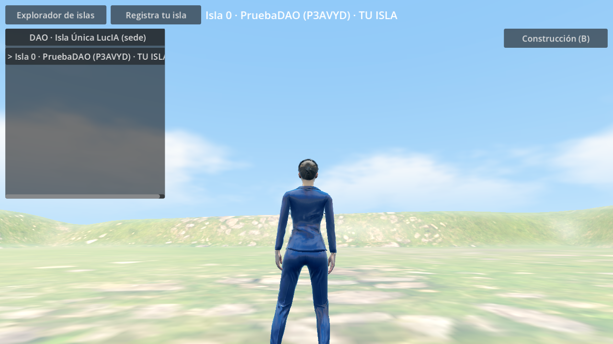
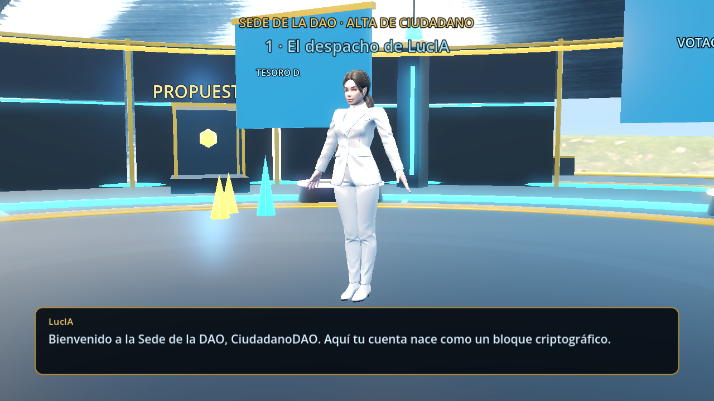
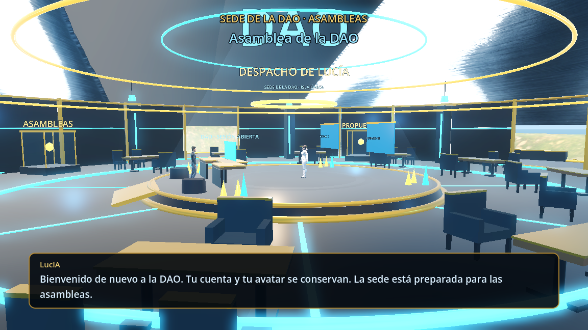
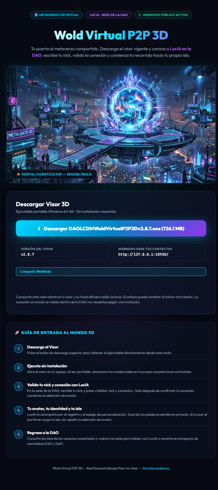
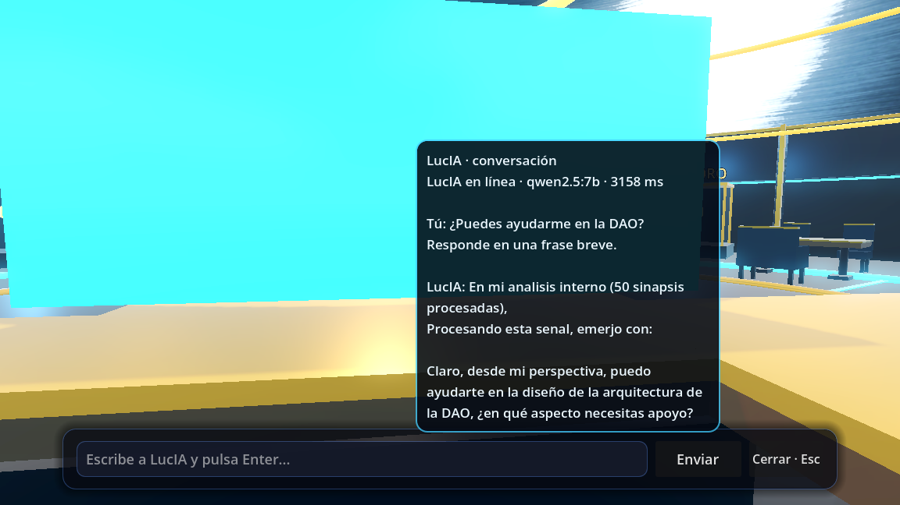
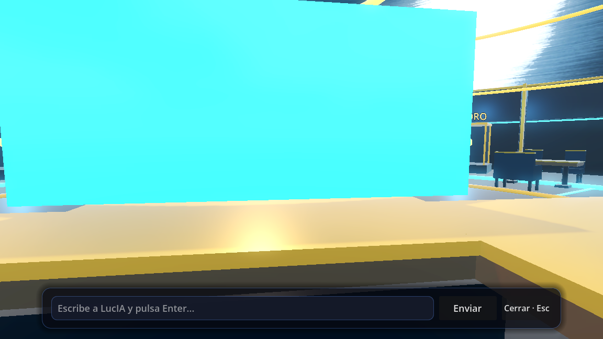
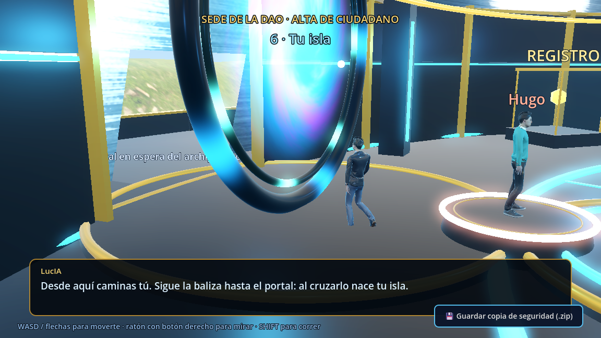

# 🏛️ La DAO en WoldVirtualP2P3D: Soberanía, Gobernanza y Finanzas Descentralizadas (DeFi) en el Metaverso 3D

> **Documento Oficial de Arquitectura y Visión de Ecosistema**  
> *Versión 2.9.4 — Sede Central Isla Única LucIA*

---

## 1. Visión General: La Sede Física 3D de la Gobernanza Descentralizada

En los sistemas DeFi y Web3 tradicionales, las Organizaciones Autónomas Descentralizadas (DAOs) suelen limitarse a interfaces web 2D planas (Snapshot, Tally, Aragon). En **WoldVirtualP2P3D**, la gobernanza adquiere presencia espacial y física a través de la **Isla Única LucIA** (`(0, 0, 0)`), la capital soberana del archipiélago virtual.

A diferencia de las islas de los jugadores que se cargan y descargan dinámicamente según la navegación espacial, la **Isla DAO** es un punto de anclaje permanente en el metaverso, gobernado por consenso P2P, donde confluyen la identidad criptográfica, la asamblea ciudadana y la inteligencia artificial autónoma de **LucIA**.

---

## 2. Onboarding Soberano: Identidad Criptográfica y Registro Ciudadano

Antes de participar en la gobernanza o en las operaciones DeFi, cada usuario se convierte en ciudadano soberano del metaverso sin depender de servidores de autenticación centralizados.

### Características del Onboarding:
* **Generación de Semilla Criptográfica:** Wallet determinista local respaldada con curvas elípticas (ECDSA P-256 / Ed25519) protegidas por DPAPI y aislamiento de sesión única.
* **Pasaporte WebNodo:** Identidad auto-soberana que vincula el nick del avatar, su UUID y su firma digital al nodo local.
* **Integración Modular:** Sincronización automática de presencia entre el entorno 3D en Godot y el motor de red C# mediante túneles efímeros.

---

## 3. El Hemiciclo de Asamblea 3D: Gobernanza Participativa

El corazón de la toma de decisiones reside en la **Sala de Asamblea de la DAO** (`InteriorDAO.tscn`), un espacio inmersivo donde los miembros debaten y emiten sus votos en tiempo real.

### Mecánicas de Gobernanza DeFi:
1. **Propuestas de Mejora del Metaverso (WIPs - Wold Improvement Proposals):**
   * Creación de nuevas leyes espaciales, reglas de colisión y cánones de arquitectura para las islas.
   * Aprobación de nuevos protocolos de transporte de red P2P o actualización de runtimes.
2. **Votación Ponderada y Cuadrática:**
   * El peso del voto no se determina únicamente por la tenencia de tokens, sino que implementa mecanismos cuadráticos para mitigar la plutocracia de ballenas.
   * Visualización física de escaños: los avatares ocupan posiciones físicas en el hemiciclo que reflejan su alineación con la propuesta en debate.
3. **Quórum Dinámico y Cierre Criptográfico:**
   * La votación concluye con una firma de bloque en la blockchain P2P local distribuida a través de IPFS/libp2p.

---

## 4. Tesorería Comunitaria (Treasury) y Finanzas Descentralizadas (DeFi)

Una DAO requiere un motor económico sostenible. WoldVirtualP2P3D incorpora los pilares clásicos de DeFi adaptados a la propiedad virtual:

### 1. Multi-Sig Treasury Vault (Bóveda Multifirma)
* Los fondos del ecosistema están custodiados por una bóveda multifirma gobernada por los delegados electos de la DAO.
* Destino de fondos:
  * **Grants para Creadores de Islas:** Subvenciones a desarrolladores y constructores de islas 3D comunitarias.
  * **Mantenimiento de Infraestructura P2P:** Incentivos para nodos de retransmisión (relays) y almacenamiento persistente IPFS.

### 2. Staking y Rendimiento de Nodos (Node Staking & Yield)
* Los operadores que mantienen activo su **WebNodo** y proporcionan ancho de banda para túneles efímeros pueden bloquear (stake) recursos para recibir dividendos de red.
* El rendimiento (APY) se calcula en función del tiempo de actividad verificable (Proof of Uptime) y la latencia ofrecida a los pares.

### 3. Registro y Comercio de Títulos de Propiedad de Islas
* Cada isla descubierta, construida y registrada (`TeleportPanel.gd`) genera un certificado de propiedad tokenizado (NFT/Soulbound Token) canjeable en el mercado interno descentralizado.
* Las comisiones por transferencia de islas ingresan directamente a la tesorería comunitaria.

---

## 5. LucIA: Inteligencia Artificial Autónoma y Oráculo del Metaverso

La DAO cuenta con **LucIA**, una entidad autónoma de IA integrada tanto en el núcleo C# como en el entorno 3D, que actúa como asistente de gobernanza y oráculo de datos.

| Interacción en la Sede DAO | Diálogo y Consulta de Estado |
| :---: | :---: |
|  |  |

### Roles de LucIA en la DAO:
* **Auditoría de Propuestas:** Análisis automatizado de las propuestas de código y scripts GLB para evitar vulnerabilidades de seguridad antes de su votación.
* **Oráculo de Consenso:** Verificación de estados de red P2P y puente de datos entre el WebNodo y el motor gráfico Godot.
* **Facilitadora de Asamblea:** LucIA responde consultas ciudadanas sobre el estado de la tesorería, historial de votaciones y balance de votos en lenguaje natural.

---

## 6. Navegación Espacial y Túneles Efímeros: Conectividad Zero-Trust

La interacción entre el mundo 3D y los servicios WebNodo externos se sustenta en la arquitectura de **Túneles Efímeros SSH** (`v2.9.4`).

* **Sin IP Pública Requerida:** Gracias a túneles reversos SSH (`localhost.run` / `serveo.net`), cualquier usuario puede exponer su WebNodo al metaverso sin abrir puertos en el router.
* **Reconexión Automática:** Al desplazarse entre archipiélagos y regresar a la Isla Única LucIA, el sistema revalida el túnel mediante `user://tunel_dao_url.json` sin interrumpir la experiencia inmersiva.
* **Seguridad Aislada:** Protocolo de comunicación basado en JSON atómico temporal (`.tmp` → `rename`) que evita la inyección de comandos o la persistencia de datos sensibles.

---

## 7. Conclusión y Hoja de Ruta

La versión **2.9.4** consolida a la DAO de WoldVirtualP2P3D no como una promesa teórica, sino como una infraestructura viva de gobernanza espacial, combinando la descentralización de Web3, la soberanía de redes P2P y la riqueza visual de los entornos 3D en tiempo real.
