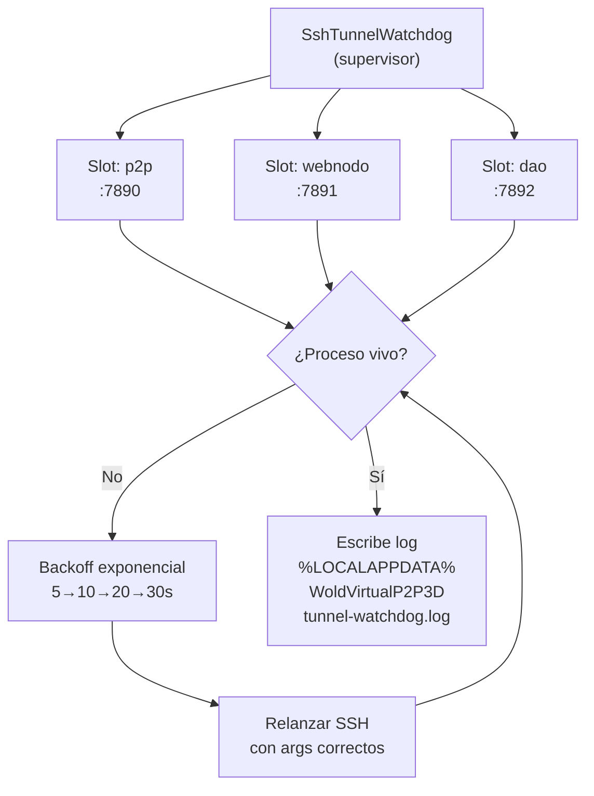

# Plan de Mejoras — Wold Virtual P2P 3D

## 1. Menú Desplegable "Secciones" (Barra Superior)

### Problema
La barra superior contiene demasiados botones alineados, ocupando espacio y dificultando la navegación visual.

### Solución
Reemplazar los botones de acciones (Lucía 3D, Oficina avatar, Invitar, Construcción, WebNodo, Chat) por un **único botón "☰ Secciones ▾"** que despliega un menú Popup flotante.

```
[ 🌐 WOLD VIRTUAL OFICIAL ] [ Usuario ] [ P2P ] [ Blockchain ] [ LucIA conectada ] [ ☰ Secciones ▾ ]
                                                                                             ↓
                                                                             ┌─────────────────────┐
                                                                             │  ✦ Lucía 3D          │
                                                                             │  ✦ Oficina con avatar │
                                                                             │  ✦ Invitar a LucIA   │
                                                                             │  🏗 Construcción     │
                                                                             │  ──────────────────  │
                                                                             │  🌐 WebNodo          │
                                                                             │  💬 Chat             │
                                                                             └─────────────────────┘
```

### Archivos modificados
- `HerraMientas/MainWindow.xaml` — Añade `BtnSecciones` + `PopupSecciones`
- `HerraMientas/SeccionesMenu.cs` — Partial class con handlers del menú

### Compatibilidad
> [!IMPORTANT]
> Los `x:Name` originales (`BtnVolverLucia`, `BtnOficinaAvatar`, `BtnInvitarLucia`, `BtnConstruir`) se mantienen como `Visibility="Collapsed"` para no romper el code-behind existente.

---

## 2. SSH Tunnel Watchdog — Conexión Estable

### Problema diagnosticado
Según `PROMPT_TUNELES_SSH_INESTABLES.md`, los túneles fallan porque:

| # | Causa | Probabilidad |
|---|-------|-------------|
| H1 | No hay `cloudflared.exe` en release → cae a SSH gratuito | **Alta** |
| H4 | Regex `lhr\.rocks` obsoleta (debería ser `lhr.life`) | Media |
| H5 | Sin watchdog en el túnel del WebNodo | Media |
| H6 | Faltan `ServerAliveCountMax` y `ExitOnForwardFailure=yes` en algunas rutas | Media-baja |

### Solución: `SshTunnelWatchdog.cs`

Clase que actúa como **supervisor centralizado** de todos los slots de túnel:



### Correcciones aplicadas

```csharp
// ANTES (regex obsoleta en P2PWebNode.cs)
@"https://[\w\-]+\.lhr\.rocks"   // ❌ TLD incorrecto + doble escape

// DESPUÉS (en SshTunnelWatchdog.cs)
@"https?://[\w\-]+\.lhr\.life"   // ✅ Correcto
```

```csharp
// Argumentos SSH unificados (aplica a TODOS los slots)
"-o StrictHostKeyChecking=no -o UserKnownHostsFile=NUL " +
"-o ServerAliveInterval=30 -o ServerAliveCountMax=3 " +   // ← antes faltaba
"-o ConnectTimeout=15 -o ExitOnForwardFailure=yes"         // ← antes faltaba en WebNodo
```

### Archivo creado
- `RedP2P/SshTunnelWatchdog.cs` — Watchdog centralizado

### Integración con MainWindow.xaml.cs
Para activar el watchdog, en el code-behind añadir:

```csharp
// Al iniciar sesión:
private SshTunnelWatchdog? _watchdog;

private async Task IniciarWatchdog()
{
    _watchdog = new SshTunnelWatchdog(puertoLocalP2P: 7890, puertoLocalWebNodo: 7891, puertoLocalDao: 7892);
    _watchdog.TunnelRestaurado += (slot, url) => 
        Dispatcher.Invoke(() => ActualizarEstadoTunel(slot, url));
    await _watchdog.IniciarAsync(_cts.Token);
}

// Al cerrar sesión:
_watchdog?.Detener();
```

---

## 3. Log de Túnel en Producción

El watchdog escribe automáticamente en:
```
%LOCALAPPDATA%\WoldVirtualP2P3D\tunnel-watchdog.log
```

Esto resuelve el problema H7 (observabilidad nula en release), permitiendo diagnosticar caídas sin depurador adjunto.

---

## Estado

| Tarea | Estado |
|-------|--------|
| `SshTunnelWatchdog.cs` | ✅ Creado |
| `MainWindow.xaml` — BtnSecciones + Popup | ✅ Modificado |
| `SeccionesMenu.cs` — Handlers del menú | ✅ Creado |
| Integrar `_watchdog` en MainWindow.xaml.cs | ⬜ Pendiente (manual) |
| Corregir regex en `P2PWebNode.cs` | ⬜ Pendiente (ver §3.5 del PROMPT) |

---

## 4. Snippets de integración — próximos pasos

### Activar watchdog en `MainWindow.xaml.cs`
Busca donde se inicia la sesión (método que contiene `BtnCrearCuenta` o similar) y añade:

```csharp
// Al inicio de sesión — campo privado:
private SshTunnelWatchdog? _sshWatchdog;

// Dentro del método de inicio de sesión:
_sshWatchdog = new SshTunnelWatchdog(
    puertoLocalP2P:     7890,
    puertoLocalWebNodo: 7891,
    puertoLocalDao:     7892);

// Opcional: suscribir al P2PTunnelManager existente
if (_tunnelManager != null)
    _sshWatchdog.SuscribirA(_tunnelManager);

// Eventos de UI
_sshWatchdog.UrlObtenida += (slot, url) =>
    Dispatcher.Invoke(() => Log($"[Watchdog] {slot} → {url}"));
_sshWatchdog.TunnelCaido += (slot) =>
    Dispatcher.Invoke(() => Log($"[Watchdog] ⚠ {slot} caído, reconectando..."));

await _sshWatchdog.IniciarAsync(_cts.Token);
```

### Al cerrar sesión o ventana:
```csharp
_sshWatchdog?.Detener();
_sshWatchdog?.Dispose();
```

### Corregir regex en `P2PWebNode.cs` (H4)
Busca `lhr\\.rocks` en ese archivo y reemplaza:
```csharp
// ANTES:
@"https://[\w\-]+\.lhr\.rocks"

// DESPUÉS:
@"https?://[\w\-]+\.lhr\.life"
```
