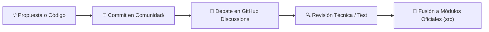

# 🌐 Guía de Contribución y Organización para la Comunidad
# 🌐 Community Contribution & Organization Guide

> **Destino oficial de propuestas / Official Destination for Proposals:**  
> `VersionDesesion/SistemaPrincipal/PRY/Archivo/Comunidad/`  
> **Discusiones / Discussions:** [GitHub Discussions](https://github.com/Chicook/WoldVirtualP2P3D/discussions)  
> **Repositorio / Repository:** [Chicook/WoldVirtualP2P3D](https://github.com/Chicook/WoldVirtualP2P3D)

---

## 🇪🇸 ESPAÑOL

### 1. Propósito y Bienvenida
Agradecemos enormemente la participación, ideas, análisis de seguridad y propuestas de código de la comunidad (como las recientes implementaciones de *Proof of Presence*, auditorías de seguridad, contratos, componentes C#, scripts GDScript y JavaScript). 

Para mantener el proyecto estable, modular y con una higiene de repositorio impecable, hemos establecido un **espacio oficial dedicado** para recibir todas las propuestas de incorporación, borradores de código y aportaciones experimentales:

📂 **Ruta oficial:**  
`VersionDesesion/SistemaPrincipal/PRY/Archivo/Comunidad/`

---

### 2. Regla de Oro: La raíz del repositorio (`/`) debe permanecer limpia
* **NO** subas archivos sueltos a la raíz del repositorio (`/PresenceCore.cs`, `/Js`, `/PrecenceArea`, etc.).
* La raíz del repositorio está reservada exclusivamente para los archivos base del proyecto (`.gitignore`, `README.md`, etc.).
* Depositar archivos en la raíz dificulta la integración de ramas, rompe la compilación automatizada de Godot/.NET y satura el control de versiones.
* Todo aporte externo, propuesta o prueba de concepto debe ubicarse dentro de la carpeta `Comunidad/`.

---

### 3. Qué colocar en la carpeta `Comunidad/`
Esta carpeta está abierta para:
1. **Propuestas de Arquitectura y RFCs:** Documentos en Markdown describiendo nuevas ideas, protocolos P2P, sistemas de consenso o economías DAO.
2. **Borradores y Prototipos de Código:** Clases en C#, scripts en GDScript para Godot, scripts en JavaScript/Python para herramientas auxiliares.
3. **Revisiones y Auditorías de Seguridad:** Documentos técnicos, pruebas de concepto éticas y análisis de vulnerabilidades.
4. **Recursos y Diagramas:** Modelos o especificaciones que apoyen una propuesta.

---

### 4. Buenas Prácticas y Convenciones de Nombres
Para facilitar la lectura y revisión tanto por humanos como por agentes de IA:

* **Usa siempre extensiones de archivo:**  
  * Código C#: `.cs` (ej. `PresenceCore.cs`, no `PresenceCore`)
  * Scripts Godot: `.gd` (ej. `PresenceArea.gd`, no `PrecenceArea`)
  * Documentación / RFCs: `.md`
  * JavaScript: `.js`
* **Evita espacios innecesarios en nombres:**  
  Prefiere `Presence_Monitoring_Structure.md` o `ProofOfPresence.cs` en lugar de `Future monitoring structure` o `Csharp C#`.
* **Organización recomendada:**  
  Si envías un conjunto de archivos o una propuesta completa, es preferible crear una subcarpeta con tu nombre de usuario o tema:  
  `VersionDesesion/SistemaPrincipal/PRY/Archivo/Comunidad/<NombrePropuesta_o_Usuario>/`

---

### 5. Flujo de Integración: De Propuesta a Código Oficial

1. **Aporte:** Se suben los archivos a `Comunidad/` mediante Pull Request o commit.
2. **Discusión:** Se abre un hilo en [GitHub Discussions](https://github.com/Chicook/WoldVirtualP2P3D/discussions) explicando el objetivo y enlazando los archivos.
3. **Debate y Evaluación:** El equipo de desarrollo y los entornos de IA revisan la propuesta, compatibilidad con la versión activa y requerimientos de seguridad.
4. **Incorporación:** Una vez aprobada, el código se refactoriza e incorpora formalmente a las rutas canónicas del taller (`src/MTBGT/`, `src/VSC#/`, `src/STM_DEF/`, etc.).

---
---

## 🇬🇧 ENGLISH

### 1. Purpose & Welcome
We greatly appreciate community contributions, ideas, security reviews, and code proposals (such as recent *Proof of Presence* implementations, security audits, C# components, GDScript, and JavaScript files).

To maintain repository hygiene, modularity, and stability across our automated Godot and .NET pipelines, we have designated an **official space** for all community proposals, drafts, and experimental contributions:

📂 **Official Path:**  
`VersionDesesion/SistemaPrincipal/PRY/Archivo/Comunidad/`

---

### 2. Golden Rule: Keep the Repository Root (`/`) Clean
* **DO NOT** place loose files in the repository root (`/PresenceCore.cs`, `/Js`, `/PrecenceArea`, etc.).
* The repository root is strictly reserved for core infrastructure files (`.gitignore`, top-level `README.md`, etc.).
* Adding files to the root complicates branch synchronization, causes build conflicts in Godot/.NET, and degrades project hygiene.
* All community proposals, draft files, and experiments must be placed in `Comunidad/`.

---

### 3. What to Place in `Comunidad/`
This directory is intended for:
1. **RFCs & Architecture Proposals:** Markdown documents detailing new mechanics, P2P network ideas, consensus logic, or DAO systems.
2. **Code Drafts & Prototypes:** C# classes, Godot GDScript files, JavaScript/Python helper scripts.
3. **Security Audits & Reports:** Independent reviews, vulnerability analyses, and proof-of-concept reports.
4. **Assets & Schematics:** Reference data supporting an open proposal.

---

### 4. File Naming & Structure Conventions
To ensure smooth review by both human maintainers and AI development agents:

* **Always include file extensions:**  
  * C# classes: `.cs` (e.g. `PresenceCore.cs`, not `PresenceCore`)  
  * Godot scripts: `.gd` (e.g. `PresenceArea.gd`, not `PrecenceArea`)  
  * Docs / RFCs: `.md`  
  * JavaScript: `.js`  
* **Avoid spaces in filenames:**  
  Use `PresenceMonitoringStructure.md` or `Presence_Ledger.cs` instead of `Future monitoring structure` or `Csharp C#`.
* **Recommended Subfolders:**  
  For multi-file proposals, please group them under a dedicated subfolder:  
  `VersionDesesion/SistemaPrincipal/PRY/Archivo/Comunidad/<ProposalName_or_Username>/`

---

### 5. Integration Workflow: From Proposal to Core

1. **Submit:** Place your files in `Comunidad/` via a Pull Request or commit.
2. **Discuss:** Open a thread in [GitHub Discussions](https://github.com/Chicook/WoldVirtualP2P3D/discussions) explaining the concept and linking the files.
3. **Technical Review:** Core maintainers and AI agents evaluate architecture fit, security, and performance.
4. **Incorporation:** Upon consensus, the code is refactored into the official module folders (`src/MTBGT/`, `src/VSC#/`, etc.).

---
*Gracias por colaborar en la construcción del Metaverso P2P 3D.*  
*Thank you for helping build Wold Virtual P2P 3D.*
